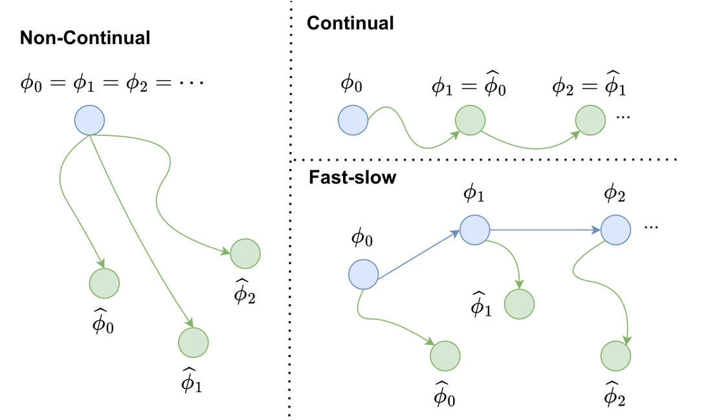
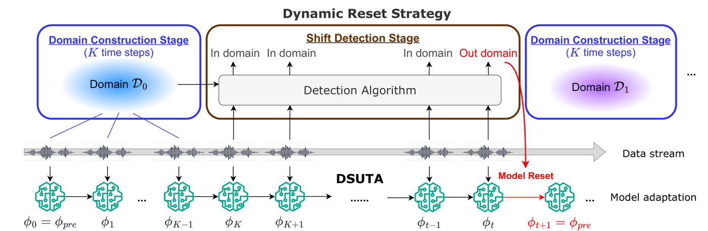
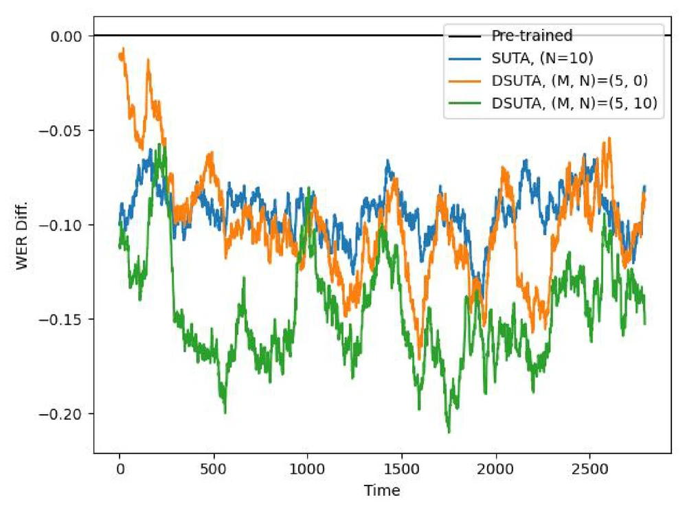
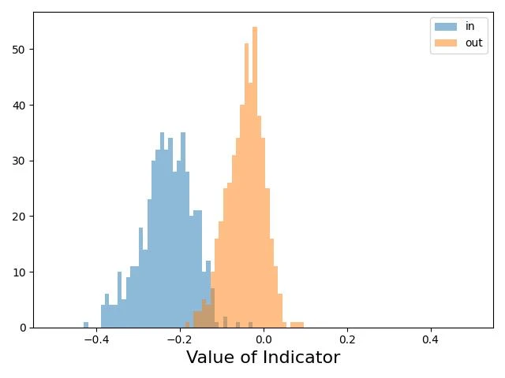

## Abstract

지금까지 ASR의 test-time adaptation은 non-continual이었다. SUTA, SGEM, wild-acoustic 방법은 모두 utterance 하나에 source 모델을 adapt한 뒤 adapt된 weight를 버린다. 매 utterance가 처음부터 시작하므로, 같은 noisy 환경의 앞선 음성에서 배운 것을 다시 쓰지 못한다. Continual TTA는 adapt된 weight를 유지하지만, 긴 stream에서는 drift하다가 collapse하기 쉽다. 당시 유일한 continual ASR 방법(AWMC)은 pseudo-label을 쓰고 단일 domain에서만 실험했다.

이 논문은 둘 사이에 놓이는 Fast-slow TTA framework를 제안한다. Meta-parameter 집합은 stream을 따라 천천히 갱신되고, 각 utterance는 그 meta-parameter에서 시작하는 빠르고 일회용인 adaptation을 받는다. 구체적인 방법인 Dynamic SUTA(DSUTA)는 빠른 갱신과 느린 갱신 모두에 SUTA의 loss를 쓴다. Dynamic reset strategy는 loss 기반 shift 통계량을 지켜보다가 domain이 바뀌면 domain 경계를 모르는 상태에서도 meta-parameter를 source 모델로 reset한다. 10종 noise를 더한 LibriSpeech, multi-domain noise stream, CHiME-3에서 DSUTA는 non-continual baseline(SUTA, SGEM)과 continual baseline(AWMC)을 모두 이기며, SUTA보다 빠르기도 하다.

## Motivation

논문은 TTA 방법을 각 utterance의 adaptation이 어디서 시작하고 무엇이 다음으로 넘어가는지로 구분한다.

*Non-continual TTA는 모든 sample을 같은 source weight에서 adapt하고, continual TTA는 adapt된 weight를 다음으로 넘기며, Fast-slow TTA는 천천히 갱신되는 meta-parameter(파란색)를 넘기고 각 sample은 그것에서 adapt한다(초록색). 논문 그림.*

- **Non-continual**(왼쪽). 모든 adapted 모델 $$\widehat{\phi}_t$$가 $$\phi_0$$에서 시작한다. 다음 utterance에 영향이 없으므로 현재 utterance에 강하게 맞출 수 있지만, 배운 것은 사라진다. SUTA가 여기에 해당한다. [/blog/2026/11/25/suta-review/](/blog/2026/11/25/suta-review/) 참고.
- **Continual**(오른쪽 위). Adapt된 weight가 다음 sample의 시작점이 된다. 지식은 쌓이지만, utterance 하나에 너무 맞추면 이후 모든 utterance가 손해를 보고, 긴 stream에서는 모델이 collapse할 수 있다. 아래 결과에서 naive continual SUTA(CSUTA)는 utterance당 1 step만 써야 하는데도 adaptation이 없을 때보다 나쁜 경우가 있다.
- **Fast-slow**(오른쪽 아래). 제안 방법은 둘 다 취한다. 천천히 변하는 시작점과, 다음으로 넘기지 않는 공격적인 utterance별 adaptation이다.

두 번째 gap은 실제 stream의 domain이 바뀐다는 것이다. 한 noise 종류 쪽으로 drift한 continual 방법은 다음 noise 종류를 나쁜 위치에서 시작한다. Vision의 RDumb처럼 일정 간격으로 source 모델로 reset하면 도움이 되지만, 적절한 간격을 알 수 없다. 논문은 domain이 실제로 바뀔 때 data로부터 감지해 reset하고자 한다.

## Method

*Dynamic reset strategy를 붙인 DSUTA. DSUTA가 data stream을 따라 adapt하는 동안, domain construction stage(K step)가 현재 domain의 기준을 만들고, 이어지는 shift detection stage가 들어오는 sample을 검사해 out-of-domain으로 보이면 meta-parameter를 pre-trained parameter로 reset한다. 논문 그림.*

### Fast-slow TTA

$$x_t$$를 시각 $$t$$의 utterance, $$\phi_{pre}$$를 pre-trained ASR parameter, $$\phi_t$$를 시각 $$t$$의 meta-parameter라 하자. Adaptation algorithm $$A$$와 update algorithm $$U$$가 framework를 정의한다.

$$
\phi_0 = \phi_{pre},\qquad \widehat{\phi}_t = A(\phi_t, x_t),\qquad \widehat{y}_t = \widehat{\phi}_t(x_t),\qquad \phi_{t+1} = U(\phi_t, x_t).
$$

Prediction $$\widehat{y}_t$$는 빠르게 adapt된 $$\widehat{\phi}_t$$에서 나오고, $$\widehat{\phi}_t$$는 그 뒤 버려진다. 다음으로 넘어가는 것은 $$U$$를 거친 $$\phi_t$$뿐이다. $$U$$가 $$\phi_t$$를 그대로 두면 non-continual TTA가 되고, $$U = A$$여서 $$\phi_{t+1} = \widehat{\phi}_t$$이면 일반적인 continual TTA가 된다.

### Dynamic SUTA

두 algorithm 모두 wav2vec 2.0 모델의 CTC output에 SUTA loss를 쓴다. $$\mathbf{P}_{ij}$$를 frame $$i$$에서 class $$j$$의 temperature-smoothed 확률($$L$$개 frame, blank를 포함한 $$C$$개 class), $$\mathbf{P}_{\cdot j} \in \mathbb{R}^{L}$$를 class $$j$$의 열이라 하면,

$$
\mathcal{L}_{suta} = \alpha\Big(-\frac{1}{L}\sum_{i=1}^{L}\sum_{j=1}^{C}\mathbf{P}_{ij}\log\mathbf{P}_{ij}\Big) + (1-\alpha)\sum_{j=1}^{C}\sum_{j' \neq j}^{C}\mathbf{P}_{\cdot j}^{\top}\mathbf{P}_{\cdot j'},
$$

즉 entropy 항과 minimum class confusion 항의 합이며, SUTA와 같이 $$\alpha = 0.3$$, temperature 2.5를 쓴다.

- **Fast adaptation $$A$$**는 시작점이 $$\phi_t$$라는 점만 빼면 SUTA와 똑같다. $$\phi_t$$를 복사해 $$x_t$$에 대해 $$\mathcal{L}_{suta}$$로 gradient step을 $$N$$번 밟고, $$x_t$$를 decoding한다.
- **Slow update $$U$$**는 크기 $$M$$의 buffer $$\mathcal{B}$$를 쓴다. 각 utterance를 buffer에 넣고, $$M$$ step마다 buffer의 평균 loss로 meta-parameter를 한 step 갱신한 뒤 buffer를 비운다.

$$
\phi_{t+1} = \mathrm{Optimizer}\Big(\phi_t,\ \frac{1}{M}\sum_{x \in \mathcal{B}}\mathcal{L}_{suta}(\phi_t, x)\Big)\quad\text{if } M \text{ divides } t,\qquad \phi_{t+1} = \phi_t \text{ otherwise}.
$$

따라서 meta-parameter는 stream 위에서 batch size $$M$$의 mini-batch gradient descent를 따르며, utterance $$M$$개당 한 step만 움직인다. Utterance마다 $$N$$ step을 그대로 넘기는 것보다 훨씬 완만하다. DSUTA는 시작점이 움직이는 SUTA다.

### Dynamic reset

시각 $$r$$에서 reset된 뒤(또는 처음부터) 방법은 두 stage를 번갈아 거친다.

**Loss Improvement Index.** Sample이 현재 domain에서 얼마나 떨어져 있는지 재기 위해 논문은 다음을 쓴다.

$$
LII_t = \mathcal{L}_{suta}(\phi_{\mathcal{D}}, x_t) - \mathcal{L}_{suta}(\phi_{pre}, x_t),
$$

여기서 $$\phi_{\mathcal{D}}$$는 현재 domain에 adapt된 meta-parameter의 snapshot이다. In-domain sample은 $$\phi_{\mathcal{D}}$$에서 loss가 낮으므로 $$LII_t$$가 더 음수가 된다. Pre-trained 모델의 loss를 빼면 sample 자체의 난이도가 제거된다.

**Domain construction stage**($$K$$ step, reset 금지). $$k = \lfloor K/2 \rfloor$$일 때 snapshot은 $$\phi_{\mathcal{D}} = \phi_{r+k}$$이다. 이후 $$K - k$$개 sample의 LII를 모아 Gaussian $$\mathcal{N}(\mu, \sigma^2)$$을 fitting한다. Stage의 절반은 $$\phi_{\mathcal{D}}$$를 domain에 특화시키는 데, 나머지 절반은 통계를 모으는 데 쓰인다.

**Shift detection stage.** Sample 하나의 LII는 noise가 너무 크므로, $$M$$ step마다 buffer에 있는 $$M$$개 sample의 평균 LII로 검정한다. Right-tailed z-test가 reset을 일으킨다.

$$
\phi_{t+1} = \begin{cases} \phi_{pre}, & \text{if } \dfrac{\overline{LII}_{\mathcal{B}} - \mu}{\sigma/\sqrt{M}} > 2,\\[4pt] U_{DSUTA}(\phi_t, x_t), & \text{otherwise,} \end{cases}
$$

여기서 $$\overline{LII}_{\mathcal{B}}$$는 buffer의 평균 LII다. Threshold 2는 5% one-sided test의 일반적인 값 1.64보다 조금 엄격하다. 구현에서는 patience parameter $$P$$로 안정성을 더한다. Reset 뒤에는 새로운 domain construction stage가 시작된다.

### Default setting

Source 모델은 LibriSpeech 960시간으로 CTC fine-tuning한 wav2vec 2.0-base다. Single-domain data에서 DSUTA는 $$M = 5$$, $$N = 10$$을 쓴다. Multi-domain stream에서는 $$(M, N) = (5, 5)$$이고 dynamic reset은 $$K = 100$$, $$P = 2$$를 쓴다. GPU memory를 아끼기 위해 모든 실험에서 20초보다 긴 utterance는 제외한다(data의 약 1%).

## Main Experiments

**Data.** LS-C는 LibriSpeech test set에 10종 noise 중 하나를 5 dB SNR로 더한 것이다. MS-SNSD의 air conditioner(AC), airport announcement(AA), babble(BA), copy machine(CM), munching(MU), neighbors(NB), shutting door(SD), typing(TP), vacuum cleaner(VC)와 Gaussian noise(GS)다. 이로부터 multi-domain stream 세 개를 만든다. MD-Easy(AC, CM, TP, AA, SD, 각 500개), MD-Hard(GS, MU, VC, BA, NB, 각 500개), MD-Long(20~500개 길이의 random noise 구간, 총 10,000개)이다. CHiME-3는 네 환경이 시간에 따라 random하게 섞인 실제 noisy 음성이다.

**Baselines.** Non-continual은 SUTA($$N = 10$$)와 SGEM이다. Continual은 CSUTA(reset 없는 SUTA, step을 늘리면 collapse해서 $$N = 1$$)와 AWMC(anchor, chaser, leader 모델을 쓰는 pseudo-labeling, wav2vec 2.0용으로 재구현)다.

**Single-domain LS-C와 CHiME-3의 WER(%), Table 1에서 발췌** (3회 평균)

| Method | AA | AC | BA | CM | GS | MU | NB | SD | TP | VC | CHiME-3 |
|---|---|---|---|---|---|---|---|---|---|---|---|
| Source model | 40.6 | 27.7 | 66.9 | 49.7 | 75.6 | 51.4 | 120.1 | 19.4 | 25.8 | 49.7 | 30.0 |
| SUTA | 30.6 | 17.4 | 53.7 | 38.7 | 54.5 | 39.0 | 112.3 | 15.0 | 17.4 | 39.3 | 23.3 |
| SGEM | 30.9 | 17.8 | 54.5 | 39.2 | 56.3 | 39.2 | 113.0 | **14.9** | 17.5 | 40.3 | 23.5 |
| CSUTA | 39.8 | 22.6 | 63.4 | 53.4 | 58.4 | 54.7 | 68.1 | 23.2 | 23.0 | 50.9 | 27.6 |
| AWMC | 31.6 | 18.0 | 61.6 | 37.7 | 48.5 | 36.2 | 131.9 | 17.0 | 18.0 | 36.1 | 22.4 |
| **DSUTA** | **25.9** | **15.4** | **33.2** | **33.5** | **37.0** | **28.4** | **36.3** | 15.5 | **15.6** | **29.9** | **21.7** |

DSUTA는 noise 10종 중 9종과 CHiME-3에서 가장 좋고, SD에서는 SGEM보다 0.6 뒤진다. 향상은 source 모델이 가장 나쁜 곳에서 가장 크다. Insertion 때문에 source WER이 100을 넘는 NB에서 SUTA는 112.3에 그치지만 DSUTA는 36.3이며, BA에서는 SUTA의 53.7을 33.2로 줄인다. CSUTA는 naive continual TTA로는 부족함을 보여 준다. CM, MU, SD, VC에서 source 모델보다 나쁘다. AWMC는 일부 noise에서 DSUTA에 근접하지만 NB에서 무너진다(131.9).

*CM stream에서 시간에 따른 pre-trained 모델 대비 WER 차이(window 100). 주황색은 utterance별 adaptation 없이 meta-parameter만 쓴 것, 파란색은 10 step SUTA, 초록색은 meta-parameter에서 10 step adapt한 DSUTA다. 논문 그림.*

이 그림이 향상의 출처를 설명한다. Meta-parameter만으로도(주황색, $$N = 0$$) utterance별 step 없이 곧 SUTA와 비슷한 수준에 이르고, 거기서 SUTA의 10 step을 돌리면(초록색) 둘 다보다 분명히 낮아진다. DSUTA는 utterance별 adaptation에 더 나은 시작점을 준다.

**Multi-domain time-varying stream의 WER(%), Table 2에서 발췌** (3회 평균)

| Method | MD-Easy | MD-Hard | MD-Long |
|---|---|---|---|
| Source model | 32.7 | 74.6 | 61.0 |
| SUTA | 24.0 | 60.4 | 53.3 |
| SGEM | 25.0 | 61.0 | 53.4 |
| CSUTA | 37.3 | 83.6 | 100.3 |
| AWMC | 25.8 | 66.1 | 60.6 |
| DSUTA | 24.0 | 45.6 | 43.2 |
| **DSUTA w/ dynamic reset** | **22.7** | **39.8** | **35.8** |
| DSUTA w/ fixed reset (every 50) | 22.8 | 49.4 | 45.2 |
| DSUTA w/ oracle boundary | 21.7 | 36.9 | 39.5 |

SUTA의 10 step 대신 5 step만 쓰고도 DSUTA는 MD-Easy에서 SUTA와 같고 MD-Hard와 MD-Long에서는 크게 앞선다. Dynamic reset은 1.3~7.4포인트를 더 줄인다. Fixed reset은 MD-Hard와 MD-Long에서 reset이 없을 때보다 나쁜데, 너무 자주 reset하면 쓸모 있는 지식을 버린다는 뜻이다. MD-Long에서 dynamic reset(35.8)은 실제 경계에서 reset하는 것(39.5)보다도 낫다. 저자들은 이를 이전 noise 종류의 지식이 여전히 도움이 될 수 있으므로 모든 경계에서 reset하는 것이 항상 바람직하지는 않다는 근거로 해석한다. CSUTA는 MD-Long에서 WER이 100%를 넘는다.

*GS utterance 100개로 $$\phi_{\mathcal{D}}$$를 adapt했을 때 5개 sample에 대한 평균 LII. GS sample(in)과 다른 noise의 sample(out)이 대부분 분리된 두 봉우리를 이룬다. 논문 그림.*

Detector는 indicator가 두 경우를 분리할 때만 동작한다. 5개 sample로 평균하면 분리되며, 논문은 sample 하나의 LII, pre-trained loss를 빼지 않은 loss, fast-adapted weight로 계산한 LII는 훨씬 많이 겹친다는 것도 보인다.

**MD-Long에서의 비용, Table 4에서 발췌** (RTX 3080 Ti, Avg는 음성 1초당 초)

| Method | #Forward | #Backward | Total runtime (s) | Avg (s) |
|---|---|---|---|---|
| SUTA | 100000 | 100000 | 5040 | 0.080 |
| SGEM | 100000 | 100000 | 11620 | 0.186 |
| AWMC | 300000 | 100000 | 11704 | 0.187 |
| DSUTA | 52000 | 52000 | 3885 | 0.062 |
| DSUTA w/ dynamic reset | 72000 | 52000 | 4149 | 0.066 |

DSUTA는 utterance별 step이 적어서 SUTA보다 빠르고, reset 검사는 forward pass만 추가한다. Appendix에서 dynamic reset을 붙인 DSUTA는 MD-Long에서 data2vec-base(source 59.6, SUTA 53.3, 46.3)와 HuBERT-large(source 43.3, SUTA 39.3, 19.0)에도 도움이 된다. HuBERT-large에서는 reset 없는 DSUTA가 더 좋다(17.8).

## Limitations

- **Shift는 background noise뿐(저자들이 명시).** Domain은 noise 종류이며, accent, 화자, 발화 스타일은 실험하지 않았다.
- **CTC 모델만(저자들이 명시).** Source 모델 세 개 모두 CTC encoder다. SGEM이 non-continual TTA에서 한 것처럼 encoder-decoder 모델로 확장하는 것은 남은 과제다([/blog/2026/11/25/sgem-review/](/blog/2026/11/25/sgem-review/) 참고).
- **Forgetting(저자들이 명시).** Meta-parameter는 현재 domain을 따라가고 shift 때 reset되므로, 이전 domain은 기억되지 않는다.
- **약한 shift에서는 덜 유용.** Appendix의 noise level 실험(AC, SD, TP, 0/5/10 dB, $$N = 5$$)에서 DSUTA는 0 dB에서 이기지만, 10 dB에서는 세 noise 모두 SUTA가 낫다(예: AC에서 SUTA 10.6, DSUTA 11.5). SD는 5 dB에서도 SUTA가 낫다. Continual 부분은 주로 source 모델이 크게 틀릴 때 효과가 있다.
- **많은 hyperparameter.** $$M$$, $$N$$, $$K$$, $$P$$, z-threshold 2, reset 규칙이 서로 얽혀 있다. MD-Long에서의 sweep($$M \in \{3, 5, 10\}$$, $$K \in \{50, 100, 200\}$$)은 민감도가 중간 정도임을 보이지만(WER 35.5~38.5), 이 sweep도 test stream에서 이루어졌다.
- **근사적인 detection.** 감지된 reset은 실제 경계 근처이지만 정확히 일치하지 않고(예: MD-Easy에서 실제 500, 1000, 1500, 2000 대비 540, 1530, 2010), 일부 경계는 놓치며, MD-Hard의 일부 run에서는 일찍(155 step) reset하기도 한다.
- **Synthetic stream.** CHiME-3를 빼면 stream은 noise를 더한 LibriSpeech를 이어 붙여 만든 것이고, 한 noise 종류가 긴 block으로 이어진다. 실제 stream은 더 서서히 바뀌거나 한 utterance 안에서 여러 source가 섞일 수 있다.

## My Thoughts

<!-- TODO -->
