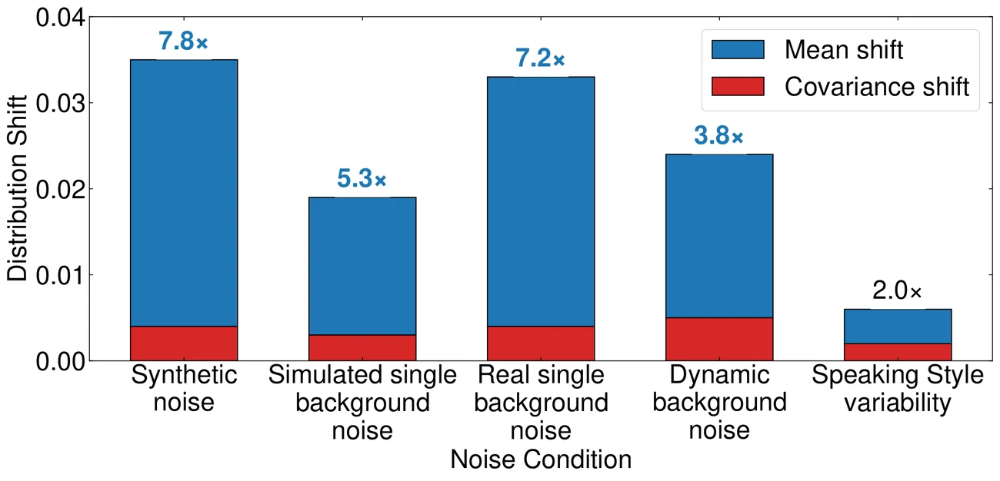
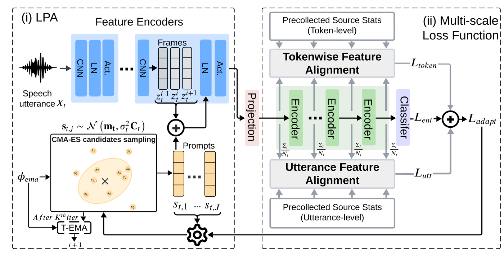
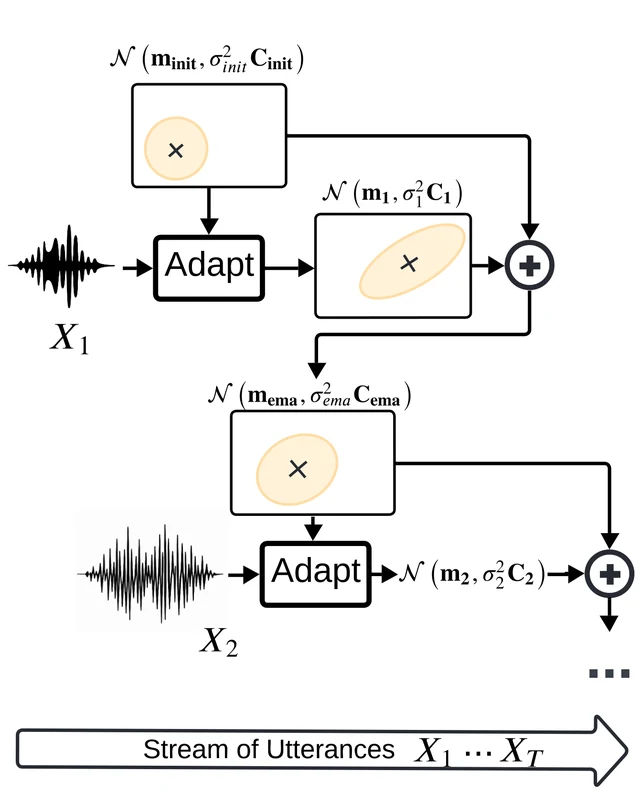
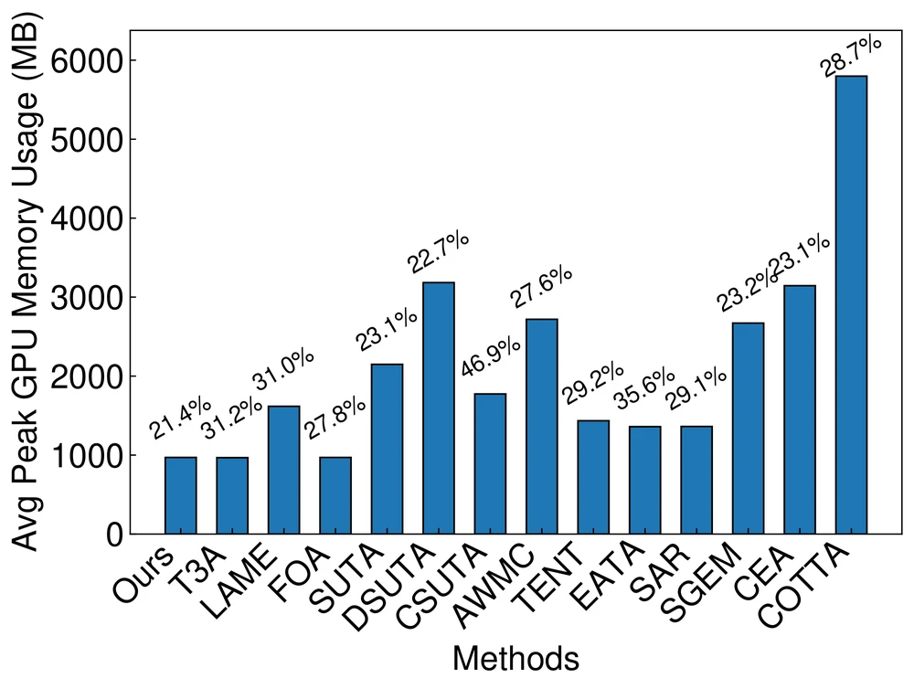
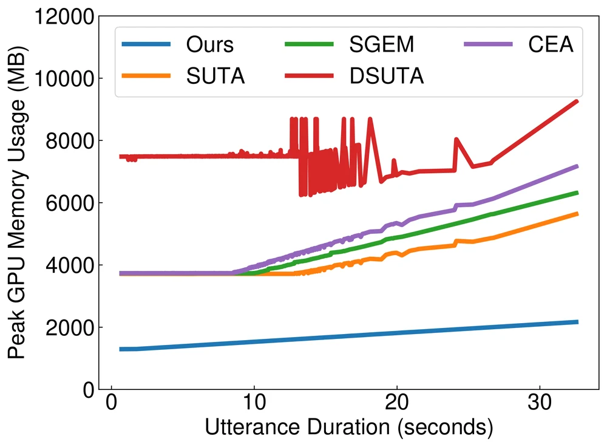

## Abstract

wav2vec 2.0이나 HuBERT 같은 speech model은 background noise, 억양, 다른 마이크 같은 acoustic shift에서 정확도가 떨어진다. [SUTA](/blog/2026/11/25/suta-review/) 이후의 ASR용 test-time adaptation(TTA)은 test utterance마다 gradient step을 밟아 이 문제를 상당 부분 해결한다. 대가는 memory다. Utterance마다 큰 모델 전체로 backpropagation하려면 수 GB의 GPU memory가 필요하고, 필요량은 utterance 길이에 따라 늘어난다. Backpropagation-free TTA 방법도 있지만, batch normalization과 큰 batch를 쓰는 image classifier를 위해 만들어져 speech에서는 성능이 낮다.

E-BATS는 speech model을 위해 설계된 backpropagation-free TTA 방법으로, utterance를 하나씩 adapt한다. CNN feature encoder 출력의 모든 frame에 학습 가능한 vector 하나("prompt")를 더하고, 이 vector를 derivative-free evolution strategy인 CMA-ES로 forward pass만 써서 찾는다. 탐색이 최소화하는 것은 multi-scale loss다. Non-blank frame의 entropy, utterance의 layer별 평균 feature와 저장된 source 평균 사이의 거리, 그리고 confidence로 가중한 token별 feature alignment로 이루어진다. Test-time exponential moving average(T-EMA)는 CMA-ES의 search distribution을 다음 utterance로 넘겨준다. 4개의 noisy dataset과 2개의 backbone에서 E-BATS는 다른 backpropagation-free 방법보다 낫고, gradient 기반 ASR TTA와 비슷한 수준이며, gradient 기반 방법보다 GPU memory를 몇 배 적게 쓴다.

## Motivation

논문은 vision 방식의 backpropagation-free TTA가 speech로 옮겨지지 않는 이유를 세 가지로 든다. 첫째, speech model은 layer normalization을 쓰므로 batch-norm 통계를 다시 추정하는 방법은 건드릴 것이 없다. 둘째, 입력이 sequence다. ASR 모델은 frame마다 token distribution을 내고, noise는 이미지의 고정된 perturbation과 달리 한 utterance 안에서도 시간에 따라 변한다. 셋째, utterance 간 차이가 커서 speech TTA는 보통 batch size 1로 돌리는데, vision 방법은 안정적인 통계를 위해 큰 batch에 의존한다.

무엇을 adapt할지 정하기 위해 저자들은 shift 아래에서 latent feature가 어떻게 움직이는지 측정한다. Feature encoder 출력에서 source와 target embedding을 두 항으로 비교한다. 평균(centroid)의 이동과 covariance의 변화이며, 이 둘은 Fréchet distance의 두 성분이다.

*다섯 가지 조건에서 source와 target latent feature 사이의 distribution shift를 평균 성분(파란색)과 covariance 성분(빨간색)으로 나눈 것. 막대 위 숫자는 평균 대 covariance 비율이다. 논문 그림.*

모든 noise 조건에서 평균 shift가 3.8배에서 7.8배로 지배적이다. Speaking style 변화만 비교적 균형적이다(2.0배). 저자들은 acoustic shift의 상당 부분이 feature cloud의 평행이동처럼 보이므로, 잘 고른 vector 하나를 feature에 더하면 target feature를 source 쪽으로 되돌릴 수 있다고 결론짓는다. Noise가 utterance마다 다르므로 이 vector를 closed form으로 계산할 수는 없고, test time에 탐색해야 한다.

## Method

*Utterance 하나에 대한 E-BATS. (i) Lightweight prompt adaptation: CMA-ES가 후보 prompt $$J$$개를 sampling하고, 각각을 CNN frame feature $$z_t^i$$에 더한 뒤 모델을 forward한다. (ii) 각 후보를 multi-scale loss(token-level alignment, entropy, utterance-level alignment)로 평가하고, 그 점수로 CMA-ES distribution을 갱신한다. 마지막 iteration 후 T-EMA가 다음 utterance를 위해 distribution을 smoothing한다. 논문 그림.*

### Setup

Source model $$\Theta = g \circ h$$는 LibriSpeech로 fine-tuning된 CTC 모델이다. $$h$$는 CNN feature encoder로, utterance $$\mathbf{X}_t$$의 각 입력 frame $$\mathbf{x}_t^i$$를 $$\mathbf{z}_t^i \in \mathbb{R}^d$$($$d = 512$$)로 보낸다. $$g$$는 projection, $$L$$개의 transformer layer, CTC head로 이루어지며 $$\mathcal{V}$$ 위의 distribution을 출력한다. $$\mathcal{V}$$는 알파벳 26개와 blank $$\varnothing$$를 포함한 special token 6개다. Test utterance $$\mathbf{X}_1, \ldots, \mathbf{X}_T$$는 batch size 1로 하나씩 들어온다. 논문은 covariate shift를 가정한다. 입력 distribution은 바뀌지만 label distribution과 $$P(y \mid \mathbf{X})$$는 바뀌지 않는다.

### Lightweight prompt adaptation (LPA)

$$\mathbf{Z}_t = [\mathbf{z}_t^1, \ldots, \mathbf{z}_t^{N_t}] \in \mathbb{R}^{d \times N_t}$$를 $$N_t$$개 frame의 CNN feature라 하자. Prompt $$\mathbf{s}_t \in \mathbb{R}^d$$를 모든 frame에 더한다.

$$
\hat{\mathbf{Z}}_t = \mathbf{Z}_t + \mathbf{s}_t \mathbf{1}_{N_t}^\top .
$$

모델 weight는 모두 고정된다. 이는 일반적인 prompt tuning(CLIP의 [TPT](/blog/2026/10/22/tpt-review/), 또는 vision용 backpropagation-free 방법인 FOA)이 transformer 입력에 token을 이어 붙이는 것과 다르다. 여기서 prompt는 acoustic feature의 평행이동이며, 위의 평균 shift 관찰에서 나온 설계다.

### Search with CMA-ES

Gradient가 없으므로 prompt는 Covariance Matrix Adaptation Evolution Strategy로 찾는다. Utterance $$t$$의 iteration $$k$$에서 CMA-ES는 평균 $$\mathbf{m}_t^{(k)} \in \mathbb{R}^d$$, covariance $$\mathbf{C}_t^{(k)} \in \mathbb{R}^{d \times d}$$, step size $$\sigma_t^{(k)} > 0$$을 가진 prompt 위의 Gaussian을 유지하며 후보 $$J$$개를 sampling한다.

$$
\mathbf{s}_{t,j} \sim \mathcal{N}\big(\mathbf{m}_t^{(k)}, (\sigma_t^{(k)})^2 \mathbf{C}_t^{(k)}\big), \qquad j = 1, \ldots, J .
$$

각 후보는 forward pass 한 번으로 loss $$L_{adapt}$$를 얻는다. CMA-ES는 후보들의 순위로 $$\mathbf{m}, \mathbf{C}, \sigma$$를 갱신하고 반복한다. $$K$$번 iteration 후, 또는 최고 loss의 개선이 세 번 연속 0.001 미만이면 더 일찍 멈춘다. Decoding에 쓰는 prompt는 지금까지 본 최고의 후보다.

$$
\mathbf{s}_t = \arg\min_{\mathbf{s}_{t,j}} L_{adapt}(\mathbf{X}_t, \mathbf{s}_{t,j}).
$$

기본 population은 $$J = 50$$이다.

### Multi-scale loss

Loss는 세 항을 합친다.

$$
L_{adapt} = \alpha L_{ent} + \beta L_{utt} + c\, L_{token},
$$

$$\alpha = 1$$, $$\beta = 2$$이고, $$c$$는 utterance마다 정해진다(아래 참조).

**Non-blank frame의 entropy.** CTC frame 대부분은 blank token을 예측하므로, 단순 평균 entropy에서는 blank가 지배한다. $$\tilde{\mathbf{X}}_t$$를 top prediction이 blank가 아닌 frame 집합, $$\mathcal{H}$$를 frame token distribution의 Shannon entropy라 하자.

$$
L_{ent} = \frac{1}{\lvert \tilde{\mathbf{X}}_t \rvert} \sum_{\mathbf{x}_t^i \in \tilde{\mathbf{X}}_t} \mathcal{H}\big(\Theta(\mathbf{x}_t^i)\big).
$$

이 항만 쓰면 degenerate한 최솟값이 생긴다. 모든 frame을 blank로 예측하거나, 문자 하나로 collapse하는 것이다.

**Utterance-level alignment.** 각 transformer layer $$l$$에 대해, source model의 frame 평균 feature를 배포 전에 clean LibriSpeech data로 한 번 평균내어 centroid $$\boldsymbol{\mu}_{src}^l$$로 저장한다. 현재 utterance의 $$\boldsymbol{\mu}_{tgt}^l$$는 layer $$l$$ feature의 frame 평균이다. Loss는 둘을 가깝게 만든다.

$$
L_{utt} = \frac{1}{L} \sum_{l} \big\lVert \boldsymbol{\mu}_{tgt}^l - \boldsymbol{\mu}_{src}^l \big\rVert_2^2 .
$$

이 항은 탐색을 source feature distribution 근처에 묶어 두고 entropy의 trivial solution을 막는다. 저장량은 $$L \times d$$개의 숫자뿐이다.

**Token-level alignment.** Utterance 하나에는 일부 token만 들어 있고 평균은 자주 나오는 token에 좌우되므로, utterance centroid만으로는 편향된 목표가 된다. E-BATS는 token class $$v$$와 layer $$l$$마다 feature의 source 평균 $$\boldsymbol{\mu}_{src}^{v,l}$$와 표준편차 $$\boldsymbol{\sigma}_{src}^{v,l}$$도 저장한다. Test utterance에서는 frame을 pseudo-label(예측 token)로 묶고 같은 통계를 맞춘다.

$$
L_{token} = \frac{1}{L}\frac{1}{\lvert \mathcal{V} \rvert} \sum_{l} \sum_{v \in \mathcal{V}} \Big( \big\lVert \boldsymbol{\mu}_{tgt}^{v,l} - \boldsymbol{\mu}_{src}^{v,l} \big\rVert_2^2 + \big\lVert \boldsymbol{\sigma}_{tgt}^{v,l} - \boldsymbol{\sigma}_{src}^{v,l} \big\rVert_2^2 \Big).
$$

**Confidence weight.** Shift가 크면 pseudo-label을 믿기 어려우므로, 다른 두 loss가 클 때 token 항의 가중치를 낮춘다. $$H = L_{ent} + L_{utt}$$로 두고

$$
c = c_{max} - \frac{H - H_{min}}{H_{max} - H_{min} + \epsilon},
$$

$$H_{min} = 0$$, $$H_{max} = 5$$, $$c_{max} = 2$$와 작은 $$\epsilon$$을 쓴다.

### T-EMA across utterances

Utterance마다 CMA-ES를 처음부터 시작하면 배운 것을 버리게 되고, 마지막 distribution을 그대로 넘기면 utterance 하나에 overfit할 수 있다. T-EMA는 CMA-ES state의 이동 평균을 유지한다. Utterance $$t$$에서 $$K$$번 iteration이 끝나면

$$
\mathbf{m}_{ema} \leftarrow \gamma\, \mathbf{m}_{ema} + (1 - \gamma)\, \mathbf{m}_t^{(K)},
$$

로 갱신하고, covariance와 step size도 같은 방식으로 갱신한다. 다음 utterance는 $$(\mathbf{m}_{ema}, \mathbf{C}_{ema}, \sigma_{ema})$$에서 탐색을 시작한다. Decay는 wav2vec 2.0에서 $$\gamma = 0.9$$, HuBERT에서 $$\gamma = 0.8$$이다.

*T-EMA. $$X_1$$에 adapt한 뒤의 search distribution을 이동 평균과 섞고, 그 평균이 $$X_2$$의 시작 distribution이 된다. 논문 그림.*

Stream 동안 바뀌는 것은 prompt와 CMA-ES state뿐이다. 모델 weight는 바뀌지 않으므로 되돌려야 할 weight drift가 없다.

## Main Experiments

Test data는 4개 dataset, 16개 조건이다. LibriSpeech test-other에 표준편차 $$\sigma \in \{0, 0.005, 0.01, 0.015, 0.02\}$$의 Gaussian noise를 더한다. CHiME-3 (Single)은 실제 환경 4개(bus, café, pedestrian, street)를 하나씩 평가하고, CHiME-3 (Mixed)는 이들을 이어 붙여 환경이 바뀌는 stream 하나로 만든다. TED(TED-LIUM v2)는 다양한 화자와 발화 스타일을, CommonVoice는 다양한 억양, 기기, 공간을 담고 있다. 모든 방법은 batch size 1을 쓴다. Baseline은 일반 TTA 4개(Tent, EATA, SAR, CoTTA), speech TTA 6개(SUTA, CEA, SGEM, AWMC, DSUTA, CSUTA), backpropagation-free 방법 3개(T3A, LAME, FOA)이다. 지표는 WER(%)이다.

**wav2vec 2.0-base(Wav2Vec2ForCTC-Base)의 WER(%), Table 1에서 발췌**

| Method | BP-free | σ=0 | 0.005 | 0.01 | 0.015 | 0.02 | Gauss. avg | CHiME-3 single | CHiME-3 mixed | TED | CommonVoice |
|---|---|---|---|---|---|---|---|---|---|---|---|
| Source | — | 8.6 | 13.9 | 24.4 | 39.5 | 54.5 | 28.2 | 34.2 | 34.2 | 13.2 | 36.8 |
| TENT | no | 8.5 | 14.0 | 24.1 | 39.2 | 54.3 | 28.0 | 34.1 | 34.1 | 13.1 | 36.8 |
| EATA | no | 14.1 | 18.1 | 27.0 | 37.9 | 51.3 | 29.7 | 33.1 | 39.9 | 14.1 | 61.3 |
| SAR | no | 8.4 | 13.6 | 22.9 | 36.0 | 49.9 | 26.2 | 33.6 | 34.7 | 13.0 | 38.2 |
| CoTTA | no | 9.2 | 12.6 | 18.1 | 39.3 | 54.5 | 26.7 | 32.9 | 34.3 | 12.8 | 36.9 |
| CEA | no | 7.5 | 11.1 | 16.4 | 23.8 | 33.6 | 18.5 | 26.8 | 26.8 | 12.0 | 31.5 |
| SGEM | no | 7.3 | 10.9 | 16.4 | 23.8 | 33.9 | 18.5 | 27.2 | 27.1 | 11.9 | 31.2 |
| AWMC | no | 9.5 | 11.7 | 16.6 | 23.9 | 31.8 | 18.7 | 34.0 | 33.9 | 13.6 | 37.9 |
| SUTA | no | 7.3 | 10.9 | 16.5 | 24.1 | 34.1 | 18.6 | 26.8 | 26.8 | 11.9 | 31.5 |
| CSUTA | no | 13.1 | 17.5 | 24.5 | 31.4 | 37.0 | 24.7 | 26.5 | 32.6 | 15.6 | 135.0 |
| DSUTA | no | 9.0 | 11.7 | 16.1 | 21.1 | **24.1** | 16.4 | **24.0** | **24.1** | 12.7 | 36.1 |
| T3A | yes | 10.0 | 15.9 | 26.8 | 42.7 | 58.6 | 30.8 | 35.9 | 35.8 | 14.6 | 38.8 |
| LAME | yes | 9.1 | 15.0 | 26.0 | 42.4 | 58.2 | 30.1 | 36.0 | 36.0 | 14.0 | 38.8 |
| FOA | yes | 8.7 | 13.9 | 22.7 | 33.3 | 45.3 | 24.8 | 31.7 | 31.1 | 13.3 | 38.2 |
| **E-BATS** | yes | 7.7 | **10.5** | **14.8** | **19.9** | 25.3 | **15.6** | **24.0** | 24.3 | 12.5 | **30.6** |

굵은 글씨는 전체 방법 중 최고값이다(σ=0의 최고값 7.3과 TED의 최고값 11.9는 SGEM과 SUTA가 공유한다).

Backpropagation-free 방법 중에서는 E-BATS가 모든 열에서 최고다. Classifier 출력만 조정하는 T3A와 LAME은 아무것도 하지 않는 것보다 나쁘다. 역시 CMA-ES를 쓰지만 prompt를 transformer 입력에 이어 붙이는 FOA는 격차의 일부만 줄인다. Gradient 기반 방법과 비교하면 E-BATS는 Gaussian 평균과 CommonVoice에서 최고이고, CHiME-3 single에서 DSUTA와 동률이며, CHiME-3 mixed에서도 근접한다. σ=0, 가장 강한 noise(DSUTA 24.1 대 25.3), TED(SUTA와 SGEM의 11.9 대 12.5)에서는 진다. 가장 강한 continual baseline인 DSUTA는 가장 다양한 set인 CommonVoice에서 36.1로 떨어지는데, E-BATS는 30.6이다.

**HuBERT-large(HuBERTForCTC-Large)의 WER(%), Table 2의 주요 행**

| Method | Gauss. avg | CHiME-3 single | CHiME-3 mixed | TED | CommonVoice |
|---|---|---|---|---|---|
| Source | 7.5 | 16.5 | 16.5 | 9.1 | 21.4 |
| CEA | **5.8** | 14.2 | 14.1 | **8.1** | **18.3** |
| SGEM | 6.1 | 14.2 | 14.2 | 8.3 | 18.4 |
| SUTA | **5.8** | 14.2 | 14.2 | 8.2 | 18.4 |
| DSUTA | 6.3 | **13.3** | **13.5** | 8.7 | 27.4 |
| LAME | 8.1 | 17.5 | 17.5 | 9.7 | 22.6 |
| FOA | 7.7 | 16.4 | 16.7 | 9.3 | 22.8 |
| **E-BATS** | 6.4 | 14.0 | 14.0 | 9.3 | 20.1 |

더 큰 backbone에서도 E-BATS는 backpropagation-free 방법 중 최고지만(TED에서는 FOA와 동률), 이제 gradient 기반 speech 방법이 대부분의 열에서 앞선다. SUTA와 CEA는 Gaussian noise, TED, CommonVoice에서, DSUTA는 두 CHiME-3 설정에서 더 낫다. 그래도 CHiME-3에서는 E-BATS가 SUTA, CEA, SGEM보다 낫다(14.0 대 14.1~14.2).

*wav2vec 2.0-base에서 방법별 평균 peak GPU memory(막대)와, 막대 위에 적힌 전체 dataset 평균 WER. 논문 그림.*

E-BATS는 다른 forward-only 방법(T3A, FOA)과 비슷한 memory를 쓰면서 평균 WER이 가장 낮다(21.4%). wav2vec 2.0-base에서 gradient 기반 방법보다 peak memory가 1.5배에서 5.9배 적으며, DSUTA보다 3.3배, CEA보다 3.2배, SGEM보다 2.8배 적다. HuBERT-large에서는 2.4배에서 6.8배 적다.

*HuBERT-large로 TED에서 측정한, utterance 길이에 따른 peak GPU memory. E-BATS와 gradient 기반 speech TTA 방법 4개를 비교한다. 논문 그림.*

Gradient 기반 방법은 길이에 따라 빠르게 늘어나 30초 clip에서 6~12 GB에 이른다. E-BATS는 거의 선형으로 늘어나며, 본문에 따르면 1초에서 약 1.1 GB, 35초에서 1.9 GB를 조금 넘는다.

**wav2vec 2.0-base ablation, WER(%), Table 3에서 발췌**

| Study | Setting | Variant | WER |
|---|---|---|---|
| Prompt location | CHiME-3 single | CNN feature에 더함 (E-BATS) | **24.0** |
| | | transformer 입력에 이어 붙임 | 34.2 |
| Loss, with T-EMA | CHiME-3 single | $$L_{ent} + L_{utt} + L_{token}$$ | **24.0** |
| | | $$L_{ent} + L_{utt}$$ | 24.3 |
| | | $$L_{ent}$$ | 24.5 |
| Loss, without T-EMA | CHiME-3 mixed | $$L_{ent} + L_{utt} + L_{token}$$ | **25.4** |
| | | $$L_{ent} + L_{utt}$$ | 25.5 |
| | | $$L_{ent}$$ | 49.6 |
| Across utterances | CHiME-3 mixed | T-EMA | **24.3** |
| | | utterance마다 reset | 26.5 |
| | | reset도 EMA도 없이 이어감 | 25.4 |

가장 중요한 것은 prompt를 CNN 출력에 두는 것이다. Vision prompt tuning처럼 transformer 입력에 이어 붙이면 WER이 source 수준(34.2)에 머문다. T-EMA 없이 mixed stream에서 entropy만 쓰면 collapse한다(49.6). Appendix에 따르면 출력의 37.50%가 trivial하며(35.91%는 한 문자만 반복, 1.59%는 전부 blank), $$L_{utt}$$를 더하면 0.61%로 줄어든다. Token 항의 추가 효과는 작다(0.1~0.3포인트). Utterance 간 state 전달에서는 reset이 가장 나쁘고 단순히 이어가는 것이 중간이므로, 이동 평균이 실제로 도움이 된다.

## Limitations

- **Latency(저자들이 명시).** Utterance마다 최대 $$K$$번의 CMA-ES iteration, 매번 $$J = 50$$번의 forward pass가 필요하고, 구현은 후보들을 GPU에서 완전히 병렬로 돌리지 않는다. 논문은 엄격한 real-time 요구가 없으면 이 latency가 허용 가능하다고 하지만, 실측 실행 시간 없이 big-O complexity만 보고하므로 SUTA 방식의 gradient step 대비 비용은 알 수 없다.
- **Source 통계 필요.** Utterance centroid와 token별 평균·표준편차는 clean LibriSpeech에서 얻는다. 크기가 작고 개별 sample을 드러내지 않지만, SUTA와 같은 엄밀한 의미의 source-free는 아니다.
- **Shift만 하는 adaptation.** Prompt는 모든 frame이 공유하는 평행이동 하나다. Motivation에서 covariance shift는 작지만 0이 아니며, speaking style 변화에서는 평균 shift의 절반이다. 한 utterance 안에서 시간에 따라 변하는 noise에도 shift는 하나뿐이다.
- **강한 backbone에서 줄어드는 이득.** HuBERT-large에서는 모든 열에서 적어도 하나의 gradient 기반 방법(SUTA, CEA, DSUTA 중)이 E-BATS를 이긴다. 그 경우 E-BATS의 장점은 정확도가 아니라 memory다.
- **수작업으로 정한 상수가 많음.** $$\alpha$$, $$\beta$$, $$c_{max}$$, $$H_{min}$$, $$H_{max}$$, $$\gamma$$(backbone별로 tuning), $$J$$, 종료 규칙이 모두 손으로 정해진다. $$c_{max}$$와 $$\gamma$$는 grid에서 골랐지만, 어떤 split으로 골랐는지는 밝히지 않는다.
- **Character CTC 전용.** Token-level loss는 character-level CTC head의 출력 class 32개에 대한 통계를 저장한다. Subword vocabulary가 큰 모델이나 Whisper 같은 encoder-decoder 모델에는 다른 설계가 필요하다. Appendix의 speech emotion recognition 실험(IEMOCAP, accuracy 38.8%에서 43.4%)이 유일한 비 ASR 결과다.
- **순서 의존성.** T-EMA 때문에 각 결과가 앞서 본 utterance에 따라 달라지는데, 논문은 stream 순서나 seed에 따른 분산을 보고하지 않는다.

## My Thoughts

<!-- TODO -->
