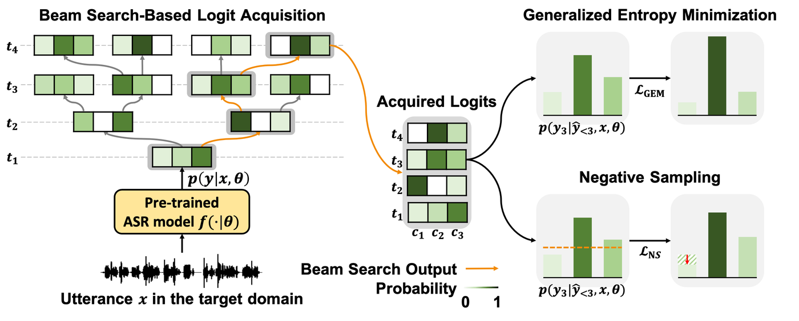
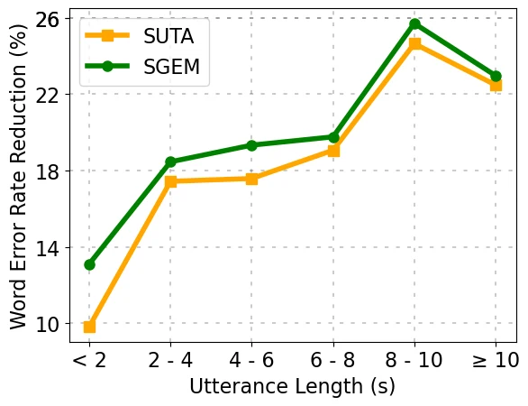

## Abstract

ASR model은 test audio가 training data와 다를 때, 즉 처음 보는 화자, 새로운 어휘, 배경 noise, accent가 있을 때 정확도가 떨어진다. Test-time adaptation(TTA)은 source data 없이, label 없는 test input 자체로 pre-trained model을 갱신한다. ASR을 위한 첫 TTA 방법인 SUTA([리뷰](/blog/2026/11/25/suta-review/))는 entropy minimization과 minimum class confusion으로 utterance 하나에 model을 adapt하지만, CTC model을 염두에 두고 만들어졌고 loss를 greedy decoding의 frame 단위 출력 위에서 계산한다.

SGEM(Sequential-level Generalized Entropy Minimization)은 autoregressive하게 decoding하거나 beam search와 외부 language model을 쓰는 model까지 포함하는 일반적인 ASR model을 위한 single-utterance TTA 방법이다. 먼저 beam search로 가장 그럴듯한 transcript를 찾고, 그 transcript를 따라 model의 출력 분포를 얻는다. 그다음 이 분포 위에서 두 가지 unsupervised loss로 model을 adapt한다. 하나는 generalized(Rényi) entropy loss이고, 다른 하나는 확률이 낮은 class를 더 낮추는 negative sampling loss이다. 세 종류의 model(wav2vec 2.0 CTC model, Conformer-CTC, Conformer-Transducer)과 12개 test set에서 SGEM은 모든 model에 대해 SUTA보다 평균 WER이 낮다.

## Motivation

이 논문에는 motivation을 보여 주는 그림이 없으며, 논증은 SUTA가 loss를 계산하는 방식에 관한 것이다. SUTA는 각 frame에서 greedy decoding의 출력을 받아 그 entropy를 최소화하며, 마치 각 frame의 argmax가 믿을 만한 target인 것처럼 다룬다. CTC가 아닌 ASR model에서는 두 가지 이유로 이것이 잘 맞지 않는다.

- **이런 model은 실제로 greedy decoding으로 쓰이지 않는다.** Autoregressive model과 transducer model은 각 token을 이전 token에 조건부로 예측하고, 실제 ASR system은 대부분 beam search로, 흔히 외부 language model과 함께 decoding한다. Greedy 경로는 system이 실제로 출력할 transcript와 다를 수 있으므로, model이 틀린 label 쪽으로 adapt될 수 있다.
- **Frame 단위 loss는 sequence를 무시한다.** 각 timestep을 독립적으로 다루면 transcript의 joint probability를 한 step씩만 보게 된다. Token 분포가 이전 token에 의존하는 model에서는 greedy 경로를 따른 분포와 decoding된 transcript를 따른 분포가 다르다.

저자들은 또한 출력 token이 몇 개 없는 짧은 utterance 하나에서는 Shannon entropy가 반드시 최선의 unsupervised objective가 아니라고 보고, Rényi entropy 계열에서 더 나은 것을 찾는다. 목표는 SUTA의 설정(한 번에 utterance 하나, source data 없음, utterance마다 model reset)을 유지하면서, adaptation 신호가 model의 실제 decoding 방식과 맞도록 하는 것이다.

## Method

*SGEM. Pre-trained model의 출력 위에서 beam search를 수행해 가장 그럴듯한 transcript(주황색 경로)를 얻고, 그 경로를 따라 출력 분포를 모은다. Generalized entropy minimization은 각 분포를 뾰족하게 만들고, negative sampling은 확률 threshold 아래의 class를 끌어내린다. 논문 그림.*

### Setting

$$f(\cdot \mid \theta)$$는 labeled source domain에서 학습된, parameter $$\theta$$를 가진 ASR model이다. Waveform $$x$$에 대해 logit $$f(x \mid \theta) \in \mathbb{R}^{L \times C}$$를 출력하며, $$L$$은 출력 timestep 수, $$C$$는 vocabulary 크기이다. Transcript $$\mathbf{y} = (y_1, \dots, y_L)$$의 점수는 다음과 같다.

$$
\log p(\mathbf{y} \mid x, \theta) = \sum_{i=1}^{L} \log p_{\text{AM}}(y_i \mid y_{<i}, x, \theta) + \lambda_{\text{LM}} \log p_{\text{LM}}(y_i \mid y_{<i}) + Z,
$$

여기서 $$p_{\text{AM}}$$은 acoustic model의 확률, $$p_{\text{LM}}$$은 weight $$\lambda_{\text{LM}}$$을 가진 외부 autoregressive language model, $$Z$$는 정규화 상수이다. Decoding은 $$\mathbf{y}^{*} = \arg\max_{\mathbf{y}} \log p(\mathbf{y} \mid x, \theta)$$를 근사한다. Single-utterance TTA에서는 각 test utterance $$x$$ 하나만으로 unsupervised loss를 써서 model을 fine-tuning하고, 그 model로 해당 utterance를 transcribe한 뒤, 다음 utterance 전에 pre-trained weight로 reset한다.

### Beam search-based logit acquisition

SGEM은 beam width $$B$$로 beam search를 실행해(language model을 쓰는 경우 함께 사용) 가장 그럴듯한 transcript $$\hat{\mathbf{y}} = (\hat{y}_1, \dots, \hat{y}_L)$$을 얻는다. Memory를 아끼기 위해 모든 beam 후보의 logit을 저장하지 않는다. 대신 $$\hat{\mathbf{y}}$$를 model에 다시 넣고, 그 prefix에 조건부인 각 step의 log-probability를 모은다.

$$
o_{ij} = \log p(y_i = j \mid \hat{y}_{<i}, x, \theta), \qquad \mathbf{o}_i = (o_{i1}, \dots, o_{iC}).
$$

아래의 adaptation loss는 이 $$\mathbf{o}_i$$ 위에서 계산되므로, model은 greedy transcript가 아니라 실제로 출력할 transcript 쪽으로 adapt된다.

### Generalized entropy minimization

$$C$$개 class에 대한 분포의 order $$\alpha$$ Rényi entropy는 $$\mathrm{H}_{\alpha} = \frac{1}{1-\alpha} \log \sum_{j=1}^{C} p_j^{\alpha}$$이다. $$\alpha \to 1$$이면 Shannon entropy가 되고, $$\alpha \to \infty$$이면 argmax pseudo-label에 대한 cross-entropy가 된다. SGEM은 그 사이($$\alpha > 1$$)에 좋은 값이 있다고 가정하고 다음 loss를 쓴다.

$$
\mathcal{L}_{\text{GEM}} = \frac{1}{L} \sum_{i=1}^{L} \frac{1}{1-\alpha} \log \Big( \sum_{j=1}^{C} p_{ij}^{\alpha} \Big), \qquad p_{ij} = \frac{\exp(o_{ij}/T)}{\sum_{j'=1}^{C} \exp(o_{ij'}/T)},
$$

여기서 $$T$$는 분포를 부드럽게 만들어 이미 확신이 높은 step에서 gradient가 사라지지 않게 하는 temperature이다. SUTA와 마찬가지로, CTC 출력에서는 blank frame이 대부분을 차지하므로 blank token의 확률이 가장 높은 timestep은 제외한다.

### Negative sampling

Label이 있는 step에서 cross-entropy 항은 $$\log p_{i,y_i} = \log(1 - \sum_{j \neq y_i} p_{ij})$$로 쓸 수 있다. 즉 틀린 class 전체의 확률 합을 낮춘다. Label이 없으므로 SGEM은 틀린 class 대신 분명히 가능성이 낮은 class, 즉 temperature를 적용하지 않은 확률 $$p'_{ij} = \mathrm{softmax}(\mathbf{o}_i)_j$$가 threshold $$\tau$$보다 낮은 class를 사용한다.

$$
\mathcal{L}_{\text{NS}} = -\frac{1}{L} \sum_{i=1}^{L} \log \Big( 1 - \sum_{j=1}^{C} \mathbf{1}[p'_{ij} < \tau]\, p_{ij} \Big).
$$

이 아이디어는 semi-supervised learning의 negative learning에서 왔다. 정답 class를 알 필요 없이, 거의 확실히 틀린 class가 무엇인지만 알면 된다.

### Overall objective

$$
\mathcal{L} = \mathcal{L}_{\text{GEM}} + \lambda_{\text{NS}} \mathcal{L}_{\text{NS}},
$$

$$\lambda_{\text{NS}}$$는 weight이다. 각 utterance에 cosine learning-rate schedule을 쓴 AdamW로 $$N = 10$$ step을 수행하고, 이후 model을 reset한다(episodic adaptation). wav2vec 2.0 model은 CNN feature extractor만, Conformer model들은 encoder만 갱신한다. 공통 설정은 $$T = 2.5$$, $$\tau = 0.4/C$$이다. Model별 설정 $$(B, \lambda_{\text{LM}}, \alpha, \lambda_{\text{NS}})$$는 CTC model이 $$(5, 0.3, 1.5, 1)$$, Conformer가 $$(5, 0.3, 1.25, 2)$$, language model을 쓰지 않는 Transducer가 $$(3, 0, 1.25, 0.5)$$이다. 모든 hyperparameter는 CHiME-3에서 tuning한다.

## Main Experiments

Model은 LibriSpeech로 fine-tuning한 wav2vec 2.0 Base(CTC), LibriSpeech로 학습한 Conformer-CTC(small), NeMo ASRSET으로 학습한 Conformer-Transducer(small)이다. Test set은 CHiME-3(CH), TED-LIUM 2(TD), Common Voice(CV), Valentini(VA)와, LibriSpeech test-other에 MS-SNSD noise 8종을 10 dB SNR로 섞은 것이다. Noise는 air conditioner(AC), airport announcement(AA), babble(BA), copy machine(CM), munching(MU), neighbors(NB), shutting door(SD), typing(TP)이다. 지표는 WER(%)이다.

**Inference에 greedy decoding을 쓴 WER(%), Table 1에서 발췌**

| Model | Method | CH | TD | CV | VA | AC | AA | BA | CM | MU | NB | SD | TP | Avg. |
|---|---|---|---|---|---|---|---|---|---|---|---|---|---|---|
| CTC | Unadapted | 31.2 | 13.2 | 36.9 | 14.5 | 28.1 | 40.9 | 66.6 | 49.8 | 50.4 | 119.2 | 19.2 | 26.2 | 41.4 |
| CTC | SUTA | 25.0 | 12.0 | 31.4 | 11.8 | 17.7 | 31.3 | 55.2 | 39.4 | 39.7 | 113.0 | 15.0 | 17.8 | 34.1 |
| CTC | **SGEM** | 24.7 | 12.0 | 31.1 | 11.6 | 17.3 | 30.7 | 53.1 | 38.5 | 38.6 | 110.5 | 14.8 | 17.5 | **33.4** |
| Conformer | Unadapted | 28.7 | 15.1 | 36.8 | 17.4 | 18.8 | 44.8 | 74.3 | 45.7 | 56.0 | 122.1 | 20.8 | 36.9 | 43.1 |
| Conformer | SUTA | 25.2 | 13.4 | 32.4 | 14.7 | 14.5 | 39.8 | 73.3 | 38.4 | 48.7 | 125.5 | 16.4 | 28.8 | 39.3 |
| Conformer | **SGEM** | 24.5 | 13.3 | 31.6 | 14.6 | 14.4 | 38.5 | 70.4 | 38.7 | 48.5 | 120.9 | 16.8 | 28.9 | **38.4** |
| Transducer | Unadapted | 11.8 | 7.2 | 12.9 | 6.5 | 14.1 | 20.4 | 31.0 | 29.7 | 31.3 | 74.6 | 12.7 | 16.2 | 22.4 |
| Transducer | SUTA | 10.3 | 6.8 | 12.1 | 5.5 | 12.0 | 18.5 | 28.3 | 26.7 | 28.7 | 74.6 | 11.7 | 14.7 | 20.8 |
| Transducer | **SGEM** | 9.9 | 6.6 | 12.0 | 5.2 | 11.6 | 18.0 | 27.5 | 26.0 | 28.0 | 76.5 | 11.5 | 14.3 | **20.6** |

여기서는 SUTA의 protocol을 따라 최종 transcript에 greedy decoding을 쓴다. SGEM 내부에서 adaptation target을 고를 때는 여전히 beam search를 쓴다.

**Inference에 beam search와 4-gram language model을 쓴 CTC model의 WER(%), Table 2에서 발췌**

| Method | CH | TD | CV | VA | AC | AA | BA | CM | MU | NB | SD | TP | Avg. |
|---|---|---|---|---|---|---|---|---|---|---|---|---|---|
| Unadapted | 29.5 | 12.2 | 36.9 | 13.0 | 26.1 | 38.6 | 58.9 | 48.9 | 49.0 | 91.6 | 17.4 | 23.7 | 37.2 |
| SUTA | 24.1 | 11.6 | 31.5 | 11.4 | 16.8 | 30.3 | 53.2 | 38.1 | 38.6 | 107.9 | 14.1 | 16.9 | 32.9 |
| **SGEM** | 24.1 | 11.7 | 31.1 | 11.1 | 16.5 | 29.8 | 51.6 | 37.7 | 37.7 | 106.7 | 14.0 | 16.9 | **32.4** |

SGEM은 모든 model과 두 decoding 방식에서 평균이 가장 좋다. 34.1에서 33.4(CTC, greedy), 32.9에서 32.4(CTC, beam search), 39.3에서 38.4(Conformer), 20.8에서 20.6(Transducer)이다. 모든 설정을 평균하면 논문은 unadapted model 대비 15.6%의 상대 WER 감소를 보고한다. SUTA와의 차이는 작아서 dataset당 대부분 0.몇 포인트이고, Conformer의 몇몇 열(CM, SD, TP)에서는 여전히 SUTA가 앞선다. Neighbors(NB) noise에서는 두 방법 모두 무너진다. CTC와 Conformer model에서 WER이 100%를 넘고, Transducer에서는 SGEM이 unadapted보다 나쁘며(76.5 대 74.6), beam search에서는 두 방법 모두 adaptation하지 않은 경우보다 훨씬 나쁘다(106.7과 107.9 대 91.6).

**L2-Arctic(모국어당 화자 한 명)에서 CTC model의 WER(%), Table 3에서 발췌**

| 모국어 | Unadapted | SUTA | SGEM |
|---|---|---|---|
| Arabic | 32.5 | 27.1 | **26.5** |
| Mandarin | 28.5 | 23.3 | **23.1** |
| Hindi | 15.7 | 12.5 | **12.3** |
| Korean | 23.3 | 19.7 | **19.5** |
| Spanish | 35.7 | 29.8 | **29.3** |
| Vietnamese | 18.5 | 15.7 | **15.4** |
| **Average** | 25.7 | 21.4 | **21.0** |

Accent가 있는 음성에서도 양상은 같다. SGEM은 여섯 모국어 모두에서 가장 좋고, SUTA보다 0.2에서 0.6포인트 낮다.

*CHiME-3에서 utterance 길이별로 나눈, unadapted CTC model 대비 상대 WER 감소. SGEM은 모든 구간에서 SUTA보다 위에 있고, 2초보다 짧은 utterance에서 차이가 가장 크다. 논문 그림.*

짧은 utterance는 adapt에 쓸 출력 token이 적으며, 이는 TTA의 small-batch 문제의 single-utterance 판이다. 2초 미만에서 SUTA는 WER을 상대적으로 약 10%, SGEM은 약 13% 줄인다. 긴 utterance에서는 두 방법이 비슷하다.

**CHiME-3에서의 ablation, WER(%), Table 4에서 발췌**

| Beam search | GEM | NS | CTC | Conformer | Transducer |
|---|---|---|---|---|---|
| | | | 31.2 | 28.7 | 11.8 |
| | ✓ | | 24.9 | 24.7 | 10.0 |
| | | ✓ | 25.2 | 25.0 | 10.1 |
| | ✓ | ✓ | 24.8 | 24.7 | 10.0 |
| ✓ | | ✓ | 24.8 | 24.7 | 10.1 |
| ✓ | ✓ | ✓ | **24.7** | **24.5** | **9.9** |

첫 행은 unadapted model이다. 두 loss 중 하나만으로도 이득의 거의 전부를 얻는다. 다른 loss를 더하는 것과 greedy target을 beam search target으로 바꾸는 것은 각각 0.1에서 0.2포인트를 더한다.

SGEM은 이후 SUTA를 기반으로 하는 wild acoustic TTA 논문([리뷰](/blog/2026/11/25/wild-acoustic-tta-review/))에서 baseline으로 쓰인다. 그 논문에서 같은 4-gram language model을 쓴 sung speech 실험의 SGEM은 greedy decoding의 SUTA와 비슷한 수준에 머문다(wav2vec 2.0 Base 평균 WER 54.3 대 54.4).

## Limitations

- **SUTA 대비 작은 이득.** SUTA 대비 평균 향상은 model에 따라 WER 0.2에서 0.9포인트이고, ablation의 각 단계는 0.1에서 0.2포인트이다. 논문은 variance 없이 단일 run만 보고하므로, dataset별 우위 중 얼마나 믿을 만한지 판단하기 어렵다.
- **Test set에서 tuning한 hyperparameter.** 모든 설정을 CHiME-3에서 고른 뒤 main table과 ablation에 CHiME-3 결과를 보고한다. 또한 model마다 learning rate, $$\alpha$$, $$\lambda_{\text{NS}}$$, beam width, LM weight를 따로 정한다.
- **일부 shift에서의 실패.** Neighbors noise에서는 adaptation이 오히려 WER을 adaptation하지 않은 경우보다 나쁘게 만들 수 있고, beam search decoding에서 특히 그렇다(unadapted 91.6 대 106.7). 논문은 이를 감지하거나 피하는 방법을 제시하지 않는다.
- **CTC에서는 "sequential" 부분이 약하다.** CTC model의 frame 출력은 이전 token에 의존하지 않으므로, beam search transcript를 다시 넣어도 autoregressive model에서처럼 $$\mathbf{o}_i$$가 바뀌지 않는다. 논문은 CTC에서 beam search로 얻는 이득이 어디서 오는지 설명하지 않으며, ablation에서 그 이득은 0.1포인트뿐이다.
- **Autoregressive encoder-decoder model 없음.** Motivation은 autoregressive ASR model에 관한 것이지만, 실험은 CTC model 두 개와 transducer 하나를 쓴다. Whisper 같은 attention encoder-decoder model은 없다.
- **비용.** Utterance마다 beam search와 10번의 forward-backward pass가 필요하다. 논문은 세 model 평균으로 audio 1초당 약 0.771초의 adaptation 시간을 보고한다.

## My Thoughts

<!-- TODO -->
