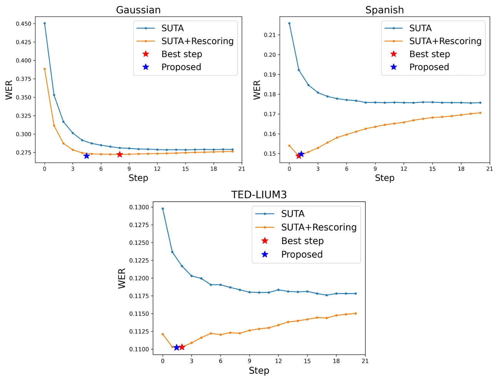
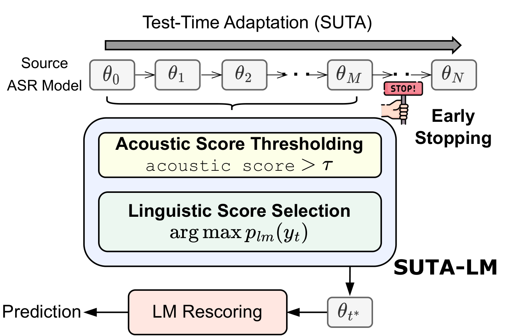
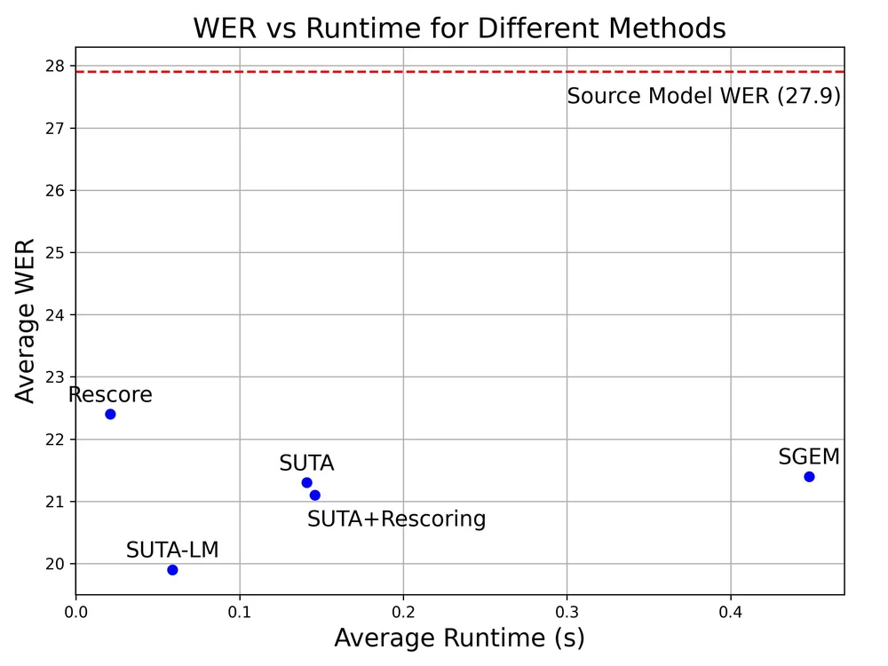
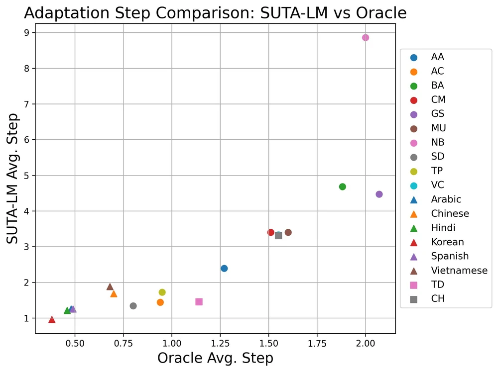

## Abstract

End-to-end ASR 모델은 training data와 다른 음성, 예를 들어 noise가 섞인 음성, 억양이 있는 화자, 잔향이 있는 강연에서 정확도가 떨어진다. Inference 시점의 대응책은 크게 두 가지다. Test-time adaptation(TTA)은 test utterance 자체에 unsupervised loss를 걸어 acoustic model을 갱신한다. Language model(LM) rescoring은 acoustic model을 그대로 두고 외부 LM과 함께 beam search를 돌려, 언어적으로 어색한 출력을 바로잡는다. 지금까지 두 방법은 대체로 따로 연구되었다.

이 논문은 둘을 어떻게 결합할지 묻고, 가장 단순한 결합([SUTA](/blog/2026/11/25/suta-review/)로 adapt한 뒤 rescoring)이 rescoring만 하는 것보다 나쁠 수 있음을 보인다. 원인은 adaptation step 수다. 너무 적으면 acoustic error가 남고, 너무 많으면 rescoring이 고칠 수 있는 여지를 해치며, 최적의 step 수는 domain마다 다르다. SUTA-LM은 SUTA의 update rule은 그대로 두고, utterance마다 어떤 중간 모델을 decoding할지 고른다. Step은 먼저 confidence threshold(acoustic score)를 넘어야 하고, 그중 greedy transcript를 LM이 가장 높게 평가하는 step이 선택된다(linguistic score). 선택이 더 이상 바뀌지 않으면 early stopping으로 adaptation을 끝낸다. 18개 test set에서 평균 WER이 가장 낮고, 일반 SUTA보다도 빠르다.

## Motivation

저자들은 먼저 당연해 보이는 pipeline인 **SUTA+Rescoring**을 시험한다. 각 test utterance $$x$$에 대해 SUTA가 source model $$\theta$$를 $$N$$ step 동안 adapt하여 $$\theta_0 = \theta, \theta_1, \ldots, \theta_N$$을 만든다. 마지막 logit $$\theta_N(x) \in \mathbb{R}^{L \times C}$$($$L$$은 frame 수, $$C$$는 output token 수)를 4-gram LM과 shallow fusion 방식의 beam search로 decoding한다.

$$
\hat{y} = \arg\max_y \; \log p_\theta(y \mid x) + \alpha \log p_{lm}(y) + \beta\,\mathrm{length}(y),
$$

모든 실험에서 $$(\alpha, \beta) = (0.5, 0)$$으로 고정한다. Acoustic model은 LibriSpeech 960h로 fine-tuning된 wav2vec 2.0-base이다.

**Preliminary study, WER(%), Table 1에서 발췌** (3회 평균)

| Method | Gaussian | TED-LIUM3 | Spanish |
|---|---|---|---|
| Source model | 45.1 | 13.0 | 21.6 |
| SUTA | 28.1 | 11.7 | 17.7 |
| Rescoring | 38.9 | **11.2** | **15.4** |
| SUTA+Rescoring | **27.3** | 11.4 | 16.5 |

10 dB Gaussian noise에서는 먼저 adapt하는 것이 크게 도움이 된다(27.3 대 38.9). 그러나 TED-LIUM3와 L2Arctic의 Spanish 억양 음성에서는 순서가 뒤집혀, SUTA+Rescoring이 adapt하지 않은 모델을 rescoring한 것보다 나쁘다. 어느 pipeline도 모든 경우에 이기지 못한다.

Rescoring만 하는 것은 $$N = 0$$인 SUTA+Rescoring이고 SUTA의 기본값은 $$N = 10$$이므로, 저자들은 $$N$$을 0부터 20까지 바꿔 본다.

*Gaussian noise, Spanish 억양 음성, TED-LIUM3에서 adaptation step 수에 따른 SUTA(greedy, 파란색)와 SUTA+Rescoring(주황색)의 WER. 빨간 별은 SUTA+Rescoring의 최적 고정 step, 파란 별은 SUTA-LM이다. 논문 그림.*

두 가지가 눈에 띈다. 최적 고정 step이 domain마다 다르다. Gaussian noise는 8, TED-LIUM3는 2, Spanish는 1이다. 또한 $$N = 0$$은 어디서도 최적이 아니므로, 양만 맞으면 adaptation은 항상 도움이 된다. 더 놀라운 것은 두 번째 관찰이다. SUTA의 greedy WER은 step이 많아져도 평평하거나 계속 내려가는데, rescoring 후 WER은 Spanish와 TED-LIUM3에서 다시 올라간다. Greedy decoding에서는 무해해 보이는 adaptation도 rescoring 후 결과는 해칠 수 있다. 따라서 step 수는 입력마다 정해야 하며, greedy WER은 그 기준이 될 수 없다.

## Method

*SUTA-LM. SUTA가 adapt된 모델들의 trajectory를 만들고, acoustic score thresholding과 linguistic score selection이 step $$t^*$$ 하나를 고르며, early stopping이 trajectory를 일찍 끊는다. 선택된 모델의 logit은 beam search와 LM rescoring으로 넘어간다. 논문 그림.*

### Base TTA: SUTA

SUTA(single-utterance test-time adaptation)는 CTC 모델을 utterance 하나씩 adapt한다. 모델 자신의 출력에 대해 frame 단위 entropy와 minimum class confusion을 섞은 loss를 최소화하고, 정해진 수만큼 gradient step을 밟은 뒤 decoding하며, 다음 utterance 전에 모델을 source weight로 reset한다. SUTA-LM은 이 update를 전혀 바꾸지 않는다. 어떤 step을 decoding할지와 몇 step을 돌릴지만 바꾼다. 구현은 class confusion loss의 reweighting을 포함한 공식 SUTA 코드를 따른다.

### Auto-step selection

SUTA-LM은 항상 $$\theta_N$$을 decoding하는 대신 전체 trajectory에서 step 하나를 고른다.

$$
t = f(x, \theta_0, \theta_1, \ldots, \theta_N), \qquad 0 \le t \le N,
$$

목표는 $$\theta_t(x)$$를 beam search했을 때 WER이 가장 낮은 것이다. $$t = 0$$(adaptation 없이 rescoring만)도 선택지에 포함된다. 선택 함수 $$f$$는 두 부분으로 이루어진다.

**Acoustic score thresholding.** $$c_l^t$$를 $$\theta_t(x)$$에서 frame $$l$$의 top token 확률이라 하자. Step $$t$$의 acoustic score는 frame 평균 log confidence이다.

$$
S_t = \frac{1}{L}\sum_{l=1}^{L} \log c_l^t ,
$$

$$S_t \ge \tau$$인 step만 남긴다.

$$
\mathcal{T} = \{\, t : S_t \ge \tau,\; 0 \le t \le N \,\}.
$$

이 단계는 acoustic model이 아직 확신하지 못하는 step을 제거한다. 기본값 $$\tau = -0.05$$는 엄격한 편으로, 평균 top token 확률이 약 0.95는 되어야 한다는 뜻이다.

**Linguistic score selection.** $$y_t$$를 $$\theta_t(x)$$의 greedy transcript라 하자. 남은 step 중 transcript의 LM 확률이 가장 높은 step을 고른다.

$$
t^* = \arg\max_{t \in \mathcal{T}} \; p_{lm}(y_t).
$$

동점이면 가장 이른 step을 택한다. Preliminary study에서 추가 adaptation이 rescoring 후 결과를 해칠 수 있음을 보았기 때문이다. $$\mathcal{T}$$가 비어 있으면 마지막 step $$t^* = N$$을 쓴다. 선택된 logit $$\theta_{t^*}(x)$$는 위의 shallow fusion beam search로 decoding된다.

두 score의 역할은 다르다. Acoustic score는 "모델이 충분히 확신한다"를 확인하고, linguistic score는 확신하는 step들 사이에서 어느 transcript가 실제 영어처럼 읽히는지로 결정을 내린다.

### Early stopping

$$N$$ step을 모두 돌린 뒤 고르는 것은 낭비이므로 선택을 online으로 수행한다. Adaptation은 step 단위로 계속된다. Threshold 아래의 step은 건너뛰고, $$\mathcal{T}$$에 속한 step에 대해서는 $$y_t$$의 LM score를 추적하며, 최고 LM score가 연속 $$P$$개의 유효 step 동안 개선되지 않으면 멈춘다(기본값 $$P = 3$$). 지금까지 LM score가 가장 높았던 step을 반환한다. Threshold를 넘는 step이 끝까지 없으면 $$N$$ step을 모두 돌리고 $$\theta_N$$을 쓴다. 실험에서 최대 step은 $$N = 20$$이다.

## Main Experiments

Benchmark는 18개 test set이다. LS-C는 LibriSpeech test에 MS-SNSD noise 10종을 10 dB SNR로 섞은 것이다(AA airport announcement, AC air conditioner, BA babble, CM copy machine, GS Gaussian, MU munching, NB neighbors, SD shutting door, TP typing, VC vacuum cleaner). L2Arctic은 비원어민 영어 억양 6종, TED-LIUM3(TD)는 약한 잔향이 있는 실제 강연, CHiME-3(CH)는 실제 noisy WSJ 음성이다. 20초보다 긴 utterance는 제외한다(전체의 1% 미만). Baseline은 SUTA, Rescoring, SUTA+Rescoring, 그리고 [SGEM](/blog/2026/11/25/sgem-review/)이다. SGEM도 LM과 beam search를 쓰지만, 최종 decoding이 아니라 adaptation loss 안에서 쓴다. 모두 $$N = 20$$이며 WER은 3회 평균이다.

**LS-C noise별 WER(%), Table 2에서 발췌**

| Method | AA | AC | BA | CM | GS | MU | NB | SD | TP | VC |
|---|---|---|---|---|---|---|---|---|---|---|
| Source model | 21.6 | 14.2 | 38.1 | 28.5 | 45.1 | 30.6 | 81.7 | 13.6 | 16.6 | 29.5 |
| SUTA | 16.2 | 10.6 | 27.7 | 21.5 | 28.1 | 22.1 | 64.6 | 10.8 | 12.1 | 20.6 |
| Rescoring | 17.6 | 10.8 | 31.6 | 23.8 | 38.9 | 25.9 | 65.7 | 10.5 | 12.9 | 24.7 |
| SGEM | 16.2 | 10.4 | 28 | 21.4 | 28.3 | 22.3 | 66.1 | 10.5 | 11.9 | 20.5 |
| SUTA+Rescoring | 15.9 | 10.2 | 27.5 | 21.1 | 27.6 | 21.9 | 64.6 | 10.5 | 11.8 | 20.1 |
| **SUTA-LM** | **15.2** | **9.6** | **26.9** | **20.2** | **27.0** | **21.2** | **63.8** | **9.7** | **11.1** | **19.4** |

**L2Arctic 억양, TED-LIUM3, CHiME-3, 18개 set 평균 WER(%), Table 2에서 발췌**

| Method | Arabic | Chinese | Hindi | Korean | Spanish | Vietnamese | TD | CH | Avg. |
|---|---|---|---|---|---|---|---|---|---|
| Source model | 21.4 | 27.5 | 17.1 | 17.3 | 21.6 | 34.8 | 13.0 | 30.0 | 27.9 |
| SUTA | 17.5 | 22.1 | 13.1 | 14.1 | 17.7 | 30.2 | 11.7 | 23.5 | 21.3 |
| Rescoring | **15.2** | 20.6 | 12.2 | 11.8 | 15.4 | 28.1 | 11.2 | 26.7 | 22.4 |
| SGEM | 17.3 | 22.2 | 12.9 | 13.9 | 17.5 | 30.1 | 11.6 | 23.4 | 21.4 |
| SUTA+Rescoring | 17.1 | 21.5 | 12.7 | 13.7 | 17.1 | 29.6 | 11.5 | 23.1 | 21.1 |
| **SUTA-LM** | **15.2** | **19.6** | **11.3** | **11.7** | **15.0** | **27.6** | **11.0** | **22.4** | **19.9** |

SUTA-LM은 모든 열에서 최고이거나 동률이며, 평균 19.9로 SUTA+Rescoring의 21.1, SGEM의 21.4보다 낮다. 표에서도 motivation의 domain 구분이 드러난다. Acoustic shift가 큰 LS-C와 CHiME-3에서는 SUTA가 Rescoring을 이긴다. Acoustic shift가 작은 L2Arctic과 TED-LIUM3에서는 Rescoring이 SUTA를 이기고, SUTA+Rescoring은 Rescoring 단독보다 뒤처진다. SUTA-LM은 각 영역에서 둘 중 나은 쪽과 같거나 조금 낫지만, 억양 음성에서 Rescoring 대비 향상은 작다(0.0~1.0포인트).

*18개 set 평균 WER과 1초 길이 utterance당 평균 실행 시간. 점선은 source model(27.9)이다. 논문 그림.*

Early stopping이 대개 몇 step 만에 끝나기 때문에, SUTA-LM은 SGEM보다 약 7배, SUTA+Rescoring보다 2배 이상 빠르다. Gradient step이 필요 없는 rescoring 단독보다는 여전히 느리다.

*18개 set 각각에 대해 SUTA-LM이 고른 평균 step(y축)과, utterance마다 WER이 가장 낮은 step을 고르는(동점이면 가장 이른 step) oracle의 평균 step(x축). 논문 그림.*

Domain 순서는 oracle과 일치한다. 억양 set이 가장 적은 step을, BA, GS, NB가 가장 많은 step을 받는다. 다만 scale은 다르다. Oracle은 평균 약 0.4~2.1 step인 반면 SUTA-LM은 약 1~9 step이어서, 특히 NB에서 필요 이상으로 adapt한다.

**Ablation, 대표 6개 set의 WER(%), Table 3에서 발췌**

| Variant | Korean | Spanish | TD | CH | GS | NB |
|---|---|---|---|---|---|---|
| SUTA-LM | **11.7** | 15.0 | **11.0** | **22.4** | **27.0** | **63.8** |
| w/o acoustic score thresholding | **11.7** | **14.8** | **11.0** | 22.9 | 27.5 | 64.0 |
| w/o early stop: thresholding + LM selection | 11.8 | 15.1 | 11.1 | 22.5 | **27.0** | 63.9 |
| w/o early stop: thresholding + random selection | 13.2 | 16.3 | 11.3 | 22.8 | 27.4 | 64.2 |

Acoustic threshold가 없으면 noisy set(CH, GS, NB)에서 LM score만으로 너무 일찍 멈추는 경향이 있다. Acoustic model은 아직 확신하지 못하는데 transcript가 우연히 자연스러워 보이는 step을 고르는 것이다. Early stopping은 정확도 손실이 없다. LM selection을 확신하는 step 중 random 선택으로 바꾸면 억양 음성에서 가장 크게 나빠진다(Korean 11.8에서 13.2, Spanish 15.1에서 16.3). 이 경우 많은 step이 threshold를 통과하므로, 그들을 구분하는 것은 LM이다.

Threshold는 극단값에서만 영향이 있다. 같은 6개 set 평균 WER은 $$\tau = -0.01, -0.03, -0.05, -0.1, -0.3$$에 대해 각각 26.2, 25.6, 25.2, 25.2, 25.3이다. 다른 CTC backbone(data2vec-base, HuBERT-large)에서도 SUTA-LM의 subset 평균이 가장 낮지만(24.7, 16.2), HuBERT-large에서는 SUTA+Rescoring과 동률이다.

## Limitations

- **수작업으로 정한 threshold와 LM weight.** $$\tau = -0.05$$와 $$P = 3$$은 고정이고, fusion weight $$(\alpha, \beta) = (0.5, 0)$$은 tuning하지 않았다. $$\tau$$ sweep은 ablation에서 보고하는 바로 그 6개 test set에서 수행된다.
- **Overconfidence가 곧 선택 신호.** Acoustic score는 확신하는 frame에 보상을 주는데, entropy minimization 기반 TTA는 구조상 frame을 확신하게 만든다. 확신하지만 틀린 step을 걸러내는 일은 LM에 의존하므로 LM의 domain을 그대로 물려받는다. 4-gram LM은 wav2vec 2.0용으로 공개된 LibriSpeech LM이며, test text가 LM corpus와 크게 다른 경우는 실험하지 않았다.
- **Oracle보다 많은 step.** SUTA-LM은 평균적으로 oracle보다 몇 배 많은 step을 고르므로, 실행 시간과 정확도 모두 개선 여지가 남아 있다.
- **Rescoring이 이미 강한 곳에서는 작은 이득.** L2Arctic과 TED-LIUM3에서 Rescoring 단독 대비 향상은 최대 1.0포인트인데, SUTA-LM은 여전히 gradient step을 돈다.
- **좁은 실험 범위.** LibriSpeech로 fine-tuning된 CTC 모델과 n-gram LM만 쓴다. Whisper 같은 encoder-decoder 모델, neural LM, LLM 기반 correction(예: LI-TTA)과는 비교하지 않는다. 각 utterance는 reset과 함께 독립적으로 adapt되므로 utterance 사이에 전달되는 것이 없다.
- **선택은 greedy, 출력은 beam search.** $$p_{lm}(y_t)$$는 greedy transcript로 계산하지만 최종 출력은 같은 logit에 대한 beam search에서 나온다. 둘이 얼마나 자주 어긋나는지는 분석하지 않았다.

## My Thoughts

<!-- TODO -->
