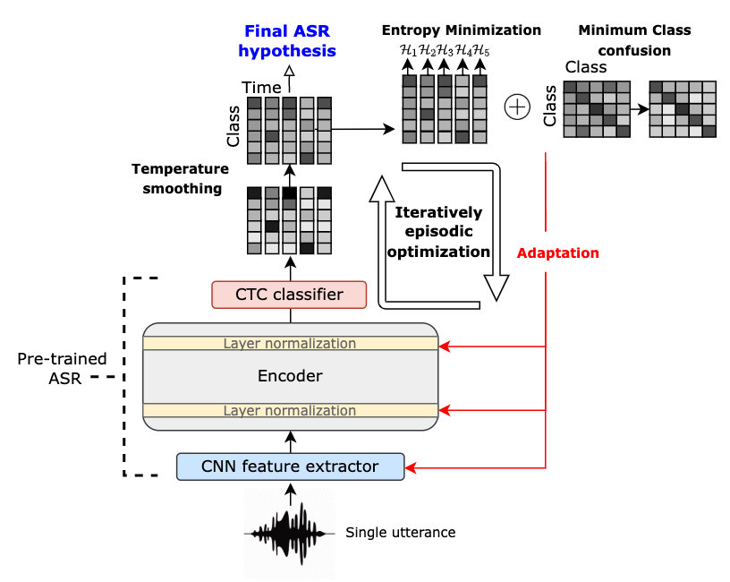
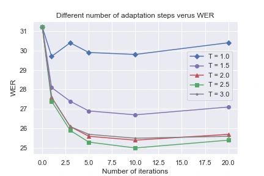
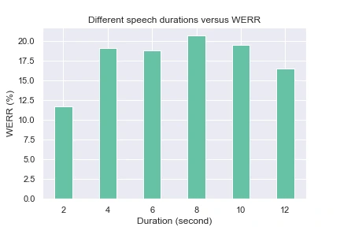

## Abstract

End-to-end ASR 모델은 test 음성이 training 음성과 비슷할 때는 잘 동작하지만, noise나 새로운 녹음 환경, 새로운 발화 스타일 앞에서는 WER이 빠르게 올라간다. Unsupervised domain adaptation이 도움이 될 수 있지만, source data와 미리 모아 둔 target 음성이 많이 필요하고, target 음성이 하나의 distribution에서 온다고 가정한다. Test-time adaptation(TTA)은 source data 없이도 동작하지만, 당시 vision 쪽 방법들은 대부분 test sample batch 단위로 adapt했고 Batch Normalization 통계에 의존했다. ASR encoder에는 보통 BN이 없다.

이 논문은 Single-Utterance Test-time Adaptation(SUTA)을 제안하며, 이를 ASR에 대한 첫 TTA 연구로 소개한다. SUTA는 test utterance마다 source weight에서 다시 시작해, 모델 자신의 CTC output으로 계산한 두 unsupervised loss로 gradient step을 몇 번 밟는다. 두 loss는 frame 단위 entropy minimization과 minimum class confusion이며, 둘 다 temperature로 smoothing한 distribution 위에서 계산한다. Layer normalization parameter와 CNN feature extractor만 갱신되고, adapt된 모델로 그 utterance를 decoding한다. LibriSpeech로 학습한 wav2vec 2.0 CTC 모델에서 SUTA는 noisy LibriSpeech, CHiME-3, Common Voice, TED-LIUM 3의 WER을 낮추고, clean in-domain LibriSpeech에서도 WER을 낮춘다.

## Motivation

이 논문에는 motivation 그림이 없고, 논지는 setting에 관한 것이다. ASR용 unsupervised domain adaptation(adversarial training, distillation, self-training)에는 실용적인 문제가 세 가지 있다. (1) privacy나 저장 문제로 source data를 못 쓸 수 있고, (2) target 음성을 먼저 모아야 하고 adaptation이 무거워 latency가 생기며, (3) 모든 target 음성이 같은 distribution에서 온다고 가정한다. Tent 같은 batch 단위 TTA는 (1)은 해결하지만 (2)와 (3)은 그대로다. 음성 서비스는 batch가 모일 때까지 기다릴 수 없고, 연달아 들어오는 요청이 식당, 전화 통화, 조용한 방에서 각각 올 수도 있다.

Architecture 측면의 차이도 있다. Vision의 TTA는 상당 부분 target data로 Batch Normalization layer를 재추정하거나 adapt하는 방식이다. 반면 ASR용 sequence model은 batch 안의 utterance 길이가 서로 달라 보통 Layer Normalization을 쓴다. 그래서 vision의 방법을 그대로 가져올 수 없다. Single-instance 방법인 SITA는 vision에서 batch 요구를 없앴지만, 여전히 augmentation과 BN 통계에 의존한다.

여기서 논문이 겨냥하는 setting이 나온다. 현재 utterance 하나만으로, label도 source data도 없이, 작은 지연으로 adapt하고, utterance들이 같은 distribution이라고 가정하지 않는다.

## Method

*SUTA. Utterance 하나를 pre-trained CTC 모델에 통과시키고, output을 temperature로 smoothing한 뒤, entropy minimization과 minimum class confusion으로 layer normalization과 CNN feature extractor를 몇 step 갱신하고 나서 최종 hypothesis를 decoding한다. 논문 그림.*

### Setting and notation

ASR 모델 $$g(y \mid x; \theta)$$는 utterance $$x$$를 받아 각 vocabulary class $$y$$에 대한 정규화되지 않은 score를 낸다. Parameter는 $$\theta = (\theta_f, \theta_a)$$로 나뉘며, $$\theta_f$$는 고정되고 $$\theta_a$$는 inference 때 갱신된다. 모델은 wav2vec 2.0-base encoder에 character 단위 CTC classifier를 붙인 것이다. $$C$$는 character class 수에 CTC blank 하나를 더한 값이고, $$L$$은 output frame 수다. Output은 logit 행렬 $$\mathbf{O} \in \mathbb{R}^{L \times C}$$이고, $$\mathbf{P}_{ij}$$는 frame $$i$$에서 class $$j$$의 확률이다.

### Entropy minimization

Tent를 따라, 첫 번째 loss는 각 frame이 확신 있는 prediction을 내도록 민다. Frame별 entropy $$\mathcal{H}_i$$의 평균이다.

$$
\mathcal{L}_{em} = \frac{1}{L}\sum_{i=1}^{L} \mathcal{H}_i = -\frac{1}{L}\sum_{i=1}^{L}\sum_{j=1}^{C} \mathbf{P}_{ij}\log \mathbf{P}_{ij}.
$$

CTC output에서는 blank token이 대부분의 frame을 차지한다. Loss가 이런 쉬운 frame에 좌우되지 않도록, SUTA는 가장 확률이 높은 class가 blank인 frame을 평균에서 뺀다.

### Minimum class confusion

두 번째 loss는 시간 축에 걸친 class 간 겹침을 줄인다. $$\mathbf{P}_{\cdot j} \in \mathbb{R}^{L}$$를 $$L$$개 frame에 걸친 class $$j$$의 확률이라 하자. 이들의 내적이 $$C \times C$$ class confusion matrix를 이루고, MCC는 그 비대각 원소만 penalize한다.

$$
\mathcal{L}_{mcc} = \sum_{j=1}^{C}\sum_{j' \neq j}^{C} \mathbf{P}_{\cdot j}^{\top}\mathbf{P}_{\cdot j'}.
$$

값이 작다는 것은 class $$j$$에 확률을 주는 frame이 다른 class에는 확률을 함께 주지 않는다는 뜻이다. MCC는 이전에 domain adaptation과 vision의 batch TTA에서 쓰였으며, entropy minimization과 비슷하게 동작하지만 gradient가 다르다.

### Temperature smoothing

두 loss를 그대로 쓰면 효과가 작다(CHiME-3에서 $$T = 1$$일 때 WER 29.9, adapt 전 31.2). 저자들의 설명은 이렇다. 확신 있는 frame은 entropy가 0에 가까워 gradient가 거의 없으므로, 갱신은 불확실한 frame이 주도하는데, 이 frame들이 가장 믿기 어렵다. SUTA는 두 loss 모두에 대해 softmax 전에 logit을 temperature $$T > 1$$로 나눈다.

$$
\mathbf{P}_{\cdot j} = \frac{\exp(\mathbf{O}_{\cdot j}/T)}{\sum_{j'=1}^{C}\exp(\mathbf{O}_{\cdot j'}/T)}.
$$

Distribution이 평평해지면 확신 있는 frame도 gradient에 남고, over-confident output에서 MCC가 과하게 작동하는 것도 누그러진다.

### Objective and update loop

두 loss는 weight $$\alpha$$로 섞는다.

$$
\mathcal{L} = \alpha\,\mathcal{L}_{em} + (1-\alpha)\,\mathcal{L}_{mcc}.
$$

Test utterance $$x$$마다 SUTA는 source weight에서 시작해 다음을 $$N$$번 반복한다. $$x$$를 forward하고, smoothing된 $$\mathbf{P}$$와 $$\mathcal{L}$$을 계산하고, optimizer로 $$\theta_a$$를 갱신한다. 그다음 $$(\theta_f, \theta_a^{N})$$로 그 utterance를 greedy decoding한다. 다음 utterance는 다시 source weight에서 시작하므로 episodic adaptation이다. Utterance 사이에 넘어가는 것은 없다.

### Default setting

$$\theta_a$$는 layer normalization parameter와 CNN feature extractor(LN+Feat)이다. Optimizer는 AdamW이고 learning rate는 LN+Feat에 $$2 \times 10^{-5}$$이다(LN만이면 $$2 \times 10^{-4}$$, 전체 모델이면 $$10^{-6}$$). $$\alpha = 0.3$$, $$T = 2.5$$, step 수 $$N = 10$$이다. Hyperparameter는 Gaussian noise를 더한 LibriSpeech test-other에서 고른 뒤 모든 corpus에 그대로 썼다. RTX 3090에서 10 step은 음성 1초당 약 0.115초가 걸린다.

## Main Experiments

Source 모델은 LibriSpeech 960시간으로 CTC fine-tuning한 wav2vec 2.0-base이다(test-clean / test-other WER 3.4 / 8.6). Target은 진폭 $$\delta \in \{0, 0.005, 0.01\}$$의 Gaussian noise를 더한 LibriSpeech test-other, CHiME-3(CH, noisy WSJ, enhanced `et05`), Common Voice(CV, crowdsourcing으로 모은 낭독 음성), TED-LIUM 3(TD, 강연)이다. TTA baseline은 저자들이 만든 single-utterance pseudo-labeling 방법인 SDPL 하나뿐이다. Greedy CTC output을 CTC loss의 label로 쓰고 매 step 갱신한다(parameter를 늘리면 발산해서 LN만 adapt). Language model은 쓰지 않는다.

**WER(%), Table 1에서 발췌**

| Model | LS $$\delta=0$$ | LS $$\delta=0.005$$ | LS $$\delta=0.01$$ | CH | CV | TD |
|---|---|---|---|---|---|---|
| SOTA trained on target | 2.5 | - | - | 5.8 | 15.4 | 5.6 |
| RASR (trained on LS) | 6.8 | - | - | - | 29.9 | 13.0 |
| Source model (wav2vec 2.0, LS) | 8.6 | 13.9 | 24.4 | 31.2 | 36.8 | 13.2 |
| + SDPL | 8.3 | 13.1 | 23.1 | 30.4 | 36.3 | 12.8 |
| + **SUTA** | **7.3** | **10.9** | **16.7** | **25.0** | **31.2** | **11.9** |

SUTA는 모든 열에서 source 모델과 SDPL을 이긴다. Shift가 클수록 향상도 커진다. Clean LibriSpeech test-other에서 1.3포인트, $$\delta = 0.01$$에서 7.7포인트, CHiME-3에서 6.2포인트다. In-domain test set도 8.6에서 7.3으로 좋아진다. RASR은 SpecAugment로 학습한 36-layer transformer이므로 TTA baseline이 아니라 더 강한 source 모델의 참고치다. 더 작은 모델에 SUTA를 쓰면 CV에서 RASR에 근접하고 TD에서는 앞선다.

**CHiME-3 ablation, Table 2에서 발췌** (WERR은 adapt 전 31.2 대비 상대 WER 감소)

| Setting | WER (%) | WERR (%) |
|---|---|---|
| Unadapted | 31.2 | 0.0 |
| **SUTA ($$\alpha=0.3$$, LN+Feat, $$T=2.5$$)** | **25.0** | **19.9** |
| $$\alpha=1.0$$ (EM only) | 25.5 | 18.3 |
| $$\alpha=0.7$$ | 25.3 | 18.9 |
| $$\alpha=0.5$$ | 25.1 | 19.6 |
| $$\alpha=0.0$$ (MCC only) | 25.4 | 18.6 |
| $$T=1.0$$ | 29.9 | 4.2 |
| $$T=1.5$$ | 26.7 | 14.2 |
| $$T=2.0$$ | 25.6 | 17.9 |
| $$T=3.0$$ | 25.5 | 18.3 |
| $$\theta_a$$ = LN | 28.8 | 7.7 |
| $$\theta_a$$ = Feat | 25.1 | 19.6 |
| $$\theta_a$$ = All | 26.7 | 14.4 |

각 loss만으로도 향상의 대부분이 나오고, 둘을 섞으면 WERR이 1포인트 정도 더 오른다. 가장 중요한 요소는 temperature다. Temperature가 없으면 WERR이 4.2%에 그친다. LN만 adapt하면 약하고, feature extractor만 adapt해도 LN+Feat에 거의 근접한다. 모델 전체를 풀면 오히려 나빠지는데, utterance 하나에서 얻는 신호로 많은 parameter를 맞추기 어려운 setting이라는 점과 맞아떨어진다.

*Temperature별로 adaptation step 수에 따른 CHiME-3 WER. $$T = 1$$이면 곡선이 들쭉날쭉하고 다시 올라가며, $$T \ge 2$$이면 약 10 step까지 WER이 꾸준히 내려간 뒤 평평해지거나 약간 오른다. 논문 그림.*

향상의 대부분은 처음 몇 step에서 나오고, 모든 temperature에서 10 step이 최적에 가깝다. 그 뒤로 WER이 조금씩 오르는데, utterance 하나에 over-adapt하기 시작한다는 신호다.

*Utterance 길이별 CHiME-3 상대 WER 감소. 2초 미만 utterance는 약 12%, 그보다 긴 utterance는 본문 기준 약 17.5% 향상된다. 논문 그림.*

짧은 utterance에는 단어가 한두 개뿐이라 output이 다루는 class가 적고, entropy minimization이 그 class들로 collapse할 수 있다. 향상은 작아지지만 여전히 양수다.

## Limitations

- **CTC 전용(저자들이 명시).** Loss가 frame 단위 CTC posterior 위에서 정의된다. Attention 기반 encoder-decoder 모델(그리고 이후의 Whisper 계열 모델)은 future work로 남긴다. 이후 SGEM과 wild-acoustic 논문이 다른 objective와 모델로 SUTA를 확장한다. [/blog/2026/11/25/sgem-review/](/blog/2026/11/25/sgem-review/), [/blog/2026/11/25/wild-acoustic-tta-review/](/blog/2026/11/25/wild-acoustic-tta-review/) 참고.
- **짧은 utterance(저자들이 명시).** 2초 미만에서는 향상이 작은데, entropy minimization에 의한 class collapse 때문으로 보인다.
- **Utterance당 비용.** Utterance마다 feature extractor와 encoder를 통과하는 forward와 backward가 10번 필요하며, RTX 3090에서 음성 1초당 약 0.115초가 든다. Streaming이나 on-device 환경에서는 가볍지 않다.
- **Utterance 사이의 기억 없음.** Episodic reset 덕분에 domain이 바뀌어도 robust하지만, 같은 domain의 앞선 utterance에서 배운 것도 버린다. CoTTA-ASR 논문(DSUTA)이 바로 이 문제를 다룬다. [/blog/2026/11/25/cotta-asr-review/](/blog/2026/11/25/cotta-asr-review/) 참고.
- **Test set에서 고른 hyperparameter.** $$\alpha$$, $$T$$, learning rate, step 수는 noisy LibriSpeech test-other에서 탐색했고, ablation 표도 CHiME-3 evaluation set 자체에서 나왔다.
- **좁은 비교.** Source 모델 하나(wav2vec 2.0-base), 저자들이 만든 baseline 하나, synthetic shift는 Gaussian noise뿐이고, language model 없이 greedy decoding만 쓴다. SUTA와 LM decoding의 관계는 이후 SUTA-LM에서 다룬다. [/blog/2026/11/25/suta-lm-review/](/blog/2026/11/25/suta-lm-review/) 참고.

## My Thoughts

<!-- TODO -->
