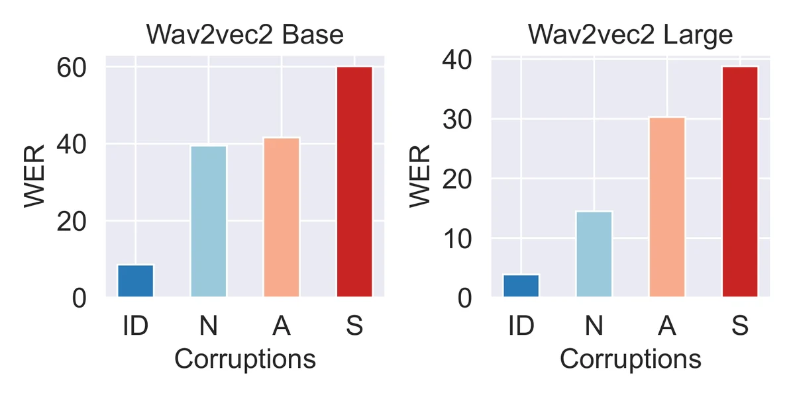
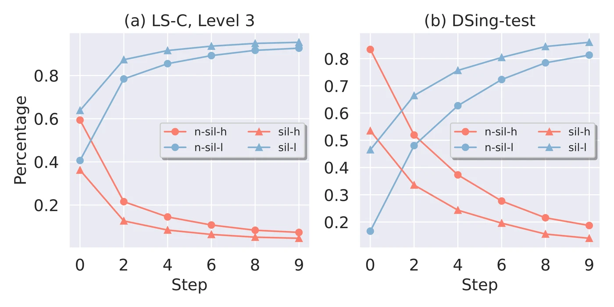
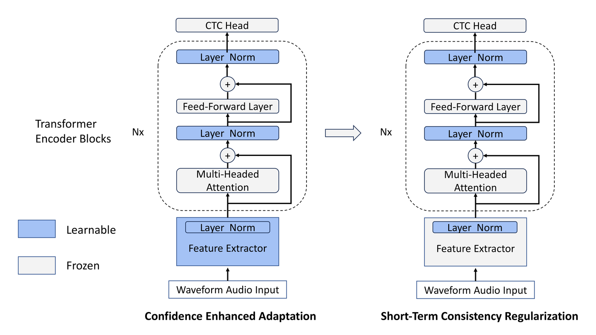

## Abstract

wav2vec 2.0처럼 ASR용으로 fine-tuning한 speech foundation model은 깨끗한 낭독 음성에서는 잘 동작하지만, 강한 noise, 환경음, 비원어민 accent, 노래 같은 큰 shift에서는 크게 나빠진다. SUTA([리뷰](/blog/2026/11/25/suta-review/))는 utterance 하나에 대한 test-time adaptation(TTA)이 도움이 됨을 보였지만, 더 약한 shift에서만 실험했다. 더 어려운 "wild" shift에 대해 vision TTA에는 entropy가 높은 sample을 버려 adaptation을 안정시키는 SAR이 있다. 논문은 이 filtering이 음성에는 맞지 않는다고 주장한다. Noisy speech에서는 entropy가 높은 frame이 바로 단어를 담고 있는 frame인 경우가 많기 때문이다.

제안 방법은 두 부분으로 이루어진다. Confidence-Enhanced Adaptation(CEA)은 non-blank frame의 entropy를 최소화하되, frame의 entropy가 클수록 weight를 키워서 불확실한 frame을 제거하는 대신 더 주목하게 한다. 이어서 Short-Term Consistency Regularization(STCR)은 음성이 짧은 구간에서 천천히 변한다는 점을 이용해 가까운 frame들의 feature를 서로 끌어당긴다. Adaptation은 utterance 하나씩 episodic하게 이루어진다. Gaussian noise, 환경음, L2 accent, sung speech에서 이 방법은 Tent, SAR, TeCo, SUTA, SGEM([리뷰](/blog/2026/11/25/sgem-review/))을 앞서지만, SUTA와의 차이는 작은 경우가 많다.

## Motivation

*In-domain LibriSpeech test-other(ID), 같은 set에 noise를 더한 것(N), L2-Arctic accent(A), DSing sung speech(S)에서 wav2vec 2.0 Base(왼쪽)와 Large(오른쪽)의 WER. 두 크기 모두에서 노래가 가장 어려운 shift이다. 논문 그림.*

첫 번째 관찰은 shift가 크다는 것이다. wav2vec 2.0 Base는 in-domain에서 10% 미만이던 WER이 noise나 accent에서는 약 40%, 노래에서는 약 60%가 된다. Large model은 더 낫지만 순서는 같다.

두 번째 관찰은 어떤 frame이 불확실한가에 관한 것이다. 저자들은 model 자신의 pseudo-label로 frame을 silent(blank로 예측)와 non-silent로 나누고, EATA의 threshold $$0.4 \ln C$$($$C$$는 출력 class 수)로 entropy가 높은 것과 낮은 것으로 나눈다.

*(a) level 3 Gaussian noise를 더한 LibriSpeech test-other와 (b) DSing-test에서, 제안 방법의 10 adaptation step 동안 non-silent(원) 및 silent(삼각형) frame 중 entropy가 높은(빨강) frame과 낮은(파랑) frame의 비율. wav2vec 2.0 Base, 무작위 utterance 100개 평균. 논문 그림.*

Step 0에서 non-silent frame의 대부분은 entropy가 높다. Noisy LibriSpeech에서 59.4%, sung speech에서는 80%가 넘는다. Silent frame은 반대로 대부분 entropy가 낮다. 따라서 entropy가 높은 input을 버리는 SAR 방식의 규칙을 쓰면 음성이 담긴 frame 대부분을 버리게 되는데, 이 frame들이 바로 transcript를 맞히는 데 필요한 frame이다. 그림은 방법이 의도한 효과도 보여 준다. Adaptation이 진행되면서 두 종류의 frame 모두에서 entropy가 높은 비율은 줄고 낮은 비율은 늘어난다.

세 번째로, 음성에 특유한 점이 두 번째 구성 요소의 동기가 된다. 인접한 speech frame은 보통 같은 phoneme에 속하므로 representation도 비슷해야 한다. Vision TTA 방법은 batch 안의 sample을 독립적으로 다루므로 이 구조를 쓰지 않는다.

## Method

*CTC acoustic foundation model에서의 두 단계. Confidence-Enhanced Adaptation은 feature extractor와 transformer의 layer norm(파랑)을 갱신하고, 이어지는 Short-Term Consistency Regularization은 feature extractor를 그 layer norm만 빼고 고정한 채 layer-norm parameter만 갱신한다. 논문 그림.*

### Setting

ASR model은 $$f_{\Theta}(y \mid x) = h_{\theta}(g_{\phi}(x))$$이다. $$g_{\phi}$$는 parameter $$\phi$$를 가진 feature extractor(waveform 위의 CNN), $$h_{\theta}$$는 CTC head가 붙은 transformer encoder이며, $$\Theta = \{\theta, \phi\}$$이다. Input은 $$n$$개 frame으로 된 test utterance $$x_{1:n}$$ 하나이다. Frame $$i$$에 대해 $$\hat{y}^{c}_{i}$$는 class $$c$$의 예측 확률, $$\hat{y}_i$$는 argmax pseudo-label, $$c_0$$는 침묵을 대신하는 blank class이다. Model은 utterance마다 reset된다.

### Confidence-Enhanced Adaptation (CEA)

Frame $$i$$의 불확실성은 prediction entropy이다.

$$
E(x_i) = -\sum_{c} \hat{y}^{c}_{i} \log \hat{y}^{c}_{i}.
$$

CEA는 불확실한 frame을 버리는 threshold 대신, 모든 non-blank frame을 남기고 각 frame에 entropy의 sigmoid로 weight를 준다.

$$
S(x_i) = \frac{1}{1 + \exp(-E(x_i))}\, \mathbb{I}[\hat{y}_i \neq c_0],
$$

$$
\min_{\Theta' = \{\phi,\, \theta_{\text{LN}}\}} \ \sum_{i=1}^{n} S(x_i)\, E(x_i),
$$

여기서 $$\theta_{\text{LN}}$$은 transformer encoder 안 layer norm의 affine(scale과 shift) parameter이다. Blank frame의 weight는 0이다. Speech frame 중에서는 더 불확실한 frame이 더 큰 weight를 받아, 갱신이 그 frame들의 representation을 "denoising"하는 데 집중된다. Normalization parameter만이 아니라 feature extractor 전체를 갱신하는 것은 input 쪽의 큰 covariate shift를 다루기 위해서이다.

### Short-Term Consistency Regularization (STCR)

CEA step들이 끝난 뒤, 두 번째 단계에서는 일반 entropy minimization에 consistency 항을 더한다.

$$
\min_{\Theta_{\text{LN}}} \ \sum_{i=1}^{n} E(x_i) + \alpha \sum_{i=1}^{n-k+1} \lVert z'_{k+i-1} - z'_{i} \rVert_2 \, \mathbb{I}[\hat{y}_i \neq c_0].
$$

여기서 $$\Theta_{\text{LN}}$$은 model 전체의 layer-norm affine parameter, $$z_i$$는 (이미 adapt된) feature extractor에서 나온 frame $$i$$의 feature, $$z'_i$$는 그 feature에 utterance 전체에 대한 parameter-free self-attention을 적용한 것이다. 공개된 code에서는 $$Z' = \mathrm{softmax}(ZZ^{\top})Z + Z$$이다. $$k$$는 window 크기, $$\alpha$$는 regularizer의 weight(0.3)이다. 이 항은 각 non-blank frame의 representation을 window 크기로 정해지는 짧은 고정 간격 뒤의 frame representation 쪽으로 끌어당긴다. 저자들에 따르면 아직 noisy한 representation 사이에 유사성을 강제하면 optimization을 잘못 이끌 수 있으므로, 이 항은 CEA 다음에만 적용한다.

### Default setting

모든 방법은 utterance마다 AdamW로 10 adaptation step을 수행한다. Learning rate는 layer-norm parameter에 대해 $$\{2, 5, 8\} \times 10^{-4}$$, feature extractor에 대해 $$\{2, 5\} \times 10^{-5}$$ 중에서 고른다. SUTA를 따라 hyperparameter는 noise level $$\delta = 0.01$$의 LibriSpeech test-other에서, 노래 실험은 DSing-dev에서 tuning한다. 기본은 greedy decoding이며, beam search 비교에는 SGEM과 같은 4-gram language model을 쓴다.

## Main Experiments

주 model은 LibriSpeech 960h로 fine-tuning한 wav2vec 2.0(Base, 노래에는 Large도)이다. Baseline은 Tent(여기서는 layer-norm affine parameter에 대한 entropy minimization), TeCo(video TTA의 temporal coherence regularization), SAR, SUTA, SGEM이다. 지표는 WER(%)이다.

**LS-C: Gaussian noise를 더한 LibriSpeech test-other, wav2vec 2.0 Base, greedy decoding, WER(%), Table 1에서 발췌**

| Method | Level 0 | Level 1 | Level 2 | Level 3 | Level 4 | Level 5 | Average |
|---|---|---|---|---|---|---|---|
| Noise amplitude $$\delta$$ | 0 | 0.005 | 0.01 | 0.015 | 0.02 | 0.03 | |
| Source | 8.6 | 13.9 | 24.4 | 39.5 | 54.5 | 75.7 | 31.6 |
| Tent | 7.7 | 11.6 | 19.7 | 32.2 | 46.3 | 69.2 | 31.1 |
| SAR | 8.2 | 12.7 | 21.5 | 35.0 | 49.2 | 72.0 | 33.1 |
| TeCo | 7.6 | 13.6 | 19.7 | 32.2 | 46.3 | 69.3 | 31.5 |
| SUTA | 7.3 | 10.9 | 16.7 | 24.6 | 34.7 | 56.5 | 25.1 |
| **Ours** | 7.3 | 10.7 | 16.2 | 24.0 | 34.1 | 56.5 | **24.8** |

Average 열은 논문에 인쇄된 그대로 옮겼다. Adapt된 모든 행에서는 여섯 level의 평균과 같지만, Source 행의 여섯 값은 평균이 31.6이 아니라 36.1이다. 따라서 인쇄된 source 평균(과 논문이 그로부터 계산한 21.5%의 평균 상대 향상)은 오타로 보인다. Entropy가 높은 input을 거르는 SAR은 Tent보다 훨씬 적게 향상되며, 이는 motivation을 뒷받침한다. SUTA 대비 향상은 level당 0.2에서 0.6포인트이고, level 0과 5에서는 0이다.

**LS-P: 다섯 SNR(dB)의 환경음을 더한 LibriSpeech test-other, wav2vec 2.0 Base, WER(%), Table 2와 3에서 발췌**

| Method | AC 10 | AC 5 | AC 0 | AC -5 | AC -10 | TP 10 | TP 5 | TP 0 | TP -5 | TP -10 |
|---|---|---|---|---|---|---|---|---|---|---|
| Source | 28.1 | 43.9 | 65.0 | 83.4 | 94.2 | 26.2 | 34.0 | 44.4 | 56.4 | 69.0 |
| Tent | 22.6 | 36.1 | 56.6 | 77.9 | 91.4 | 21.0 | 27.9 | 37.0 | 49.2 | 63.0 |
| SAR | 24.5 | 39.1 | 59.9 | 79.9 | 92.1 | 23.0 | 30.3 | 39.7 | 52.1 | 65.3 |
| TeCo | 22.5 | 36.2 | 56.6 | 77.9 | 91.3 | 21.0 | 27.8 | 37.0 | 49.1 | 63.0 |
| SUTA | 17.7 | 26.1 | 41.2 | 62.7 | 82.7 | 17.9 | 23.3 | 30.4 | 41.0 | 53.4 |
| **Ours** | **17.5** | **25.6** | **40.6** | **61.6** | **82.2** | **17.5** | **22.8** | **29.9** | **40.4** | **52.6** |

AC는 air conditioner, TP는 typing이며, 나머지 여섯 소리는 appendix에 있다. 5 dB air conditioner noise에서 이 방법은 WER을 43.9에서 25.6으로 줄여 41.7%의 상대 감소를 얻지만, 그 대부분은 SUTA(26.1)로도 얻어진다.

**Sung speech, WER(%), Table 4에서 발췌**

| Decoding | Method | DSing-dev Base | DSing-dev Large | DSing-test Base | DSing-test Large | Hansen Base | Hansen Large | Avg. Base | Avg. Large |
|---|---|---|---|---|---|---|---|---|---|
| Greedy | Source | 61.8 | 40.6 | 60.1 | 38.8 | 64.3 | 43.7 | 62.1 | 41.0 |
| Greedy | Tent | 55.7 | 34.8 | 56.1 | 33.2 | 60.2 | 39.1 | 57.3 | 35.7 |
| Greedy | SAR | 58.8 | 40.6 | 57.2 | 38.2 | 62.7 | 42.7 | 59.6 | 40.5 |
| Greedy | TeCo | 56.2 | 35.0 | 55.6 | 33.1 | 60.0 | 39.1 | 57.3 | 35.7 |
| Greedy | SUTA | 53.9 | 34.9 | 51.3 | 33.6 | **58.0** | 39.3 | 54.4 | 35.9 |
| Greedy | **Ours** | **53.5** | **34.0** | **50.1** | **31.2** | **58.0** | **37.9** | **53.9** | **34.4** |
| Beam search | Source+LM | 58.6 | 41.1 | 55.3 | 37.6 | 60.1 | 43.5 | 58.0 | 40.7 |
| Beam search | SGEM | 54.4 | 34.4 | 50.8 | 33.0 | 57.8 | 38.6 | 54.3 | 35.3 |
| Beam search | **Ours+LM** | **53.2** | **33.3** | **50.0** | **30.3** | **57.7** | **37.5** | **53.6** | **33.7** |

Base와 Large는 wav2vec 2.0 Base와 Large이다. 노래는 adaptation 후에도 어렵다. Base의 가장 좋은 결과도 WER이 여전히 50%를 넘는다. SUTA 대비 가장 큰 향상은 Large model에서 나온다(greedy decoding 평균 35.9에서 34.4). Greedy decoding만으로도 beam search를 쓴 SGEM을 평균에서 앞서며, 같은 language model을 더하면 조금 더 좋아진다. LibriSpeech로 학습한 4-gram LM은 Large source model을 오히려 나쁘게 만드는데(DSing-dev에서 41.1 대 40.6), 이는 여기 있는 어떤 방법도 adapt하지 않는 text-domain shift의 징후이다.

**다른 ASR architecture, DSing-test, WER(%), Table 5에서 발췌**

| Method | Conformer-CTC | Conformer-Transducer |
|---|---|---|
| Source | 62.2 | 48.8 |
| SUTA | 55.9 | 44.8 |
| SGEM | 55.7 | 44.5 |
| **Ours** | **55.4** | **43.0** |

SGEM 논문에서 쓴 것과 같은 두 Conformer model이다.

**Ablation, wav2vec 2.0 Base, greedy decoding, WER(%), Table 6에서 발췌**

| Method | Noise | Accent | Singing |
|---|---|---|---|
| **Ours** | **24.0** | **23.0** | **50.1** |
| w/o STCR | 25.1 | 23.4 | 51.0 |
| w/o CEA | 35.9 | 26.9 | 54.5 |

CEA를 빼는 것이 STCR을 빼는 것보다 훨씬 손해가 크다. Noise와 Singing 열은 위 표의 LS-C level 3, DSing-test와 같은 값이다. Appendix에는 DSing-test에서의 관련 확인이 두 가지 더 있다. Non-silent frame만 weighting하는 것(50.1)이 silent frame만(51.7) 또는 모든 frame(50.6)보다 좋고, SUTA에 STCR을 더하면 51.3에서 50.9로 좋아지지만 여전히 CEA와 STCR 조합보다 뒤진다. L2-Arctic(appendix에 화자별로 보고)과 CHiME-3(SUTA 25.0 대 24.5)에서도 이 방법이 SUTA보다 조금 앞선다.

## Limitations

- **SUTA 대비 작은 차이.** Noise, accent, CHiME-3에서 SUTA 대비 향상은 보통 0.몇 포인트이며, 일부 L2-Arctic 화자와 noise level에서는 SUTA가 같거나 앞선다. 결과는 variance 없는 단일 run이다.
- **Headline 결과 표의 오류.** LS-C에 인쇄된 source 평균(31.6)은 여섯 값(평균 36.1)과 맞지 않으며, 논문의 21.5% 평균 상대 향상은 이 값으로 계산되었다.
- **Weighting이 약하다.** Entropy는 음수가 아니므로 non-blank frame의 sigmoid weight $$S(x_i)$$는 0.5와 1 사이에 있다. 즉 가장 불확실한 frame도 가장 확신 있는 frame의 최대 두 배 weight밖에 받지 못한다. CEA 효과의 상당 부분은 blank frame 제외와 feature extractor 갱신에서 올 수 있지만, 논문은 weight 자체의 효과를 따로 분리하지 않는다.
- **Blank를 침묵으로 간주.** 침묵을 CTC blank label로 근사하는데, blank는 단어 안의 글자 사이 frame도 포함한다. 저자들도 이를 언급하지만 실제 voice activity detector와 비교하지는 않는다.
- **느린 adaptation(일부는 저자들이 명시).** DSing-test에서 adaptation은 utterance당 0.879초로, SUTA의 0.483초, Tent의 0.328초보다 길다. 이 방법은 streaming을 위해 설계되지 않았으며, 저자들은 이를 future work로 든다.
- **주로 CTC encoder.** 주 실험은 CTC head를 단 wav2vec 2.0, HuBERT, WavLM과 작은 Conformer 확인 실험이다. Adaptation 실험에 Whisper 같은 attention encoder-decoder model은 없고, language model은 text-domain shift에 맞게 adapt되지 않는다(저자들이 명시).
- **Test data에서 tuning한 hyperparameter.** SUTA처럼 설정을 noisy LibriSpeech의 한 level에서 tuning하고, 노래는 결과 표에도 보고되는 DSing-dev에서 tuning한다.

## My Thoughts

<!-- TODO -->
