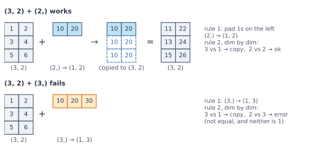
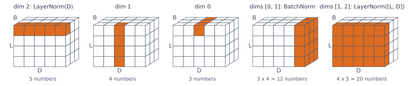
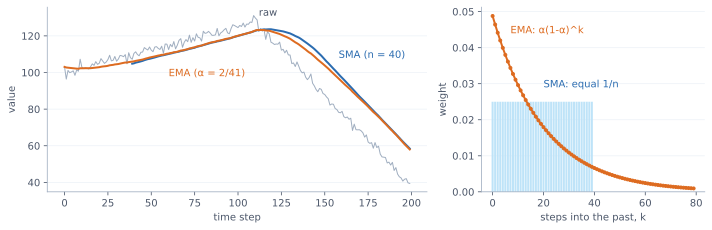

<ul class="post-sources">
<li markdown="span">[임커밋](https://www.youtube.com/@%EC%9E%84%EC%BB%A4%EB%B0%8B/videos)의 [딥러닝 / 머신러닝](https://www.youtube.com/playlist?list=PL6R2CbVlhcYsmmpXWDXTZbVo4pTM0ptR_) 강의 정리</li>
</ul>

## nn.Linear: 행렬곱과 벡터합

[▶ 딥러닝 공부의 제일 기본: nn.Linear](https://www.youtube.com/watch?v=zj8_UbOAKkk)

`nn.Linear`는 논문과 코드에서 fully connected layer(fc layer), dense layer, linear layer, projection 등 여러 이름으로 불린다. 이름은 많아도 계산은 하나이다. **weight 행렬을 곱하고 bias 벡터를 더한다.**

$$
\mathbf{y} = W\mathbf{x} + \mathbf{b}, \qquad \mathbf{x} \in \mathbb{R}^{n},\ W \in \mathbb{R}^{m \times n},\ \mathbf{b}, \mathbf{y} \in \mathbb{R}^{m}
$$

`nn.Linear(n, m)`의 두 인자는 입력과 출력의 원소 수이다. 예를 들어 `nn.Linear(5, 9)`는 $$9 \times 5$$ 행렬 $$W$$와 숫자 9개의 벡터 $$\mathbf{b}$$를 가진다. 행렬곱의 단위 작업은 "위치별로 곱해서 모두 더하기"이다. 입력 5개와 $$W$$의 한 행을 곱해 더하면 숫자 하나가 나오고, 이것을 행마다 9번 하면 숫자 9개가 나온다. 따로 초기화하지 않으면 $$W$$와 $$\mathbf{b}$$의 값은 균등 분포에서 샘플링된다.

쓸 때 알아 둘 점은 세 가지이다.

1. **입력의 원소 수를 맞춘다.** `nn.Linear(5, 9)`에 원소 6개인 벡터를 넣으면 행렬곱이 성립하지 않아 오류가 난다.
2. **`bias=False`로 bias를 뺄 수 있다.** 그러면 $$\mathbf{y} = W\mathbf{x}$$만 계산한다.
3. **맞춰야 하는 것은 맨 마지막 차원이다.** 앞의 차원들은 벡터의 개수로 취급된다. shape가 $$[6, 7, 5]$$인 텐서는 5차원 벡터가 $$6 \times 7 = 42$$개 있는 것으로 보고, 각 벡터에 같은 $$W$$와 $$\mathbf{b}$$를 적용해 $$[6, 7, 9]$$를 내놓는다.

세 번째 성질 덕분에 `nn.Linear`는 시퀀스의 위치마다 따로 적용되는 모듈로 쓰인다. [강의 2](/blog/2026/10/24/imc-02-cnn/)의 CNN은 이 행렬곱을 인접한 위치까지 확장한 것이고, [강의 3](/blog/2026/10/24/imc-03-attention/)의 $$W_Q$$, $$W_K$$, $$W_V$$와 FFN이 바로 이 모듈이다.

```python
import math
import torch
import torch.nn as nn

fc = nn.Linear(5, 9)
print(fc.weight.shape, fc.bias.shape)        # [9, 5], [9]

x = torch.tensor([0.1, 0.2, 0.3, 0.4, 0.5])
print(torch.allclose(fc(x), fc.weight @ x + fc.bias))   # True
print(fc(torch.ones(6, 7, 5)).shape)         # [6, 7, 9]
# fc(torch.ones(6))                          # RuntimeError: 행렬곱 shape 불일치
```

## 학습 코드 읽기: 모델은 언제 바뀌는가

[▶ 쫌더 친절한 딥러닝 1](https://www.youtube.com/watch?v=QoAq1hLYzMg)

입문 예제의 학습 코드는 몇 줄로 끝나서 따라 쓰기 쉽다. 하지만 예제를 응용하려면 각 줄이 무엇을 연결하는지 알아야 한다. 데이터셋을 바꾸려면 어디를, 모델과 loss를 바꾸려면 어디를 고칠지 알아야 하기 때문이다. 학습은 세 요소 **데이터, 모델, optimizer**를 준비한 뒤 다음을 반복하는 것이다.

1. 데이터에서 입력과 정답을 꺼내 실험 설정에 맞게 준비한다.
2. 입력을 모델에 넣어 출력을 얻는다.
3. 출력과 정답을 비교해 loss를 구하고, 그 결과로 optimizer가 weight를 업데이트한다.

PyTorch 공식 MNIST 예제가 전형적인 형태이다. 준비 단계의 요소는 다음과 같다.

| 요소 | 하는 일 |
|---|---|
| `torch.cuda.is_available()`, `device` | 쓸 수 있는 GPU가 있는지 보고 계산 장치를 정한다 |
| `torch.manual_seed` | 데이터 순서, 초기값 같은 무작위 요소의 기준을 고정한다 |
| `transforms` | 데이터를 텐서로 바꾸고 데이터셋의 평균(0.1307)과 표준편차(0.3081)로 정규화한다 |
| `DataLoader` | 데이터셋을 batch 단위로 내준다. `shuffle`은 epoch마다 batch 조합을 섞고, `num_workers`는 데이터를 준비할 CPU 프로세스 수, `pin_memory`는 GPU로의 복사를 빠르게 하는 옵션이다 |
| `model.to(device)` | 모델을 정한 장치에 올린다 |
| `optimizer` | **모델 파라미터의 목록**과 learning rate(한 번에 얼마나 크게 업데이트할지)를 받는다 |
| `scheduler` | 학습 중 learning rate를 조절한다. 없어도 동작하지만 학습에 도움이 된다 |

학습 루프를 보면 이상한 점이 있다. `loss.backward()`와 `optimizer.step()` 어디에도 `model`이 없는데 모델이 학습된다. 이것을 푸는 열쇠가 준비 단계에 있다.

- `optimizer`는 선언될 때 `model.parameters()`를 받아서 **파라미터 텐서 자체를 참조**로 들고 있다. 그래서 `step()`이 모델의 weight를 직접 바꿀 수 있다.
- `loss`는 다음 절에서 볼 **계산 그래프**로 모델 파라미터까지 이어져 있다. 그래서 `backward()`가 각 파라미터의 `.grad`를 채울 수 있다.

```python
torch.manual_seed(0)
X = torch.randn(256, 4)
Y = X @ torch.tensor([1.0, -2.0, 3.0, 0.5]) + 0.7          # 맞혀야 할 관계
loader = torch.utils.data.DataLoader(
    torch.utils.data.TensorDataset(X, Y.unsqueeze(1)), batch_size=32, shuffle=True)

model = nn.Sequential(nn.Linear(4, 16), nn.ReLU(), nn.Linear(16, 1))
optimizer = torch.optim.Adam(model.parameters(), lr=1e-2)
scheduler = torch.optim.lr_scheduler.StepLR(optimizer, step_size=10, gamma=0.5)
print(optimizer.param_groups[0]["params"][0] is model[0].weight)   # True: 같은 객체

for epoch in range(30):
    for xb, yb in loader:
        optimizer.zero_grad()                         # 이전 gradient 지우기
        loss = nn.functional.mse_loss(model(xb), yb)  # forward + loss
        loss.backward()                               # 각 파라미터의 .grad 채우기
        optimizer.step()                              # .grad로 파라미터 업데이트
    scheduler.step()
print(loss.item() < 0.5)                              # True: 학습이 된다
```

실제 연구에서는 MNIST와 간단한 CNN에 머물지 않는다. 더 복잡한 데이터에는 `Dataset`과 `DataLoader`를, 더 복잡한 구조에는 모델을, 다른 목적에는 loss를 직접 설계한다. 위 표와 루프의 어느 칸을 바꾸는 일인지 알면 응용의 출발점이 된다.

## forward, loss, backward의 동선

[▶ 동선 추적 (forward, loss, backward)](https://www.youtube.com/watch?v=yZgK9FA9_rA)

학습 코드의 동작은 왕복 길찾기와 닮았다. 목적지(loss)까지 가는 동안 갈림길마다 돌아올 길을 표시해 두고, 돌아올 때(역전파) 그 표시를 따라간다. PyTorch에서 표시는 forward 계산 중에 자동으로 남는다.

연산 결과 텐서의 `grad_fn`은 그 텐서를 만든 연산의 역방향 함수이고, `grad_fn.next_functions`는 그 직전 단계들을 가리킨다. 이것을 따라가면 **계산 그래프(computational graph)**를 거꾸로 걷게 된다. 끝에서 만나는 `AccumulateGrad`는 파라미터에 gradient를 쌓는 노드이다. 입력 데이터처럼 gradient가 필요 없는 쪽은 갈 곳이 없어 `None`이다.

`nn.Linear` 두 개를 통과하는 계산을 행렬 연산으로 직접 써서 따라가 보자. (`nn.Linear` 출력의 `grad_fn` 이름은 PyTorch 버전과 입력 shape에 따라 다르게 보이므로, 구조가 잘 드러나도록 풀어 썼다.)

```python
W1, b1 = nn.Parameter(torch.randn(3, 4)), nn.Parameter(torch.randn(3))
W2, b2 = nn.Parameter(torch.randn(2, 3)), nn.Parameter(torch.randn(2))
a = torch.randn(4)

o1 = W1 @ a + b1
o2 = W2 @ o1 + b2
loss = o2.mean()

print(o1.grad_fn)                 # AddBackward0: o1을 만든 마지막 연산
add1 = o1.grad_fn
mv1, acc_b1 = (f for f, _ in add1.next_functions)
print(mv1, acc_b1)                # MvBackward0, AccumulateGrad(b1 쪽)
print(mv1.next_functions)         # (AccumulateGrad(W1 쪽), 0), (None, 0): a로는 갈 곳이 없다
print(mv1.next_functions[0][0].variable is W1)            # True

mv2 = o2.grad_fn.next_functions[0][0]
print(mv2.next_functions[1][0] is o1.grad_fn)             # True: o2의 길이 o1의 길로 이어진다

print(W2.grad)                    # None: backward 전
print(mv1._saved_vec.shape)       # torch.Size([4]): 미분에 쓸 값이 저장되어 있다
loss.backward()
print(W2.grad.shape)              # torch.Size([2, 3]): 역전파가 채운 gradient
# mv1._saved_vec                  # RuntimeError: backward 후에는 해제된다
```

`loss.backward()`는 loss의 `grad_fn`에서 출발해 `next_functions`를 따라가며 gradient를 계산하고, 파라미터의 `.grad`에 값을 넣는다. 그 값을 `optimizer.step()`이 쓴다.

역전파에 필요해서 저장해 둔 중간값(`_saved_*`)은 backward가 끝나면 해제된다. 돌아오면서 표시를 치우는 셈이다. 중간값은 모두 메모리이고 보통 다시 쓸 일이 없기 때문이다. 같은 그래프로 다시 backward를 하면 오류가 나는 이유이기도 하다(필요하면 `retain_graph=True`를 준다). 또한 `AccumulateGrad`라는 이름대로 gradient는 `.grad`에 **더해지므로**, 지우지 않으면 쌓인다. 그래서 `zero_grad()`가 필요하고, 뒤에서 볼 gradient accumulation은 이 성질을 이용한다.

## Broadcasting

[▶ 시각화로 쉽게 이해하는 broadcasting](https://www.youtube.com/watch?v=qebDZAYBLuk)

**broadcasting**은 두 텐서의 연산에서 shape가 다를 때, 한쪽을 복사한 것처럼 취급해 shape를 맞추는 규칙이다. shape가 $$(3, 2)$$인 텐서에 $$(2,)$$는 더할 수 있지만 $$(3,)$$은 더할 수 없다. 언제 되는지는 규칙 두 개로 모두 판단할 수 있다.

**규칙 1: 차원 수 맞추기.** 차원 수는 shape에 적힌 숫자의 개수이다. 차원 수가 다르면 작은 쪽 shape의 **앞에** 1을 붙여 맞춘다.

**규칙 2: 차원별로 비교하기.** 각 차원에서 두 숫자는 **같거나, 어느 한쪽이 1**이어야 한다. 같으면 나란히 계산하고, 한쪽이 1이면 다른 쪽의 크기만큼 복사한다. 둘 다 아니면 오류이다.


*처음 질문의 답. $$(2,)$$는 앞에 1을 붙여 $$(1, 2)$$가 되고, 첫 차원을 복사해 $$(3, 2)$$와 나란해진다. $$(3,)$$은 $$(1, 3)$$이 되는데 마지막 차원이 2와 3이고 어느 쪽도 1이 아니라서 오류가 난다. 앞에 1을 붙인다는 규칙 때문에 **뒤에서부터** 맞춰 보게 된다는 점이 핵심이다.*

복잡해 보이는 경우도 절차는 같다. $$(7, 1, 4, 1)$$과 $$(8, 4, 6)$$을 더해 보자.

| 차원 | 0 | 1 | 2 | 3 |
|---|---|---|---|---|
| 첫 번째 | 7 | 1 | 4 | 1 |
| 두 번째 (규칙 1) | 1 | 8 | 4 | 6 |
| 판정 (규칙 2) | 복사 | 복사 | 같음 | 복사 |
| 결과 | 7 | 8 | 4 | 6 |

```python
print((torch.ones(3, 2) + torch.ones(2)).shape)                # [3, 2]
print((torch.ones(7, 1, 4, 1) + torch.ones(8, 4, 6)).shape)    # [7, 8, 4, 6]
# torch.ones(3, 2) + torch.ones(3)                             # RuntimeError
print(torch.broadcast_shapes((7, 1, 4, 1), (8, 4, 6)))         # 계산 없이 shape만 확인
```

## 정규화 레이어

### 정규화 차원과 LayerNorm

[▶ 시각화로 이해하는 LayerNorm](https://www.youtube.com/watch?v=r7DRvHmHcNU)

먼저 용어를 정리한다. 데이터 분석에서는 **정규화(normalization)**와 **표준화(standardization)**를 구별하는데, 딥러닝의 BatchNorm과 LayerNorm은 이름과 달리 수식상 표준화, 즉 평균을 빼고 표준편차로 나누는 일을 한다. 관례대로 여기서도 정규화라고 부른다. 결과는 평균 0, 표준편차 1이다.

**정규화 차원**은 평균과 표준편차를 구하는 범위이다. shape가 $$[B, L, D] = [3, 4, 5]$$인 텐서를 생각하자. 이 텐서는 $$[4, 5]$$ 행렬 3개이고, 각 행렬은 5차원 벡터 4개이다.

- 차원 2로 정규화하면 $$D$$ 방향의 숫자 5개마다, 차원 1이면 $$L$$ 방향의 4개마다, 차원 0이면 $$B$$ 방향의 3개마다 평균과 표준편차를 구한다.
- 여러 차원도 가능하다. 차원 $$[0, 1]$$이면 $$3 \times 4 = 12$$개, $$[0, 2]$$이면 $$3 \times 5 = 15$$개를 한 묶음으로 쓴다.

**LayerNorm**의 설명에서 자주 쓰는 그림은 이 텐서의 높이와 너비에 해당하는 **면**을 칠해 두 차원에 걸친 정규화처럼 보여 준다. 이 그림은 CNN 특징 맵을 다룬 Group Normalization 논문에서 널리 퍼졌고, PyTorch 문서에도 실려 있다. 하지만 시퀀스 모델에서 흔히 쓰는 `nn.LayerNorm(D)`는 **마지막 차원 하나**만 정규화한다. 그림의 면이 아니라 **선**이다. 벡터 하나하나를 자기 자신의 $$D$$개 숫자로 정규화하는 것이다.

$$
\mu = \frac{1}{D}\sum_{j=1}^{D} x_j, \qquad
\sigma^2 = \frac{1}{D}\sum_{j=1}^{D} (x_j - \mu)^2, \qquad
y_j = \gamma_j \frac{x_j - \mu}{\sqrt{\sigma^2 + \epsilon}} + \beta_j
$$

$$\epsilon$$은 0으로 나누는 것을 막는 작은 수이고, $$\gamma_j, \beta_j$$는 학습되는 파라미터이다. 면으로 정규화하려면 `nn.LayerNorm([L, D])`처럼 리스트로 뒤쪽 차원들을 명시해야 한다. 표현상 가능하지만 Transformer 계열에서는 거의 쓰지 않는다.


*$$[B, L, D]$$ 텐서에서 평균과 표준편차를 한 번 구할 때 쓰는 칸(주황). 맨 왼쪽의 선이 보통 쓰는 `nn.LayerNorm(D)`이고, 맨 오른쪽의 면이 흔히 그려지는 그림에 해당하는 `nn.LayerNorm([L, D])`이다. 네 번째 면은 `(B, D, L)`로 차원을 바꿔 넣은 `nn.BatchNorm1d(D)`가 채널마다 쓰는 범위이다.*

```python
x = torch.randn(3, 4, 5)                               # [B, L, D]
ln = nn.LayerNorm(5, elementwise_affine=False)         # 학습 파라미터 없이 정규화만
mean = x.mean(dim=-1, keepdim=True)
var = x.var(dim=-1, keepdim=True, unbiased=False)
print(torch.allclose(ln(x), (x - mean) / (var + 1e-5).sqrt(), atol=1e-5))   # True

print(nn.LayerNorm(5).weight.shape, nn.LayerNorm([4, 5]).weight.shape)      # [5], [4, 5]
```

### BatchNorm: 학습과 추론이 다른 이유

[▶ 그냥 쓰는거...라고 하면 떨어질 것 같은데.. (BatchNorm)](https://www.youtube.com/watch?v=LpXeOt3xmhM)

**BatchNorm(batch normalization)**은 면접에 자주 나오는데, 질문은 대체로 세 가지이다. 무엇이 학습되는가, 학습과 추론의 동작은 왜 다른가, 왜 쓰는가.

계산은 두 단계이다. **정규화**를 하고, 채널마다 **곱하고 더한다**. $$(N, C)$$ 입력의 채널 $$c$$에 대해 $$N$$개 샘플로

$$
y_c = \gamma_c \frac{x_c - \mu_c}{\sqrt{\sigma_c^2 + \epsilon}} + \beta_c
$$

이다. **무엇이 학습되는가.** 곱하고 더하는 $$\gamma_c, \beta_c$$(코드의 `weight`, `bias`)는 학습 파라미터이다. 학습 중의 $$\mu_c, \sigma_c^2$$는 현재 mini-batch 자신에게서 구하므로 저장할 값이 아니다. 대신 **학습되지 않는 파라미터**로 `running_mean`, `running_var`가 있다(PyTorch에서는 parameter가 아니라 buffer이다).

**학습과 추론이 다른 이유.** 추론 때는 학습의 mini-batch 같은 개념이 없다. 입력이 하나뿐일 수도 있고, 여러 요청이 함께 왔더라도 데이터셋을 대표하는 표본이라고 볼 수 없다. 그래서 학습 중에 mini-batch 통계를 iteration마다 몰래 누적해 두었다가, eval 모드에서는 그 값으로 정규화한다. PyTorch의 기본값(`momentum=0.1`)으로 누적은 다음과 같고, 이는 뒤에서 볼 EMA이다.

$$
\mu_\text{running} \leftarrow 0.9\, \mu_\text{running} + 0.1\, \mu_\text{batch}
$$

**왜 쓰는가.** 원 논문의 설명은 **내부 공변량 변화(internal covariate shift)**이다. 레이어 fc1 뒤에 fc2가 이어진다고 하자. 한 step에서 fc2는 지금 받은 입력에 대해 loss가 줄어들도록 업데이트되는데, 같은 step에 fc1도 업데이트되므로 다음 step의 fc2는 특성이 달라진 입력을 받는다. 뒤쪽 모듈 입장에서는 풀어야 할 문제가 계속 움직이는 셈이라 학습이 불안정하고 느려진다.

BatchNorm을 넣으면 뒤쪽 모듈의 입력은 채널마다 평균 $$\beta_c$$, 표준편차 $$\lvert\gamma_c\rvert$$로 고정된다. 앞쪽 레이어가 바뀌어도 분포의 처음 두 모멘트는 이 두 값으로만 움직이고, 이 두 값은 천천히 업데이트되므로 입력의 흔들림이 줄어든다. (이 설명이 효과의 전부인지는 논쟁이 있다. Santurkar et al. (2018)은 BatchNorm의 주된 효과가 loss 지형을 매끄럽게 하는 데 있다고 주장한다.)

```python
bn = nn.BatchNorm1d(3)
print([n for n, _ in bn.named_parameters()])   # ['weight', 'bias']: 학습됨
print([n for n, _ in bn.named_buffers()])      # running_mean, running_var, num_batches_tracked

x = torch.randn(32, 3) * 2 + 5
bn(x)                                          # train 모드: x 자신의 통계로 정규화하고 누적
print(torch.allclose(bn.running_mean, 0.1 * x.mean(0)))   # True: 초기값 0에서 한 번 누적

# bn(torch.randn(1, 3))                        # train 모드에서 샘플 1개는 ValueError
bn.eval()
print(bn(torch.randn(1, 3)).shape)             # [1, 3]: eval 모드는 저장된 통계를 쓴다
```

| | BatchNorm | LayerNorm (보통 쓰는 형태) |
|---|---|---|
| 정규화 범위 | 채널별, batch 축을 포함 | 벡터별, 마지막 차원 |
| 샘플끼리 영향 | 있음 | 없음 |
| 학습 / 추론 동작 | 다름 (running 통계) | 같음 |
| 학습 파라미터 | $$\gamma, \beta$$ (채널 수만큼) | $$\gamma, \beta$$ (마지막 차원 크기만큼) |

## softmax의 최댓값 빼기

[▶ softmax에 숨어있던 잡기술](https://www.youtube.com/watch?v=SAHGsTbZGyA)

[강의 3](/blog/2026/10/24/imc-03-attention/)에서 attention 가중치를 만든 softmax에는 불안한 곳이 있다. $$e^{1} \approx 2.7$$이지만 $$e^{10}$$은 이미 2만이 넘는다. 레이어 중간의 값이 학습 중에 얼마나 커질지 미리 알 수 없는 상황에서, 지수 함수는 쉽게 수의 표현 범위를 벗어난다.

해결책은 간단하다. 입력의 최댓값 $$C = \max_j x_j$$를 정하고 분자와 분모에 $$e^{-C}$$를 곱한다. 전체에 1을 곱한 것이므로 수학적으로 값은 같다.

$$
\frac{e^{x_i}}{\sum_j e^{x_j}}
= \frac{e^{x_i} e^{-C}}{\sum_j e^{x_j} e^{-C}}
= \frac{e^{x_i - C}}{\sum_j e^{x_j - C}}
$$

이제 지수의 입력은 모두 0 이하이므로 각 항은 1을 넘지 않고, 최댓값 항은 정확히 $$e^0 = 1$$이다. 그래서 분모는 $$1$$ 이상 $$n$$ 이하에 머문다. 수식은 같아도 오차와 한계가 있는 컴퓨터 계산에서는 큰 차이가 난다.

`float16`이 잘 보여 준다. 표현할 수 있는 최댓값이 65504인데 $$e^{12} \approx 162755$$이다. $$[10, 11, 12]$$와 $$[0, 1, 2]$$의 softmax는 이론상 같지만, 그대로 계산하면 앞의 것은 무한대가 나와 망가진다. 최댓값을 빼면 둘 다 $$[-2, -1, 0]$$의 계산이 되어 결과가 같다. 분모가 1 이상이므로 입력이 모두 큰 음수일 때 분모가 0으로 사라지는 문제도 함께 막힌다.

```python
def naive_softmax(x):
    e = x.exp()
    return e / e.sum()

def safe_softmax(x):
    e = (x - x.max()).exp()
    return e / e.sum()

for v in ([0., 1., 2.], [10., 11., 12.], [-20., -21., -22.]):
    x = torch.tensor(v, dtype=torch.float16)
    print(naive_softmax(x), safe_softmax(x))
# [0.0900, 0.2448, 0.6650]  [0.0901, 0.2448, 0.6655]
# [0., 0., nan]             [0.0901, 0.2448, 0.6655]   exp(12)이 inf
# [nan, nan, nan]           [0.6655, 0.2448, 0.0901]   exp 값이 모두 0으로 사라져 0/0
```

같은 발상은 고속 attention 구현 FlashAttention의 토대가 되기도 한다. 딥러닝 코드에는 이렇게 수식에 드러나지 않는 수치 안정화 기법이 곳곳에 숨어 있다.

## Gaussian sampling: uniform에서 정규분포로

[▶ uniform 주고 사기치는 거 아님? (Gaussian sampling)](https://www.youtube.com/watch?v=0H1KhishPJM)

[VAE](/blog/2026/10/24/imc-06-vae/)나 [diffusion](/blog/2026/10/24/imc-10-diffusion/)은 Gaussian 분포에서 끝없이 샘플을 뽑는다. `torch.randn` 한 줄로 끝나지만, 어떻게 뽑는 걸까? 대표적인 방법인 **Box-Muller 변환(Box-Muller transform)**을 보자. $$[0, 1)$$의 균등 분포 샘플은 쉽게 얻을 수 있다고 가정한다.

### 확률 변수를 함수에 통과시키면

확률 변수 $$X$$를 함수 $$f$$에 통과시킨 $$Y = f(X)$$는 또 다른 분포를 따르는 확률 변수이다. $$X \sim \mathrm{Uniform}(0, 1)$$일 때,

- $$Y = 3X$$는 $$[0, 3]$$의 균등 분포이다.
- $$Y = \sqrt{X}$$는 $$[0, 1]$$ 사이의 값이지만 균등하지 않다. $$P(Y \le y) = P(X \le y^2) = y^2$$이므로 밀도가 $$2y$$이다.

입력이 둘이어도 된다. 서로 독립인 $$X_1, X_2 \sim \mathrm{Uniform}(0, 1)$$로 $$Y = X_1 - X_2$$를 만들면 $$[-1, 1]$$에서 밀도가 $$1 - \lvert y \rvert$$인 삼각형 분포이다. 즉 둘을 뽑아 빼는 것은 삼각형 분포에서 샘플을 뽑는 것과 같다.

### Box-Muller 변환

Gaussian을 만드는 함수는 다음과 같다. 독립인 $$U_1, U_2 \sim \mathrm{Uniform}(0, 1)$$에 대해

$$
Z_1 = \sqrt{-2 \ln U_1}\, \cos(2\pi U_2), \qquad
Z_2 = \sqrt{-2 \ln U_1}\, \sin(2\pi U_2)
$$

는 서로 독립인 $$\mathcal{N}(0, 1)$$ 샘플이다. 하나만 필요하면 $$Z_1$$만 쓴다.

이유는 극좌표로 보면 드러난다. 독립인 표준 정규 변수 두 개의 결합 밀도를 $$z_1 = r\cos\theta$$, $$z_2 = r\sin\theta$$로 바꾸면 ($$dz_1\, dz_2 = r\, dr\, d\theta$$)

$$
\frac{1}{2\pi} e^{-(z_1^2 + z_2^2)/2}\, dz_1\, dz_2
= \underbrace{\frac{1}{2\pi}\, d\theta}_{\Theta} \cdot \underbrace{r e^{-r^2/2}\, dr}_{R}
$$

로 나뉜다. 즉 각도 $$\Theta$$는 $$[0, 2\pi)$$의 균등 분포이고, 반지름 $$R$$은 $$P(R > r) = e^{-r^2/2}$$인 분포로 서로 독립이다. 각도는 $$2\pi U_2$$로 바로 얻는다. 반지름은 $$e^{-R^2/2} = U_1$$로 놓고 풀면 $$R = \sqrt{-2\ln U_1}$$이고, 이때 $$P(R > r) = P(U_1 < e^{-r^2/2}) = e^{-r^2/2}$$로 맞다. 평균 $$\mu$$, 표준편차 $$\sigma$$가 필요하면 $$\mu + \sigma Z$$로 옮긴다.

```python
g = torch.Generator().manual_seed(0)
u1 = 1 - torch.rand(1_000_000, generator=g)   # (0, 1]: ln 0을 피한다
u2 = torch.rand(1_000_000, generator=g)
z = (-2 * u1.log()).sqrt() * (2 * math.pi * u2).cos()
print(z.mean().item(), z.std().item())        # 약 0, 약 1
print((z.abs() < 1).float().mean().item())    # 약 0.683: N(0,1)의 ±1σ 구간 확률
```

## EMA

### 이동 평균과 지수 이동 평균

[▶ Exponential Moving Average 설명](https://www.youtube.com/watch?v=KQ_xgw6kueo)

**이동 평균(moving average)**은 나열된 값들의 구간별 평균이다. 주가의 3일 이동 평균은 오늘, 어제, 그저께의 평균을 오늘 자리에 찍고, 구간을 옮기며 이를 반복한 것이다. 이동 평균은 **국소적인 변동을 줄이고 전체적인 경향을 드러낸다.** 구간이 길수록 그 효과가 커지지만, 대신 최근의 변화가 늦게 반영되어 원본을 뒤따라가게 된다. 이를 **후행(lag)**이라고 한다.

일반 이동 평균은 구간의 모든 값이 같은 비중을 가진다. **지수 이동 평균(exponential moving average, EMA)**은 최근 값의 비중을 크게 하고, 과거로 갈수록 비중을 **기하급수적으로** 줄인다.

$$
s_t = \alpha x_t + \alpha(1 - \alpha) x_{t-1} + \alpha(1 - \alpha)^2 x_{t-2} + \cdots
= \alpha \sum_{k=0}^{\infty} (1 - \alpha)^k x_{t-k}, \qquad 0 < \alpha < 1
$$

앞에 $$\alpha$$가 붙은 이유는 평균이기 때문이다. 평균이 되려면 계수의 합이 1이어야 하는데, 무한등비급수의 합 공식(첫째 항 / (1 - 공비))으로

$$
\sum_{k=0}^{\infty} \alpha(1 - \alpha)^k = \frac{\alpha}{1 - (1 - \alpha)} = 1
$$

이다. 실제 데이터는 유한하지만 충분히 많은 값을 쓰면 합이 1에 가까워진다. 비중의 평균적인 범위는 대략 $$1/\alpha$$개이다.


*노이즈가 낀 추세선(회색)과 두 이동 평균(왼쪽). 둘 다 노이즈를 줄이면서 경향을 드러내지만 원본을 뒤따라간다. 꺾이는 지점 직후에는 최근 비중이 큰 EMA가 먼저 움직인다. 오른쪽은 과거 $$k$$ step 전 값에 곱하는 계수이다. 평균적인 과거 범위가 같도록 $$n = 40$$, $$\alpha = 2/41$$로 맞췄다.*

### 모델 weight의 EMA

[▶ 딥러닝의 EMA model 설명](https://www.youtube.com/watch?v=_cCpG_3clK0)

딥러닝에서 EMA는 주로 모델 weight에 적용한다. 그런데 EMA에는 나열된 값이 필요한데, weight는 숫자의 나열이라기보다 그냥 텐서이다. 여기서 나열은 **학습 과정**이다. 학습 step마다 weight 값이 바뀌므로, weight 숫자 하나하나를 학습 step이라는 시간축 위의 데이터로 보고 EMA를 계산한다.

위 공식을 그대로 쓰면 과거의 모든 step의 weight를 저장해야 한다. 300 MB 모델을 1000 step 학습하면 EMA 하나에 300 GB가 필요하다. 하지만 공식에서 $$s_{t-1}$$ 부분을 묶어 내면 직전 값만으로 계산할 수 있다. 이를 **온라인 업데이트(online update)**라고 한다.

$$
s_t = \alpha x_t + (1 - \alpha) s_{t-1}, \qquad s_0 = x_0
$$

step마다 과거 값에 $$(1 - \alpha)$$가 누적으로 곱해지는 효과가 나므로, 모델 한 벌만큼의 메모리만 더 쓰면 된다. 맨 처음의 $$x_0$$에는 남은 비중 $$(1 - \alpha)^t$$가 모두 몰리므로 계수의 합은 어느 $$t$$에서나 정확히 1이다. weight에 쓸 때는 보통 $$\beta = 1 - \alpha$$를 써서

$$
\bar{\theta}_t = \beta\, \bar{\theta}_{t-1} + (1 - \beta)\, \theta_t
$$

로 적고, $$\beta$$는 0.999처럼 1에 가깝게 둔다. $$\theta_t$$는 $$t$$번째 step 직후의 weight, $$\bar{\theta}_t$$는 EMA weight이다. $$\beta = 0.999$$이면 대략 최근 1000 step을 평균 내는 셈이다.

의미는 이동 평균의 성질에서 나온다. 학습 과정의 weight에서 **전체적인 경향**은 task를 점점 잘 수행하게 되는 변화이고, **국소적인 변동**은 mini-batch 하나에 맞추느라 생기는 노이즈이다. EMA는 후자를 줄여 더 안정적인 weight를 얻는다. Adam의 momentum이 gradient를 안정화하는 것과 비슷한 발상을 weight에 적용한 것이다. [DDPM](/blog/2026/10/24/imc-10-diffusion/) 같은 생성 모델 학습에 널리 쓰이고, DINO는 EMA로 만든 모델을 학습의 teacher로 쓴다. 다만 모든 도메인에서 효과가 있는 것은 아니므로, 비슷한 task에서 쓰였는지 확인하고 적용하는 것이 좋다.

```python
import copy

@torch.no_grad()
def update_ema(ema_model, model, beta=0.999):
    for p_ema, p in zip(ema_model.parameters(), model.parameters()):
        p_ema.lerp_(p, 1 - beta)                  # beta * p_ema + (1 - beta) * p
    for b_ema, b in zip(ema_model.buffers(), model.buffers()):
        b_ema.copy_(b)                            # BatchNorm의 running 통계 등은 복사

model = nn.Sequential(nn.Linear(4, 16), nn.BatchNorm1d(16), nn.Linear(16, 1))
ema_model = copy.deepcopy(model).requires_grad_(False)
optimizer = torch.optim.SGD(model.parameters(), lr=0.1)

for _ in range(5):
    loss = model(torch.randn(8, 4)).pow(2).mean()
    optimizer.zero_grad()
    loss.backward()
    optimizer.step()
    update_ema(ema_model, model)                  # step 직후에 갱신, 추론에는 ema_model 사용

# 온라인 업데이트가 계수 합 공식과 같은지 확인
a, xs = 0.1, torch.randn(50)
s = xs[0]
for x in xs[1:]:
    s = a * x + (1 - a) * s
t = len(xs) - 1
direct = sum(a * (1 - a) ** k * xs[t - k] for k in range(t)) + (1 - a) ** t * xs[0]
print(torch.isclose(s, direct, atol=1e-5))        # True
```

## Gradient accumulation

[▶ Gradient Accumulation 원리와 코드](https://www.youtube.com/watch?v=eB2ITlxAfyU)

batch size를 너무 작게 잡으면 학습에 실패할 수 있는데, GPU가 적으면 큰 batch가 메모리에 들어가지 않는다. **gradient accumulation(GA)**은 시간을 더 들여 큰 batch로 학습한 효과를 내는 방법이다. 일시불로 하던 계산을 할부로 나누어 내는 것이다.

원리는 **gradient의 선형성**이다. batch의 loss를 평균으로 정의했다면, 크기 $$B = Kb$$의 batch를 크기 $$b$$의 조각 $$S_1, \dots, S_K$$로 나누었을 때

$$
\nabla_\theta \frac{1}{B}\sum_{j=1}^{B} \ell_j
= \frac{1}{K} \sum_{m=1}^{K} \nabla_\theta \Big( \frac{1}{b} \sum_{j \in S_m} \ell_j \Big)
$$

이다($$\ell_j$$는 샘플 $$j$$의 loss이다). 즉 합친 다음 미분한 것과 미분한 다음 합친 것이 같다. 메모리는 조각 하나의 계산 그래프만큼 필요하다. 앞에서 본 대로 `.grad`는 덧셈으로 쌓이므로 구현도 간단하다. 조각의 loss를 $$K$$로 나누어 backward하고, $$K$$번마다 한 번 `step`과 `zero_grad`를 부른다.

```python
torch.manual_seed(0)
model = nn.Sequential(nn.Linear(4, 8), nn.ReLU(), nn.Linear(8, 1))
xb, yb, K = torch.randn(8, 4), torch.randn(8, 1), 2

model.zero_grad()
nn.functional.mse_loss(model(xb), yb).backward()            # 일시불
full = [p.grad.clone() for p in model.parameters()]

model.zero_grad()
for xs, ys in zip(xb.chunk(K), yb.chunk(K)):                # K번 할부
    (nn.functional.mse_loss(model(xs), ys) / K).backward()  # .grad에 누적
print(all(torch.allclose(f, p.grad) for f, p in zip(full, model.parameters())))  # True
# 학습 루프에서는 여기서 optimizer.step(); optimizer.zero_grad()
```

**주의할 점은 BatchNorm이다.** BatchNorm은 mini-batch 축으로 평균과 표준편차를 구하므로 위 등식이 성립하지 않는다. 조각마다 그 조각의 통계로 정규화되기 때문이다. 위 코드의 모델에 `nn.BatchNorm1d`를 넣으면 비교 결과는 `False`가 된다. GA를 쓸 때 BatchNorm이 있다면, 조각의 크기 $$b$$만으로도 통계를 구하기에 충분한지 확인해야 한다.

Hugging Face의 `accelerate`를 쓰면 더 간단하다. `Accelerator`에 step 수를 주고 루프를 `accumulate`로 감싸면 된다. loss를 $$K$$로 나누는 것도 `accelerator.backward`가 처리한다.

```python
from accelerate import Accelerator

accelerator = Accelerator(gradient_accumulation_steps=2)
model = nn.Linear(4, 1)
optimizer = torch.optim.SGD(model.parameters(), lr=0.1)
scheduler = torch.optim.lr_scheduler.StepLR(optimizer, step_size=1, gamma=0.5)
loader = torch.utils.data.DataLoader(
    torch.utils.data.TensorDataset(torch.randn(8, 4), torch.randn(8, 1)), batch_size=2)
model, optimizer, loader, scheduler = accelerator.prepare(model, optimizer, loader, scheduler)

for x, y in loader:
    with accelerator.accumulate(model):
        loss = nn.functional.mse_loss(model(x), y)
        accelerator.backward(loss)
        optimizer.step()           # 2번째 batch마다만 실제로 동작
        scheduler.step()           # 마찬가지
        optimizer.zero_grad()      # 마찬가지
```

`step`과 `zero_grad`는 조각 사이에 실행되면 안 되므로 조건문이 필요할 것 같지만, 그럴 필요가 없다. `accelerate`로 감싼 optimizer와 scheduler는 step 수가 차기 전에는 호출을 무시한다. 그래서 루프를 평소처럼 두면 된다.

## 정리

| 주제 | 핵심 |
|---|---|
| `nn.Linear(n, m)` | $$W\mathbf{x} + \mathbf{b}$$, 입력의 마지막 차원을 $$n$$에 맞추고 앞 차원은 벡터의 개수로 본다 |
| 학습 루프 | optimizer는 파라미터를 참조로 들고, `backward`는 `.grad`를 채우며, `step`이 파라미터를 바꾼다 |
| 계산 그래프 | forward가 `grad_fn`, `next_functions`로 길을 남기고, backward 후 중간값을 해제한다 |
| Broadcasting | 작은 쪽 앞에 1을 붙이고, 차원마다 같거나 한쪽이 1이어야 한다 |
| LayerNorm | 보통 마지막 차원의 벡터별 정규화 (선), 학습과 추론이 같다 |
| BatchNorm | 학습은 mini-batch 통계, 추론은 running 통계, $$\gamma, \beta$$만 학습된다 |
| softmax | 최댓값을 빼서 $$e^{x_i - C}$$로 계산하면 수치적으로 안전하다 |
| Box-Muller | $$\sqrt{-2\ln U_1}\cos(2\pi U_2)$$, uniform 두 개로 Gaussian을 만든다 |
| EMA | $$s_t = \alpha x_t + (1 - \alpha)s_{t-1}$$, weight에 쓰면 mini-batch 노이즈를 줄인다 |
| Gradient accumulation | gradient의 선형성으로 큰 batch를 나누어 계산한다, BatchNorm은 예외이다 |

위치 정보를 더하는 방법은 [강의 4](/blog/2026/10/24/imc-04-positional-encoding/)에서 이어진다.
