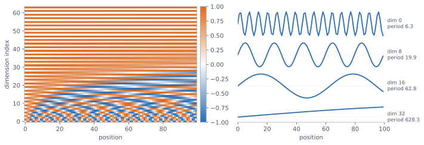
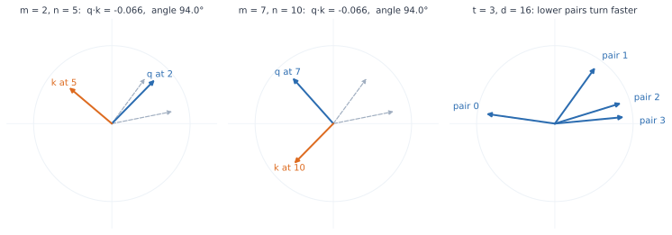
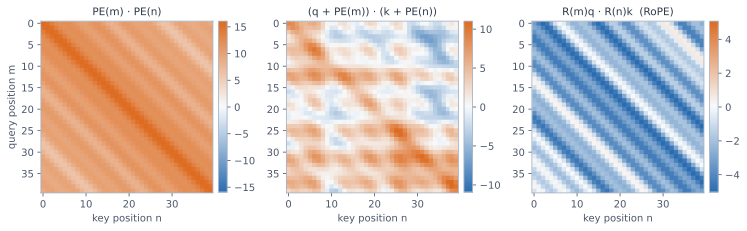

<ul class="post-sources">
<li markdown="span">[임커밋](https://www.youtube.com/@%EC%9E%84%EC%BB%A4%EB%B0%8B/videos)의 [딥러닝 / 머신러닝](https://www.youtube.com/playlist?list=PL6R2CbVlhcYsmmpXWDXTZbVo4pTM0ptR_) 강의 정리</li>
</ul>

## 왜 위치 정보가 필요한가

[▶ 시각화로 Positional encoding 이해하기](https://www.youtube.com/watch?v=I1OMC3A15HU)

[강의 3](/blog/2026/10/24/imc-03-attention/)에서 attention은 key와 value의 순서를 섞어도 결과가 변하지 않는다는 것을 보았다. query와 key의 내적은 각 쌍마다 따로 계산되고, value의 가중치 합은 더하는 순서와 상관이 없기 때문이다. 이 성질을 **순열 불변(permutation invariance)**이라고 한다.

시퀀스 전체를 넣는 self-attention으로 범위를 넓혀도 사정은 비슷하다. 입력의 순서를 섞으면 출력도 **똑같이 섞일 뿐**, 각 토큰의 출력 값은 그대로이다(엄밀히는 **순열 등변(permutation equivariance)**이라고 한다). "dog bites man"과 "man bites dog"은 단어 구성이 같고 순서만 달라 뜻이 다른데, 위치 정보가 없는 Transformer에게 두 문장의 "dog"는 같은 값을 받는다. 그래서 순서 정보를 따로 넣어야 하고, 그 장치가 **positional encoding(PE)**이다.

강의 3에서는 "위치마다 정해진 벡터를 더한다"까지만 보았다. 이 강의의 질문은 **어떤 벡터를 쓰느냐**이다.

## Learnable PE: 위치를 외우기

가장 단순한 방법은 위치마다 벡터를 하나씩 두고 다른 weight처럼 학습시키는 것이다. 이를 **learnable positional encoding**이라고 한다. `nn.Embedding(max_len, d)`이 곧 그 표이다.

한계는 표의 크기이다. 학습 데이터의 최대 길이가 512이면 0번부터 511번까지의 위치 벡터만 학습된다. 추론 때 513번째 토큰이 들어오면 쓸 벡터가 없다. 표를 미리 더 크게 잡아 두어도, 학습 중에 한 번도 쓰이지 않은 벡터는 초기값 그대로라서 모델에게 아무 의미가 없다. 학습 때 본 길이까지만 동작하는 것이다.

```python
import math
import torch
import torch.nn as nn

learned = nn.Embedding(512, 8)     # 위치 0~511의 벡터를 학습
print(learned(torch.tensor([511])).shape)   # torch.Size([1, 8])
# learned(torch.tensor([512]))              # IndexError: index out of range in self
```

## Sinusoidal PE: 위치를 규칙으로 쓰기

위치를 외우는 대신 **위치의 함수**로 벡터를 만들면 표의 크기라는 제약이 사라진다. 원래 Transformer의 **sinusoidal positional encoding**은 다음과 같다.

$$
\mathrm{PE}(t, 2i) = \sin(\omega_i t), \qquad
\mathrm{PE}(t, 2i+1) = \cos(\omega_i t), \qquad
\omega_i = \frac{1}{10000^{2i/d}}
$$

$$t$$는 위치, $$d$$는 벡터 차원, $$i = 0, 1, \dots, d/2 - 1$$은 sin과 cos 한 쌍의 번호이다. 학습할 파라미터가 없고, 어떤 $$t$$에 대해서도 값을 계산할 수 있다. 모델이 "위치가 늘어나면 벡터가 이런 규칙으로 변한다"는 패턴을 배운다면, 학습 때 보지 못한 위치로 **외삽(extrapolation)**하는 것도 기대해 볼 수 있다. 다만 이것은 보장이 아니라 기대이다.

수식은 두 가지 설계로 나누어 볼 수 있다. 하나는 **주기가 서로 다른** 파동을 쓰는 것이고, 다른 하나는 **sin과 cos을 짝지어** 쓰는 것이다.

### 주기가 다른 파동: 시계의 원리

한 쌍의 주기는 $$2\pi / \omega_i = 2\pi \cdot 10000^{2i/d}$$이다. $$i = 0$$이면 분모가 1이라 주기가 약 6.3으로 가장 빠르게 진동한다. $$i$$가 커질수록 분모가 10000에 가까워져, 주기가 최대 약 $$2\pi \times 10000 \approx 62832$$까지 길어진다.

왜 여러 주기가 필요한지는 시계를 떠올리면 알 수 있다. 초침만 보면 몇 초인지는 알아도 몇 시인지는 모른다. 60초마다 같은 자리로 돌아오기 때문이다. 시침만 보면 대략의 시각은 알아도 정밀한 시각은 모른다. 하지만 초침, 분침, 시침의 조합을 3차원 벡터로 보면 12시간 안의 모든 시각이 서로 다른 벡터가 된다. PE도 같다. 빠른 차원은 가까운 위치를 구별하고, 느린 차원은 먼 위치를 구별해서, 벡터 전체로는 위치마다 고유한 값이 된다.


*$$d = 64$$인 sinusoidal PE. 왼쪽은 각 위치(가로)의 벡터를 세로로 세운 것이다. 아래쪽 차원은 위치에 따라 빠르게 바뀌고, 위로 갈수록 천천히 바뀐다. 오른쪽은 짝수 차원 몇 개를 따로 그린 것으로, 초침부터 시침까지에 해당한다.*

### sin과 cos의 짝: 내적이 거리에만 의존한다

그런데 시계의 원리만 필요하다면 주기를 달리한 sin만 써도 될 것 같다. 굳이 sin과 cos을 번갈아 쓰는 이유는 PE가 가지면 좋은 다음 성질 때문이다.

> 두 위치 사이의 거리가 같으면 PE의 내적도 같다.

위치 3과 5의 관계는 위치 10과 12의 관계와 같이 "두 칸 떨어져 있다"이다. attention은 두 토큰의 관계를 내적으로 재므로, 거리가 같을 때 내적이 같으면 상대 거리 정보가 내적에 자연스럽게 드러난다. 이 성질은 삼각함수의 덧셈정리 $$\cos(A - B) = \cos A \cos B + \sin A \sin B$$에서 바로 나온다. 위치 $$a$$와 $$b$$의 PE를 내적하면 쌍마다 sin끼리의 곱과 cos끼리의 곱이 더해져서

$$
\mathrm{PE}(a) \cdot \mathrm{PE}(b)
= \sum_{i=0}^{d/2-1} \left[\sin(\omega_i a)\sin(\omega_i b) + \cos(\omega_i a)\cos(\omega_i b)\right]
= \sum_{i=0}^{d/2-1} \cos\big(\omega_i (a - b)\big)
$$

이다. 결과에 $$a - b$$만 남는다. $$d = 16$$이면 $$\mathrm{PE}(3) \cdot \mathrm{PE}(5)$$와 $$\mathrm{PE}(10) \cdot \mathrm{PE}(12)$$가 둘 다 $$6.368$$이다. $$a = b$$이면 모든 항이 1이므로 벡터의 크기 제곱은 위치와 상관없이 항상 $$d/2$$이다.

sin만 쓰면 어떻게 될까? $$\sin A \sin B = \tfrac{1}{2}\left[\cos(A - B) - \cos(A + B)\right]$$이므로 내적에 $$a + b$$ 항이 남아 절대 위치에 의존하게 된다. 같은 $$d = 16$$의 8개 주파수로 sin만 쓰면 위치 쌍 $$(3, 5)$$의 내적은 $$0.836$$, $$(10, 12)$$는 $$1.217$$로 거리가 같아도 값이 다르다. 게다가 위치 0의 벡터는 영벡터가 된다.

```python
def sinusoidal_pe(n, d):
    t = torch.arange(n, dtype=torch.float32).unsqueeze(1)    # (n, 1)
    w = 1 / 10000 ** (torch.arange(0, d, 2) / d)             # (d/2,)
    pe = torch.zeros(n, d)
    pe[:, 0::2] = torch.sin(t * w)
    pe[:, 1::2] = torch.cos(t * w)
    return pe

pe = sinusoidal_pe(64, 16)
print(pe[3] @ pe[5], pe[10] @ pe[12], pe[7] @ pe[9])    # 셋 다 약 6.368
print(pe[3] @ pe[3])                                    # 8 = d/2
```

## 더하기의 한계

[▶ RoPE 시각적으로 이해하기](https://www.youtube.com/watch?v=nIAj-dTMAPQ)

요즘 Transformer는 sinusoidal PE 대신 **RoPE(rotary position embedding)**를 많이 쓴다. 이유는 앞의 좋은 성질이 실제 attention에서 깨지기 때문이다.

PE는 단어 벡터에 **더해지고**, 그 결과로 query와 key를 만든다. attention score는 PE끼리의 내적이 아니라 단어 정보가 섞인 벡터끼리의 내적이다. query 쪽 단어 벡터를 $$\mathbf{q}$$, key 쪽 단어 벡터를 $$\mathbf{k}$$, 위치를 $$m$$, $$n$$이라고 하면

$$
\big(\mathbf{q} + \mathrm{PE}(m)\big) \cdot \big(\mathbf{k} + \mathrm{PE}(n)\big)
= \mathbf{q} \cdot \mathbf{k}
+ \mathbf{q} \cdot \mathrm{PE}(n)
+ \mathrm{PE}(m) \cdot \mathbf{k}
+ \mathrm{PE}(m) \cdot \mathrm{PE}(n)
$$

이다. 마지막 항만 $$m - n$$에 의존하고, 가운데 두 항은 **절대 위치**에 의존한다. 같은 두 단어가 같은 거리에 있어도 문장 안의 어디에 있느냐에 따라 점수가 달라지는 것이다. 게다가 실제로는 더한 결과에 $$W_Q$$, $$W_K$$를 곱하므로, 마지막 항마저 $$\mathrm{PE}(m)^\top W_Q^\top W_K\, \mathrm{PE}(n)$$이 되어 깔끔한 형태가 유지되지 않는다. 내재된 성질이 학습에 도움이 되기를 기대할 수는 있어도, 점수에 상대 거리가 직접 반영된다고 말하기는 어렵다.

## RoPE: 더하지 말고 돌리기

RoPE의 핵심은 위치 벡터를 만들어 더하는 대신 **query와 key 벡터 자체를 위치에 따라 회전**시키는 것이다. 별도의 위치 벡터가 없고, 학습할 파라미터도 없다.

### 2차원씩 묶어 회전

먼저 벡터를 2차원씩 묶어서 본다. 16차원 벡터라면 $$(q_0, q_1), (q_2, q_3), \dots$$로 평면 8개에 놓인 2차원 벡터 8개로 보는 것이다. 아직 값을 바꾼 것은 아니다. 이제 위치 $$t$$에서 $$i$$번째 쌍을 각도 $$\omega_i t$$만큼 회전시킨다.

$$
\begin{bmatrix} q'_{2i} \\ q'_{2i+1} \end{bmatrix}
= R(\omega_i t) \begin{bmatrix} q_{2i} \\ q_{2i+1} \end{bmatrix},
\qquad
R(\theta) = \begin{bmatrix} \cos\theta & -\sin\theta \\ \sin\theta & \cos\theta \end{bmatrix},
\qquad
\omega_i = \frac{1}{10000^{2i/d}}
$$

회전 속도는 sinusoidal PE와 같은 규칙이다. 0번째 쌍은 위치가 1 늘 때 1라디안씩 빠르게 돌고, 뒤쪽 쌍일수록 느리게 돈다. 마지막 쌍의 속도는 $$10000^{-(d-2)/d}$$로, $$d$$가 크면 거의 $$1/10000$$이다. 위치 정보를 초침과 시침으로 담는 발상은 그대로이고, 담는 방식이 덧셈에서 회전으로 바뀐 것이다.

### 내적이 위치 차이에 의존한다

위치 $$m$$의 query와 위치 $$n$$의 key를 내적해 보자. 회전 행렬은 $$R(\alpha)^\top = R(-\alpha)$$, $$R(\alpha)R(\beta) = R(\alpha + \beta)$$를 만족하므로 $$i$$번째 쌍에서

$$
\big(R(\omega_i m)\mathbf{q}_i\big) \cdot \big(R(\omega_i n)\mathbf{k}_i\big)
= \mathbf{q}_i^\top R(\omega_i m)^\top R(\omega_i n)\, \mathbf{k}_i
= \mathbf{q}_i^\top R\big(\omega_i (n - m)\big)\, \mathbf{k}_i
$$

이다($$\mathbf{q}_i$$, $$\mathbf{k}_i$$는 $$i$$번째 쌍의 2차원 벡터이다). 전체 점수는 이것을 모든 쌍에 대해 더한 것이다. **단어 벡터 $$\mathbf{q}, \mathbf{k}$$가 그대로 살아 있으면서 위치는 차이 $$n - m$$으로만 들어간다.** 더하기에서 생기던 절대 위치 항이 없다. 회전은 벡터의 크기를 바꾸지 않으므로, 같은 위치($$m = n$$)끼리의 내적은 회전 전의 $$\mathbf{q} \cdot \mathbf{k}$$와 정확히 같다.

그림으로 보면 두 벡터를 같은 위치 차이만큼 벌려 놓은 뒤 함께 돌리는 것이므로, 사잇각이 변하지 않는다.


*2차원 쌍 하나에서 본 회전. 점선은 회전 전의 $$\mathbf{q}, \mathbf{k}$$이다. 위치 $$(2, 5)$$(왼쪽)와 $$(7, 10)$$(가운데)은 거리가 같으므로, 절대 각도는 달라도 사잇각과 내적이 같다($$\omega = 0.3$$으로 예시). 오른쪽은 $$d = 16$$의 $$t = 3$$에서 앞쪽 네 쌍이 돈 각도이다. 번호가 작은 쌍일수록 빠르게 돈다.*

세 방식의 내적을 위치 $$(m, n)$$의 격자에 그리면 차이가 분명하다. 대각선 방향으로 값이 일정하면 내적이 $$m - n$$에만 의존한다는 뜻이다.


*고정된 단어 벡터 쌍 $$\mathbf{q}, \mathbf{k}$$($$d = 32$$, PE와 같은 크기의 난수)를 위치 $$m, n$$에 놓았을 때의 내적. PE끼리의 내적(왼쪽)은 대각선 줄무늬이지만, 단어 벡터에 PE를 더하면(가운데) 줄무늬가 깨진다. RoPE(오른쪽)는 단어 정보가 들어 있는데도 줄무늬가 유지된다.*

### 무엇이 좋은가: 문장을 옮겨도 점수가 같다

같은 문장 A가 글의 맨 앞에 오든 두 번째 문장으로 오든, 문장 안 단어들의 **상대 거리**는 같다. 위치가 전부 같은 값만큼 밀릴 뿐이다. RoPE에서 attention score는 상대 거리에만 의존하므로, 문장이 어디로 옮겨 가도 그 안의 self-attention score는 변하지 않는다. 모델이 같은 문장을 같은 의미로 해석할 수 있는 바탕이 생기는 것이다.

### 구현: 회전 행렬을 원소별 계산으로

회전 행렬을 실제로 곱할 필요는 없다. $$R(\theta)$$를 곱한 결과는 $$(x_0 \cos\theta - x_1 \sin\theta,\ x_0 \sin\theta + x_1 \cos\theta)$$이므로 원소별 연산으로 끝난다. 아래 코드는 원리를 그대로 옮긴 것이고, 실제 라이브러리의 구현은 복소수 곱이나 미리 계산한 표로 이를 효율화한다. RoPE는 attention의 $$Q$$, $$K$$에만 적용하고 value에는 적용하지 않는다.

```python
def rope(x, t):
    """x: (..., n, d), d는 짝수. t: (n,) 각 토큰의 위치."""
    d = x.size(-1)
    w = 10000 ** (-torch.arange(0, d, 2, dtype=torch.float32) / d)   # (d/2,)
    theta = t.unsqueeze(-1) * w                                      # (n, d/2)
    c, s = theta.cos(), theta.sin()
    x0, x1 = x[..., 0::2], x[..., 1::2]
    return torch.stack([x0 * c - x1 * s, x0 * s + x1 * c], dim=-1).flatten(-2)

torch.manual_seed(0)
q, k = torch.randn(4, 16), torch.randn(4, 16)
t = torch.arange(4.0)

score = rope(q, t) @ rope(k, t).T                   # 문장이 위치 0~3에 있을 때
moved = rope(q, t + 100) @ rope(k, t + 100).T       # 같은 문장을 100칸 뒤로 옮겼을 때
print(torch.allclose(score, moved, atol=1e-3))      # True: 점수가 변하지 않는다
print(torch.allclose(rope(q, t).norm(dim=-1), q.norm(dim=-1)))          # True: 크기 보존
print(torch.allclose(score.diagonal(), (q * k).sum(-1), atol=1e-4))     # True: m = n이면 원래 내적

# 더하기 방식은 옮기면 점수가 달라진다
pe = sinusoidal_pe(104, 16)
added = (q + pe[:4]) @ (k + pe[:4]).T
added_moved = (q + pe[100:104]) @ (k + pe[100:104]).T
print(torch.allclose(added, added_moved, atol=1e-3))                    # False
```

## 정리

| 방식 | 위치 정보를 넣는 법 | 학습 길이 밖의 위치 | 내적과 상대 거리 |
|---|---|---|---|
| Learnable PE | 위치별 벡터를 학습해 더함 | 쓸 수 없음 | 보장 없음 |
| Sinusoidal PE | 주기가 다른 sin, cos 벡터를 더함 | 계산 가능 (외삽은 기대) | PE끼리는 $$m - n$$에만 의존, 단어 벡터와 더하면 깨짐 |
| RoPE | $$Q$$, $$K$$의 2차원 쌍을 위치에 따라 회전 | 계산 가능 | score 자체가 위치를 $$m - n$$으로만 반영 |

- attention은 순서를 모르므로 위치 정보를 따로 넣어야 한다. 표로 외우는 방식은 학습한 길이까지만 동작한다.
- sinusoidal PE의 **주기가 다른 파동**은 시계처럼 모든 위치에 고유한 벡터를 주고, **sin과 cos의 짝**은 덧셈정리로 내적이 위치 차이에만 의존하게 한다.
- 더하기는 단어와 위치를 내적 안에서 섞어 그 성질을 흐린다. RoPE는 같은 속도 규칙으로 $$Q$$, $$K$$를 회전시켜 $$\mathbf{q}^\top R(\omega(n - m))\mathbf{k}$$ 꼴을 만들고, 문장을 옮겨도 score가 유지되게 한다.
