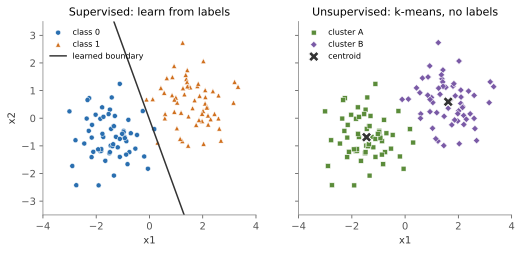

## 면접 답변

> 핵심 차이는 학습 데이터에 정답 레이블이 있는지입니다. 지도 학습은 입력과 정답의 쌍으로 입력에서 정답을 예측하는 함수를 배우고, 비지도 학습은 입력만 보고 군집이나 저차원 구조 같은 데이터 자체의 구조를 찾습니다. 이 차이는 평가 방식의 차이로 이어져서, 지도 학습은 정답과 비교해 성능을 직접 잴 수 있지만 비지도 학습은 정답이 없어 평가가 더 어렵습니다. 예를 들어 스팸 여부가 표시된 메일로 분류기를 만드는 것은 지도 학습이고, 구매 기록만으로 고객을 비슷한 그룹으로 묶는 것은 비지도 학습입니다.

## 자세한 설명

### 무엇을 학습하는가

지도 학습(supervised learning)의 데이터는 $$\{(x_i, y_i)\}_{i=1}^{n}$$이다. $$x_i$$는 입력, $$y_i$$는 정답이다. 손실 $$L$$을 최소화해 함수 $$f$$를 찾으며, 확률적으로 보면 조건부 분포 $$p(y \mid x)$$를 추정하는 경우가 많다.

$$
\min_{f} \frac{1}{n} \sum_{i=1}^{n} L\big(f(x_i), y_i\big)
$$

비지도 학습(unsupervised learning)의 데이터는 $$\{x_i\}_{i=1}^{n}$$뿐이다. 목표는 $$p(x)$$나 그 구조를 파악하는 것이다. 예를 들어 k-means는 $$k$$개 군집의 중심 $$\mu_j$$와 각 점의 배정 $$c_i$$를 찾아 다음 값을 최소화한다.

$$
\min_{\{\mu_j\}, \{c_i\}} \sum_{i=1}^{n} \lVert x_i - \mu_{c_i} \rVert^2
$$

*같은 데이터 120개에 대한 두 접근. 왼쪽은 레이블을 사용해 로지스틱 회귀로 경계를 학습했고(학습 정확도 98.3%), 오른쪽은 레이블을 숨긴 채 k-means로 묶었다. 군집 결과를 나중에 레이블과 비교하면 99.2%가 일치하지만, 이는 두 덩어리가 잘 분리되도록 생성한 데이터이기 때문이다.*

### 비교

| | 지도 학습 | 비지도 학습 |
|---|---|---|
| 데이터 | 입력과 레이블 | 입력만 |
| 대표 과제 | 분류, 회귀 | 군집화, 차원 축소, 밀도 추정 |
| 대표 알고리즘 | 로지스틱 회귀, 랜덤 포레스트, SVM | k-means, GMM, PCA |
| 평가 | 정답과 직접 비교 | 실루엣 같은 내부 지표, 도메인 해석, 후속 과제 성능 |
| 주된 비용 | 레이블 확보 | 결과의 해석과 검증 |

### 군집이 곧 클래스는 아니다

비지도 학습이 찾은 구조가 우리가 원하는 개념과 일치한다는 보장은 없다. 그림에서는 일치했지만, 사진을 군집화하면 물체의 종류가 아니라 배경색으로 묶일 수도 있다. 찾아낸 군집에 의미를 부여하는 일은 사람의 몫이다.

### 경계에 있는 방법들

- **준지도 학습(semi-supervised learning)**: 소량의 레이블과 대량의 비레이블 데이터를 함께 사용한다.
- **자기지도 학습(self-supervised learning)**: 데이터에서 레이블을 스스로 만들어 지도 학습 형태로 학습한다. 사람이 레이블을 달지 않는다는 점에서 비지도의 일종으로 분류되기도 한다.
- **강화 학습(reinforcement learning)**: 정답 대신 행동의 결과로 얻는 보상으로 학습하는 별도의 틀이다.

## 관련 개념

- **분류와 회귀**: 지도 학습의 두 갈래로, 출력이 범주인지 연속값인지로 나뉜다. [분류와 회귀의 차이](/blog/2026/11/02/knowledge-18-classification-regression/)에서 다룬다.
- **K-means**: 대표적인 비지도 군집화 알고리즘이다. 유도와 수렴은 [K-Means와 EM 정리](/blog/2026/10/22/ml-12-kmeans-em/)에 있고, 이름이 비슷한 지도 학습 알고리즘 KNN과의 비교는 [KNN과 K-means의 차이](/blog/2026/11/02/knowledge-33-knn-vs-kmeans/)에 있다.
- **차원 축소**: PCA처럼 레이블 없이 데이터의 주요 방향을 찾는 비지도 기법이다. 자세한 내용은 [차원 축소 기법](/blog/2026/11/02/knowledge-25-dimensionality-reduction/)을 참고한다.
- **자기지도 학습**: 대량의 비레이블 데이터로 표현을 학습한 뒤 소량의 레이블로 미세조정한다. [Self-Supervised Learning 정리](/blog/2026/10/22/ml-16-self-supervised/)에서 다룬다.

## 꼬리 질문

**Q.** 레이블이 일부만 있으면 어떻게 하나요?
비레이블 데이터로 자기지도 사전학습을 한 뒤 레이블 데이터로 미세조정하거나, 모델의 확신이 높은 예측을 임시 레이블로 쓰는 pseudo-labeling 같은 준지도 기법을 쓴다. 레이블 데이터만 쓴 기준 모델과 비교해 실제로 나아지는지 확인해야 한다.

**Q.** 비지도 학습의 결과는 어떻게 평가하나요?
실루엣 계수 같은 내부 지표, 일부 데이터에 레이블을 달아 비교하는 외부 지표, 도메인 전문가의 해석, 군집이나 표현을 사용한 후속 과제의 성능을 함께 본다. 내부 지표가 좋다고 해서 사업적으로 의미 있는 군집이라는 보장은 없다.

**Q.** 지도 학습이 비지도 학습보다 항상 좋은가요?
목표 과제의 레이블이 충분하면 지도 학습이 그 과제에 직접 최적화되므로 대체로 유리하다. 하지만 레이블이 비싸거나 구조 탐색 자체가 목적이면 비지도 학습이 필요하므로, 우열이 아니라 문제와 데이터에 따른 선택이다.
