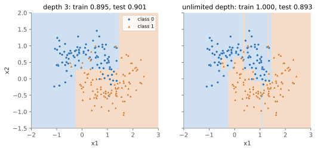

## 면접 답변

> 의사결정나무의 가장 큰 장점은 해석이 쉽고 전처리가 적게 든다는 것이고, 가장 큰 단점은 분산이 커서 불안정하고 과적합하기 쉽다는 것입니다. if-then 규칙으로 읽을 수 있고, 값의 순서만 쓰므로 특징 스케일링이 필요 없으며, 비선형성과 특징 간 상호작용도 자동으로 다룹니다. 반면 탐욕적으로 분할하므로 데이터가 조금만 달라져도 구조가 크게 바뀔 수 있고, 축에 평행한 경계만 만들기 때문에 대각선 경계에는 계단 모양으로 근사하게 됩니다. 예를 들어 깊이를 제한하지 않으면 학습 정확도는 100%가 되어도 새 데이터 성능은 나아지지 않습니다. 그래서 실무에서는 깊이 제한이나 가지치기로 복잡도를 조절하거나, 랜덤 포레스트나 gradient boosting 같은 앙상블로 씁니다.

## 자세한 설명

### 장단점 요약

| 장점 | 단점 |
|---|---|
| 규칙으로 읽을 수 있어 해석이 쉬움 (얕은 경우) | 깊이를 제한하지 않으면 과적합 |
| 특징 스케일링 불필요 | 데이터가 조금 바뀌어도 구조가 크게 변함 |
| 비선형 관계와 상호작용을 자동으로 포착 | 축에 평행한 경계만 가능 |
| 수치형과 범주형을 함께 처리 가능 | 탐욕적 분할이므로 전역 최적을 보장하지 않음 |
| 이상치에 비교적 둔감 (입력 쪽) | 회귀 트리는 학습 범위 밖으로 외삽하지 못함 |
| 예측이 빠름 (깊이에 비례) | 값 종류가 많은 특징이 분할 기준에서 유리해지는 편향 |

결측값 처리와 범주형 특징의 직접 지원은 알고리즘과 구현에 따라 다르다. 예를 들어 CART는 대체 분할(surrogate split)을 정의하지만, 모든 라이브러리가 이를 제공하는 것은 아니다.

### 학습 방식: 불순도 감소

트리는 각 노드에서 불순도를 가장 많이 낮추는 특징과 임곗값을 고른다. 클래스 $$k$$의 비율을 $$p_k$$라고 할 때 대표적인 불순도는 다음과 같다.

$$
\text{Gini} = 1 - \sum_k p_k^2, \qquad H = -\sum_k p_k \log_2 p_k
$$

**계산 예.** 노드에 양성 6개, 음성 4개가 있다. Gini는 $$1 - 0.6^2 - 0.4^2 = 0.48$$이다(엔트로피로는 약 $$0.971$$). 어떤 분할이 왼쪽에 (양성 5, 음성 1), 오른쪽에 (양성 1, 음성 3)을 보낸다면 다음과 같다.

- 왼쪽 Gini: $$1 - (5/6)^2 - (1/6)^2 \approx 0.278$$
- 오른쪽 Gini: $$1 - (1/4)^2 - (3/4)^2 = 0.375$$
- 가중 평균: $$0.6 \times 0.278 + 0.4 \times 0.375 \approx 0.317$$

불순도 감소량은 $$0.48 - 0.317 \approx 0.163$$이다. 후보 분할을 모두 계산해 이 값이 가장 큰 것을 택한다. 최적의 트리를 찾는 문제는 NP-완전으로 알려져 있어(Hyafil and Rivest, 1976), 이렇게 한 단계씩 탐욕적으로 만든다.

### 과적합과 불안정성을 실험으로 보기

numpy로 구현한 CART(Gini 기준)를 잡음 섞인 두 반달 데이터에 학습시켰다.

*학습 데이터 200개로 만든 두 트리. 경계가 모두 축에 평행하다. 깊이 제한이 없는 오른쪽 트리는 점 하나를 위한 좁은 영역까지 만들어 학습 정확도 100%를 달성하지만, 테스트 데이터 4,000개에 대한 정확도는 깊이 3인 왼쪽 트리(0.901)보다 오히려 낮다(0.893).*

같은 분포에서 학습 데이터 200개를 두 번씩 독립적으로 뽑아 트리 두 개를 만들고, 테스트 점에서 두 트리의 예측이 다른 비율을 30회 반복해 평균했다.

| 모델 | 평균 테스트 정확도 | 두 트리의 예측이 다른 비율 |
|---|---|---|
| 깊이 3 | 0.885 | 6.6% |
| 깊이 제한 없음 | 0.883 | 13.1% |

평균 정확도는 거의 같은데, 학습 데이터가 바뀔 때 예측이 달라지는 정도는 깊은 트리가 약 2배이다. 이것이 분산이 크다는 말의 의미이다. 이 데이터에서만 얻은 결과이므로 수치 자체를 일반화해서는 안 된다.

### 약점을 보완하는 방법

- **복잡도 제한**: 최대 깊이, 리프의 최소 샘플 수, [가지치기](/blog/2026/11/02/knowledge-30-tree-pruning/)
- **배깅(bagging)**: 부트스트랩 표본으로 만든 트리들의 투표로 분산을 줄인다. 위 실험의 처음 10회 반복에서 깊은 트리 한 그루의 평균 테스트 정확도는 0.881이었고, 같은 학습 데이터에서 만든 깊은 트리 50그루의 다수결은 0.904였다.
- **랜덤 포레스트**: 배깅에 분할별 무작위 특징 선택을 더해 트리 간 상관을 줄인다.
- **Boosting**: 얕은 트리를 순차적으로 더해 편향을 줄인다.

앙상블을 쓰면 성능은 좋아지지만 단일 트리의 장점인 쉬운 해석은 대부분 잃는다.

## 관련 개념

- **편향-분산 트레이드오프**: 깊은 트리는 편향이 작고 분산이 크다. [Bias-Variance Tradeoff](/blog/2026/11/02/knowledge-28-bias-variance/)에서 다룬다.
- **과적합**: 위 실험의 깊은 트리가 보이는 현상이다. [과적합](/blog/2026/11/02/knowledge-13-overfitting/)을 참고한다.
- **트리 실습**: 결정 트리를 코드로 다룬 내용은 [핵심 머신러닝 알고리즘 정리](/blog/2026/10/22/dlbook-03-ml-algorithms/)에 있다.
- **특징 중요도**: 불순도 감소 기반 중요도는 값의 종류가 많은 특징에 치우칠 수 있으므로, 순열 중요도와 비교하는 것이 안전하다.

## 꼬리 질문

**Q.** Gini와 엔트로피 중 무엇을 써야 하나요?
두 값은 모양이 비슷해 대부분 비슷한 트리를 만든다. Gini는 로그 계산이 없어 조금 더 빠르며, 보통 이 선택보다 깊이 같은 복잡도 조절이 결과에 더 큰 영향을 준다.

**Q.** 대각선 경계가 필요한 데이터에서는 어떻게 하나요?
트리를 깊게 하면 계단으로 근사하지만 데이터가 많이 필요하다. 두 특징의 합이나 차처럼 경계 방향에 맞는 특징을 만들거나, 선형 모델이나 앙상블과 비교해 본다.

**Q.** 트리 기반 모델에 원-핫 인코딩은 항상 좋은가요?
그렇지 않다. 범주가 많으면 원-핫 열 각각은 정보가 적어 분할에서 잘 선택되지 않고 트리가 깊어진다. 범주형을 직접 지원하는 구현이나 누수를 막은 타깃 인코딩을 함께 비교할 만하다.
