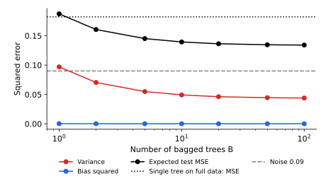

<ul class="post-sources">
<li markdown="span">질문 출처: [Science Vibe, 머신러닝 면접 질문 모음](https://jrc-park.tistory.com/259)</li>
</ul>

## 면접 답변

> 배깅(bagging, bootstrap aggregating)은 학습 데이터에서 복원 추출한 표본마다 모델을 따로 학습하고, 예측을 평균하거나 투표로 결합하는 방법입니다.
> 데이터가 조금 달라지면 예측이 크게 흔들리는 모델의 분산을 평균으로 줄이는 것이 목적입니다.
> 그래서 깊은 의사결정나무처럼 편향은 낮고 분산은 큰 모델에 효과가 크고, 선형 회귀처럼 안정적인 모델에는 효과가 작습니다.
> 대표적인 예가 랜덤 포레스트로, 배깅에 특징 무작위 선택을 더해 나무 사이의 상관을 더 낮춥니다.
> 각 모델은 병렬로 학습할 수 있고, 학습에 쓰이지 않은 out-of-bag 샘플로 별도의 검증 세트 없이 성능을 추정할 수도 있습니다.

## 자세한 설명

### 알고리즘

학습 데이터 $$\mathcal{D}$$의 크기가 $$n$$일 때 $$b = 1, \dots, B$$에 대해 다음을 수행한다.

1. $$\mathcal{D}$$에서 $$n$$개를 복원 추출해 부트스트랩 표본 $$\mathcal{D}_b$$를 만든다.
2. $$\mathcal{D}_b$$로 모델 $$\hat{f}_b$$를 학습한다.

회귀의 예측은 평균이고, 분류는 다수결 또는 예측 확률의 평균이다.

$$
\hat{f}_{\text{bag}}(\mathbf{x}) = \frac{1}{B}\sum_{b=1}^{B}\hat{f}_b(\mathbf{x})
$$

### 왜 분산이 줄어드는가

[Q-100](/blog/2026/11/02/knowledge-100-ensemble/)의 식처럼 평균의 분산은 $$\rho\sigma^2 + (1-\rho)\sigma^2/B$$이다. 부트스트랩 표본들은 같은 원본에서 나오므로 $$\rho$$가 0이 되지는 않는다. 따라서 $$B$$를 늘리면 분산이 $$\rho\sigma^2$$ 근처에서 수렴한다. 랜덤 포레스트는 각 분기에서 후보 특징을 일부만 고려해 $$\rho$$를 더 낮춘다.

### 실험

$$y = \sin(2\pi x) + \varepsilon$$, $$\sigma = 0.3$$인 합성 데이터에서 $$x \sim U(0, 1)$$로 표본 50개를 뽑아, 끝까지 자란 1차원 회귀 나무를 배깅했다. 이를 400번 반복해 $$x \in [0.05, 0.95]$$ 구간에서 평균을 냈다.

*배깅한 나무 수에 따른 분산, 편향의 제곱, 기대 테스트 MSE. 합성 데이터로 계산한 값이며, 나무 수를 늘리면 분산이 줄다가 수렴한다.*

| 모델 | Bias² | Variance | 기대 테스트 MSE |
|---|---:|---:|---:|
| 전체 데이터로 학습한 나무 1개 | 0.0002 | 0.0918 | 0.1821 |
| 배깅, $$B = 1$$ | 0.0003 | 0.0969 | 0.1872 |
| 배깅, $$B = 10$$ | 0.0002 | 0.0493 | 0.1394 |
| 배깅, $$B = 100$$ | 0.0001 | 0.0439 | 0.1341 |

이 실험에서 편향은 거의 변하지 않고 분산만 절반 이하로 줄었다. $$B = 1$$이 전체 데이터로 학습한 나무보다 조금 나쁜 이유는 부트스트랩 표본에 고유한 샘플이 약 63%뿐이기 때문이다. $$B = 50$$과 $$B = 100$$의 차이가 작은 것처럼 나무를 늘려도 과적합이 심해지지는 않고 일정 수준에서 개선이 멈춘다.

### Out-of-bag 평가

각 샘플은 표본 하나에서 약 36.8%의 확률로 제외된다. 샘플마다 자신을 포함하지 않은 모델들로만 예측해 오차를 계산하면 **OOB(out-of-bag) 오차**가 되며, 교차 검증과 유사한 일반화 오차 추정으로 쓸 수 있다.

### 효과가 작은 경우

- **안정적인 모델**: 선형 회귀처럼 데이터 변화에 예측이 크게 흔들리지 않으면 줄일 분산이 적다.
- **편향이 큰 모델**: 얕은 스텀프를 배깅해도 표현력이 늘지 않는다. [Q-105](/blog/2026/11/02/knowledge-105-bagging-vs-boosting/)의 실험에서 확인할 수 있다.

## 관련 개념

- **부트스트랩**: 배깅의 복원 추출 방법이다. [Q-103](/blog/2026/11/02/knowledge-103-bootstrapping/)에서 다룬다.
- **의사결정나무**: 분산이 커서 배깅의 대표적인 기본 모델이다. [Q-8](/blog/2026/11/02/knowledge-08-decision-tree-pros-cons/)을 참고한다.
- **편향-분산 분해**: 위 표의 항들이 무엇인지는 [Q-28](/blog/2026/11/02/knowledge-28-bias-variance/)에서 다룬다.
- **부스팅**: 순차 학습으로 주로 편향을 줄이는 방식이다. [Q-104](/blog/2026/11/02/knowledge-104-boosting/)를 참고한다.

## 꼬리 질문

**Q.** 랜덤 포레스트는 배깅과 무엇이 다른가요?
배깅에 더해 각 분기에서 무작위로 고른 특징 일부만 후보로 씁니다. 그 결과 강한 특징 하나가 모든 나무의 구조를 지배하지 않아 나무 간 상관이 낮아집니다.

**Q.** $$B$$는 얼마나 크게 잡아야 하나요?
오차가 평탄해질 때까지 늘리면 됩니다. 크게 잡아도 일반적으로 성능이 나빠지지는 않으며, 비용만 늘어납니다. OOB 오차 곡선으로 확인할 수 있습니다.

**Q.** 부트스트랩 없이 데이터를 나눠 학습하면 안 되나요?
가능합니다. 비복원 추출은 pasting, 특징 일부를 쓰는 방식은 random subspace라고 합니다. 데이터가 나뉜 만큼 각 모델의 학습 데이터가 줄어드는 점을 고려해야 합니다.
