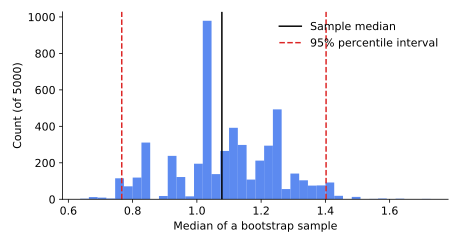

<ul class="post-sources">
<li markdown="span">질문 출처: [Science Vibe, 머신러닝 면접 질문 모음](https://jrc-park.tistory.com/259)</li>
</ul>

## 면접 답변

> 부트스트래핑(bootstrapping)은 가지고 있는 표본에서 같은 크기로 복원 추출을 반복해, 어떤 통계량이 표본에 따라 얼마나 변하는지 추정하는 방법입니다.
> 모집단에서 새 표본을 더 뽑을 수 없으므로, 표본을 모집단의 대용으로 삼아 재추출을 하는 것입니다.
> 예를 들어 중앙값은 표준오차 공식이 간단하지 않은데, 재표본마다 중앙값을 계산하면 그 분포로부터 표준오차와 신뢰구간을 구할 수 있습니다.
> 머신러닝에서는 배깅이 이 방법으로 학습 데이터를 다양화하며, 크기 $$n$$의 재표본에는 고유한 샘플이 평균 약 63.2% 들어갑니다.
> 다만 새로운 정보를 만드는 것은 아니어서, 원본 표본이 작거나 치우쳐 있으면 추정도 그 한계를 그대로 가집니다.

## 자세한 설명

### 절차

표본 $$x_1, \dots, x_n$$과 통계량 $$\hat{\theta}$$가 있다고 하자.

1. 표본에서 $$n$$개를 복원 추출해 재표본 $$x^{\ast}_1, \dots, x^{\ast}_n$$을 만든다.
2. 재표본으로 통계량 $$\hat{\theta}^{\ast}$$를 계산한다.
3. 1, 2를 $$B$$번 반복한다.

$$\hat{\theta}^{\ast}_1, \dots, \hat{\theta}^{\ast}_B$$의 표준편차가 표준오차의 추정값이고, 이 값들의 2.5, 97.5 백분위수가 95% **백분위수 구간(percentile interval)**이다. 즉, 모집단과 표본의 관계를 표본과 재표본의 관계로 근사한다. 이 방법은 Efron(1979)이 제안했다.

### 예제

로그 정규 분포 $$\text{LogNormal}(0, 1)$$에서 뽑은 표본 40개로 시뮬레이션했다. 먼저 공식과 비교할 수 있는 평균의 표준오차를 보면, 공식 $$s/\sqrt{n}$$의 값은 0.267이고 재표본 5,000번으로 구한 값은 0.263으로 비슷하다.

중앙값은 표본 값이 1.078이고, 부트스트랩 표준오차는 0.162, 95% 백분위수 구간은 $$[0.766, 1.402]$$이다.

*재표본 5,000개의 중앙값 분포. 중앙값은 표본 안의 값 또는 그 평균으로만 나오므로 분포가 울퉁불퉁하다.*

한계도 확인할 수 있다. 같은 분포에서 새 표본 40개를 실제로 20,000번 뽑으면 중앙값의 표준편차는 약 0.200이다. 위 표본의 부트스트랩 추정 0.162는 이보다 작다. 부트스트랩 추정 자체도 주어진 하나의 표본에 의존하기 때문이다.

### 재표본에 포함되는 비율

특정 샘플이 한 번의 추출에서 뽑히지 않을 확률은 $$1 - 1/n$$이다. 따라서 $$n$$번의 추출에 한 번이라도 뽑힐 확률은 다음과 같다.

$$
1 - \left(1 - \frac{1}{n}\right)^n \longrightarrow 1 - \frac{1}{e} \approx 0.632
$$

| $$n$$ | 10 | 100 | 1,000 | $$\infty$$ |
|---|---:|---:|---:|---:|
| 포함 확률 | 0.6513 | 0.6340 | 0.6323 | 0.6321 |

나머지 약 36.8%가 [배깅](/blog/2026/11/02/knowledge-102-bagging/)의 out-of-bag 샘플이다.

### 잘 맞지 않는 경우

- **표본이 매우 작은 경우**: 표본이 모집단을 잘 대표한다고 보기 어렵다.
- **극단값 통계량**: 표본 최댓값처럼 분포의 끝에 의존하는 통계량은 재표본이 원본 최댓값을 넘을 수 없어 잘 근사되지 않는다.
- **독립이 아닌 데이터**: 시계열을 샘플 단위로 재추출하면 의존 구조가 깨진다. 이때는 구간을 묶어 추출하는 block bootstrap을 쓴다.

## 관련 개념

- **배깅**: 재표본마다 모델을 학습한다. [Q-102](/blog/2026/11/02/knowledge-102-bagging/)에서 다룬다.
- **신뢰구간**: 부트스트랩은 공식 없이 구간을 추정하는 방법 중 하나이다. [Q-63](/blog/2026/11/02/knowledge-63-confidence-interval/)을 참고한다.
- **교차 검증**: 역시 재표본 방법이지만 비복원으로 나누고, 주로 일반화 오차 추정에 쓴다. [Q-74](/blog/2026/11/02/knowledge-74-cross-validation/)를 참고한다.

## 꼬리 질문

**Q.** 왜 복원 추출인가요?
비복원으로 $$n$$개를 뽑으면 항상 원본과 같은 표본이 되어 변동을 볼 수 없기 때문입니다. 복원 추출은 모집단에서 독립으로 뽑는 상황을 경험적 분포에서 흉내 냅니다.

**Q.** $$B$$는 얼마나 필요한가요?
표준오차는 수백 번, 백분위수 구간은 분포의 꼬리를 봐야 하므로 보통 수천 번을 씁니다. $$B$$를 늘리면 재추출의 무작위성은 줄지만, 표본 자체의 한계는 줄지 않습니다.

**Q.** 부트스트랩으로 모델 성능의 신뢰구간도 구할 수 있나요?
네. 테스트 세트의 샘플을 재추출해 AUC 등의 지표를 반복 계산하면 됩니다. 이때 모델을 다시 학습하지 않으므로 테스트 세트에서 오는 변동만 반영합니다.
