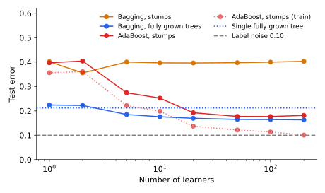

<ul class="post-sources">
<li markdown="span">질문 출처: [Science Vibe, 머신러닝 면접 질문 모음](https://jrc-park.tistory.com/259)</li>
</ul>

## 면접 답변

> 가장 큰 차이는 학습 방식과 줄이는 오차의 종류입니다.
> 배깅은 서로 다른 부트스트랩 표본으로 모델을 독립적으로 학습해 평균하므로 주로 분산을 줄이고, 부스팅은 앞선 모델의 오차를 보완하도록 순차적으로 학습하므로 주로 편향을 줄입니다.
> 그래서 배깅에는 깊은 나무처럼 분산이 큰 모델이, 부스팅에는 스텀프나 얕은 나무처럼 편향이 큰 모델이 어울립니다.
> 예를 들어 랜덤 포레스트는 나무를 많이 추가해도 과적합이 크게 심해지지 않지만, Gradient Boosting은 나무가 너무 많으면 과적합될 수 있어 조기 종료가 필요합니다.
> 실무에서는 튜닝이 간단하고 노이즈에 강한 쪽을 원하면 배깅 계열을, 튜닝을 감수하고 예측 성능을 높이려면 부스팅 계열을 먼저 시도합니다.

## 자세한 설명

### 비교

| 항목 | 배깅 | 부스팅 |
|---|---|---|
| 학습 순서 | 병렬, 모델끼리 독립 | 순차, 이전 모델에 의존 |
| 데이터 사용 | 부트스트랩 재표본 | 샘플 가중치 또는 잔차 변경 |
| 결합 | 동일 가중 평균 또는 투표 | 대개 가중합 |
| 주로 줄이는 오차 | 분산 | 편향 |
| 기본 모델 | 깊은 나무 등 저편향, 고분산 | 얕은 나무 등 고편향, 저분산 |
| 모델 수 증가 | 수렴, 과적합이 심해지지 않음 | 지나치면 과적합 가능 |
| 레이블 노이즈 | 상대적으로 강함 | 상대적으로 민감 |
| 대표 예 | 랜덤 포레스트 | AdaBoost, XGBoost |

"주로"라는 표현이 중요하다. 부스팅도 분산을 줄이는 효과가 있을 수 있어 이 구분은 절대적인 규칙이 아니라 경향이다.

### 실험

2차원 표준 정규 입력에서 원 $$x_1^2 + x_2^2 = 1.386$$의 안팎을 양성, 음성으로 정하고(두 클래스가 거의 같은 비율), 레이블 10%를 뒤집었다. 따라서 달성 가능한 최소 오차는 0.10이다. 학습 샘플 300개, 테스트 샘플 4,000개로 30번 반복해 평균했다.

*학습기 수에 따른 테스트 오차. 합성 데이터로 계산한 값이다. 스텀프를 배깅하면 개선이 거의 없지만, 부스팅하면 오차가 크게 줄어든다.*

| 모델 | 학습기 1개 | 10개 | 200개 |
|---|---:|---:|---:|
| 배깅, 스텀프 | 0.401 | 0.397 | 0.403 |
| 배깅, 끝까지 자란 나무 | 0.224 | 0.176 | 0.163 |
| AdaBoost, 스텀프 | 0.397 | 0.252 | 0.181 |

- **스텀프 배깅**: 스텀프 하나로는 원 모양 경계를 표현할 수 없다. 평균해도 편향이 그대로이므로 오차가 0.40 근처에 머문다.
- **깊은 나무 배깅**: 전체 데이터로 학습한 나무 1개의 오차 0.212에서 0.163까지 줄었다. 나무의 분산이 줄어든 결과이다.
- **스텀프 부스팅**: 같은 스텀프로도 축에 평행한 경계를 쌓아 원을 근사하므로 0.18 근처까지 내려간다. 이때 학습 오차는 약 0.10까지 줄어 테스트 오차와의 차이가 벌어진다.

이 실험의 결과는 "배깅이 부스팅보다 낫다"는 뜻이 아니다. 데이터와 튜닝에 따라 순위는 쉽게 바뀌며, 여기서 부스팅은 학습률이나 나무 깊이를 조정하지 않았고 레이블 노이즈도 넣었다. 비교의 요점은 어떤 기본 모델이 어떤 방식과 맞는가이다.

### 선택 지침

- **기본값이 필요하고 튜닝 시간이 적다**: 랜덤 포레스트처럼 배깅 계열이 무난하다.
- **표 형태 데이터에서 성능을 높이고 싶고 검증 데이터가 충분하다**: Gradient Boosting을 시도한다.
- **레이블 노이즈가 많다**: 배깅 계열이나, 학습률을 낮추고 정규화한 부스팅을 쓴다.

## 관련 개념

- **배깅**: [Q-102](/blog/2026/11/02/knowledge-102-bagging/)에서 다룬다.
- **부스팅**: [Q-104](/blog/2026/11/02/knowledge-104-boosting/)에서 다룬다.
- **편향-분산 분해**: 두 방식의 차이를 설명하는 틀이다. [Q-28](/blog/2026/11/02/knowledge-28-bias-variance/)을 참고한다.

## 꼬리 질문

**Q.** 부스팅의 기본 모델로 깊은 나무를 쓰면 어떻게 되나요?
첫 모델이 이미 학습 데이터를 거의 맞히면 다음 모델이 보완할 내용이 노이즈뿐이어서 과적합되기 쉽습니다. 그래서 깊이를 제한합니다.

**Q.** 부스팅도 병렬화할 수 있나요?
나무를 차례로 더하는 과정 자체는 순차적입니다. 그러나 나무 하나를 만들 때 분기 탐색을 병렬화할 수 있으며, XGBoost나 LightGBM 같은 구현이 이를 활용합니다.

**Q.** 부스팅과 배깅을 함께 쓸 수 있나요?
네. 각 부스팅 단계에서 데이터 일부만 사용하는 stochastic gradient boosting이 대표적입니다. 샘플링 덕분에 분산이 줄어드는 효과를 얻습니다.
