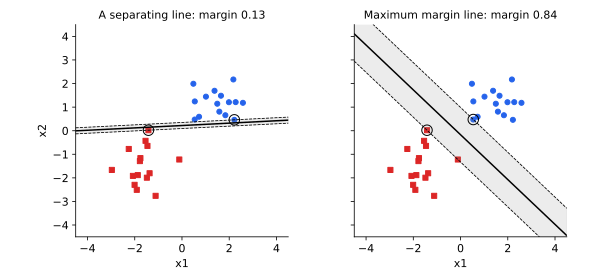

<ul class="post-sources">
<li markdown="span">질문 출처: [Science Vibe, 머신러닝 면접 질문 모음](https://jrc-park.tistory.com/259)</li>
</ul>

## 면접 답변

> 마진을 최대화하면 일반화와 안정성 측면에서 장점이 있습니다.
> 첫째, 경계와 샘플 사이 여유가 커서 입력이 마진보다 작게 변해도 학습 샘플 근처의 예측은 바뀌지 않습니다.
> 둘째, 마진이 크면 입력 차원이 높아도 모델의 유효 복잡도가 제한된다는 이론적 일반화 상한이 있습니다.
> 셋째, 볼록 문제여서 초평면이 유일하게 정해지고, 해가 서포트 벡터에만 의존합니다.
> 다만 마진이 크다고 테스트 성능이 반드시 좋아지는 것은 아닙니다. 간단한 시뮬레이션에서는 퍼셉트론과 차이가 거의 없는 경우도 있고, 하드 마진은 이상치 하나에도 크게 흔들리므로 실제로는 소프트 마진을 씁니다.

## 자세한 설명

여기서 마진 $$\gamma$$는 초평면에서 가장 가까운 샘플까지의 거리이다. SVM의 수식은 [Q-107](/blog/2026/11/02/knowledge-107-svm/)에서 다룬다.

*같은 데이터에서 일부러 기울인 분리선(왼쪽, 마진 0.13)과 최대 마진 분리선(오른쪽, 마진 0.84). 원으로 표시한 점이 경계를 결정하는 샘플이다. 왼쪽 그림은 가능한 분리선 중 나쁜 예를 고른 것이다.*

### 1. 입력 변화에 대한 여유

학습 샘플을 $$\lVert\boldsymbol{\delta}\rVert < \gamma$$만큼 움직여도 초평면을 넘지 못하므로 예측이 바뀌지 않는다. 그림의 왼쪽 경계는 0.13만 움직여도 넘어갈 수 있는 샘플이 있지만, 오른쪽은 0.84까지 안전하다. 이 보장은 **학습 샘플** 주변에 대한 것이고, 테스트 샘플이 어느 위치에 나타날지는 따로 보장하지 않는다.

### 2. 일반화 이론

반지름 $$R$$인 공 안의 데이터에서 마진 $$\gamma$$ 이상인 초평면 집합의 VC 차원은 다음과 같이 제한된다(Vapnik). $$d$$는 입력 차원이다.

$$
h \le \min\left(\left\lceil \frac{R^2}{\gamma^2} \right\rceil, d\right) + 1
$$

즉, 차원 $$d$$가 매우 커도 마진이 크면 복잡도가 작을 수 있다. 커널로 아주 높은 차원에 매핑해도 SVM이 잘 동작할 수 있는 이유를 이 관점에서 설명한다. 다만 이 값은 상한이어서 실제 오차를 예측하는 값으로 쓰기에는 느슨한 경우가 많다. 하드 마진 SVM에서 leave-one-out 오차가 서포트 벡터 비율 이하라는 결과도 같은 방향의 근거이다.

### 3. 유일한 해

분리 가능한 데이터를 나누는 초평면은 무수히 많고, 퍼셉트론의 해는 초기값과 샘플 순서에 따라 달라진다. 반면 하드 마진 문제의 목적 함수는 $$\mathbf{w}$$에 대해 강볼록하므로 $$\mathbf{w}$$가 유일하게 정해진다.

### 4. 희소성

해가 서포트 벡터만으로 표현되므로, 커널 SVM은 예측할 때 학습 샘플 전체를 저장하지 않아도 된다. 다만 데이터가 잘 분리되지 않으면 서포트 벡터의 수가 많아질 수 있다.

### 실제로 얼마나 차이 나는가

평균이 $$\pm(1.5, 1.5)$$, 공분산이 $$I$$인 두 정규 분포에서 클래스당 20개를 뽑고, 분리 가능한 경우 500번에 대해 최대 마진 분류기와 퍼셉트론을 비교했다. 테스트는 클래스당 5,000개로 평가했다.

| 분류기 | 평균 마진 | 평균 테스트 오차 |
|---|---:|---:|
| 최대 마진 | 0.459 | 2.79% |
| 퍼셉트론(영벡터에서 시작) | 0.208 | 2.74% |

최적 오차는 약 1.69%이다. 차이 0.04%포인트는 표준오차 약 0.05%포인트 안에 들고, 두 방법 중 어느 쪽이 나은지도 시행마다 거의 반반이다. 따라서 이 단순한 저차원 설정에서는 마진이 2배 넘게 커졌어도 테스트 오차가 나아지지 않았다. 이 결과가 마진의 효과 전반을 부정하는 것은 아니지만, 마진 최대화가 곧 더 나은 테스트 성능을 뜻하지는 않는다는 점을 보여 준다.

### 한계

- **이상치에 민감함**: 하드 마진은 가장 가까운 점들로만 정해진다. 소프트 마진의 $$C$$로 조절한다.
- **스케일 의존**: 거리 기반이므로 특징의 스케일을 바꾸면 마진을 최대화하는 초평면도 달라진다.
- **분포를 고려하지 않음**: 경계에 가까운 샘플만 사용하므로 클래스 전체의 분포 정보는 쓰지 않는다.

## 관련 개념

- **SVM 활용**: 사용하기 적합한 상황은 [Q-42](/blog/2026/11/02/knowledge-42-svm-when/)에서 다룬다.
- **L2 정규화**: $$\lVert\mathbf{w}\rVert$$를 줄이는 것이 마진을 넓히는 것과 대응한다. [Q-90](/blog/2026/11/02/knowledge-90-regularization/)을 참고한다.
- **부스팅의 마진**: AdaBoost의 일반화를 마진 분포로 설명하는 이론도 있다. [Q-104](/blog/2026/11/02/knowledge-104-boosting/)를 참고한다.
- **적대적 예제**: 작은 입력 변화에 대한 안정성을 깊은 모델에서 다룬다. [Deep Learning 20](/blog/2026/10/22/dl-20-adversarial-examples/)을 참고한다.

## 꼬리 질문

**Q.** 마진과 $$\lVert\mathbf{w}\rVert$$는 왜 반비례하나요?
가장 가까운 샘플에서 $$y_i(\mathbf{w}^\top\mathbf{x}_i + b) = 1$$이 되도록 크기를 맞췄기 때문입니다. 그 샘플의 거리는 $$1/\lVert\mathbf{w}\rVert$$이므로 노름이 작을수록 마진이 큽니다.

**Q.** $$C$$를 무한히 키우면 어떻게 되나요?
분리 가능한 데이터에서는 위반이 허용되지 않아 하드 마진과 같아집니다. 분리 불가능한 데이터에서는 위반을 최대한 줄이려 하면서 경계가 이상치에 민감해집니다.

**Q.** 신경망에서도 마진이 의미가 있나요?
로지스틱 손실로 선형 분리 가능한 데이터를 경사하강법으로 학습하면 가중치 방향이 최대 마진 해로 수렴한다는 결과가 알려져 있습니다. 다만 깊은 신경망의 일반화를 마진만으로 설명할 수 있는지는 아직 확정되지 않았습니다.
