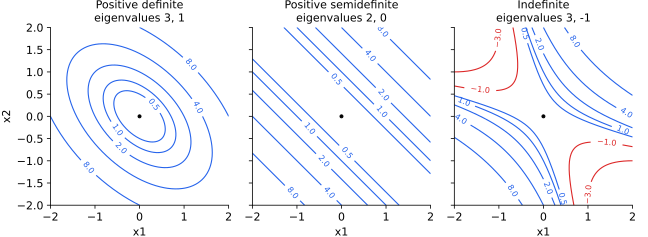

<ul class="post-sources">
<li markdown="span">질문 출처: [Science Vibe, 머신러닝 면접 질문 모음](https://jrc-park.tistory.com/259)</li>
</ul>

## 면접 답변

> 대칭 행렬 A가 양의 정부호(positive-definite)라는 것은 0이 아닌 모든 벡터 x에 대해 x 전치 A x가 양수라는 뜻이고, 고유값이 모두 양수라는 조건과 동치입니다.
> 기하학적으로는 어느 방향으로 가도 값이 커지는 그릇 모양의 2차 함수에 해당해, 최솟값이 하나뿐입니다.
> 그래서 어떤 임계점에서 헤시안이 양의 정부호이면 그 점은 극솟값입니다.
> 예를 들어 공분산 행렬은 항상 양의 준정부호이고, 어떤 특징도 다른 특징의 선형 결합이 아니면 양의 정부호가 됩니다.
> 주의할 점은 성분이 전부 양수라고 양의 정부호인 것은 아니라는 것으로, [[1, 2], [2, 1]]은 고유값 -1을 가집니다.

## 자세한 설명

### 정의

대칭 행렬 $$A$$를 다음과 같이 분류한다. 문헌에 따라 대칭을 정의의 일부로 삼는다.

| 이름 | 조건($$\mathbf{x} \ne \mathbf{0}$$) | 고유값 |
|---|---|---|
| 양의 정부호(PD) | $$\mathbf{x}^\top A\mathbf{x} > 0$$ | 모두 양수 |
| 양의 준정부호(PSD) | $$\mathbf{x}^\top A\mathbf{x} \ge 0$$ | 모두 0 이상 |
| 부정부호(indefinite) | 부호가 모두 나타남 | 양수와 음수가 모두 있음 |

고유값과의 동치는 $$A = Q\Lambda Q^\top$$에 $$\mathbf{y} = Q^\top\mathbf{x}$$를 대입하면 바로 나온다.

$$
\mathbf{x}^\top A\mathbf{x} = \mathbf{y}^\top\Lambda\mathbf{y} = \sum_{i}\lambda_i y_i^2
$$

*$$\mathbf{x}^\top A\mathbf{x}$$의 등고선. 왼쪽은 타원(PD), 가운데는 값이 변하지 않는 방향이 있는 평행선(PSD), 오른쪽은 음수 영역(붉은색)이 있는 쌍곡선(부정부호)이다.*

### 판별 방법

대칭 행렬에서 다음은 모두 PD와 동치이다.

- 모든 고유값이 양수이다.
- 모든 선행 주소행렬식(leading principal minor)이 양수이다(Sylvester 판정법).
- 대각 성분이 양수인 하삼각 행렬 $$L$$로 $$A = LL^\top$$ 분해가 존재한다(Cholesky).
- 열이 독립인 행렬 $$X$$로 $$A = X^\top X$$로 쓸 수 있다.

실제 계산에서는 Cholesky 분해를 시도하는 방법이 효율적이고 안정적이다.

### 수치 예제

| 행렬 | 고유값 | 선행 소행렬식 | 판정 |
|---|---|---|---|
| $$\begin{bmatrix} 2 & 1 \\ 1 & 2 \end{bmatrix}$$ | 3, 1 | 2, 3 | PD |
| $$\begin{bmatrix} 2 & -1 \\ -1 & 2 \end{bmatrix}$$ | 3, 1 | 2, 3 | PD |
| $$\begin{bmatrix} 1 & 1 \\ 1 & 1 \end{bmatrix}$$ | 2, 0 | 1, 0 | PSD |
| $$\begin{bmatrix} 1 & 2 \\ 2 & 1 \end{bmatrix}$$ | 3, −1 | 1, −3 | 부정부호 |

마지막 행렬에서 $$\mathbf{x} = (1, -1)$$이면 $$\mathbf{x}^\top A\mathbf{x} = -2$$이다. 첫 행렬의 Cholesky 인수는 대각 성분이 $$\sqrt{2}$$, $$\sqrt{3/2}$$이고 왼쪽 아래 성분이 $$1/\sqrt{2}$$이다.

한 가지 주의할 점이 있다. PSD의 경우, 선행 소행렬식이 0 이상인 것만으로는 충분하지 않다. 모든 주소행렬식을 확인해야 한다.

### 머신러닝에서의 의미

- **볼록성**: 2차 미분 가능한 함수는 헤시안이 모든 점에서 PSD인 것과 볼록인 것이 동치이다. 임계점에서 헤시안이 PD이면 극소, 부정부호이면 안장점이다.
- **공분산**: $$\mathbf{a}^\top\Sigma\mathbf{a} = \text{Var}(\mathbf{a}^\top\mathbf{x}) \ge 0$$이므로 항상 PSD이다. 정규 분포의 밀도에는 $$\Sigma^{-1}$$이 필요하므로 PD이어야 한다.
- **커널**: 유효한 커널은 어떤 샘플을 넣어도 커널 행렬이 PSD이어야 한다.
- **릿지 회귀**: $$X^\top X$$는 PSD이고, $$\lambda > 0$$이면 $$X^\top X + \lambda I$$의 고유값은 $$\lambda$$ 이상이어서 PD이다. 따라서 항상 역행렬이 있다.
- **뉴턴 방법**: 헤시안이 PD이면 뉴턴 방향이 하강 방향이다.

## 관련 개념

- **대칭 행렬**: PD의 전제이자 직교 대각화의 근거이다. [Q-112](/blog/2026/11/02/knowledge-112-symmetric-matrix/)를 참고한다.
- **볼록 함수**: [Q-21](/blog/2026/11/02/knowledge-21-convex/)에서 다룬다.
- **고유값**: 판별 기준이자 곡률의 크기이다. [Q-118](/blog/2026/11/02/knowledge-118-eigenvalue/)을 참고한다.
- **커널 행렬의 조건**: [Machine Learning 7](/blog/2026/10/22/ml-07-kernels/)에서 다룬다.

## 꼬리 질문

**Q.** $$X^\top X$$는 왜 PSD이고, 언제 PD인가요?
$$\mathbf{v}^\top X^\top X\mathbf{v} = \lVert X\mathbf{v}\rVert^2 \ge 0$$이므로 PSD입니다. $$X\mathbf{v} = \mathbf{0}$$의 해가 영벡터뿐일 때, 즉 열이 독립일 때 PD입니다.

**Q.** 대칭이 아닌 행렬에서 2차 형식이 양수이면 고유값도 양수인가요?
그렇지 않습니다. $$\begin{bmatrix} 1 & 1 \\ -1 & 1 \end{bmatrix}$$의 2차 형식은 $$x_1^2 + x_2^2$$이지만 고유값은 $$1 \pm i$$입니다. 2차 형식은 대칭 부분만 보기 때문입니다.

**Q.** 공분산 행렬의 PD 조건이 수치적으로 깨지면 어떻게 하나요?
추정 오차나 반올림으로 Cholesky 분해가 실패할 수 있습니다. 대각 성분에 작은 값을 더하거나 수축 추정(shrinkage)을 사용합니다.
