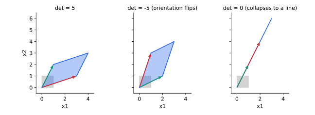

<ul class="post-sources">
<li markdown="span">질문 출처: [Science Vibe, 머신러닝 면접 질문 모음](https://jrc-park.tistory.com/259)</li>
</ul>

## 면접 답변

> 행렬식(determinant)은 행렬을 선형 변환으로 봤을 때 부피가 몇 배로 변하는지를 나타내는 값이고, 부호는 방향이 뒤집히는지를 알려 줍니다.
> 값이 0이면 공간이 더 낮은 차원으로 납작해지는 것이어서 정보가 사라지고 역행렬이 존재하지 않습니다.
> 예를 들어 [[3, 1], [1, 2]]의 행렬식은 5이고, 넓이 1인 단위 정사각형을 넓이 5인 평행사변형으로 옮깁니다.
> 행렬식은 고유값들의 곱과 같습니다.
> 머신러닝에서는 정규 분포의 밀도와 normalizing flow의 변수 변환에서 부피 변화를 보정하는 항으로 쓰입니다.

## 자세한 설명

### 기하학적 의미

$$2 \times 2$$ 행렬의 행렬식은 다음과 같다.

$$
\det\begin{bmatrix} a & b \\ c & d \end{bmatrix} = ad - bc
$$

행렬의 두 열은 단위 정사각형의 두 변이 옮겨 간 벡터이다. $$\lvert\det A\rvert$$는 그 벡터들이 만드는 평행사변형의 넓이이다. 3차원에서는 평행육면체의 부피이고, 일반 차원에서도 같다. 어떤 영역이든 변환 후의 부피는 원래 부피의 $$\lvert\det A\rvert$$배가 된다.

*회색의 단위 정사각형이 변환된 모습. 화살표는 변환된 두 기저 벡터이다. 부호가 음수이면 두 벡터의 회전 순서가 뒤집히고, 0이면 넓이가 사라진다.*

### 주요 성질

| 성질 | 의미 |
|---|---|
| $$\det(AB) = \det A \det B$$ | 연속 변환의 부피 배율은 곱해진다 |
| $$\det(A^{-1}) = 1/\det A$$ | 역변환은 배율을 되돌린다 |
| $$\det(A^\top) = \det A$$ | 행과 열은 대칭적이다 |
| $$\det A = \prod_i \lambda_i$$ | 고유 방향의 배율을 곱한 값이다 |
| $$\det A = 0 \iff A$$가 특이 행렬 | 랭크가 부족하다 |
| 직교 행렬에서 $$\det Q = \pm 1$$ | 회전과 반사는 부피를 보존한다 |

$$A = \begin{bmatrix} 3 & 1 \\ 1 & 2 \end{bmatrix}$$의 고유값은 약 3.618과 1.382이고, 그 곱은 $$3 \cdot 2 - 1 \cdot 1 = 5$$와 같다.

### 행렬식이 작다고 거의 특이한 것은 아니다

행렬식은 특이성의 척도로 쓰기에 적합하지 않다. 크기가 차원에 따라 쉽게 변하기 때문이다.

| 행렬 | $$\det$$ | 조건수 | 해석 |
|---|---:|---:|---|
| $$0.1I$$ (10차원) | $$10^{-10}$$ | 1 | 단순 축소, 수치적으로 매우 안정 |
| $$\begin{bmatrix} 1 & 1 \\ 1 & 1.0001 \end{bmatrix}$$ | $$10^{-4}$$ | 약 $$4 \times 10^4$$ | 거의 특이 |

행렬이 거의 특이한지는 조건수나 특이값으로 판단해야 한다.

### 머신러닝에서의 쓰임

**다변량 정규 분포**의 정규화 상수는 $$\det\Sigma$$를 포함한다. 분포가 늘어난 부피만큼 밀도를 낮추어 전체 적분을 1로 유지하기 위해서이다.

$$
p(\mathbf{x}) = \frac{1}{\sqrt{(2\pi)^d\det\Sigma}}\exp\left(-\frac{1}{2}(\mathbf{x} - \boldsymbol{\mu})^\top\Sigma^{-1}(\mathbf{x} - \boldsymbol{\mu})\right)
$$

**변수 변환**에서도 같은 이유로 등장한다. 비선형 함수는 국소적으로 야코비 행렬이라는 선형 변환으로 근사되므로, 그 행렬식이 국소 부피 배율이다. [Q-120](/blog/2026/11/02/knowledge-120-jacobian/)과 [Normalizing Flow](/blog/2026/10/24/imc-08-flow/)에서 다룬다.

고차원에서는 행렬식이 쉽게 넘치거나 사라지므로 값 대신 로그 행렬식을 계산한다. PD 행렬이면 Cholesky 인수 $$L$$로 $$\log\det A = 2\sum_i\log L_{ii}$$이다.

## 관련 개념

- **역행렬과 랭크**: 행렬식이 0인지와 풀 랭크인지는 정방행렬에서 동치이다. [Q-114](/blog/2026/11/02/knowledge-114-rank/)를 참고한다.
- **고유값**: 행렬식은 고유값의 곱이다. [Q-118](/blog/2026/11/02/knowledge-118-eigenvalue/)을 참고한다.
- **특성 방정식**: $$\det(A - \lambda I) = 0$$으로 고유값을 구한다. [Linear Algebra 7](/blog/2026/10/22/la-07-eigendecomposition/)에서 다룬다.
- **GDA**: 정규 분포로 클래스를 모델링하므로 밀도식에 행렬식이 포함된다. [Machine Learning 5](/blog/2026/10/22/ml-05-gda/)를 참고한다.

## 꼬리 질문

**Q.** $$\det(cA)$$는 얼마인가요?
$$n \times n$$ 행렬이면 $$c^n\det A$$입니다. 각 축을 $$c$$배 하므로 부피는 $$c^n$$배가 됩니다.

**Q.** 큰 행렬의 행렬식은 어떻게 계산하나요?
여인수 전개는 비용이 $$n!$$에 비례해 쓸 수 없습니다. LU 분해 후 대각 성분을 곱하면 $$O(n^3)$$으로 계산됩니다.

**Q.** 행렬식의 부호는 언제 중요한가요?
방향 보존 여부를 판단할 때입니다. 예를 들어 Kabsch 알고리즘으로 최적 회전을 구할 때 행렬식이 $$-1$$이면 회전이 아니라 반사이므로 보정합니다.
