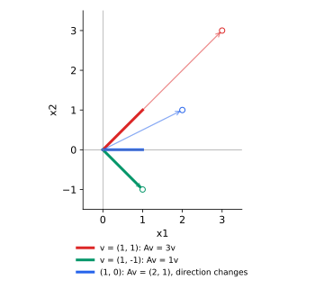

<ul class="post-sources">
<li markdown="span">질문 출처: [Science Vibe, 머신러닝 면접 질문 모음](https://jrc-park.tistory.com/259)</li>
</ul>

## 면접 답변

> 고유벡터(eigenvector)는 행렬을 곱해도 방향이 유지되고 크기만 변하는 0이 아닌 벡터이며, 그 배율을 고유값이라고 합니다. 식으로는 Av = λv입니다.
> 대부분의 벡터는 행렬을 곱하면 방향이 바뀌므로, 고유벡터는 그 변환의 고유한 축이라고 볼 수 있습니다.
> 예를 들어 [[2, 1], [1, 2]]에 (1, 1)을 곱하면 (3, 3)이 되어 방향이 같고 크기만 3배가 되지만, (1, 0)을 곱하면 (2, 1)이 되어 방향이 바뀝니다.
> 고유값을 부호까지 포함해 생각하므로 방향이 반대로 뒤집히는 경우도 고유벡터에 포함됩니다.
> 또한 고유벡터는 크기가 정해져 있지 않아, 0이 아닌 상수를 곱해도 같은 고유값의 고유벡터입니다.

## 자세한 설명

### 정의

정방행렬 $$A$$에 대해 다음을 만족하는 $$\mathbf{v} \ne \mathbf{0}$$이 **고유벡터**이고, 스칼라 $$\lambda$$가 **고유값**이다.

$$
A\mathbf{v} = \lambda\mathbf{v}
$$

영벡터는 어떤 $$\lambda$$에도 식을 만족하므로 제외한다.

### 구하는 방법

식을 $$(A - \lambda I)\mathbf{v} = \mathbf{0}$$으로 고쳐 쓰면, 0이 아닌 해가 있어야 하므로 $$A - \lambda I$$는 특이 행렬이다. 따라서 고유값은 특성 방정식의 근이고, 고유벡터는 $$A - \lambda I$$의 영공간에 있는 0이 아닌 벡터이다.

$$
\det(A - \lambda I) = 0
$$

**수치 예제.** $$A = \begin{bmatrix} 2 & 1 \\ 1 & 2 \end{bmatrix}$$이면 $$(2 - \lambda)^2 - 1 = \lambda^2 - 4\lambda + 3 = 0$$이므로 $$\lambda = 3, 1$$이다.

- $$\lambda = 3$$: $$(A - 3I)\mathbf{v} = \mathbf{0}$$에서 $$\mathbf{v} = (1, 1)$$
- $$\lambda = 1$$: $$(A - I)\mathbf{v} = \mathbf{0}$$에서 $$\mathbf{v} = (1, -1)$$

*굵은 선은 원래 벡터, 원으로 끝나는 얇은 화살표는 $$A$$를 곱한 결과이다. 고유벡터는 같은 직선 위에 머물지만 $$(1, 0)$$은 방향이 바뀐다.*

### 항상 실수 고유벡터가 있는 것은 아니다

- **회전 행렬**: 90도 회전 $$\begin{bmatrix} 0 & -1 \\ 1 & 0 \end{bmatrix}$$은 모든 실수 벡터의 방향을 바꾼다. 고유값은 $$\pm i$$이다.
- **결손 행렬(defective matrix)**: 전단 $$\begin{bmatrix} 1 & 1 \\ 0 & 1 \end{bmatrix}$$은 고유값 1이 두 번 나오지만 고유 방향은 $$(1, 0)$$ 하나뿐이다. 고유벡터로 기저를 만들 수 없어 대각화가 되지 않는다.
- **대칭 행렬**: 실수 고유값과 서로 직교하는 고유벡터의 기저가 항상 있다. [Q-112](/blog/2026/11/02/knowledge-112-symmetric-matrix/)에서 다룬다.

### 대각화

$$n$$개의 독립인 고유벡터를 열로 쌓은 행렬을 $$V$$, 고유값을 담은 대각 행렬을 $$\Lambda$$라 하면 다음과 같다.

$$
A = V\Lambda V^{-1}
$$

즉, 고유벡터 좌표계로 옮기면 $$A$$는 각 축을 독립적으로 늘리는 대각 행렬이 된다. 이 성질이 왜 쓸모 있는지는 [Q-117](/blog/2026/11/02/knowledge-117-eigenvector-importance/)에서 다룬다.

## 관련 개념

- **고유값**: 고유벡터 방향의 배율이다. [Q-118](/blog/2026/11/02/knowledge-118-eigenvalue/)에서 다룬다.
- **고유값 분해**: 유도와 기하학적 설명은 [Linear Algebra 7](/blog/2026/10/22/la-07-eigendecomposition/)에서 다룬다.
- **행렬 관점의 고유값**: 다른 설명은 [Spectral](/blog/2026/10/23/see-matrix-02-spectral/)을 참고한다.
- **영공간**: 고유값 0의 고유벡터는 영공간의 원소이다. [Q-111](/blog/2026/11/02/knowledge-111-null-space/)을 참고한다.

## 꼬리 질문

**Q.** 정규화된 고유벡터는 유일한가요?
아닙니다. 부호를 바꾸어도 조건을 만족합니다. 라이브러리나 실행에 따라 PCA 주성분의 부호가 뒤집히는 이유입니다. 고유값이 중복되면 그 고유 공간 안에서 기저도 자유롭게 고를 수 있습니다.

**Q.** 큰 행렬의 고유벡터는 어떻게 구하나요?
특성 방정식을 직접 풀지 않고 QR 알고리즘을 씁니다. 가장 큰 고유값 몇 개만 필요하면 멱반복법이나 Lanczos 방법이 효율적입니다.

**Q.** 비정방 행렬에도 고유벡터가 있나요?
없습니다. 입력과 출력의 차원이 달라 $$A\mathbf{v} = \lambda\mathbf{v}$$가 정의되지 않습니다. 대신 SVD의 특이 벡터를 사용합니다.
