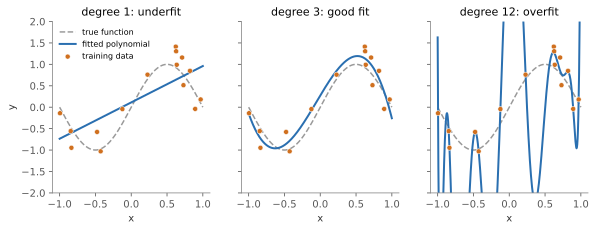
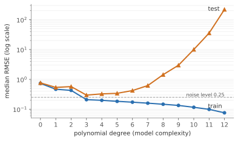

## 면접 답변

> 과적합은 모델이 학습 데이터의 일반적인 패턴뿐 아니라 잡음까지 학습해서, 학습 성능은 좋은데 새로운 데이터에서는 성능이 떨어지는 현상입니다. 주된 원인은 데이터 양과 품질에 비해 모델의 표현력이 너무 큰 것입니다. 학습 오차와 검증 오차를 함께 보아서, 학습 오차는 계속 내려가는데 검증 오차가 오르거나 큰 격차를 유지하면 의심합니다. 해결 방법으로는 데이터를 늘리거나, 모델을 단순화하거나, L2 정규화나 드롭아웃, 조기 종료를 적용합니다. 예를 들어 데이터 15개에 12차 다항식을 맞추면 곡선이 거의 모든 점을 지나가지만, 점 사이에서 크게 요동쳐 새 데이터에서는 3차 다항식보다 훨씬 나쁜 예측을 합니다.

## 자세한 설명

### 정의

학습 데이터의 평균 손실을 $$\hat{R}(f)$$, 분포 전체의 기대 손실을 $$R(f)$$라고 하면 둘의 차이를 **일반화 격차(generalization gap)**라고 한다.

$$
\text{gap} = R(f) - \hat{R}(f)
$$

격차가 어느 정도 있는 것 자체는 정상이다. 과적합이라고 부르는 것은 모델이 학습 데이터 특유의 잡음에 맞춰져, 더 단순하거나 더 규제된 모델이었다면 얻었을 $$R(f)$$보다 나빠진 상태이다.

### 실험: 다항식 회귀

참 함수는 $$y = \sin(\pi x) + \varepsilon$$이다. $$\varepsilon$$은 표준편차 0.25인 정규 잡음이고, 학습 데이터는 구간 $$[-1, 1]$$의 균등 분포에서 뽑은 15개이다. 여기에 차수만 바꾼 다항식을 최소제곱으로 맞춘다.

*같은 학습 데이터 15개에 맞춘 세 다항식. 1차는 패턴을 따라가지 못하고(과소적합), 3차는 참 함수에 가까우며, 12차는 점들을 거의 지나가지만 그 사이에서 크게 요동친다(과적합).*

데이터를 새로 뽑아 500번 반복한 RMSE(root mean squared error)의 중앙값은 다음과 같다.

*다항식 차수에 따른 RMSE 중앙값(로그 축). 학습 오차는 차수가 오를수록 계속 내려가지만, 테스트 오차는 3차 근처에서 가장 낮고 이후 급격히 오른다.*

| 차수 | 학습 RMSE | 테스트 RMSE | 상태 |
|---|---|---|---|
| 1 | 0.466 | 0.537 | 과소적합 |
| 3 | 0.209 | 0.297 | 적절 |
| 12 | 0.076 | 219 | 과적합 |

잡음의 표준편차가 0.25이므로 어떤 모델도 평균적으로 테스트 RMSE를 0.25보다 낮출 수 없다. 12차의 학습 RMSE 0.076이 이보다 훨씬 낮다는 것은 잡음까지 외웠다는 신호이다. 12차 모델은 매개변수가 13개여서 데이터 15개를 거의 그대로 표현할 수 있다.

이 예에서 12차의 테스트 오차가 이토록 큰 것은 데이터 수가 적은 데다 다항식이 구간 끝에서 크게 튀기 때문이며, 모든 과적합이 이 정도로 극적이지는 않다.

### 왜 일어나는가: 편향과 분산

제곱 손실에서 고정된 입력 $$x$$의 기대 오차는 다음처럼 분해된다. $$\sigma^2$$은 줄일 수 없는 잡음의 분산, $$\bar{f}(x)$$는 학습 데이터를 바꿔 가며 얻은 모델 예측의 평균, $$f^*(x)$$는 참 함수이다.

$$
\mathbb{E}\big[(y - \hat{f}(x))^2\big] = \sigma^2 + \big(\bar{f}(x) - f^*(x)\big)^2 + \mathbb{E}\big[(\hat{f}(x) - \bar{f}(x))^2\big]
$$

마지막 항이 분산으로, 과적합은 이 항이 지배하는 상태이다. 데이터가 적을수록, 모델이 유연할수록 커진다.

### 진단

| 학습 오차 | 검증 오차 | 해석 |
|---|---|---|
| 높음 | 높음 (학습과 비슷) | 과소적합 |
| 낮음 | 높음 | 과적합 |
| 낮음 | 낮음 | 양호 |
| 낮음 | 비정상적으로 낮음 | 데이터 누수 의심 |

학습 데이터 크기를 늘려 가며 두 오차를 그리는 학습 곡선도 유용하다. 두 곡선이 크게 벌어진 채 점차 가까워지면 데이터를 더 모으는 것이 도움이 될 가능성이 크다.

### 해결 방법

- **데이터**: 더 모으거나, 이미지라면 뒤집기 같은 증강을 쓴다.
- **모델 단순화**: 차수, 층, 트리 깊이, 특징 수를 줄인다.
- **정규화**: 손실에 가중치 크기에 대한 벌점을 더한다. 다음은 L2(ridge)이다.

$$
\min_{w} \sum_{i=1}^{n} \big(y_i - w^\top \phi(x_i)\big)^2 + \lambda \lVert w \rVert^2
$$

$$\phi$$는 특징 변환, $$\lambda \ge 0$$은 규제 강도이다. 위 실험에서 12차 모델(르장드르 다항식 기저)에 $$\lambda = 0.1$$을 적용하면 테스트 RMSE 중앙값이 219에서 0.352로 내려간다. 차수는 그대로인데 계수를 눌러서 요동을 막은 결과이다.

- **신경망**: 드롭아웃, 가중치 감쇠, 조기 종료(early stopping)를 쓴다.
- **앙상블**: 배깅처럼 여러 모델을 평균해 분산을 줄인다.

### 주의: 복잡도가 크다고 항상 과적합은 아니다

위의 U자 곡선은 고전적인 관점이다. 매개변수가 데이터보다 훨씬 많은 신경망은 학습 데이터를 거의 완벽히 맞추면서도 잘 일반화하는 경우가 많고, 매개변수 수가 데이터 수를 넘어가면서 테스트 오차가 다시 내려가는 **이중 하강(double descent)**도 관찰된다. 그래서 매개변수 수만 보고 판단하지 말고 검증 성능을 보아야 한다.

## 관련 개념

- **편향-분산 트레이드오프**: 과적합과 과소적합을 분해로 설명한다. [Bias-Variance Tradeoff](/blog/2026/11/02/knowledge-28-bias-variance/)와 [Machine Learning 10](/blog/2026/10/22/ml-10-bias-variance/)에서 이중 하강까지 다룬다.
- **Train, validation, test 분할**: 과적합을 발견하려면 학습에 쓰지 않은 데이터가 있어야 한다. [Training Set과 Test Set의 차이](/blog/2026/11/02/knowledge-12-train-test/)를 참고한다.
- **MAP 추정**: L2 정규화는 가중치에 가우시안 사전 분포를 둔 MAP 추정과 같다. [Machine Learning 11](/blog/2026/10/22/ml-11-model-selection/)에서 다룬다.
- **가지치기**: 의사결정나무의 과적합을 막는 방법이다. [Decision tree 가지치기](/blog/2026/11/02/knowledge-30-tree-pruning/)를 참고한다.

## 꼬리 질문

**Q.** L1과 L2 정규화는 어떻게 다른가요?
L2는 가중치를 전반적으로 0 쪽으로 줄이고, L1은 일부 가중치를 정확히 0으로 만들어 특징 선택 효과를 낸다. L1의 벌점은 0에서 뾰족해 최적해가 0에 놓이기 쉽기 때문이다.

**Q.** 학습 오차가 0이면 무조건 과적합인가요?
아니다. 과적합 판단에는 검증 성능이 필요하다. 현대 신경망은 학습 오차가 거의 0이어도 검증 성능이 좋을 수 있으며, 잡음이 거의 없는 쉬운 문제라면 학습 오차가 0인 것이 자연스럽다.

**Q.** 검증 집합에도 과적합할 수 있나요?
그렇다. 검증 성능을 보며 설정을 아주 많이 바꾸면 검증 집합의 우연한 특성에 맞춰진다. 그래서 최종 평가는 건드리지 않은 테스트 집합으로 하고, 데이터가 적으면 중첩 교차 검증을 쓴다.

**Q.** 조기 종료는 왜 정규화처럼 작동하나요?
경사하강법이 작은 가중치에서 출발하면 학습 초반에는 주요 패턴부터 맞추고, 잡음은 나중에 맞추는 경향이 있다. 도중에 멈추면 모델이 도달할 수 있는 복잡도가 제한되며, 선형 모델의 제곱 손실에서는 L2 정규화와 근사적으로 대응한다는 분석도 있다.
