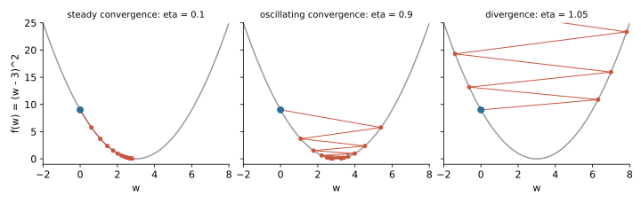

## 면접 답변

> 경사하강법은 손실 함수의 기울기를 계산해 그 반대 방향으로 파라미터를 조금씩 옮기는 일을 반복하는 최적화 방법입니다. 그래디언트는 함수가 국소적으로 가장 빠르게 증가하는 방향이므로, 그 반대로 가면 손실이 가장 빠르게 줄어듭니다. 한 번에 움직이는 크기는 학습률이 정하는데, 너무 작으면 학습이 느리고 너무 크면 진동하거나 발산합니다. 예를 들어 $$f(w) = (w - 3)^2$$에서 학습률 0.1로 $$w = 0$$에서 출발하면 $$w$$는 0.6, 1.08, 1.46으로 최솟값 3에 다가갑니다. 실제로는 전체 데이터 대신 미니배치로 그래디언트를 추정하는 미니배치 SGD를 주로 씁니다. 볼록 함수에서는 적절한 학습률로 전역 최솟값에 다가갈 수 있지만, 신경망 같은 비볼록 함수에서는 전역 최솟값이 보장되지 않습니다.

## 자세한 설명

### 업데이트 규칙

파라미터 $$\theta$$, 손실 함수 $$L$$, 학습률(learning rate) $$\eta > 0$$에 대해 $$t$$번째 업데이트는 다음과 같다.

$$
\theta_{t+1} = \theta_t - \eta \nabla_\theta L(\theta_t)
$$

### 왜 그래디언트의 반대 방향인가

작은 변화 $$\Delta$$에 대한 1차 테일러 근사는 $$L(\theta + \Delta) \approx L(\theta) + \nabla L(\theta)^\top \Delta$$이다. $$\Delta$$의 크기를 고정하면 코시-슈바르츠 부등식에 의해 내적 $$\nabla L^\top \Delta$$는 $$\Delta$$가 $$-\nabla L$$과 같은 방향일 때 가장 작다. 이 근사는 작은 범위에서만 맞으므로 학습률이 작아야 손실 감소를 기대할 수 있다.

### 학습률의 효과

$$f(w) = (w - 3)^2$$의 그래디언트는 $$2(w - 3)$$이다. 최솟값까지의 오차를 $$e_t = w_t - 3$$이라 하면 업데이트는 다음과 같이 정리된다.

$$
e_{t+1} = (1 - 2\eta) e_t
$$

따라서 $$0 < \eta < 1$$일 때만 수렴한다. $$w_0 = 0$$에서 출발한 값은 다음과 같다.

| 학습률 | $$w_1$$ | $$w_2$$ | $$w_3$$ | $$w_4$$ | $$w_5$$ | 결과 |
|---|---|---|---|---|---|---|
| $$\eta = 0.1$$ | 0.6 | 1.08 | 1.464 | 1.771 | 2.017 | 한쪽에서 수렴 |
| $$\eta = 0.9$$ | 5.4 | 1.08 | 4.536 | 1.771 | 3.983 | 진동하며 수렴 |
| $$\eta = 1.05$$ | 6.3 | -0.63 | 6.993 | -1.392 | 7.832 | 발산 |

*같은 함수와 같은 시작점에서 학습률만 바꾼 경로. 파란 점이 시작점이다.*

### 그래디언트를 얼마나 많은 데이터로 계산하는가

데이터가 $$N$$개이면 $$L(\theta) = \frac{1}{N} \sum_{i=1}^{N} \ell_i(\theta)$$이다. 여기서 $$\ell_i$$는 $$i$$번째 샘플의 손실이다.

| 방식 | 한 업데이트에 쓰는 샘플 | 특징 |
|---|---|---|
| 배치 경사하강법(batch GD) | $$N$$개 전부 | 그래디언트가 정확하지만 큰 데이터에서 업데이트 한 번이 비싸다 |
| 확률적 경사하강법(SGD) | 1개 | 업데이트가 싸지만 추정치의 잡음이 크다 |
| 미니배치 SGD | $$B$$개 | 잡음과 비용의 절충이며 GPU 병렬 계산에 맞는다 |

### 한계

- **비볼록성**: 신경망 손실에서는 지역 최솟값이나 안장점(saddle point)에서 그래디언트가 0이 될 수 있다. 그래디언트가 0이라는 것은 최솟값이 아니라 정지점(stationary point)이라는 뜻일 뿐이다.
- **나쁜 조건수**: 방향마다 곡률이 크게 다르면 경로가 지그재그로 움직인다. 특징 스케일링(feature scaling), 모멘텀(momentum), Adam 같은 방법이 이를 완화한다.
- **1차 정보만 사용**: 곡률을 보지 않으므로 학습률을 따로 조정해야 한다.

## 관련 개념

- **볼록 함수(convex function)**: 지역 최솟값이 곧 전역 최솟값인 함수로, 경사하강법의 이론적 보장이 가장 깔끔하다. [Q-21](/blog/2026/11/02/knowledge-21-convex/)에서 다룬다.
- **역전파(backpropagation)**: 신경망에서 경사하강법에 필요한 그래디언트를 계산하는 알고리즘이다. [Q-16](/blog/2026/11/02/knowledge-16-backpropagation/)에서 다룬다.
- **모멘텀과 Adam**: 과거 그래디언트의 평균이나 크기 정보를 이용해 업데이트 방향과 크기를 보정하는 변형이다. [Deep Learning 4: Optimization](/blog/2026/10/22/dl-04-optimization/)에 정리되어 있다.
- **LMS 규칙**: 선형 회귀에 경사하강법을 적용해 얻는 업데이트이다. 유도 과정은 [Machine Learning 2](/blog/2026/10/22/ml-02-lms/)에 있다.

## 꼬리 질문

**Q.** 왜 2차 정보를 쓰는 뉴턴법 대신 경사하강법을 쓰나요?
파라미터가 $$d$$개이면 헤시안은 $$d \times d$$ 행렬이어서 신경망에서는 저장도 역행렬 계산도 현실적이지 않다. 비볼록 문제에서 순수한 뉴턴법은 안장점으로 끌려갈 수도 있다.

**Q.** 특징 스케일링이 왜 도움이 되나요?
특징의 단위 차이가 크면 손실 등고선이 길쭉해져 한 학습률로 모든 방향을 다루기 어렵다. 표준화하면 조건수가 나아지는 경우가 많아 더 큰 학습률로 빠르게 수렴할 수 있다.

**Q.** 학습률은 어떻게 정하나요?
여러 값을 로그 스케일로 시험해 검증 손실로 고르고, 학습이 진행되면 학습률을 줄이는 스케줄을 함께 쓰는 것이 일반적이다. 손실이 커지면 학습률이 너무 크다는 신호이다.

**Q.** 미니배치의 잡음은 나쁘기만 한가요?
아니다. 그래디언트 추정의 분산은 수렴을 흔들지만, 업데이트를 훨씬 자주 할 수 있게 해 주고 정확한 그래디언트가 0인 불안정한 지점에 머무르지 않게 돕기도 한다.
