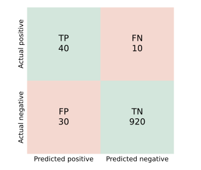

## 면접 답변

> Confusion matrix는 실제 클래스와 예측 클래스를 교차해 개수를 센 표로, 모델이 어떤 종류의 실수를 하는지 보여 줍니다. 이진 분류에서는 TP, FP, FN, TN 네 칸으로 나뉩니다. 정확도 하나만 보면 틀린 예측이 모두 똑같이 취급되지만, 실제로는 거짓 양성과 거짓 음성의 비용이 다른 경우가 많아서 이 표가 필요합니다. 예를 들어 양성이 5%인 질병 데이터에서 모두 음성이라고 답하면 정확도는 95%이지만 환자를 한 명도 찾지 못하며, 표에서는 TP가 0인 것이 바로 드러납니다. 정밀도, 재현율, 특이도 같은 지표도 모두 이 네 값에서 계산합니다. 다만 표는 정해진 임계값에서의 결과이므로, 임계값을 바꾸면 값도 달라집니다.

## 자세한 설명

### 네 칸의 의미

첫 글자는 예측이 맞았는지(True/False), 둘째 글자는 모델이 무엇이라고 예측했는지(Positive/Negative)를 나타낸다.

- **TP(true positive)**: 실제 양성을 양성으로 예측했다.
- **FN(false negative)**: 실제 양성을 음성으로 예측했다. 통계의 2종 오류이다.
- **FP(false positive)**: 실제 음성을 양성으로 예측했다. 통계의 1종 오류이다.
- **TN(true negative)**: 실제 음성을 음성으로 예측했다.

아래는 설명을 위해 만든 가상의 검진 결과로, 1000명 중 실제 양성은 50명이다.

*가상 예제의 confusion matrix. 초록은 맞힌 예측, 빨강은 틀린 예측이다.*

### 여기서 나오는 지표

| 지표 | 식 | 묻는 것 | 예제 값 |
|---|---|---|---|
| 정확도(accuracy) | $$\frac{TP + TN}{TP + FP + FN + TN}$$ | 전체 중 얼마나 맞혔나 | 0.960 |
| 정밀도(precision) | $$\frac{TP}{TP + FP}$$ | 양성 예측 중 진짜 양성은 얼마나 되나 | 0.571 |
| 재현율(recall, TPR) | $$\frac{TP}{TP + FN}$$ | 실제 양성 중 얼마나 찾았나 | 0.800 |
| 특이도(specificity, TNR) | $$\frac{TN}{TN + FP}$$ | 실제 음성 중 얼마나 음성으로 맞혔나 | 0.968 |
| 거짓 양성률(FPR) | $$\frac{FP}{FP + TN}$$ | 실제 음성 중 잘못 경보한 비율 | 0.032 |
| F1 | $$\frac{2 \cdot \text{precision} \cdot \text{recall}}{\text{precision} + \text{recall}}$$ | 정밀도와 재현율의 조화 평균 | 0.667 |

정확도 0.96은 좋아 보이지만, 모두 음성이라고 답하는 모델의 정확도도 0.95이다. 정밀도 0.571은 양성 판정을 받은 70명 중 30명이 오경보라는 뜻이다. 비율 지표만으로는 이런 내용을 알기 어려우므로 표 자체를 함께 보는 것이 좋다.

### 임계값에 따라 달라진다

확률을 출력하는 모델은 임계값을 정해야 표를 만들 수 있다. 임계값을 낮추면 양성 예측이 늘어 FN은 줄고 FP는 늘어나는 것이 보통이다. 어느 쪽이 더 비싼지에 따라 임계값을 정한다. 암 검진이라면 FN을, 스팸 필터라면 정상 메일을 버리는 FP를 더 경계한다.

### 다중 클래스

클래스가 $$K$$개이면 $$K \times K$$ 표가 된다. 대각선은 맞힌 개수이고, $$i$$행 $$j$$열은 실제 $$i$$를 $$j$$로 예측한 개수이다. 예컨대 숫자 분류에서 4와 9 칸의 값이 크면 두 클래스를 혼동한다는 것을 알 수 있어 오류 분석에 유용하다. 클래스별 지표는 해당 클래스를 양성, 나머지를 음성으로 놓고 계산하며, 이를 합치는 방법으로 macro 평균과 micro 평균이 있다.

## 관련 개념

- **F1-score**: 정밀도와 재현율을 하나의 수로 묶은 지표이다. [Q-27](/blog/2026/11/02/knowledge-27-f1-score/)에서 다룬다.
- **ROC curve**: 임계값을 움직이며 TPR과 FPR의 변화를 그린 곡선으로, 여러 confusion matrix를 한 그림에 요약한다. [Q-38](/blog/2026/11/02/knowledge-38-roc-curve/)에서 다룬다.
- **TPR과 recall**: 이름만 다른 같은 값이다. [Q-36](/blog/2026/11/02/knowledge-36-tpr-recall/)에서 다룬다.
- **클래스 불균형(class imbalance)**: 한 클래스가 드물 때 정확도가 쉽게 높아지는 현상이다. 이때 confusion matrix의 칸별 값과 정밀도, 재현율이 더 많은 것을 알려 준다.

## 꼬리 질문

**Q.** 표의 행과 열은 항상 같은 순서인가요?
아니다. 문헌과 라이브러리마다 다르다. scikit-learn은 행이 실제, 열이 예측이고 레이블을 정렬해 배치하므로 이진 분류의 첫 행이 TN, FP 순서이다. 읽기 전에 관례를 확인해야 한다.

**Q.** 질병 검사와 스팸 필터에서 각각 무엇을 중시하나요?
질병 선별 검사는 환자를 놓치는 비용이 크므로 재현율을 중시하고, 스팸 필터는 정상 메일을 잃는 비용이 크므로 정밀도를 중시하는 경우가 많다. 실제 선택은 오류별 비용으로 정해야 한다.

**Q.** 양성 비율이 바뀌면 어떤 지표가 달라지나요?
모델의 판별 특성이 그대로라면 재현율과 FPR은 각 실제 클래스 안에서 계산되므로 유지된다. 반면 정밀도와 정확도는 양성 비율에 영향을 받는다. 같은 모델이라도 양성이 드문 환경에서는 정밀도가 낮아진다.
