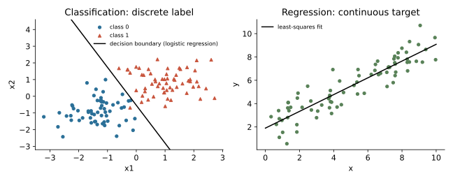

## 면접 답변

> 둘 다 지도 학습이고, 가장 큰 차이는 예측 대상입니다. 분류는 스팸인지 아닌지처럼 정해진 범주를 예측하고, 회귀는 집값처럼 연속적인 수치를 예측합니다. 이 차이 때문에 분류는 보통 교차 엔트로피로 학습하고 정확도나 F1, AUC로 평가하며, 회귀는 MSE로 학습하고 RMSE나 MAE, 결정계수로 평가합니다. 주의할 점은 이름만으로 판단하면 안 된다는 것입니다. 로지스틱 회귀는 이름과 달리 클래스 확률을 내놓는 분류 모델입니다. 또 분류 모델도 내부적으로는 연속적인 점수를 계산하고 마지막에 임계값으로 범주를 정합니다. 같은 집값이라도 금액을 맞히면 회귀이고, 고가인지 저가인지를 맞히면 분류이므로 문제 정의에 따라 달라집니다.

## 자세한 설명

### 비교

| | 분류(classification) | 회귀(regression) |
|---|---|---|
| 출력 $$y$$ | 유한한 범주 $$\{1, \dots, K\}$$ | 실수 $$\mathbb{R}$$ |
| 모델이 배우는 것 | 결정 경계, 클래스 확률 | 입력에 따른 수치의 함수 |
| 대표 손실 | 교차 엔트로피 | MSE, MAE, Huber |
| 대표 지표 | 정확도, F1, AUC | RMSE, MAE, $$R^2$$ |
| 예 | 스팸 판별, 이미지 분류 | 집값, 수요 예측 |

*합성 데이터에 실제로 학습한 결과. 왼쪽은 클래스를 나누는 결정 경계, 오른쪽은 수치를 예측하는 직선이다.*

### 틀린 정도의 의미가 다르다

회귀에서는 오차의 크기에 의미가 있다. 10을 12로 예측한 것은 20으로 예측한 것보다 낫다. 일반적인 분류의 범주에는 그런 거리가 없어서, 고양이를 개로 틀린 것과 비행기로 틀린 것은 정답 레이블만으로는 구별되지 않는다. 대신 정답 클래스에 얼마나 높은 확률을 주었는지를 따진다.

### 손실 함수: 확률 모델에서의 차이

$$N$$개의 샘플에 대해 정답을 $$y_i$$, 회귀 예측을 $$\hat{y}_i$$라 하면 MSE는 다음과 같다.

$$
\text{MSE} = \frac{1}{N} \sum_{i=1}^{N} (y_i - \hat{y}_i)^2
$$

이는 $$y$$에 평균이 $$\hat{y}$$이고 분산이 고정된 가우시안 잡음이 있다고 보고 우도를 최대화한 결과와 같다. 이진 분류에서 $$y_i \in \{0, 1\}$$, 양성 확률 예측을 $$\hat{p}_i$$라 하면 베르누이 분포의 음의 로그우도가 교차 엔트로피이다.

$$
\text{CE} = -\frac{1}{N} \sum_{i=1}^{N} \left( y_i \log \hat{p}_i + (1 - y_i) \log (1 - \hat{p}_i) \right)
$$

정답이 양성일 때 $$\hat{p} = 0.9$$이면 손실은 $$-\log 0.9 \approx 0.105$$이고, $$\hat{p} = 0.1$$이면 $$-\log 0.1 \approx 2.303$$이다. 자신 있게 틀릴수록 벌점이 크게 늘어난다.

### 경계가 흐린 경우

- **순서형 회귀(ordinal regression)**: 별점 1~5처럼 범주이면서 순서가 있는 경우이다. 일반 분류는 순서 정보를 버리고, 일반 회귀는 간격이 같다고 가정한다.
- **수치의 구간화**: 회귀 문제를 구간별 분류로 바꿀 수 있지만 정보가 줄고, 구간 경계 양쪽의 비슷한 값이 다른 레이블이 된다. 의사결정에 정말 범주만 필요할 때 쓰는 편이 좋다.
- **같은 알고리즘의 두 버전**: 의사결정나무, 랜덤 포레스트, 신경망, SVM은 출력과 손실을 바꾸어 양쪽 모두에 쓸 수 있다.

## 관련 개념

- **로지스틱 회귀(logistic regression)**: 선형 점수에 시그모이드를 씌워 확률을 예측하는 분류 모델이다. 유도는 [Machine Learning 3](/blog/2026/10/22/ml-03-logistic-regression/)에 있다.
- **일반화 선형 모델(GLM)**: 선형 회귀와 로지스틱 회귀를 출력 분포만 다른 같은 틀로 묶는다. [Machine Learning 4](/blog/2026/10/22/ml-04-glm/)에서 다룬다.
- **소프트맥스(softmax)**: 점수를 $$K$$개 클래스의 확률로 바꾸어 다중 분류에 쓰는 함수이다.
- **평가 지표**: 문제 유형에 따라 쓰는 지표가 다르다. [Q-22](/blog/2026/11/02/knowledge-22-useful-metrics/)에 정리했다.

## 꼬리 질문

**Q.** 로지스틱 회귀는 왜 회귀라고 부르나요?
로그 오즈(log-odds)를 입력의 선형 함수로 회귀하는 통계 모델에서 온 이름이다. 연속적인 확률을 출력하지만 쓰임새는 분류이다.

**Q.** 분류에 MSE를 쓰면 안 되나요?
계산은 가능하지만 일반적으로 권하지 않는다. 시그모이드 출력에 MSE를 쓰면 포화 영역에서 그래디언트가 작아 자신 있게 틀린 예측의 학습이 더디고, 로지스틱 회귀의 손실도 파라미터에 대해 볼록하지 않게 된다.

**Q.** 고객 평점 예측은 어느 쪽인가요?
평점의 순서와 간격을 어떻게 볼지에 달렸다. 평균 평점을 예측해 추천 순서를 정하려면 회귀가 자연스럽고, 범주 사이 간격이 같다고 보기 어렵다면 순서형 회귀가 더 알맞다.
