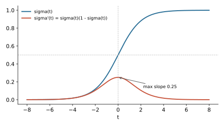

## 면접 답변

> 시그모이드 함수는 실수 전체를 0과 1 사이의 값으로 바꾸는 S자 모양의 함수로, 머신러닝에서는 보통 로지스틱 함수를 가리킵니다. 출력을 확률처럼 해석할 수 있어서 로지스틱 회귀나 이진 분류 신경망의 출력층에 씁니다. 예를 들어 모델의 점수가 2이면 시그모이드를 지나 약 0.88이 되고, 이를 양성 확률 88%로 해석합니다. 은닉층의 활성화 함수로도 쓰였지만 지금은 드뭅니다. 입력의 절댓값이 크면 기울기가 거의 0이 되고 기울기의 최댓값도 0.25라서, 깊은 망에서 그래디언트 소실을 일으키기 쉽기 때문입니다. 그래서 은닉층에는 ReLU 계열을 주로 쓰고, 시그모이드는 출력층이나 LSTM의 게이트처럼 0과 1 사이의 값이 필요한 곳에 씁니다.

## 자세한 설명

### 정의와 성질

입력 $$t \in \mathbb{R}$$에 대해 로지스틱 시그모이드는 다음과 같다.

$$
\sigma(t) = \frac{1}{1 + e^{-t}}
$$

- **범위**: $$\sigma(t) \in (0, 1)$$이고 $$\sigma(0) = 0.5$$이다.
- **대칭**: $$\sigma(-t) = 1 - \sigma(t)$$이다.
- **미분**: $$\sigma'(t) = \sigma(t) (1 - \sigma(t))$$이며, 최댓값은 $$t = 0$$에서 $$0.25$$이다.

| $$t$$ | -2 | 0 | 2 | 5 |
|---|---|---|---|---|
| $$\sigma(t)$$ | 0.119 | 0.500 | 0.881 | 0.993 |
| $$\sigma'(t)$$ | 0.105 | 0.250 | 0.105 | 0.0066 |

*시그모이드(파랑)와 그 미분(빨강). 입력의 절댓값이 커지면 미분이 빠르게 0에 가까워진다.*

넓은 의미의 sigmoid는 S자 함수 전체를 가리키며, $$\tanh$$나 정규 분포의 누적 분포 함수도 여기에 속한다. 머신러닝에서 단독으로 쓰면 대개 위의 로지스틱 함수이다.

### 왜 확률 모델에 자연스러운가

역함수는 **로짓(logit)**, 즉 **로그 오즈(log-odds)**이다.

$$
\sigma^{-1}(p) = \log \frac{p}{1 - p}
$$

예컨대 $$p = 0.8$$의 로그 오즈는 $$\log 4 \approx 1.386$$이다. 로지스틱 회귀는 입력 $$\mathbf{x}$$와 가중치 $$\mathbf{w}$$, 편향 $$b$$에 대해 로그 오즈를 선형 함수 $$\mathbf{w}^\top \mathbf{x} + b$$로 놓는 모델이고, 양쪽에 $$\sigma$$를 적용하면 다음을 얻는다.

$$
P(y = 1 \mid \mathbf{x}) = \sigma(\mathbf{w}^\top \mathbf{x} + b)
$$

### 은닉층에서의 문제

- **그래디언트 소실**: 역전파에서 층마다 $$\sigma'$$가 곱해진다. 활성화 미분은 층당 많아야 0.25이므로 10개 층에서 이 부분의 곱은 많아야 $$0.25^{10} \approx 9.5 \times 10^{-7}$$이다. 실제 그래디언트에는 가중치도 곱해지지만 소실 경향을 잘 보여 준다.
- **포화(saturation)**: $$t = 5$$에서 미분은 약 0.0066이다. 포화한 뉴런은 거의 학습되지 않는다.
- **비영점 중심(not zero-centered)**: 출력이 항상 양수여서 다음 층의 입력이 치우치고, 업데이트 경로가 비효율적이 될 수 있다. $$\tanh$$는 이 문제를 줄이지만 포화 문제는 남는다.

### 출력층에서는 교차 엔트로피와 함께 쓴다

정답 1에 대해 $$-\log \sigma(t)$$의 $$t$$ 미분은 $$-(1 - \sigma(t))$$이다. 크게 틀린 경우($$t$$가 큰 음수) 크기가 1에 가까워 그래디언트가 유지된다. MSE는 그래디언트에 $$\sigma'(t)$$가 그대로 곱해져 크게 틀려도 학습이 느릴 수 있다. 수치 안정성을 위해 구현에서는 시그모이드와 손실을 분리하지 않고 로짓을 직접 받는 손실(PyTorch의 `BCEWithLogitsLoss` 등)을 쓰는 것이 좋다.

## 관련 개념

- **로지스틱 회귀**: 시그모이드로 선형 점수를 확률로 바꾸는 분류 모델이다. [Machine Learning 3](/blog/2026/10/22/ml-03-logistic-regression/)에서 유도한다.
- **소프트맥스(softmax)**: 시그모이드를 여러 클래스로 일반화한 함수이다. 클래스가 2개이면 시그모이드와 같은 모델이 된다. [Deep Learning 2](/blog/2026/10/22/dl-02-ml-basics/)에 정리되어 있다.
- **ReLU**: 양수 구간의 미분이 1이어서 포화와 소실이 덜한 활성화 함수로, 은닉층의 기본 선택이다. 다만 음수 구간에서 뉴런이 죽는 문제가 있다.
- **역전파**: 시그모이드의 그래디언트 문제가 드러나는 과정이다. [Q-16](/blog/2026/11/02/knowledge-16-backpropagation/)에서 다룬다.

## 꼬리 질문

**Q.** 시그모이드와 소프트맥스는 언제 각각 쓰나요?
클래스가 서로 배타적이면 소프트맥스를 쓴다. 한 샘플에 여러 레이블이 붙을 수 있는 다중 레이블(multi-label) 분류에서는 레이블마다 독립적인 시그모이드를 쓴다.

**Q.** 시그모이드 출력은 정말 확률인가요?
0과 1 사이에 있을 뿐, 잘 보정(calibrated)되어 있다는 보장은 없다. 0.9로 예측한 샘플 중 실제로 90%가 양성인지는 따로 확인해야 하며, 필요하면 temperature scaling 등으로 보정한다.

**Q.** 임계값은 항상 0.5인가요?
아니다. 0.5는 관례일 뿐이고, 오류 비용과 클래스 비율에 따라 검증 데이터로 정해야 한다.
