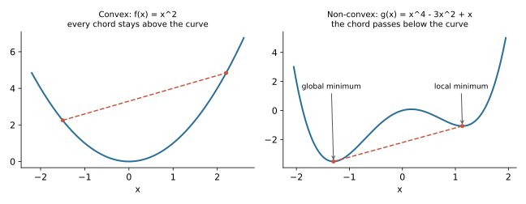

## 면접 답변

> 볼록 함수는 그래프 위의 어떤 두 점을 이어도 그 선분이 그래프보다 아래로 내려가지 않는 함수입니다. 두 번 미분 가능하다면 헤시안이 모든 곳에서 양의 준정부호라는 조건과 같습니다. 머신러닝에서 중요한 이유는 모든 지역 최솟값이 곧 전역 최솟값이어서, 경사하강법이 나쁜 지역 최솟값에 갇힐 걱정이 없기 때문입니다. 예를 들어 선형 회귀의 제곱 손실과 로지스틱 회귀의 로그 손실은 파라미터에 대해 볼록합니다. 반면 신경망의 손실은 비볼록해서 전역 최적을 보장하지 못합니다. 다만 볼록하다고 최솟값이 항상 존재하거나 유일한 것은 아니고, 유일성은 강볼록 같은 더 강한 조건이 있어야 보장됩니다.

## 자세한 설명

### 정의

볼록 집합을 정의역으로 갖는 함수 $$f$$가 모든 점 $$\mathbf{x}, \mathbf{y}$$와 모든 $$\lambda \in [0, 1]$$에 대해 다음을 만족하면 **볼록 함수(convex function)**이다.

$$
f(\lambda \mathbf{x} + (1 - \lambda) \mathbf{y}) \le \lambda f(\mathbf{x}) + (1 - \lambda) f(\mathbf{y})
$$

왼쪽은 두 점 사이에서의 함수값, 오른쪽은 두 점을 잇는 선분의 높이이다. 예를 들어 $$f(x) = x^2$$, $$x = -1$$, $$y = 3$$, $$\lambda = 0.5$$이면 왼쪽은 $$f(1) = 1$$, 오른쪽은 $$0.5 \cdot 1 + 0.5 \cdot 9 = 5$$이다.

*왼쪽의 선분은 어디서나 곡선 위에 있다. 오른쪽은 두 최솟값을 잇는 선분이 곡선 아래로 지나가 볼록 조건을 어기며, 지역 최솟값이 전역 최솟값과 다르다.*

### 판별 방법

- **1차 조건**(미분 가능할 때): 접평면이 함수 전체의 아래에 있다. 즉, $$f(\mathbf{y}) \ge f(\mathbf{x}) + \nabla f(\mathbf{x})^\top (\mathbf{y} - \mathbf{x})$$이다.
- **2차 조건**(두 번 미분 가능할 때): 헤시안 $$\nabla^2 f(\mathbf{x})$$가 모든 점에서 양의 준정부호(positive semidefinite)이다. 1차원에서는 $$f''(x) \ge 0$$이다.
- **합성 규칙**: 볼록 함수의 음이 아닌 가중합과 최대값은 볼록하고, 볼록 함수에 선형 변환을 합성해도 볼록하다.

### 왜 지역 최솟값이 전역 최솟값인가

$$\mathbf{x}$$가 지역 최솟값인데 $$f(\mathbf{y}) < f(\mathbf{x})$$인 점 $$\mathbf{y}$$가 있다고 하자. 볼록성에 따라 두 점 사이의 점 $$\mathbf{z} = \lambda \mathbf{x} + (1 - \lambda) \mathbf{y}$$($$\lambda < 1$$)에서는 다음이 성립한다.

$$
f(\mathbf{z}) \le \lambda f(\mathbf{x}) + (1 - \lambda) f(\mathbf{y}) < f(\mathbf{x})
$$

$$\lambda$$를 1에 가깝게 하면 $$\mathbf{z}$$는 $$\mathbf{x}$$의 바로 옆인데 함수값이 더 작으므로 지역 최솟값이라는 가정에 모순이다.

### 흔한 오해

| 주장 | 실제 |
|---|---|
| 볼록하면 최솟값이 있다 | $$e^x$$는 볼록하지만 최솟값에 도달하지 않는다 |
| 볼록하면 최솟점이 하나이다 | $$f(x) = 0$$처럼 여러 개일 수 있다. 강볼록이면 존재할 때 유일하다 |
| 볼록하면 미분 가능하다 | $$\lvert x \rvert$$와 힌지 손실은 볼록하지만 꺾인 점이 있어 서브그래디언트를 쓴다 |
| 예측값에 볼록하면 파라미터에도 볼록하다 | 신경망의 MSE는 $$\hat{y}$$에는 볼록하지만 가중치에는 비볼록하다 |

### 머신러닝 손실에 적용하기

**선형 회귀**: 설계 행렬 $$X$$, 정답 $$\mathbf{y}$$, 파라미터 $$\mathbf{w}$$에 대해 $$J(\mathbf{w}) = \frac{1}{2} \lVert X \mathbf{w} - \mathbf{y} \rVert^2$$의 헤시안은 $$X^\top X$$이다. 임의의 $$\mathbf{v}$$에 대해 $$\mathbf{v}^\top X^\top X \mathbf{v} = \lVert X \mathbf{v} \rVert^2 \ge 0$$이므로 볼록하다.

**로지스틱 회귀**: 로그 손실의 헤시안은 $$X^\top S X$$이다. $$S$$는 대각 성분이 $$\hat{p}_i (1 - \hat{p}_i) \ge 0$$인 대각 행렬이므로 역시 볼록하다. 반면 시그모이드 출력에 제곱 손실을 쓰면 볼록하지 않다. 그 손실은 위아래로 유계이면서 상수가 아닌데, 실수 전체에서 유계인 볼록 함수는 상수뿐이기 때문이다.

**신경망**: 은닉 유닛 두 개의 가중치를 서로 맞바꾸면 손실은 같지만 파라미터는 다른 점이 된다. 볼록하다면 두 해의 중간 점도 손실이 그 이하여야 하는데, 중간 점에서는 두 유닛이 같아져 표현력을 잃으므로 일반적으로 성립하지 않는다.

## 관련 개념

- **경사하강법**: 볼록하고 매끄러운 함수에서 적절한 학습률이면 최적값에 수렴이 보장된다. [Q-15](/blog/2026/11/02/knowledge-15-gradient-descent/)에서 다룬다.
- **강볼록(strongly convex)**: $$f(\mathbf{x}) - \frac{m}{2} \lVert \mathbf{x} \rVert^2$$가 볼록하게 되는 $$m > 0$$이 있는 함수이다. L2 정규화를 더하면 볼록한 손실이 강볼록해져 해가 유일해진다.
- **오목 함수(concave function)**: $$-f$$가 볼록한 함수이다. 로그우도를 최대화하는 문제는 음의 로그우도를 최소화하는 볼록 문제로 바꾸어 다룬다.
- **안장점(saddle point)**: 어떤 방향으로는 극소, 다른 방향으로는 극대인 정지점으로, 고차원의 비볼록 손실에서 흔하다. [Deep Learning 4](/blog/2026/10/22/dl-04-optimization/)에서 다룬다.
- **젠센 부등식(Jensen's inequality)**: 볼록 함수 $$f$$에 대해 $$f(\mathbb{E}[X]) \le \mathbb{E}[f(X)]$$이다. EM 알고리즘과 ELBO 유도의 기초이다.

## 꼬리 질문

**Q.** 신경망은 비볼록한데 왜 학습이 잘 되나요?
완전히 규명된 것은 아니다. 과매개변수화된 망에서는 나쁜 지역 최솟값이 실제 학습에 큰 장애가 되지 않는 경우가 많다고 보고되고, SGD의 잡음과 좋은 초기화, 잔차 연결 같은 구조도 도움이 된다고 본다. 다만 일반적인 보장은 아니다.

**Q.** $$x^3$$은 볼록한가요?
실수 전체에서는 아니다. $$f''(x) = 6x$$가 음수인 구간이 있다. $$x \ge 0$$으로 제한하면 볼록하다.

**Q.** SVM의 힌지 손실은 미분이 안 되는데 어떻게 최적화하나요?
힌지 손실은 볼록하므로 서브그래디언트 방법을 쓸 수 있다. 또 쌍대 문제를 이차 계획법으로 풀 수도 있다.
