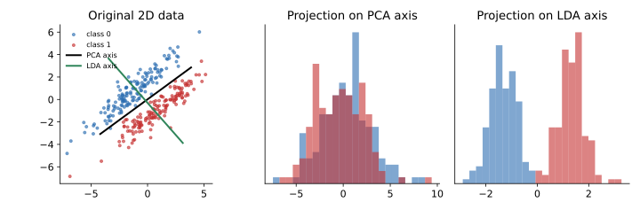

## 면접 답변

> 대표적인 기법으로는 PCA, LDA, Kernel PCA, ICA, NMF, 오토인코더, 그리고 시각화용인 t-SNE와 UMAP이 있습니다. 특징 추출은 기존 변수 일부를 고르는 특징 선택과 달리, 기존 변수를 조합해 새로운 저차원 변수를 만드는 방법입니다. 어떤 기법을 쓸지는 라벨이 있는지, 데이터 구조가 선형인지, 목적이 전처리인지 시각화인지에 따라 결정합니다. 라벨이 없고 구조가 대체로 선형이면 PCA를 먼저 시도하고, 분류 문제에서 클래스 분리가 중요하면 LDA를 고려합니다. 비선형 구조가 강하면 Kernel PCA나 오토인코더를 쓰고, 2차원 시각화가 목적이면 t-SNE나 UMAP을 씁니다. 예를 들어 분산이 큰 방향이 클래스 구분과 무관한 데이터에서는 PCA가 클래스를 겹치게 만들 수 있고, 이때는 LDA가 더 적합합니다.

## 자세한 설명

### 특징 선택과 특징 추출

**특징 선택(feature selection)**은 원래 변수 중 일부를 그대로 남긴다. **특징 추출(feature extraction)**은 $$d$$차원 입력 $$\mathbf{x}$$를 함수 $$g$$로 변환해 $$k < d$$차원의 새 표현 $$\mathbf{z} = g(\mathbf{x})$$를 만든다. 추출된 변수는 원래 변수의 조합이므로 정보를 더 많이 담을 수 있지만, 해석은 어려워질 수 있다.

### 기법 비교

| 기법 | 라벨 | 변환 | 무엇을 보존하거나 찾는가 | 주 용도 |
|---|---|---|---|---|
| PCA | 불필요 | 선형 | 분산이 최대인 직교 방향 | 전처리, 압축, 노이즈 감소 |
| LDA | 필요 | 선형 | 클래스 간 분리 | 분류 전처리 |
| Kernel PCA | 불필요 | 비선형 | 커널이 정의한 특징 공간의 분산 | 비선형 구조 추출 |
| ICA | 불필요 | 선형 | 통계적으로 독립인 성분 | 신호 분리 |
| NMF | 불필요 | 선형 분해 | 음수가 없는 부분들의 합 | 토픽, 이미지 부분 표현 |
| 랜덤 투영(random projection) | 불필요 | 선형 | 점 사이 거리를 근사적으로 유지 | 매우 높은 차원의 빠른 축소 |
| 오토인코더(autoencoder) | 불필요 | 비선형 가능 | 복원에 필요한 정보 | 이미지 등의 표현 학습 |
| t-SNE, UMAP | 불필요 | 비선형 | 이웃 관계 | 2, 3차원 시각화 |

### PCA

데이터를 평균 0으로 맞춘 뒤 공분산 행렬을 $$\mathbf{S}$$라 하면, PCA의 첫 축은 투영 분산을 최대화하는 단위 벡터 $$\mathbf{w}$$이다.

$$
\max_{\lVert\mathbf{w}\rVert=1} \mathbf{w}^\top \mathbf{S} \mathbf{w}
$$

해는 $$\mathbf{S}$$의 가장 큰 고유값에 대응하는 고유벡터이고, 이때의 분산이 그 고유값 $$\lambda$$이다. 뒤따르는 축은 앞선 축과 직교하면서 남은 분산을 최대화한다.

예를 들어 $$\mathbf{S} = \begin{bmatrix} 3 & 1 \\ 1 & 3 \end{bmatrix}$$의 고유값은 4와 2이고, 첫 고유벡터는 $$(1, 1)/\sqrt{2}$$이다. 첫 축 하나로 전체 분산의 $$4/(4+2) \approx 66.7\%$$를 설명한다.

PCA는 단위에 민감하므로 변수의 척도가 다르면 먼저 표준화하는 것이 보통이다.

### LDA

**선형 판별 분석(linear discriminant analysis, LDA)**은 클래스 간 산포 행렬 $$\mathbf{S}_B$$와 클래스 내 산포 행렬 $$\mathbf{S}_W$$의 비를 최대화한다.

$$
\max_{\mathbf{w}} \frac{\mathbf{w}^\top \mathbf{S}_B \mathbf{w}}{\mathbf{w}^\top \mathbf{S}_W \mathbf{w}}
$$

$$\mathbf{S}_B$$의 랭크는 많아야 $$C-1$$이므로($$C$$는 클래스 수), 이 방식으로 얻는 축은 최대 $$C-1$$개이다. 이진 분류라면 1차원까지만 줄일 수 있다.

*같은 2차원 합성 데이터의 투영 비교. 분산이 큰 방향으로 투영한 PCA(가운데)는 두 클래스가 겹치고, LDA(오른쪽)는 분리된다. 이 데이터에서 PCA 첫 축은 분산의 77.5%를 설명하지만, 그 축에서 임계값 하나로 얻는 최고 학습 정확도는 57.7%이고 LDA 축에서는 100%이다.*

### 비선형 기법과 사용 시 주의점

- **Kernel PCA**는 데이터를 고차원 특징 공간으로 보낸 것처럼 내적을 커널로 계산해 그 공간에서 PCA를 한다. 커널 선택과 파라미터에 결과가 좌우된다.
- **오토인코더**는 인코더와 디코더를 복원 오차로 학습한다. 선형 활성화와 MSE를 쓰면 잠재 공간은 PCA의 주성분 공간과 같은 부분공간을 펼치므로, 비선형 오토인코더는 PCA의 일반화로 볼 수 있다.
- **t-SNE**는 지역적 이웃 관계에 집중하므로 시각화에 강하지만, 군집 사이 거리나 군집 크기를 그대로 해석하면 안 된다. 기본 형태는 새 데이터를 변환하는 함수를 제공하지 않아 일반적인 전처리 단계로는 잘 쓰지 않는다.

## 관련 개념

- **SVD**: 평균을 뺀 데이터 행렬의 SVD에서 오른쪽 특이벡터가 PCA의 주성분이다. [Linear Algebra 9](/blog/2026/10/22/la-09-svd/)와 [SEE Matrix 3](/blog/2026/10/23/see-matrix-03-svd/)에서 다룬다.
- **PCA와 ICA**: PCA는 상관을 없애는 직교 축을 찾고, ICA는 독립인 성분을 찾는다. [Machine Learning 15](/blog/2026/10/22/ml-15-pca-ica/)에 정리되어 있다.
- **VAE**: 오토인코더의 잠재 공간을 확률 분포로 만든 생성 모델이다. [임커밋 6](/blog/2026/10/24/imc-06-vae/)에서 이어서 볼 수 있다.
- **차원의 저주(curse of dimensionality)**: 차원이 커질수록 데이터가 희소해지고 거리의 대비가 약해지는 현상으로, KNN 같은 거리 기반 모델에서 차원 축소가 도움이 되는 이유 중 하나이다.
- **PCA 회전**: 주성분 축을 해석 목적으로 더 회전하는 문제는 [Q-43](/blog/2026/11/02/knowledge-43-pca-rotation/)에서 다룬다.

## 꼬리 질문

**Q.** 주성분 개수는 어떻게 정하나요?
누적 설명 분산이 목표치에 도달하는 지점이나 scree plot의 꺾이는 지점을 참고합니다. 지도 학습의 전처리라면 교차 검증으로 최종 성능을 비교해 정하는 것이 가장 직접적입니다.

**Q.** PCA를 학습할 때 test set을 함께 써도 되나요?
안 됩니다. 평균, 표준편차, 주성분을 train set에서만 구하고 같은 변환을 test set에 적용해야 데이터 누수(data leakage)를 막을 수 있습니다.

**Q.** PCA를 쓰면 항상 분류 성능이 좋아지나요?
아닙니다. PCA는 라벨을 보지 않으므로, 분산은 작지만 클래스 구분에 중요한 방향을 버릴 수 있습니다.
