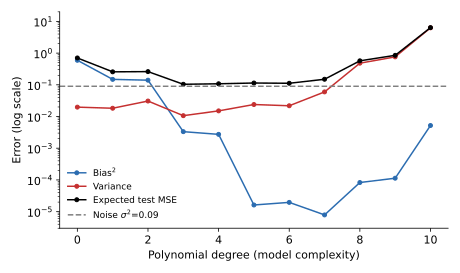

## 면접 답변

> 편향-분산 트레이드오프는 모델 복잡도를 조절할 때 편향과 분산이 대체로 반대로 움직여, 일반화 오차를 줄이려면 둘의 균형을 맞춰야 한다는 개념입니다. 편향은 모델의 가정이 너무 단순해서 생기는 체계적인 오차이고, 분산은 학습 데이터가 조금 바뀔 때 예측이 크게 흔들리는 정도입니다. 제곱 오차에서는 기대 테스트 오차가 편향의 제곱, 분산, 줄일 수 없는 노이즈의 합으로 정확히 분해됩니다. 예를 들어 곡선 데이터에 직선을 맞추면 어떤 학습 데이터를 받아도 곡선을 놓치므로 편향이 크고, 표본 수에 비해 차수가 높은 다항식을 맞추면 노이즈까지 따라가 분산이 커집니다. 학습 오차와 검증 오차가 모두 높으면 편향을 먼저 의심하고, 학습 오차는 낮은데 검증 오차와의 차이가 크면 분산을 먼저 의심합니다. 다만 항상 맞바꿔야만 하는 것은 아닙니다. 데이터를 더 모으면 편향을 키우지 않고 분산을 줄일 수 있습니다.

## 자세한 설명

### 오차 분해

데이터가 $$y = f(\mathbf{x}) + \varepsilon$$으로 생성된다고 하자. $$f$$는 참 함수, $$\varepsilon$$은 평균 0이고 분산이 $$\sigma^2$$인 노이즈이다. 학습 데이터 $$\mathcal{D}$$로 학습한 모델을 $$\hat{f}_{\mathcal{D}}$$, 여러 학습 데이터에 대한 평균 예측을 $$\bar{f}(\mathbf{x}) = \mathbb{E}_{\mathcal{D}}[\hat{f}_{\mathcal{D}}(\mathbf{x})]$$라 한다. 고정된 $$\mathbf{x}$$에서 기대 제곱 오차는 다음과 같다.

$$
\mathbb{E}_{\mathcal{D}, \varepsilon}\left[(y - \hat{f}_{\mathcal{D}}(\mathbf{x}))^2\right]
= \underbrace{(\bar{f}(\mathbf{x}) - f(\mathbf{x}))^2}_{\text{Bias}^2}
+ \underbrace{\mathbb{E}_{\mathcal{D}}\left[(\hat{f}_{\mathcal{D}}(\mathbf{x}) - \bar{f}(\mathbf{x}))^2\right]}_{\text{Variance}}
+ \underbrace{\sigma^2}_{\text{Noise}}
$$

$$\varepsilon$$이 학습 데이터와 독립이고 평균이 0이며, $$\hat{f}_{\mathcal{D}} - \bar{f}$$의 기댓값도 0이므로 제곱을 전개할 때 교차항이 모두 사라진다. 그 결과 위의 세 항만 남는다.

- **편향(bias)**: 모델 클래스나 가정 때문에 평균적으로 벗어나는 정도이다.
- **분산(variance)**: 학습 데이터의 변화에 대한 예측의 민감도이다.
- **노이즈(irreducible error)**: 어떤 모델로도 줄일 수 없는 오차의 하한이다.

### 시뮬레이션

$$y = \sin(2\pi x) + \varepsilon$$, $$\sigma = 0.3$$인 합성 데이터에서 $$x \sim U(0, 1)$$로 표본 30개를 뽑아 다항 회귀를 학습했다. 이를 2,000번 반복해 $$x \in [0.1, 0.9]$$ 구간에서 평균을 냈다. 구간 양끝을 제외한 이유는 고차 다항식이 표본 경계에서 극단적으로 흔들려 전체 그림을 지배하기 때문이다.

*다항식 차수에 따른 편향의 제곱, 분산, 기대 테스트 MSE(로그 스케일). 시뮬레이션으로 계산한 값이며, 회색 점선은 노이즈 $$\sigma^2 = 0.09$$이다.*

| 차수 | Bias² | Variance | 기대 테스트 MSE | 상태 |
|---|---|---|---|---|
| 0 | 0.5933 | 0.0198 | 0.7031 | 과소적합 |
| 1 | 0.1485 | 0.0182 | 0.2567 | 과소적합 |
| 3 | 0.0033 | 0.0106 | 0.1040 | 이 실험의 최솟값 |
| 5 | 0.0001 미만 | 0.0239 | 0.1139 | 분산 증가 시작 |
| 8 | 0.0001 | 0.4810 | 0.5711 | 과적합 |
| 10 | 0.0052 | 6.2722 | 6.3675 | 심한 과적합 |

세 항의 합은 노이즈 0.09 아래로 내려가지 않는다. 또한 곡선이 교과서 그림처럼 매끄럽게 단조롭지는 않다. 예컨대 $$\sin(2\pi x)$$는 $$x = 0.5$$에 대해 점대칭이어서, 짝수 차항을 더하는 차수 2는 차수 1에 비해 편향을 거의 줄이지 못한다. 트레이드오프는 전체적인 경향이지 차수 하나마다 성립하는 법칙이 아니다.

### 진단과 대응

| 증상 | 의심할 원인 | 대응 |
|---|---|---|
| 학습 오차와 검증 오차가 모두 높음 | 높은 편향 | 더 표현력 있는 모델, 특징 추가, 정규화 완화 |
| 학습 오차는 낮고 검증 오차와 차이가 큼 | 높은 분산 | 데이터 추가, 정규화 강화, 단순한 모델, 배깅 |

대표적인 조절 수단의 방향은 다음과 같다.

- **정규화 강도 증가**: 분산은 줄고 편향은 늘어나는 경향이 있다.
- **데이터 증가**: 모델을 고정하면 주로 분산이 줄어든다. 트레이드오프 없이 개선되는 대표적인 경우이다.
- **KNN의 $$k$$ 증가**: 더 많은 이웃을 평균하므로 분산은 줄고 편향은 늘어나는 경향이 있다.
- **배깅(bagging)**: 여러 모델의 평균으로 주로 분산을 줄인다.
- **부스팅(boosting)**: 약한 모델의 오차를 순차적으로 보정해 주로 편향을 줄인다.

### 고전적 그림의 한계

위의 깔끔한 분해는 제곱 오차에 대한 것이다. 0-1 손실 같은 분류 손실에서는 같은 형태로 더해지지 않는다. 또한 과매개변수화된 신경망에서는 복잡도가 보간 임계점을 넘은 뒤 테스트 오차가 다시 줄어드는 **이중 하강(double descent)**이 관찰되기도 한다. 이는 오차 분해 자체가 틀렸다는 뜻이 아니라, 파라미터 수만으로는 복잡도를 다 표현하지 못하고 분산이 단조 증가한다는 가정이 항상 성립하지는 않는다는 뜻이다.

## 관련 개념

- **과적합(overfitting)**: 높은 분산으로 나타나는 대표적인 현상이다. [Q-13](/blog/2026/11/02/knowledge-13-overfitting/)에서 다룬다.
- **교차 검증(cross-validation)**: 편향과 분산을 직접 구하는 대신, 합쳐진 일반화 오차를 추정해 복잡도를 고른다. [Machine Learning 11](/blog/2026/10/22/ml-11-model-selection/)에서 이어진다.
- **유도와 정규화**: [Machine Learning 10](/blog/2026/10/22/ml-10-bias-variance/)과 [Deep Learning Discussion 2](/blog/2026/10/22/dl-dis-02-matrix-calculus/)에서 더 자세히 다룬다.
- **오차 분석**: 학습 오차와 검증 오차의 차이로 다음 행동을 정하는 실무 절차이다. [Deep Learning 3](/blog/2026/10/22/dl-03-error-analysis/)을 참고한다.

## 꼬리 질문

**Q.** 실제 데이터에서 편향과 분산을 직접 계산할 수 있나요?
참 함수와 노이즈를 모르므로 정확히 계산할 수는 없습니다. 보통 학습 곡선과 교차 검증으로 어느 쪽이 지배적인지 추정합니다.

**Q.** 랜덤 포레스트는 왜 분산을 줄이나요?
깊은 트리는 분산이 크지만, 부트스트랩과 특징 무작위 선택으로 상관을 낮춘 트리들을 평균하면 평균의 분산이 줄어듭니다. 개별 트리의 편향은 크게 변하지 않습니다.

**Q.** 데이터를 더 모아도 소용없는 경우는 언제인가요?
편향이 지배적일 때입니다. 학습 오차와 검증 오차가 이미 높은 값으로 수렴했다면 데이터보다 모델이나 특징을 개선해야 합니다.

**Q.** 모델을 키우면 항상 분산이 커지나요?
고전적인 범위에서는 대체로 그렇지만 항상은 아닙니다. 과매개변수화 영역에서는 이중 하강처럼 복잡도가 더 커져도 테스트 오차가 줄어들 수 있습니다.
