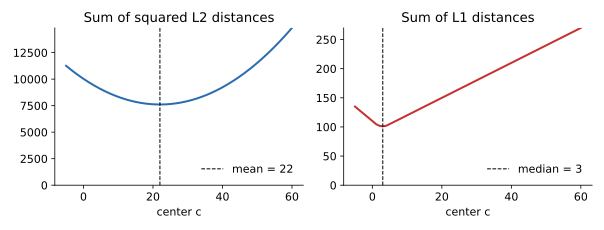

## 면접 답변

> 질문의 전제는 틀렸습니다. KNN은 Manhattan 거리를 아무 문제 없이 사용할 수 있습니다. KNN은 거리를 계산해 가까운 이웃을 고르기만 하고 중심을 계산하지 않기 때문입니다. K-means도 Manhattan 거리를 절대 쓸 수 없는 것은 아니지만, 할당 단계의 거리만 바꾸면 알고리즘의 정합성이 깨집니다. 중심을 평균으로 갱신하는 단계는 제곱 유클리드 거리를 최소화할 때만 최적이기 때문입니다. L1 거리의 합을 최소화하는 점은 평균이 아니라 좌표별 중앙값이고, 이렇게 바꾼 알고리즘이 k-medians입니다. 예를 들어 1, 2, 3, 4, 100이라는 값에서 평균은 22이지만 L1 거리 합을 최소화하는 점은 3입니다.

## 자세한 설명

### KNN: 제약이 없다

KNN은 질의 점과 학습 데이터 사이의 거리를 구하고 가까운 $$k$$개로 예측한다. 평균을 내는 단계나 거리와 맞물린 최적화 문제가 없으므로, 다음 Manhattan 거리($$d$$는 차원)도 그대로 쓸 수 있다.

$$
d_1(\mathbf{x}, \mathbf{y}) = \sum_{j=1}^{d} \lvert x_j - y_j \rvert
$$

실제로 scikit-learn의 KNN도 `metric="manhattan"`을 지원한다. 어떤 거리가 나은지는 데이터에 달려 있으므로 검증 성능으로 고르면 된다. L1은 차이를 제곱하지 않아 한 좌표의 큰 차이에 상대적으로 덜 지배된다. 어떤 거리를 쓰든 스케일에 민감하므로 특징 스케일링은 필요하다.

### K-means: 목적 함수와 갱신 규칙이 맞물려 있다

K-means는 군집 $$C_1, \dots, C_K$$와 중심 $$\boldsymbol{\mu}_1, \dots, \boldsymbol{\mu}_K$$에 대해 다음 목적 함수를 줄인다.

$$
J = \sum_{m=1}^{K} \sum_{\mathbf{x} \in C_m} \lVert \mathbf{x} - \boldsymbol{\mu}_m \rVert_2^2
$$

- **할당 단계**: 중심을 고정하고 각 점을 가장 가까운 중심에 배정한다.
- **갱신 단계**: 군집을 고정하고 $$J$$를 최소화하는 중심을 구한다.

두 단계 모두 $$J$$를 늘리지 않고 군집 분할의 가짓수는 유한하므로 알고리즘은 유한한 단계 안에 수렴한다. 갱신 단계에서 평균이 나오는 것은 목적 함수에서 유도되는 결과이다. 1차원에서 미분하면 다음과 같다.

$$
\frac{d}{dc}\sum_i (x_i - c)^2 = -2\sum_i (x_i - c) = 0 \quad\Rightarrow\quad c = \frac{1}{n}\sum_i x_i
$$

반면 L1 합 $$\sum_i \lvert x_i - c \rvert$$의 기울기는 ($$c$$보다 작은 점의 수) $$-$$ ($$c$$보다 큰 점의 수)이다. 이 값이 0이 되는 점이 **중앙값(median)**이다. L1 거리는 좌표별로 나뉘므로 다차원에서는 좌표별 중앙값이 최소점이 된다.

### 예: 1, 2, 3, 4, 100

| 중심 $$c$$ | L1 거리 합 | 제곱 거리 합 |
|---|---:|---:|
| 평균 22 | 156 | **7610** |
| 중앙값 3 | **101** | 9415 |

*같은 다섯 점에 대한 비용 곡선. 제곱 거리 합은 평균 22에서, L1 거리 합은 중앙값 3에서 최소가 된다.*

할당에는 L1을 쓰면서 중심을 평균으로 갱신하면, 이 예처럼 갱신이 L1 비용을 101에서 156으로 올릴 수 있다. 즉 두 단계가 같은 목적 함수를 줄이지 않으므로, 표준 K-means의 수렴 근거였던 단조 감소가 사라진다.

### 올바른 대안

| 알고리즘 | 거리 | 중심 | 특징 |
|---|---|---|---|
| K-means | 제곱 유클리드 | 평균 | 기본 방법, 이상치에 민감 |
| K-medians | Manhattan | 좌표별 중앙값 | 이상치에 더 강건, 중심이 실제 데이터 점은 아닐 수 있음 |
| K-medoids (PAM) | 임의의 비유사도 | 실제 데이터 점 | 거리 선택이 자유롭고 해석이 쉬움, 계산량이 큼 |

## 관련 개념

- **K-means와 EM**: K-means의 두 단계를 교대 최적화로 볼 수 있다. [Machine Learning 12](/blog/2026/10/22/ml-12-kmeans-em/)에서 다룬다.
- **Lp 거리**: $$p = 1$$이 Manhattan, $$p = 2$$가 유클리드인 거리 가족이다. KNN에서 $$p$$는 튜닝할 수 있는 하이퍼파라미터이다.
- **KNN과 K-means의 차이**: 이름은 비슷하지만 문제 자체가 다르다. [Q-33](/blog/2026/11/02/knowledge-33-knn-vs-kmeans/)에서 비교한다.
- **강건성(robustness)**: 중앙값은 극단값 하나에 평균보다 훨씬 덜 움직이므로, k-medians가 이상치에 더 강하다.

## 꼬리 질문

**Q.** K-means에 코사인 거리를 쓰고 싶으면 어떻게 하나요?
벡터를 단위 길이로 정규화한 뒤 K-means를 적용하고 중심도 다시 정규화하는 spherical K-means를 씁니다. 단위 벡터에서 제곱 유클리드 거리와 코사인 유사도는 일대일로 대응합니다.

**Q.** 고차원에서는 Manhattan이 항상 유클리드보다 낫나요?
그렇지 않습니다. 고차원에서는 L2와 L1 모두 거리의 대비가 약해질 수 있고, 어떤 거리가 나은지는 데이터에 따라 다르므로 검증으로 확인합니다.

**Q.** k-medians의 중심은 왜 실제 데이터 점이 아닐 수 있나요?
중앙값을 좌표별로 따로 구하므로, 각 좌표 값은 실제 값이어도 그 조합은 데이터에 없는 점일 수 있습니다. 실제 데이터 점을 중심으로 고집한다면 k-medoids를 씁니다.
