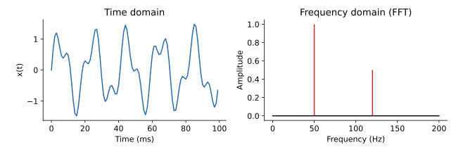
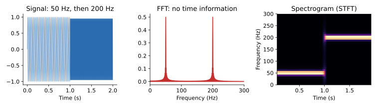

## 면접 답변

> 푸리에 변환은 시간이나 공간에 대한 함수를 여러 주파수의 사인파 성분으로 분해하는 변환입니다. 각 주파수와의 내적을 계산해 그 주파수 성분이 얼마나 들어 있는지와 위상이 어떠한지를 복소수 값으로 얻습니다. 역변환으로 원래 신호를 복원할 수 있으므로, 같은 정보를 다른 기저로 표현한 것으로 볼 수 있습니다. 머신러닝에서는 음성 신호를 스펙트로그램으로 바꿔 입력으로 쓰는 것이 대표적인 예입니다. 또 합성곱 정리에 따라 시간 영역의 합성곱이 주파수 영역의 곱셈이 되므로, 긴 합성곱을 FFT로 효율적으로 계산할 수 있습니다. 다만 전체 신호의 푸리에 변환은 어떤 주파수가 언제 나타났는지 알려 주지 않으므로, 이때는 짧은 구간별로 변환하는 STFT를 사용합니다.

## 자세한 설명

### 정의

신호 $$x(t)$$의 **푸리에 변환(Fourier transform)** $$X(f)$$와 역변환은 다음과 같다. $$t$$는 시간, $$f$$는 주파수(Hz), $$i$$는 허수 단위이다.

$$
X(f) = \int_{-\infty}^{\infty} x(t)\, e^{-i 2\pi f t}\, dt,
\qquad
x(t) = \int_{-\infty}^{\infty} X(f)\, e^{i 2\pi f t}\, df
$$

오일러 공식 $$e^{-i\theta} = \cos\theta - i\sin\theta$$에 따라, 이 적분은 $$x(t)$$가 주파수 $$f$$의 코사인, 사인과 얼마나 닮았는지를 계산한다. $$X(f)$$는 복소수이고 크기 $$\lvert X(f) \rvert$$는 성분의 세기, 편각은 위상을 나타낸다. 각주파수 $$\omega = 2\pi f$$로 쓰는 표기도 흔하며, 이 경우 역변환 앞에 $$1/(2\pi)$$ 같은 상수가 붙는 등 관례에 따라 상수 배치가 달라진다.

### 이산 푸리에 변환과 FFT

컴퓨터에서는 표본 $$x_0, \dots, x_{N-1}$$에 대한 **이산 푸리에 변환(discrete Fourier transform, DFT)**을 쓴다.

$$
X_k = \sum_{n=0}^{N-1} x_n\, e^{-i 2\pi k n / N}, \qquad k = 0, \dots, N-1
$$

그대로 계산하면 $$O(N^2)$$이지만, **FFT(fast Fourier transform)** 알고리즘은 $$O(N \log N)$$에 계산한다. 샘플링 주파수를 $$f_s$$라 하면 주파수 간격은 $$\Delta f = f_s / N$$이고, 표현할 수 있는 최대 주파수는 나이퀴스트 주파수 $$f_s / 2$$이다. 이보다 높은 성분은 낮은 주파수로 겹쳐 보이는 **에일리어싱(aliasing)**을 일으킨다.

### 예

$$x(t) = \sin(2\pi \cdot 50t) + 0.5\sin(2\pi \cdot 120t)$$를 $$f_s = 1000$$ Hz로 1초 샘플링하면 $$N = 1000$$, $$\Delta f = 1$$ Hz이다. FFT의 진폭 $$2\lvert X_k \rvert / N$$은 50 Hz에서 1, 120 Hz에서 0.5로, 신호에 넣은 두 성분을 그대로 찾아낸다.

*시간 영역에서는 복잡해 보이는 신호(왼쪽)가 주파수 영역에서는 50 Hz와 120 Hz의 두 성분으로 나타난다(오른쪽).*

### 합성곱 정리

두 신호의 합성곱에 푸리에 변환을 적용하면 곱이 된다.

$$
\mathcal{F}\{x \ast h\}(f) = X(f)\, H(f)
$$

길이 $$N$$과 $$M$$의 직접 합성곱은 $$O(NM)$$이지만, FFT로 변환해 곱한 뒤 역변환하면 $$L = N + M - 1$$에 대해 $$O(L \log L)$$이다. 다만 DFT의 곱은 순환 합성곱(circular convolution)에 해당하므로, 일반적인 선형 합성곱을 얻으려면 양쪽을 $$L$$ 길이 이상으로 zero padding해야 한다. 이 관계 덕분에 합성곱 필터는 주파수 응답으로 해석할 수 있다. 예를 들어 평균 필터는 저주파 통과 성질을 가진다.

### 시간 정보와 스펙트로그램

전체 신호의 푸리에 변환에서는 주파수가 언제 나타났는지 알기 어렵다. **단시간 푸리에 변환(short-time Fourier transform, STFT)**은 창 함수 $$w$$를 시간 $$\tau$$로 옮겨 가며 구간별로 변환한다.

$$
X(\tau, f) = \int_{-\infty}^{\infty} x(t)\, w(t - \tau)\, e^{-i 2\pi f t}\, dt
$$

$$\lvert X(\tau, f) \rvert^2$$을 시간-주파수 평면에 그린 것이 **스펙트로그램(spectrogram)**이다. 창이 길면 주파수 해상도가 좋아지고, 짧으면 시간 해상도가 좋아지는 맞교환이 있다.

*앞 1초는 50 Hz, 뒤 1초는 200 Hz인 신호. FFT에는 두 봉우리만 보이고, 128 샘플 창을 쓴 스펙트로그램에는 언제 어떤 주파수가 나왔는지가 나타난다.*

### 머신러닝과 신호 처리에서의 활용

- **음성 인식과 오디오 분류**: 파형을 스펙트로그램이나 mel-spectrogram으로 바꿔 입력한다. 이를 이미지처럼 CNN에 넣는 경우도 많다.
- **큰 커널 합성곱**: 긴 필터의 합성곱을 FFT로 계산한다.
- **Fourier Neural Operator**: 주파수 영역에서 가중치를 곱하는 층으로 편미분 방정식의 해 연산자를 학습한다.
- **Fourier features**: 입력을 사인, 코사인 특징으로 바꿔 신경망이 고주파 함수를 학습하기 쉽게 한다. NeRF의 positional encoding이 이와 관련된 예이다.
- **압축과 이미지 처리**: JPEG는 푸리에 변환과 가까운 이산 코사인 변환(DCT)을 사용한다.

## 관련 개념

- **합성곱 신경망**: CNN의 합성곱 층은 합성곱 정리로 주파수 영역에서도 해석할 수 있다. 합성곱 자체는 [임커밋 2](/blog/2026/10/24/imc-02-cnn/)에서 볼 수 있다.
- **파시발 정리(Parseval's theorem)**: 시간 영역과 주파수 영역의 에너지가 보존된다. DFT에서는 $$\sum_n \lvert x_n \rvert^2 = \frac{1}{N}\sum_k \lvert X_k \rvert^2$$이고, 위의 예에서 양변 모두 625이다.
- **기저 변환**: DFT는 신호를 복소 사인파 기저로 표현하는 선형 변환이다. 행렬로 보면 [Linear Algebra 4](/blog/2026/10/22/la-04-linear-transformation/)의 선형 변환과 이어진다.
- **에일리어싱**: 샘플링이 너무 드물면 다른 주파수로 보이는 현상으로, CNN의 다운샘플링에서도 같은 원리의 문제가 생길 수 있다.

## 꼬리 질문

**Q.** 푸리에 변환과 푸리에 급수의 차이는 무엇인가요?
푸리에 급수는 주기 신호를 이산적인 주파수 성분의 합으로 나타내고, 푸리에 변환은 비주기 신호까지 연속적인 주파수로 다룹니다.

**Q.** 스펙트로그램에서 위상을 버리면 어떤 문제가 있나요?
크기만 쓰면 파형을 바로 복원할 수 없습니다. 분류 입력으로는 크기만으로 충분한 경우가 많지만, 음성 합성에서는 Griffin-Lim이나 신경망 보코더로 파형을 만듭니다.

**Q.** CNN은 항상 FFT로 합성곱을 계산하나요?
아닙니다. 일반적인 작은 커널에서는 직접 계산이 더 효율적입니다. FFT는 커널이 클 때 이득이 커집니다.
