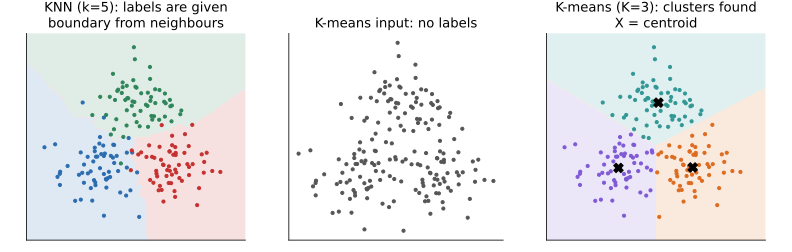

## 면접 답변

> KNN은 지도 학습의 분류와 회귀 알고리즘이고, K-means는 비지도 학습의 군집화 알고리즘입니다. KNN은 라벨이 있는 데이터를 저장해 두었다가, 새 입력과 가까운 k개 이웃의 라벨로 예측합니다. 반면 K-means는 라벨 없이 군집 내 제곱 거리의 합이 작아지도록 K개의 중심을 반복해서 학습합니다. 이름의 K도 다릅니다. KNN의 k는 참고할 이웃의 수이고, K-means의 K는 만들 군집의 수입니다. 예를 들어 어떤 환자의 질병 유무를 과거 진단 기록으로 예측한다면 KNN을 쓸 수 있습니다. 라벨 없는 고객 데이터에서 비슷한 고객 집단을 찾는다면 K-means를 쓸 수 있습니다. 둘 다 거리에 의존하므로 특징 스케일링이 중요하다는 공통점이 있습니다.

## 자세한 설명

### 비교

| | KNN | K-means |
|---|---|---|
| 학습 유형 | 지도 학습 | 비지도 학습 |
| 목적 | 새 입력의 라벨이나 값 예측 | 데이터의 군집 구조 발견 |
| 입력 | 특징과 라벨 | 특징만 |
| K의 의미 | 참고할 이웃의 수 | 군집의 수 |
| 학습 | 데이터 저장(lazy learning) | 반복적으로 중심 계산 |
| 학습 후 보관 | 학습 데이터 전체 | K개의 중심 |
| 기본 계산량 | 예측 한 번에 $$O(nd)$$ | 학습에 $$O(nKdT)$$, 할당 한 번에 $$O(Kd)$$ |
| K 선택 | 검증 성능, 교차 검증 | 엘보우, 실루엣, 도메인 목적 |
| 결과의 의미 | 라벨의 의미가 정해져 있음 | 군집 번호 자체에는 의미가 없음 |

$$n$$은 표본 수, $$d$$는 특징 수, $$T$$는 반복 횟수이다. KNN의 계산량은 전수 탐색 기준이며, KD-tree나 근사 최근접 이웃 탐색으로 줄일 수 있다.

### KNN

입력 $$\mathbf{x}$$와 가까운 학습 데이터 $$k$$개의 집합을 $$N_k(\mathbf{x})$$라 하면, 분류에서는 다수결로, 회귀에서는 평균으로 예측한다.

$$
\hat{y} = \arg\max_{c} \sum_{i \in N_k(\mathbf{x})} \mathbf{1}(y_i = c),
\qquad
\hat{y} = \frac{1}{k} \sum_{i \in N_k(\mathbf{x})} y_i
$$

$$k$$가 작으면 경계가 복잡해져 분산이 커지고, 커지면 경계가 매끄러워지는 대신 편향이 커진다.

### K-means

K-means의 목적 함수는 $$K$$개 군집 $$C_m$$과 그 중심 $$\boldsymbol{\mu}_m$$에 대한 군집 내 제곱 거리의 합이다.

$$
J = \sum_{m=1}^{K} \sum_{\mathbf{x} \in C_m} \lVert \mathbf{x} - \boldsymbol{\mu}_m \rVert_2^2
$$

대표적인 Lloyd 알고리즘은 각 점을 가장 가까운 중심에 할당하는 단계와, 군집별 평균으로 중심을 갱신하는 단계를 반복한다. 전역 최적을 보장하지 않으므로 k-means++ 초기화와 여러 번의 재시작을 쓰는 것이 일반적이다.

*같은 180개 점을 사용한 비교. KNN은 주어진 라벨로 새 점을 분류하는 경계를 만들고(왼쪽), K-means는 라벨 없는 점들(가운데)에서 중심과 군집을 찾는다(오른쪽). K-means의 경계는 직선으로 이뤄진 Voronoi 경계이고 색 자체에는 클래스 의미가 없다.*

### 혼동하기 쉬운 지점

- 두 알고리즘은 이름과 거리 사용 외에는 해결하는 문제가 다르다. K-means를 KNN의 학습 단계로 볼 수 없다.
- K-means로 새 점을 가장 가까운 중심에 할당하는 것은 중심들에 대한 1-최근접 이웃 규칙과 같다. 이 부분은 형식상 닮았지만 중심은 라벨 없이 학습된 것이다.
- K-means로 얻은 군집을 분류 결과로 쓰려면, 군집 번호에 사람이 의미를 부여하거나 라벨과 대응시키는 단계가 따로 필요하다.

## 관련 개념

- **지도 학습과 비지도 학습**: 두 알고리즘을 가르는 기준이다. [Q-2](/blog/2026/11/02/knowledge-02-supervised-unsupervised/)에서 다룬다.
- **K-means와 EM**: K-means는 GMM에 대한 EM의 단단한 할당 버전으로 볼 수 있다. [Machine Learning 12](/blog/2026/10/22/ml-12-kmeans-em/)에서 유도한다.
- **Manhattan 거리**: KNN은 거리를 쉽게 바꿀 수 있지만 K-means는 중심 정의까지 함께 바뀐다. [Q-29](/blog/2026/11/02/knowledge-29-manhattan-distance/)를 참고한다.
- **편향과 분산**: KNN의 $$k$$는 모델 복잡도를 직접 조절한다. [Q-28](/blog/2026/11/02/knowledge-28-bias-variance/)과 연결된다.
- **차원의 저주**: 차원이 높으면 거리의 대비가 약해져 두 방법 모두 영향을 받는다. 이때 [Q-25](/blog/2026/11/02/knowledge-25-dimensionality-reduction/)의 차원 축소를 고려할 수 있다.

## 꼬리 질문

**Q.** KNN에서 k를 어떻게 정하나요?
교차 검증으로 정합니다. 이진 분류에서는 동점을 피하기 위해 홀수를 자주 쓰고, 가까운 이웃에 더 큰 가중치를 주는 방법도 있습니다.

**Q.** K-means의 K는 어떻게 정하나요?
K에 따른 $$J$$의 꺾임을 보는 엘보우 방법과 실루엣 점수를 참고합니다. 다만 $$J$$는 K가 커질수록 줄어들 뿐이므로, 최종적으로는 군집의 활용 목적까지 함께 봅니다.

**Q.** K-means가 잘 안 되는 데이터는 무엇인가요?
초승달처럼 볼록하지 않은 군집이나 크기와 밀도가 많이 다른 군집입니다. DBSCAN이나 spectral clustering, GMM을 고려합니다.
