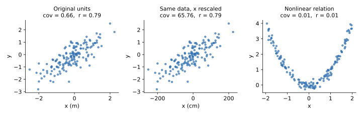

## 면접 답변

> 공분산은 두 변수가 함께 움직이는 방향과 정도를 나타내는 값이고, 상관계수는 공분산을 두 표준편차로 나누어 단위를 없앤 값입니다.
> 공분산은 부호로 방향을 알려 주지만 크기가 변수의 단위에 따라 달라져서, 값만 보고 관계의 강도를 비교할 수 없습니다.
> 반면 피어슨 상관계수는 항상 -1과 1 사이이고 단위를 바꿔도 변하지 않아 서로 다른 변수 쌍을 비교할 수 있습니다.
> 예를 들어 키를 미터에서 센티미터로 바꾸면 공분산은 100배가 되지만 상관계수는 그대로입니다.
> 다만 둘 다 선형 관계만 측정하기 때문에, 값이 0이라고 해서 두 변수가 독립인 것은 아닙니다.

## 자세한 설명

### 정의

$$X$$, $$Y$$의 공분산과 피어슨 상관계수(Pearson correlation coefficient)는 다음과 같다. $$\mu$$는 평균, $$\sigma$$는 표준편차이다.

$$
\operatorname{Cov}(X, Y) = \mathbb{E}\left[(X - \mu_X)(Y - \mu_Y)\right], \qquad
\rho_{XY} = \frac{\operatorname{Cov}(X, Y)}{\sigma_X \sigma_Y}
$$

표본 $$n$$개로 추정할 때는 $$\bar{x}$$, $$\bar{y}$$를 표본 평균으로 하여 다음을 쓴다.

$$
s_{xy} = \frac{1}{n-1}\sum_{i=1}^{n}(x_i - \bar{x})(y_i - \bar{y}), \qquad
r = \frac{s_{xy}}{s_x s_y}
$$

상관계수는 두 변수를 각각 표준화한 뒤 구한 공분산과 같다. 코시-슈바르츠 부등식(Cauchy-Schwarz inequality)에 의해 $$\lvert \rho \rvert \le 1$$이고, 등호는 $$Y = aX + b$$ 꼴로 완전한 선형 관계일 때 성립한다.

| | 공분산 | 상관계수 |
|---|---|---|
| 범위 | $$(-\infty, \infty)$$ | $$[-1, 1]$$ |
| 단위 | $$X$$ 단위 $$\times$$ $$Y$$ 단위 | 없음 |
| $$aX + b$$, $$cY + d$$로 변환 | $$ac$$배 | 부호만 $$\operatorname{sign}(ac)$$에 따름 |
| 주 용도 | 공분산 행렬, PCA, 다변량 가우시안 | 관계 강도의 비교, 탐색적 분석 |

### 예제

$$x = (1, 2, 3, 4, 5)$$, $$y = (2, 4, 5, 4, 5)$$라고 하자. 평균은 3과 4이고, 편차의 곱의 합은 6이다.

$$
s_{xy} = \frac{6}{4} = 1.5, \quad s_x^2 = 2.5, \quad s_y^2 = 1.5, \quad
r = \frac{1.5}{\sqrt{2.5 \times 1.5}} \approx 0.775
$$

$$x$$에 100을 곱하면 $$s_{xy} = 150$$이 되지만 $$r$$은 그대로 $$0.775$$이다.

### 0이어도 독립은 아니다

독립이면 공분산은 0이지만, 역은 일반적으로 성립하지 않는다. $$x = (-2, -1, 0, 1, 2)$$, $$y = x^2$$이면 $$y$$는 $$x$$로 완전히 결정되는데도 공분산과 상관계수가 모두 0이다.

*시뮬레이션 데이터 150개. 단위를 바꾸면 공분산만 100배가 되고(왼쪽, 가운데), 2차 관계는 뚜렷한데도 상관계수는 0에 가깝다(오른쪽).*

피어슨 상관계수는 이상치에도 민감하고, 인과 관계를 뜻하지도 않는다. 단조 관계를 보고 싶다면 순위로 계산하는 스피어만 상관계수(Spearman correlation)를 쓴다.

## 관련 개념

- **공분산 행렬(covariance matrix)**: 변수 쌍의 공분산을 모은 대칭 행렬이다. 이 행렬의 고유벡터가 PCA의 주성분이다. [PCA 글](/blog/2026/10/22/ml-14-factor-analysis-pca/)에서 다룬다.
- **표준화(standardization)**: 평균을 빼고 표준편차로 나누는 변환이다. 표준화한 데이터의 공분산 행렬이 곧 상관 행렬이다.
- **스피어만 상관계수**: 값 대신 순위에 피어슨 상관을 적용한다. 단조 비선형 관계를 포착하고 이상치에 덜 민감하다.
- **상호 정보량(mutual information)**: 선형 여부와 관계없이 의존성을 측정하며, 독립일 때만 0이 된다.
- **연속형과 범주형의 상관**: 피어슨 상관을 그대로 쓸 수 없는 경우이다. [Q-40](/blog/2026/11/02/knowledge-40-continuous-categorical-correlation/)에서 다룬다.

## 꼬리 질문

**Q.** 상관계수가 0이면 독립이 되는 경우가 있나요?
두 변수가 결합 가우시안(jointly Gaussian)을 따르면 무상관과 독립이 동치입니다. 일반적인 분포에서는 성립하지 않습니다.

**Q.** 표본 공분산에서 왜 $$n$$이 아니라 $$n-1$$로 나누나요?
모평균 대신 표본 평균을 쓰면서 자유도가 하나 줄기 때문입니다. $$n-1$$로 나누어야 불편 추정량(unbiased estimator)이 됩니다.

**Q.** PCA에서 공분산 행렬과 상관 행렬 중 어느 것을 써야 하나요?
변수의 단위나 스케일이 다르면 상관 행렬(표준화 후 PCA)을 씁니다. 공분산 행렬을 쓰면 값의 범위가 큰 변수가 주성분을 지배합니다.
