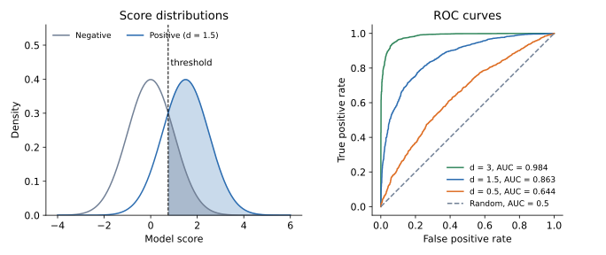

## 면접 답변

> ROC 곡선은 이진 분류기의 임계값을 바꿔 가면서 위양성률(FPR)을 가로축, 진양성률(TPR)을 세로축으로 그린 곡선입니다.
> 분류 성능은 임계값에 따라 달라지므로, 특정 임계값 하나에 묶이지 않고 모델이 양성과 음성을 얼마나 잘 분리하는지 보기 위해 사용합니다.
> 왼쪽 위 모서리에 가까울수록 좋고, 대각선은 무작위 분류기에 해당합니다.
> 곡선 아래 면적인 AUC는 임의의 양성 샘플이 임의의 음성 샘플보다 높은 점수를 받을 확률로 해석되며, 예를 들어 AUC 0.81이면 약 81%의 쌍에서 순위가 맞다는 뜻입니다.
> 다만 양성이 매우 드문 문제에서는 AUC가 높아도 정밀도가 낮을 수 있어서, 이럴 때는 PR 곡선을 함께 봅니다.

## 자세한 설명

### 정의

모델이 샘플마다 점수 $$s$$를 내고 $$s \ge t$$이면 양성으로 예측한다고 하자. 임계값 $$t$$마다 다음 두 값이 정해지고, 이를 점 $$(\text{FPR}(t), \text{TPR}(t))$$로 찍어 이은 것이 **ROC(receiver operating characteristic) 곡선**이다.

$$
\text{TPR} = \frac{TP}{TP + FN}, \qquad \text{FPR} = \frac{FP}{FP + TN}
$$

$$t$$를 $$+\infty$$에서 낮추면 모두 음성인 $$(0, 0)$$에서 출발해 모두 양성인 $$(1, 1)$$에 도착한다. 두 비율 모두 감소하지 않으므로 곡선은 단조 증가한다.

*왼쪽: 임계값 0.75에서 양성 분포의 오른쪽 면적이 TPR(약 0.77), 음성 분포의 오른쪽 면적이 FPR(약 0.23)이다. 오른쪽: 분산 1인 두 정규 분포의 평균 차 $$d$$를 바꾸어 클래스당 2,000개씩 시뮬레이션한 ROC 곡선. 분리가 좋을수록 왼쪽 위로 붙는다.*

### 손으로 그려 보기

양성 4개, 음성 4개의 점수가 다음과 같다고 하자. 점수 내림차순으로 임계값을 내리며 양성을 만나면 위로 $$1/4$$, 음성을 만나면 오른쪽으로 $$1/4$$ 이동한다.

| 점수 | 0.9 | 0.8 | 0.7 | 0.6 | 0.55 | 0.4 | 0.3 | 0.2 |
|---|---:|---:|---:|---:|---:|---:|---:|---:|
| 정답 | + | + | − | + | − | + | − | − |
| FPR | 0 | 0 | 0.25 | 0.25 | 0.5 | 0.5 | 0.75 | 1 |
| TPR | 0.25 | 0.5 | 0.5 | 0.75 | 0.75 | 1 | 1 | 1 |

사다리꼴 면적을 합하면 $$\text{AUC} = 0.8125$$이다.

### AUC의 의미

**AUC(area under the curve)**는 다음과 같다. $$s^+$$, $$s^-$$는 각각 무작위로 뽑은 양성, 음성 샘플의 점수이다.

$$
\text{AUC} = P(s^+ > s^-) + \tfrac{1}{2}P(s^+ = s^-)
$$

위 예제에서 양성-음성 16쌍 중 양성의 점수가 더 높은 쌍을 세면 점수 0.9가 4쌍, 0.8이 4쌍, 0.6이 3쌍, 0.4가 2쌍으로 13쌍이다. $$13/16 = 0.8125$$로 면적과 일치한다.

- AUC 1은 완벽한 순위, 0.5는 무작위 순위를 뜻한다. 0.5 미만이면 점수의 방향이 뒤집혀 있다는 뜻이다.
- 순위만 보므로 점수에 단조 변환을 적용해도 AUC는 그대로이다. 그래서 확률값이 잘 보정되었는지는 알려 주지 않는다.
- AUC는 임계값을 고르는 도구가 아니다. 운영할 임계값은 FP와 FN의 비용을 보고 따로 정해야 한다.

### 클래스 불균형

TPR과 FPR은 각 클래스 안에서 계산하므로, 클래스별 점수 분포가 유지되면 양성 비율이 변해도 ROC 곡선은 변하지 않는다. 비교에는 장점이지만, 양성이 드물 때는 실제 사용 경험을 가릴 수 있다. 양성 100개, 음성 1,000,000개에서 TPR 0.9, FPR 0.01이면 ROC 상으로는 좋은 점이다. 그런데 $$TP = 90$$, $$FP = 10{,}000$$이므로 정밀도는 $$90/10{,}090 \approx 0.9\%$$에 불과하다.

## 관련 개념

- **TPR과 Recall**: ROC의 세로축인 TPR은 Recall과 같다. [Q-36](/blog/2026/11/02/knowledge-36-tpr-recall/)에서 다룬다.
- **혼동 행렬**: 임계값 하나마다 혼동 행렬 하나가 정해지고, 그것이 ROC 위의 점 하나가 된다. [Q-17](/blog/2026/11/02/knowledge-17-confusion-matrix/)을 참고한다.
- **PR 곡선(precision-recall curve)**: 가로축 Recall, 세로축 Precision으로 그린다. 정밀도가 양성 비율에 의존하므로 희귀 양성 문제에서 차이가 잘 드러난다.
- **다른 평가 지표**: 하나의 임계값에서 계산하는 지표들은 [Q-41](/blog/2026/11/02/knowledge-41-accuracy-metrics/)에서 정리한다.

## 꼬리 질문

**Q.** ROC 곡선에서 임계값은 어떻게 고르나요?
FP와 FN의 비용을 반영해 기대 비용이 최소인 점을 고릅니다. 비용 정보가 없으면 $$\text{TPR} - \text{FPR}$$을 최대화하는 Youden's J를 쓰기도 합니다.

**Q.** 다중 클래스에서는 ROC를 어떻게 쓰나요?
클래스별로 일대다(one-vs-rest) 곡선을 그린 뒤 AUC를 macro 또는 micro 방식으로 평균합니다.

**Q.** AUC가 0.3이 나오면 어떻게 해석하나요?
순위가 대체로 반대라는 뜻입니다. 점수나 레이블의 부호가 뒤집혔는지 먼저 확인합니다. 점수를 뒤집으면 AUC는 0.7이 됩니다.
