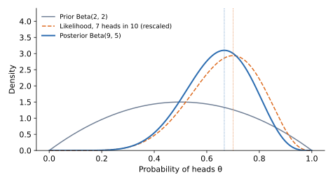

## 면접 답변

> Prior는 데이터를 보기 전 파라미터에 대한 믿음이고, Likelihood는 특정 파라미터 값에서 관측 데이터가 나올 가능성이며, Posterior는 데이터를 본 뒤 갱신된 믿음입니다.
> 세 값은 베이즈 정리로 연결되어, Posterior는 Likelihood와 Prior의 곱에 비례합니다.
> 주의할 점은 Likelihood가 데이터를 고정한 파라미터의 함수이고, 파라미터에 대한 확률 분포가 아니라는 것입니다.
> 예를 들어 앞면 확률이 0.5쯤이라고 믿는 Prior를 두고 동전을 10번 던져 앞면이 7번 나오면, Posterior는 0.5와 0.7 사이로 이동합니다.
> 데이터가 많아질수록 Likelihood의 영향이 커지고 Prior의 영향은 줄어듭니다.

## 자세한 설명

### 세 항의 관계

파라미터를 $$\theta$$, 관측 데이터를 $$D$$라고 하면 다음이 성립한다.

$$
\underbrace{p(\theta \mid D)}_{\text{posterior}} = \frac{\overbrace{p(D \mid \theta)}^{\text{likelihood}}\;\overbrace{p(\theta)}^{\text{prior}}}{\underbrace{p(D)}_{\text{evidence}}}, \qquad
p(D) = \int p(D \mid \theta)\,p(\theta)\,d\theta
$$

| 용어 | 식 | 의미 | 변수 |
|---|---|---|---|
| Prior (사전 분포) | $$p(\theta)$$ | 데이터를 보기 전의 믿음 | $$\theta$$의 분포 |
| Likelihood (가능도) | $$p(D \mid \theta)$$ | $$\theta$$가 데이터를 얼마나 잘 설명하는가 | $$D$$를 고정한 $$\theta$$의 함수 |
| Posterior (사후 분포) | $$p(\theta \mid D)$$ | 데이터를 본 뒤의 믿음 | $$\theta$$의 분포 |
| Evidence (증거) | $$p(D)$$ | 모델 전체가 데이터를 설명하는 정도 | $$\theta$$가 적분되어 사라진 상수 |

식 $$p(D \mid \theta)$$는 $$\theta$$를 고정하고 $$D$$를 변수로 보면 확률 분포이지만, $$D$$를 고정하고 $$\theta$$를 변수로 보면 가능도이다. 가능도는 $$\theta$$에 대해 적분해도 일반적으로 1이 되지 않으므로 $$\theta$$의 확률이 아니다.

### 예제: 동전 던지기

앞면 확률을 $$\theta$$라 하고, 10번 중 7번이 앞면이었다고 하자. 가능도는 이항 분포로부터 다음과 같다.

$$
p(D \mid \theta) = \binom{10}{7}\theta^{7}(1-\theta)^{3}
$$

$$\theta = 0.5$$이면 약 0.117, $$\theta = 0.7$$이면 약 0.267이므로 데이터는 0.7을 더 잘 설명한다. Prior로 0.5 근처를 약하게 선호하는 $$\text{Beta}(2, 2)$$, 즉 $$p(\theta) \propto \theta(1-\theta)$$를 두면 Posterior는 다음과 같다.

$$
p(\theta \mid D) \propto \theta^{8}(1-\theta)^{4} \quad\Rightarrow\quad \theta \mid D \sim \text{Beta}(9, 5)
$$

*Prior와 Likelihood가 결합되어 Posterior가 된다. 세로 점선은 MLE(0.7)와 MAP(약 0.667)이다. Likelihood는 비교하기 쉽도록 면적이 1이 되게 조정했다.*

| 추정 | 정의 | 값 |
|---|---|---:|
| MLE | Likelihood의 최댓값 | $$7/10 = 0.7$$ |
| MAP | Posterior의 최댓값 | $$8/12 \approx 0.667$$ |
| Posterior 평균 | Posterior의 기댓값 | $$9/14 \approx 0.643$$ |

같은 비율로 100번 중 70번이 앞면이면 Posterior는 $$\text{Beta}(72, 32)$$가 되고, 평균은 $$72/104 \approx 0.692$$로 MLE 0.7에 가까워진다. 데이터가 쌓일수록 Prior의 영향이 작아지는 것이다.

### Prior와 정규화

로그를 취해 부호를 바꾸면 MAP의 목적 함수는 다음과 같다.

$$
\hat{\theta}_{\text{MAP}} = \arg\min_\theta \left[-\log p(D \mid \theta) - \log p(\theta)\right]
$$

가중치에 평균 0인 가우시안 Prior를 두면 $$-\log p(\theta)$$는 L2 정규화 항이 되고, 라플라스 Prior를 두면 L1 정규화 항이 된다. 정규화를 Prior로 해석할 수 있는 이유이다.

## 관련 개념

- **베이즈 정리**: 세 항을 연결하는 공식이다. [Q-34](/blog/2026/11/02/knowledge-34-bayes-theorem/)에서 정의한다.
- **MLE와 MAP**: Prior가 균등 분포이면 MAP은 MLE와 같아진다. [베이즈 통계와 정규화](/blog/2026/10/22/ml-11-model-selection/)에서 다룬다.
- **켤레 사전 분포(conjugate prior)**: Posterior가 Prior와 같은 분포족이 되는 Prior이다. 이항 가능도에 대한 Beta 분포가 대표적이다.
- **변분 추론**: $$p(D)$$의 적분이 어려울 때 Posterior를 근사하는 방법이다. [VAE 글](/blog/2026/10/24/imc-06-vae/)에서 쓰인다.

## 꼬리 질문

**Q.** Probability와 Likelihood의 차이는 무엇인가요?
Probability는 파라미터를 고정하고 데이터의 가능성을 묻고, Likelihood는 데이터를 고정하고 파라미터 값들을 비교합니다. 같은 식을 어느 쪽 변수로 보느냐의 차이입니다.

**Q.** Posterior 평균 대신 MAP을 쓰면 무엇을 잃나요?
불확실성 정보와 분포의 형태를 잃습니다. 또한 MAP은 파라미터화 방식을 바꾸면 값이 달라질 수 있습니다.

**Q.** Prior는 어떻게 정하나요?
도메인 지식을 반영하거나, 약한 정보만 주는 Prior를 쓰거나, 계산 편의를 위해 켤레 분포를 씁니다. 데이터가 적을수록 선택의 영향이 크므로 여러 Prior로 결과의 민감도를 확인하는 것이 좋습니다.
