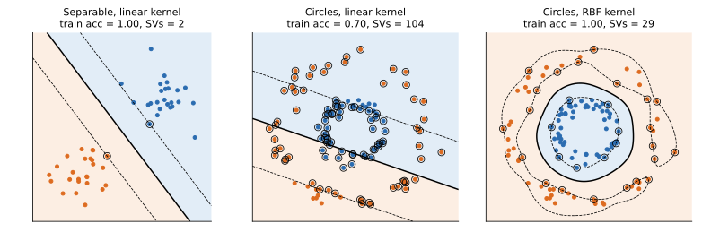

## 면접 답변

> SVM은 표본이 작거나 중간 규모이고, 특성 차원이 높으며, 클래스 사이의 경계가 비교적 분명한 분류 문제에 먼저 고려합니다.
> 마진을 최대화하기 때문에 차원이 높아도 비교적 과적합에 강하고, 결정 경계가 일부 서포트 벡터에만 의존하기 때문입니다.
> 비선형 경계가 필요하면 커널을 써서 특성을 직접 만들지 않고도 해결할 수 있습니다.
> 대표적인 예가 TF-IDF 텍스트 분류로, 특성이 수만 차원이어도 선형 SVM이 잘 맞는 경우가 많습니다.
> 반대로 표본이 수백만 개일 때 커널 SVM은 계산량 때문에 부담이 크고, 보정된 확률이 필요하거나 클래스가 많이 겹치고 노이즈가 많을 때도 다른 모델을 먼저 검토합니다.
> 또한 스케일에 민감하므로 특성 표준화는 사실상 필수입니다.

## 자세한 설명

### 무엇을 최적화하는가

SVM은 두 클래스를 나누는 초평면 중 가장 가까운 점까지의 거리, 즉 **마진(margin)**이 최대인 것을 찾는다. 소프트 마진(soft margin) SVM의 목적 함수는 다음과 같다. $$y_i \in \{-1, +1\}$$은 레이블, $$\mathbf{w}$$와 $$b$$는 초평면의 파라미터, $$\xi_i$$는 마진 위반량, $$C$$는 위반의 벌점이다.

$$
\min_{\mathbf{w}, b, \xi} \; \frac{1}{2}\lVert \mathbf{w} \rVert^2 + C\sum_{i=1}^{n}\xi_i
\quad \text{s.t.} \quad y_i(\mathbf{w}^\top \mathbf{x}_i + b) \ge 1 - \xi_i, \;\; \xi_i \ge 0
$$

마진 폭은 $$2/\lVert \mathbf{w} \rVert$$이다. 이 문제는 $$\ell(z) = \max(0, 1 - z)$$인 **힌지 손실(hinge loss)**에 L2 정규화를 더한 것과 같다.

쌍대 문제(dual problem)의 해로 쓰면 결정 함수는 다음과 같다. $$\alpha_i \ge 0$$은 쌍대 변수이고, $$\alpha_i > 0$$인 점이 **서포트 벡터(support vector)**이며, $$K$$는 커널 함수이다.

$$
f(\mathbf{x}) = \sum_{i} \alpha_i y_i K(\mathbf{x}_i, \mathbf{x}) + b
$$

데이터가 내적을 통해서만 등장하므로 $$K$$를 바꾸면 고차원 특징 공간에서의 선형 분리를 명시적인 변환 없이 할 수 있다. RBF 커널은 $$K(\mathbf{x}, \mathbf{x}') = \exp(-\gamma \lVert \mathbf{x} - \mathbf{x}' \rVert^2)$$이다.

*직접 구현한 SMO로 학습한 결과. 실선은 결정 경계, 점선은 $$f = \pm 1$$, 검은 원은 서포트 벡터이다. 동심원 데이터는 선형 커널로 분리되지 않지만(가운데, 학습 정확도 0.70) RBF 커널로는 분리된다(오른쪽, 학습 정확도 1.00). 왼쪽은 점 2개만으로 경계가 정해진다.*

### 적합한 상황과 아닌 상황

| 상황 | 판단 | 이유 |
|---|---|---|
| 특성이 많고 희소함 (텍스트) | 선형 SVM 적합 | 고차원에서는 선형 분리가 쉬운 경우가 많고 희소 데이터에 계산이 효율적 |
| 표본이 적거나 중간 규모, 경계가 비선형 | RBF SVM 적합 | 복잡한 경계를 적은 특성 공학으로 표현 |
| 표본 수보다 특성이 많음 (유전자 발현 등) | 선형 SVM 고려 | 정규화된 마진으로 복잡도 제어. 다만 특성 선택과 교차 검증을 함께 수행 |
| 표본이 매우 많음 | 커널 SVM 비적합 | 학습 비용이 대략 $$n^2$$에서 $$n^3$$ 사이로 증가. 선형 SVM이나 커널 근사로 대체 |
| 확률 예측이 필요함 | 다른 모델 우선 | 기본 출력은 거리 값이고 확률에는 Platt scaling 같은 추가 보정이 필요 |
| 클래스 겹침과 노이즈가 많음 | 다른 모델 검토 | 이상치가 마진 위반 벌점에 직접 영향을 줌. $$C$$ 튜닝이 필수 |
| 이미지, 음성 같은 원시 입력에 데이터가 많음 | 딥러닝 우선 | SVM은 표현을 학습하지 않음 |
| 수치와 범주가 섞인 표 데이터 | 트리 앙상블과 비교 | 트리 계열은 스케일 조정이 필요 없고 범주와 결측을 다루기 쉬움 |

메모리도 제약이 된다. 표본이 10만 개이면 전체 커널 행렬의 원소는 $$10^{10}$$개이고, 8바이트 실수로 저장하면 80GB이다. 실제 구현은 행렬 전체를 저장하지 않고 캐시하지만, 규모가 커질수록 부담이 빠르게 커진다.

### 사용할 때 주의할 점

- **특성을 스케일링한다.** 거리와 내적에 의존하므로, 범위가 큰 특성이 결과를 지배한다.
- **$$C$$와 $$\gamma$$를 교차 검증으로 튜닝한다.** $$C$$가 크면 위반을 덜 허용해 경계가 복잡해지고, $$\gamma$$가 크면 각 점의 영향 범위가 좁아져 과적합하기 쉽다.
- **선형 커널부터 시도한다.** 고차원 희소 데이터에서는 선형으로 충분한 경우가 많고 훨씬 빠르다.
- **다중 클래스는 조합한다.** SVM은 본래 이진 분류기이므로 일대일 또는 일대다 방식을 쓴다.

## 관련 개념

- **커널 트릭(kernel trick)**: 내적을 커널 함수로 대체해 고차원 특징 공간을 암묵적으로 사용한다. [커널 글](/blog/2026/10/22/ml-07-kernels/)에서 다룬다.
- **서포트 벡터 머신 실습**: 코드로 된 예제는 [머신러닝 알고리즘 글](/blog/2026/10/22/dlbook-03-ml-algorithms/)을 참고한다.
- **로지스틱 회귀**: 선형 경계를 만드는 점은 같지만 손실이 다르다. 모든 샘플이 손실에 기여하고 확률을 직접 출력한다.
- **분류기 선택**: 데이터 크기, 해석 가능성, 비용을 함께 고려하는 절차는 [Q-11](/blog/2026/11/02/knowledge-11-choosing-classifier/)에서 다룬다.
- **SVR(support vector regression)**: 오차 허용 폭을 두어 SVM을 회귀로 확장한 모델이다.

## 꼬리 질문

**Q.** 서포트 벡터가 아닌 점을 제거하면 결정 경계가 변하나요?
변하지 않습니다. $$\alpha_i = 0$$인 점은 결정 함수에 기여하지 않기 때문입니다. 단, 데이터를 추가하거나 서포트 벡터를 제거하면 달라질 수 있습니다.

**Q.** 서포트 벡터 수가 매우 많다면 무엇을 의미하나요?
마진 안이나 반대편에 있는 점이 많다는 뜻입니다. 가운데 그림처럼 모델이 데이터에 맞지 않거나 클래스 겹침이 크거나, 또는 $$C$$와 $$\gamma$$가 적절하지 않은 것일 수 있습니다. 예측 비용도 서포트 벡터 수에 비례해 커집니다.

**Q.** SVM과 로지스틱 회귀 중 어떻게 고르나요?
확률이 필요하면 로지스틱 회귀, 비선형 경계가 필요하고 데이터가 크지 않으면 커널 SVM을 먼저 고려합니다. 선형인 두 모델의 성능은 비슷한 경우가 많으니 교차 검증으로 정합니다.
