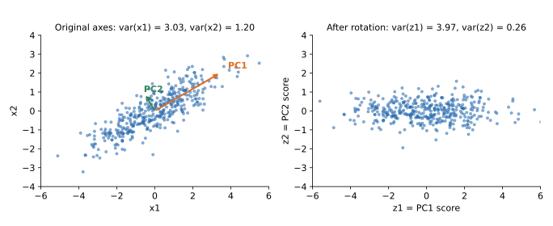

## 면접 답변

> 먼저 '회전'이 무엇을 가리키는지 구분해야 합니다.
> PCA 자체가 분산이 가장 큰 방향이 축이 되도록 좌표축을 회전하는 것이므로, 이 회전은 필요한 정도가 아니라 PCA 그 자체입니다.
> 반면 주성분을 구한 뒤 해석을 쉽게 하려고 추가로 적용하는 varimax 같은 회전은 필수가 아닙니다.
> 추가 회전은 선택한 성분들이 설명하는 총 분산은 유지하지만, 분산을 성분 사이에 재분배하기 때문에 '첫 번째 성분이 분산을 최대로 설명한다'는 성질은 사라집니다.
> 예를 들어 상관 행렬로 구한 두 성분의 분산이 2.83과 1.57이었는데 varimax를 적용하면 2.42와 1.98이 되고, 총합 4.40은 그대로입니다.
> 그래서 압축이나 전처리가 목적이면 추가 회전을 하지 않고, 성분을 사람이 해석해야 할 때만 선택적으로 적용합니다.

## 자세한 설명

### PCA 자체가 회전이다

평균을 0으로 맞춘 데이터의 표본 공분산 행렬을 $$\Sigma$$라고 하자. 고유값 분해는 다음과 같다. $$V$$는 고유벡터를 열로 가진 직교 행렬, $$\Lambda$$는 고유값 $$\lambda_1 \ge \lambda_2 \ge \dots$$의 대각 행렬이다.

$$
\Sigma = V \Lambda V^\top, \qquad \mathbf{z} = V^\top \mathbf{x}
$$

$$V$$는 $$V^\top V = I$$이므로 $$\mathbf{z}$$로의 변환은 길이와 각도를 보존한다. 즉 강체 회전이다(고유벡터의 부호 선택에 따라 반사가 포함될 수 있다). 변환 후의 공분산은 다음과 같이 대각 행렬이 된다.

$$
\operatorname{Cov}(\mathbf{z}) = V^\top \Sigma V = \Lambda
$$

따라서 성분끼리 무상관이고, 총 분산은 $$\operatorname{tr}(\Lambda) = \operatorname{tr}(\Sigma)$$로 보존되며, 분산은 내림차순으로 정렬된다.

*시뮬레이션 데이터 400개. 약 30.2도 회전하면 분산이 $$(3.03, 1.20)$$에서 $$(3.97, 0.26)$$으로 재배치되고, 합 4.23은 그대로이며, 상관계수 0.84는 0이 된다.*

차원 축소는 그다음 단계이다. 회전만으로는 정보가 전혀 사라지지 않고, 분산이 작은 축을 버릴 때 정보가 줄어든다. 회전 없이 원래 축 중 일부를 고르는 것은 PCA가 아니라 특성 선택(feature selection)이다.

### 추가 회전은 왜 하는가

주성분은 분산이 최대가 되게 정해질 뿐 해석이 쉽도록 정해지지 않는다. 첫 번째 성분에 모든 변수가 조금씩 실리는 일이 많다. 그래서 상위 $$k$$개 성분이 만드는 부분공간 안에서 축을 한 번 더 돌려, 각 변수가 소수의 성분에만 크게 실리도록 만든다.

적재량 행렬을 $$L = V_k \Lambda_k^{1/2}$$라고 하자. $$V_k$$와 $$\Lambda_k$$는 상위 $$k$$개만 남긴 행렬이다. 직교 행렬 $$T$$로 회전하면 $$L^* = LT$$이고, varimax는 다음을 최대화하는 $$T$$를 찾는다. $$\ell^*_{jc}$$는 변수 $$j$$의 성분 $$c$$에 대한 적재량, $$p$$는 변수의 수이다.

$$
\sum_{c=1}^{k}\left[\frac{1}{p}\sum_{j=1}^{p}(\ell^{*}_{jc})^4 - \left(\frac{1}{p}\sum_{j=1}^{p}(\ell^{*}_{jc})^2\right)^2\right]
$$

이 값은 성분별 제곱 적재량의 분산이다. 값이 크면 적재량이 0 근처와 큰 값으로 갈라져 해석하기 쉬워진다.

### 예제: varimax 전후

변수 6개의 상관 행렬에서 변수 1~3끼리의 상관은 0.7, 변수 4~6끼리의 상관은 0.5, 그룹 간 상관은 0.2라고 하자. 상위 두 성분을 남기고 varimax를 적용하면 다음과 같다(회전각 약 34.7도).

| 변수 | PC1 | PC2 | 회전 후 RC1 | 회전 후 RC2 | 공통성 |
|---|---:|---:|---:|---:|---:|
| 1~3 | 0.788 | −0.423 | 0.889 | 0.101 | 0.800 |
| 4~6 | 0.568 | 0.586 | 0.134 | 0.805 | 0.667 |
| 성분의 분산 | 2.832 | 1.568 | 2.424 | 1.976 | 합 4.400 |

- **좋아진 점**: 회전 전 PC1에는 모든 변수가 함께 실려 있지만, 회전 후에는 RC1이 변수 1~3, RC2가 변수 4~6을 대표한다.
- **유지된 점**: 두 성분이 설명하는 총 분산은 4.4(변수 6개 분산의 약 73.3%)이고, 변수별 공통성(communality)도 같다. 부분공간이 그대로이므로 재구성 오차도 같다.
- **잃은 점**: 첫 성분의 분산이 모든 방향 중 최대인 2.832에서 2.424로 줄었다. 여기서는 RC1이 여전히 더 크지만, 일반적으로 회전 후 성분에 분산 순서가 보장되지 않는다. 또한 PCA의 주성분은 $$k$$를 늘려도 앞 성분이 바뀌지 않지만, 회전 성분은 $$k$$에 따라 달라진다.

"회전을 하면 성분 간 분산 차이가 커진다"는 설명을 보기도 하는데, 이 말은 PCA의 축 변환 자체에만 맞다. varimax는 오히려 차이를 줄인다. 위 예제에서 차이는 1.264에서 0.448로 줄었다.

### 직교성의 대가

추가 회전 후에는 PCA의 두 직교 성질을 동시에 유지할 수 없다.

| 무엇을 회전하는가 | 가중치 벡터 | 성분 점수 |
|---|---|---|
| 회전 없음 | 직교 | 무상관 |
| 스케일된 적재량 $$V_k\Lambda_k^{1/2}T$$ | 직교 아님 | 표준화 점수는 무상관 |
| 단위 길이 고유벡터 $$V_kT$$ | 직교 | 상관 생김 (예제에서 약 0.27) |

### 언제 쓰는가

| 목적 | 추가 회전 |
|---|---|
| 차원 축소, 노이즈 제거, 모델 입력 전처리 | 불필요. 예측 모델은 같은 부분공간이면 정보가 같음 |
| 압축, 시각화 | 불필요. 앞 성분의 분산 최대 성질이 중요함 |
| 설문, 심리 측정 등 잠재 요인의 해석 | 선택적으로 사용. 이 경우 인자 분석이 더 적합한지도 검토 |

## 관련 개념

- **고유값 분해와 SVD**: 주성분은 $$\Sigma$$의 고유벡터이며, 중심화한 데이터 행렬의 오른쪽 특이벡터와 같다. [SVD 글](/blog/2026/10/23/see-matrix-03-svd/)에서 회전, 늘이기, 회전의 관점으로 볼 수 있다.
- **재구성 오차 최소화**: 분산 최대화와 같은 부분공간을 준다. [PCA 다시 보기](/blog/2026/10/22/ml-15-pca-ica/)에서 다룬다.
- **인자 분석(factor analysis)**: 잠재 요인 모델로, 해에 회전 불확정성이 있어 회전이 널리 쓰인다. [인자 분석과 PCA](/blog/2026/10/22/ml-14-factor-analysis-pca/)에서 비교한다.
- **차원 축소 기법 전반**: PCA 외의 특징 추출 기법은 [Q-25](/blog/2026/11/02/knowledge-25-dimensionality-reduction/)에서 다룬다.
- **사각 회전(oblique rotation)**: promax처럼 성분 간 상관을 허용하는 회전이다. 해석은 쉬워질 수 있지만 무상관 성질을 포기한다.

## 꼬리 질문

**Q.** PCA 전에 표준화가 필요한가요?
변수의 단위가 다르면 필요합니다. 공분산 기반 PCA는 범위가 큰 변수 쪽으로 첫 축이 끌려가기 때문입니다. 단위가 같고 분산 차이에 의미가 있다면 표준화하지 않을 수 있습니다.

**Q.** PCA를 다시 실행했을 때 주성분의 부호가 뒤집혀 있으면 문제인가요?
아닙니다. $$\mathbf{v}$$와 $$-\mathbf{v}$$는 같은 축을 나타내고 고유값도 같습니다. 다만 적재량의 부호를 해석하거나 모델 간 비교를 할 때는 부호를 맞춰야 합니다.

**Q.** 추가 회전이 예측 성능을 바꾸나요?
같은 $$k$$개 부분공간을 쓰므로 선형 회귀 같은 모델의 적합값은 변하지 않습니다. L2 정규화나 트리처럼 좌표축에 민감한 모델에서는 달라질 수 있습니다.
