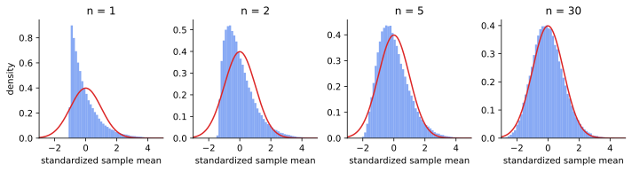

<ul class="post-sources">
<li markdown="span">질문 출처: [Science Vibe, 머신러닝 면접 질문 모음](https://jrc-park.tistory.com/259)</li>
</ul>

## 면접 답변

> 중심극한정리는 독립이고 같은 분포를 따르며 분산이 유한한 표본의 평균이, 표본 크기가 커질수록 원래 분포의 모양과 상관없이 정규 분포에 가까워진다는 정리입니다.
> 평균이 μ, 분산이 σ²인 분포라면 표본 평균은 근사적으로 평균 μ, 분산 σ²/n인 정규 분포를 따릅니다.
> 많은 작은 독립적 변동이 더해지면 치우침이 서로 상쇄되어 분포의 세부 모양이 사라지기 때문입니다.
> 예를 들어 지수 분포는 오른쪽으로 크게 치우쳐 있지만, 30개씩 뽑아 평균을 내면 그 평균들의 히스토그램은 정규 분포와 꽤 비슷해집니다.
> 주의할 점은 데이터 자체가 정규 분포가 되는 것이 아니라 평균의 분포가 정규에 가까워진다는 것이고, 코시 분포처럼 분산이 유한하지 않으면 성립하지 않는다는 것입니다.

## 자세한 설명

### 정리

$$X_1, \dots, X_n$$이 독립이고 분포가 같으며(i.i.d.), 평균이 $$\mu$$, 분산이 $$0 < \sigma^2 < \infty$$라고 하자. 표본 평균 $$\bar{X}_n = \frac{1}{n}\sum_{i=1}^{n} X_i$$에 대해 다음이 성립한다.

$$
\frac{\sqrt{n}\,(\bar{X}_n - \mu)}{\sigma} \xrightarrow{d} \mathcal{N}(0, 1) \quad (n \to \infty)
$$

$$\xrightarrow{d}$$는 분포 수렴(convergence in distribution)을 뜻한다. 표준화하는 이유가 중요하다. $$\bar{X}_n$$ 자체는 $$\mu$$ 한 점으로 모이므로([큰수의 법칙](/blog/2026/11/02/knowledge-46-lln/)), 극한의 모양을 보려면 오차를 $$\sqrt{n}$$배로 확대해야 한다.

### 시뮬레이션

지수 분포 $$\text{Exp}(1)$$은 평균과 표준편차가 모두 1이고 왜도(skewness)가 2이다. 독립인 표본의 평균은 왜도가 $$2/\sqrt{n}$$으로 줄어든다. 따라서 $$n = 1, 5, 30$$에서 왜도는 각각 2, 약 0.89, 약 0.37이다. 치우침은 줄지만 $$n = 30$$에서도 0이 되지는 않는다.

*$$\text{Exp}(1)$$ 표본 평균을 표준화한 값의 히스토그램(각 100,000회 시뮬레이션). 빨간 곡선은 표준 정규 밀도이다.*

### 오해하기 쉬운 점

- **"$$n \ge 30$$이면 충분하다"는 정리가 아니다.** 경험칙일 뿐이고, 필요한 $$n$$은 분포의 치우침과 꼬리에 달려 있다. 베리-에센(Berry-Esseen) 정리에 따르면 정규 근사의 오차 상한은 $$\mathbb{E}\lvert X - \mu \rvert^3 / (\sigma^3 \sqrt{n})$$에 비례하므로, 치우침이 클수록 더 많은 표본이 필요하다.
- **유한한 분산이 필요하다.** 코시(Cauchy) 분포는 평균과 분산이 정의되지 않으며, 표본 평균이 $$n$$과 상관없이 같은 코시 분포를 따른다.
- **i.i.d.는 완화할 수 있지만 조건 없이 사라지지는 않는다.** 분포가 달라도 린데베르그(Lindeberg) 조건을 만족하면 성립하고, 약한 의존성에 대한 버전도 있다. 그러나 강하게 의존하는 데이터에는 그대로 적용할 수 없다.
- **합과 평균에 대한 정리이다.** 최댓값 같은 통계량의 극한은 극값 이론(extreme value theory)이 다룬다.

## 관련 개념

- **큰수의 법칙(law of large numbers)**: 표본 평균이 어디로 수렴하는지 말한다. 중심극한정리는 그 주변의 오차가 어떤 모양인지 말한다. [Q-46](/blog/2026/11/02/knowledge-46-lln/)에서 다룬다.
- **표준오차(standard error)**: 표본 평균의 표준편차 $$\sigma/\sqrt{n}$$이다. 정확도를 2배로 높이려면 표본이 4배 필요하다.
- **활용**: 신뢰구간, 가설 검정, 몬테카를로 오차 추정의 근거가 된다. [Q-45](/blog/2026/11/02/knowledge-45-clt-uses/)에서 이어진다.

## 꼬리 질문

**Q.** 중심극한정리가 데이터를 정규 분포로 만들어 주나요?
아닙니다. 데이터의 분포는 그대로이고, 표본 평균의 분포가 정규에 가까워집니다. 표본을 더 모으면 원래 분포의 모양은 오히려 더 정확히 드러납니다.

**Q.** 왜 하필 정규 분포로 수렴하나요?
독립인 변수의 합에서는 평균과 분산만 누적되고, 표준화 후 3차 이상의 정보는 $$n$$이 커질수록 사라지기 때문입니다. 특성 함수를 테일러 전개하면 $$e^{-t^2/2}$$만 남고, 이것이 표준 정규 분포의 특성 함수입니다.

**Q.** 다변량에도 성립하나요?
그렇습니다. 공분산 행렬 $$\Sigma$$가 유한하면 $$\sqrt{n}(\bar{\mathbf{X}}_n - \boldsymbol{\mu})$$는 $$\mathcal{N}(\mathbf{0}, \Sigma)$$로 분포 수렴합니다.
