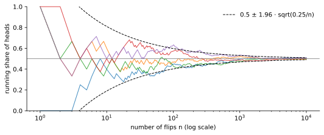

<ul class="post-sources">
<li markdown="span">질문 출처: [Science Vibe, 머신러닝 면접 질문 모음](https://jrc-park.tistory.com/259)</li>
</ul>

## 면접 답변

> 큰수의 법칙은 독립이고 같은 분포에서 뽑은 표본의 평균이, 표본이 많아질수록 참 기댓값으로 수렴한다는 정리입니다.
> 표본 평균의 분산이 σ²/n으로 줄어들기 때문에, 분산이 유한하면 평균이 참값 근처로 모이는 것을 쉽게 보일 수 있습니다.
> 예를 들어 공정한 동전을 10번 던지면 앞면 비율이 0.7일 수 있어도, 1만 번 던지면 0.5에 매우 가까워집니다.
> 머신러닝에서는 학습 데이터의 평균 손실로 기대 손실을 근사하는 근거가 되고, 몬테카를로 추정도 이 법칙에 기대고 있습니다.
> 흔한 오해는 앞면이 많이 나왔으니 다음에 뒷면이 나올 차례라는 것인데, 각 시행은 독립이고 과거의 편차가 보상되는 것이 아니라 표본이 늘면서 비율 안에서 희석되는 것입니다.

## 자세한 설명

### 정리

$$X_1, X_2, \dots$$가 i.i.d.이고 기댓값 $$\mu$$가 유한할 때, 표본 평균 $$\bar{X}_n$$에 대해 수렴의 강도가 다른 두 가지 형태가 있다.

- **약한 법칙(weak law)**: 임의의 $$\epsilon > 0$$에 대해 $$P(\lvert \bar{X}_n - \mu \rvert > \epsilon) \to 0$$이다. 확률 수렴이다.
- **강한 법칙(strong law)**: $$P(\lim_{n \to \infty} \bar{X}_n = \mu) = 1$$이다. 거의 확실한 수렴이다.

약한 법칙은 큰 $$n$$ 하나를 고정했을 때 벗어날 확률이 작다는 말이고, 강한 법칙은 한 번의 무한 수열에서 평균이 결국 $$\mu$$에 머문다는 말이다.

### 분산이 유한할 때의 증명

$$\text{Var}(\bar{X}_n) = \sigma^2/n$$이므로 체비쇼프 부등식(Chebyshev's inequality)에서 바로 나온다.

$$
P(\lvert \bar{X}_n - \mu \rvert \ge \epsilon) \le \frac{\sigma^2}{n \epsilon^2} \to 0
$$

공정한 동전($$\sigma^2 = 0.25$$)을 $$n = 10000$$번 던지고 $$\epsilon = 0.05$$로 두면 상한은 $$0.25 / (10000 \times 0.0025) = 0.01$$이다. 다만 이 상한은 느슨하며, 실제 확률은 이보다 훨씬 작다.

*공정한 동전 시뮬레이션 5회의 누적 앞면 비율. 점선은 중심극한정리로 구한 95% 범위로, 폭이 $$1/\sqrt{n}$$로 줄어든다.*

### 중심극한정리와의 차이

| | 큰수의 법칙 | [중심극한정리](/blog/2026/11/02/knowledge-44-clt/) |
|---|---|---|
| 말하는 것 | 평균이 어디로 가는가 | 평균의 오차가 어떤 모양인가 |
| 극한 | 상수 $$\mu$$ | 정규 분포 |
| 스케일 | $$\bar{X}_n - \mu$$ | $$\sqrt{n}(\bar{X}_n - \mu)$$ |
| 필요 조건(i.i.d.) | 유한한 평균 | 유한한 분산 |

코시 분포는 평균이 정의되지 않아 큰수의 법칙도 성립하지 않는다.

### 머신러닝에서의 의미

학습 손실 $$\frac{1}{n}\sum_i \ell(f; x_i, y_i)$$는 고정된 $$f$$에 대해 기대 손실로 수렴한다. 그러나 $$f$$를 같은 데이터로 골랐다면 $$f$$가 데이터에 의존하므로 이 법칙을 바로 쓸 수 없다. 그래서 학습 오차는 낙관적이며, 일반화 이론에는 모델 집합 전체에 대한 균등 수렴(uniform convergence)이 필요하고, 실무에서는 [별도의 테스트 셋](/blog/2026/11/02/knowledge-12-train-test/)을 둔다.

## 관련 개념

- **중심극한정리**: 수렴 주변의 오차 크기와 모양을 알려 준다. [Q-44](/blog/2026/11/02/knowledge-44-clt/)에서 다룬다.
- **일치성(consistency)**: 표본이 커질수록 추정량이 참값으로 수렴하는 성질이다. 표본 평균의 일치성이 곧 큰수의 법칙이다. [Q-51](/blog/2026/11/02/knowledge-51-biased-unbiased/)에서 불편성과 비교한다.
- **SGD**: 미니배치 평균이 전체 기울기를 근사하는 것도 같은 원리이다. [Q-95](/blog/2026/11/02/knowledge-95-sgd/)에서 다룬다.

## 꼬리 질문

**Q.** 도박사의 오류와 어떻게 다른가요?
도박사의 오류는 편차가 이후 시행에서 반대로 보상된다고 믿는 것입니다. 실제로 앞면 수와 기대치의 절대 차이는 줄지 않고 오히려 $$\sqrt{n}$$ 규모로 커지는 경향이 있으며, 비율의 차이만 분모 $$n$$ 때문에 줄어듭니다.

**Q.** 표본이 많으면 편향된 데이터도 해결되나요?
아닙니다. 표본이 많아지면 표본을 추출한 분포의 기댓값으로 수렴할 뿐입니다. 수집 방식이 치우쳤다면 그 치우친 값으로 더 정확히 수렴합니다.
