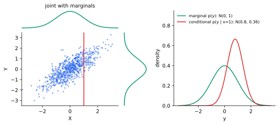

<ul class="post-sources">
<li markdown="span">질문 출처: [Science Vibe, 머신러닝 면접 질문 모음](https://jrc-park.tistory.com/259)</li>
</ul>

## 면접 답변

> 주변 분포는 여러 변수의 결합 분포에서 일부 변수만 남기고, 나머지 변수를 모든 값에 대해 더하거나 적분해서 얻은 분포입니다.
> 나머지 변수가 무슨 값이든 상관없이 관심 변수만 볼 때의 분포라는 의미입니다.
> 예를 들어 날씨와 우산 사용의 결합 확률표가 있을 때, 우산 여부별 확률을 더해 비 올 확률만 구하면 그것이 날씨의 주변 분포입니다.
> 표의 가장자리, 즉 margin에 합계를 적던 데서 이름이 유래했습니다.
> 머신러닝에서는 잠재 변수 모델의 p(x)를 구할 때 잠재 변수를 주변화하는 계산으로 자주 등장합니다.
> 주의할 점은 주변 분포만으로는 변수 사이의 관계를 알 수 없고, 결합 분포를 복원할 수도 없다는 것입니다.

## 자세한 설명

### 정의

두 확률변수 $$X, Y$$의 결합 분포에서 $$X$$의 주변 분포(marginal distribution)는 다음과 같다. 이 연산을 주변화(marginalization)라 하며, 확률의 합 규칙(sum rule)이다.

$$
P(X = x) = \sum_{y} P(X = x, Y = y), \qquad p_X(x) = \int p_{X,Y}(x, y)\, dy
$$

왼쪽은 이산, 오른쪽은 연속인 경우이다.

### 예시

날씨 $$W$$와 우산 사용 $$U$$의 결합 분포를 예시로 정하자. 표의 가장자리가 주변 분포이다.

| | 우산 안 씀 | 우산 씀 | $$P(W)$$ |
|---|---|---|---|
| 맑음 | 0.45 | 0.05 | **0.50** |
| 비 | 0.10 | 0.40 | **0.50** |
| $$P(U)$$ | **0.55** | **0.45** | 1 |

예컨대 $$P(U = \text{씀}) = 0.05 + 0.40 = 0.45$$이다.

### 연속인 경우

표준화된 이변량 정규 분포에서 상관이 $$\rho = 0.8$$이면, $$X$$와 $$Y$$의 주변 분포는 모두 $$\mathcal{N}(0, 1)$$이다. 다변량 정규 분포의 주변 분포는 항상 정규 분포이며, 해당 평균과 공분산 블록만 잘라 내면 된다. 다만 그 역은 일반적으로 성립하지 않아, 주변 분포가 모두 정규여도 결합 분포가 다변량 정규라는 보장은 없다.

*왼쪽: $$\rho = 0.8$$인 이변량 정규 표본 700개와 그 가장자리의 주변 밀도. 오른쪽: 초록은 $$Y$$의 주변 분포, 빨강은 왼쪽 빨간 선($$x = 1$$)에서의 [조건부 분포](/blog/2026/11/02/knowledge-49-conditional/)이다.*

### 주변 분포로 알 수 없는 것

주변 분포는 결합 분포의 일부 정보를 버린다. 다음 두 결합 분포는 주변 분포가 모두 $$(0.5, 0.5)$$로 같다.

| 결합 분포 | $$P(0,0)$$ | $$P(0,1)$$ | $$P(1,0)$$ | $$P(1,1)$$ | 관계 |
|---|---|---|---|---|---|
| A | 0.25 | 0.25 | 0.25 | 0.25 | 독립 |
| B | 0.5 | 0 | 0 | 0.5 | 항상 같은 값 |

그래서 변수를 하나씩 살펴보는 것만으로는 상호작용이나 상관을 놓칠 수 있다.

### 머신러닝에서의 사용

- **잠재 변수 모델**: $$p(x) = \sum_z p(x, z)$$이다. [GMM과 EM](/blog/2026/10/22/ml-13-gmm-em/)이 대표적이다. 합이나 적분이 어려우면 [VAE](/blog/2026/10/24/imc-06-vae/)처럼 하한을 최적화한다.
- **베이즈 추론**: 증거(evidence) $$p(x) = \int p(x \mid \theta) p(\theta)\, d\theta$$가 주변 우도(marginal likelihood)이다.

## 관련 개념

- **결합 분포(joint distribution)**: 주변 분포와 조건부 분포의 출발점이다. 결합 분포를 알면 둘 다 계산할 수 있다.
- **조건부 분포(conditional distribution)**: 다른 변수를 더해 없애는 것이 주변화라면, 다른 변수를 특정 값에 고정하는 것이 조건부화이다. [Q-49](/blog/2026/11/02/knowledge-49-conditional/)에서 다룬다.
- **베이즈 정리의 분모**: 사후 확률의 분모가 주변 확률이다. [Q-34](/blog/2026/11/02/knowledge-34-bayes-theorem/)에서 다룬다.

## 꼬리 질문

**Q.** 주변 분포들로 결합 분포를 구할 수 있나요?
변수들이 독립일 때만 곱으로 구할 수 있습니다. 일반적으로는 위의 예처럼 같은 주변 분포를 갖는 결합 분포가 여러 개 있습니다.

**Q.** 고차원에서 주변화가 왜 어려운가요?
이진 변수 $$d$$개를 단순 합산하면 항이 $$2^d$$개이므로 계산량이 지수적으로 늘어납니다. 그래서 그래프 구조를 이용하거나 변분 추론, MCMC 같은 근사를 씁니다.
