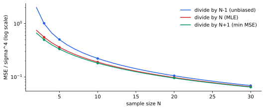

<ul class="post-sources">
<li markdown="span">질문 출처: [Science Vibe, 머신러닝 면접 질문 모음](https://jrc-park.tistory.com/259)</li>
</ul>

## 면접 답변

> 어느 하나가 항상 옳은 것은 아니고 목적에 따라 다릅니다.
> 평균은 둘 다 표본 평균으로 같고, 차이는 분산의 분모입니다. MLE는 N으로 나누어 작게 치우치고, 표본 분산은 N-1로 나누어 불편합니다.
> 그런데 평균 제곱 오차를 기준으로 하면 오히려 MLE가 표본 분산보다 낫고, 정규 분포에서는 N+1로 나누는 것이 가장 낫습니다.
> 예를 들어 N이 5이고 σ²이 1이면 MSE가 N-1일 때 0.5, N일 때 0.36, N+1일 때 약 0.33입니다.
> 그래서 평균의 신뢰구간이나 t 검정처럼 추론을 하는 경우에는 표본 분산을 쓰고, GMM처럼 우도를 최적화하는 모델의 일부라면 MLE를 쓰는 것이 자연스럽습니다.
> 표본이 충분히 크면 셋의 차이는 거의 없어서 실무에서는 큰 문제가 되지 않습니다.

## 자세한 설명

### MLE 유도

i.i.d. 표본 $$x_1, \dots, x_N \sim \mathcal{N}(\mu, \sigma^2)$$의 로그 우도는 다음과 같다.

$$
\ell(\mu, \sigma^2) = -\frac{N}{2}\log(2\pi\sigma^2) - \frac{1}{2\sigma^2}\sum_{i=1}^{N} (x_i - \mu)^2
$$

$$\mu$$와 $$\sigma^2$$로 각각 미분해 0으로 두면 다음을 얻는다.

$$
\hat{\mu}_{\text{MLE}} = \bar{x}, \qquad \hat{\sigma}^2_{\text{MLE}} = \frac{1}{N}\sum_{i=1}^{N} (x_i - \bar{x})^2
$$

### 세 분모의 비교

$$T = \sum_i (x_i - \bar{x})^2$$이라 하자. 정규 데이터이면 $$T / \sigma^2$$은 자유도 $$N - 1$$인 카이제곱 분포를 따르므로, 추정량 $$T / d$$에 대해 다음이 성립한다.

$$
\text{Bias} = \sigma^2\left(\frac{N - 1}{d} - 1\right), \qquad \text{Var} = \frac{2(N - 1)\sigma^4}{d^2}
$$

[MSE = Bias² + Var](/blog/2026/11/02/knowledge-52-bias-variance-mse/)를 $$d$$에 대해 최소화하면 $$d = N + 1$$이다. $$\sigma^2 = 1$$로 두었을 때의 이론값은 다음과 같고, 400,000회 시뮬레이션과 0.003 이내로 일치했다.

| $$N$$ | 분모 | Bias | Var | MSE |
|---|---|---|---|---|
| 5 | $$N - 1$$ (표본 분산) | 0 | 0.5 | 0.5 |
| 5 | $$N$$ (MLE) | -0.2 | 0.32 | 0.36 |
| 5 | $$N + 1$$ | -0.3333 | 0.2222 | 0.3333 |
| 10 | $$N - 1$$ | 0 | 0.2222 | 0.2222 |
| 10 | $$N$$ | -0.1 | 0.18 | 0.19 |
| 10 | $$N + 1$$ | -0.1818 | 0.1488 | 0.1818 |
| 100 | $$N - 1$$ | 0 | 0.0202 | 0.0202 |
| 100 | $$N$$ | -0.01 | 0.0198 | 0.0199 |
| 100 | $$N + 1$$ | -0.0198 | 0.0194 | 0.0198 |

*정규 데이터에서 분모별 MSE. 선은 이론값, 점은 200,000회 시뮬레이션 값이다. $$N$$이 커지면 세 곡선이 겹친다.*

### 언제 무엇을 쓰는가

| 목적 | 선택 | 이유 |
|---|---|---|
| 평균의 신뢰구간, t 검정 | $$N - 1$$ | t 분포 결과가 이 정의를 전제로 한다 |
| 분산 자체를 편향 없이 추정, 여러 추정값의 평균 | $$N - 1$$ | 평균을 내도 편향이 쌓이지 않는다 |
| GMM, GDA, EM 같은 우도 기반 모델 | $$N$$ | 전체 우도를 최대화하는 일관된 절차의 일부이다 |
| 로그 우도, AIC 비교 | $$N$$ | 파라미터가 우도를 최대화해야 정의와 맞는다 |
| 정규 가정 아래 단일 추정의 제곱 오차 최소화 | $$N + 1$$ | 이 기준의 최적값이지만 실무에서는 드물게 쓴다 |

### $$N + 1$$은 정규성에 의존한다

불편성과 달리 MSE 최적 분모는 분포에 달려 있다. 초과 첨도(excess kurtosis)가 $$\kappa$$이면 $$T / d$$ 꼴에서 MSE를 최소화하는 분모는 $$d^* = N + 1 + \kappa(N - 1)/N$$이다. 라플라스 분포($$\kappa = 3$$), $$N = 10$$이면 $$d^* = 13.7$$이고, 시뮬레이션으로도 약 13.71을 얻었다. 꼬리가 두꺼울수록 더 크게 나누어 축소해야 한다.

또한 MSE는 과소 추정과 과대 추정을 같게 벌한다. 분산을 작게 잡으면 위험을 과소평가하는 상황에서는 $$N + 1$$의 음의 편향이 바람직하지 않을 수 있다.

## 관련 개념

- **N-1의 근거**: 불편성 유도는 [Q-54](/blog/2026/11/02/knowledge-54-n-minus-one/)에서 다룬다.
- **가우시안 MLE의 활용**: [GDA](/blog/2026/10/22/ml-05-gda/)와 [GMM](/blog/2026/10/22/ml-13-gmm-em/)이 이 추정을 사용한다.
- **불편 추정의 한계**: 불편한 추정량이 항상 좋은 것은 아니다. [Q-56](/blog/2026/11/02/knowledge-56-unbiased-always-good/)에서 다룬다.

## 꼬리 질문

**Q.** MLE의 편향은 왜 생기나요?
$$\mu$$를 모른 채 같은 데이터로 함께 추정해서 $$\bar{x}$$가 데이터에 맞춰지기 때문입니다. $$\mu$$를 알고 그 값을 쓰면 $$N$$으로 나눈 MLE는 불편입니다.

**Q.** 그 편향을 줄이는 MLE 계열의 방법이 있나요?
제한 최대우도(REML)가 있습니다. 평균 효과를 제거한 데이터의 우도를 최대화하며, 이 단순한 모델에서는 $$N - 1$$ 분모를 줍니다.

**Q.** 고차원에서도 차이가 작나요?
아닙니다. 공분산 행렬에서 차원 $$p$$가 $$N$$에 가깝거나 더 크면 $$N$$ 분모든 $$N-1$$ 분모든 추정이 불안정하고, $$p \ge N$$이면 역행렬도 존재하지 않습니다. 이때는 분모보다 축소(shrinkage)나 정규화가 중요합니다.
