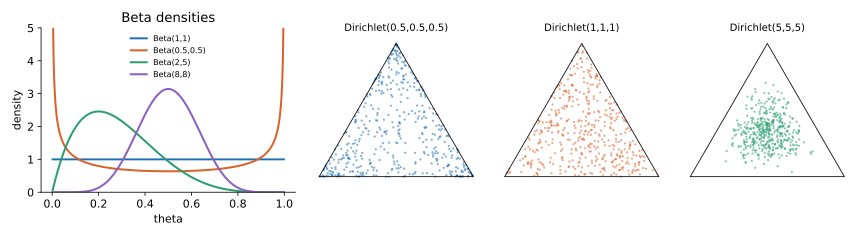

<ul class="post-sources">
<li markdown="span">질문 출처: [Science Vibe, 머신러닝 면접 질문 모음](https://jrc-park.tistory.com/259)</li>
</ul>

## 면접 답변

> Beta 분포는 0과 1 사이의 값, 즉 확률 하나에 대한 분포이고, Dirichlet 분포는 합이 1인 확률 벡터에 대한 분포로 Beta를 여러 차원으로 일반화한 것입니다. 쓰임새는 주로 베이즈 추론의 사전 분포입니다. Beta는 Bernoulli와 Binomial의, Dirichlet은 Multinoulli와 Multinomial의 켤레 사전 분포여서 사후 분포를 파라미터 덧셈만으로 구할 수 있기 때문입니다. 파라미터는 미리 본 가상의 횟수처럼 해석할 수 있습니다. 예를 들어 클릭률에 Beta(2, 8)을 두면 평균이 0.2이고, 클릭 3번과 미클릭 7번을 관측하면 사후 분포는 Beta(5, 15)가 됩니다. 머신러닝에서는 LDA 토픽 모델과 Thompson sampling에서 볼 수 있고, Laplace smoothing도 균등한 Dirichlet 사전 분포의 사후 평균으로 해석됩니다.

## 자세한 설명

### Beta 분포

$$\theta \in (0, 1)$$에 대한 **Beta 분포**는 $$\alpha, \beta > 0$$으로 정해진다. $$\Gamma$$는 감마 함수이며, 앞의 계수는 적분을 1로 만드는 정규화 상수이다.

$$
p(\theta) = \frac{\Gamma(\alpha + \beta)}{\Gamma(\alpha)\Gamma(\beta)} \theta^{\alpha - 1} (1-\theta)^{\beta - 1}
$$

평균과 분산은 다음과 같다. $$\alpha, \beta > 1$$이면 최빈값은 $$(\alpha - 1)/(\alpha + \beta - 2)$$이다.

$$
\mathbb{E}[\theta] = \frac{\alpha}{\alpha + \beta}, \qquad \text{Var}[\theta] = \frac{\alpha\beta}{(\alpha + \beta)^2 (\alpha + \beta + 1)}
$$

$$\alpha + \beta$$가 커질수록 분포가 평균 주위로 좁아지므로, 이 합을 믿음의 강도로 볼 수 있다. $$\text{Beta}(1, 1)$$은 균등 분포이고, $$\alpha, \beta < 1$$이면 양 끝에 몰린다. $$\text{Beta}(2, 5)$$는 평균이 $$2/7 \approx 0.286$$, 최빈값이 0.2이다.

### Dirichlet 분포

합이 1인 확률 벡터 $$\boldsymbol{\theta} = (\theta_1, \dots, \theta_K)$$가 놓이는 공간을 **심플렉스(simplex)**라 한다. **Dirichlet 분포**는 이 위의 분포이며 $$\alpha_j > 0$$으로 정해진다.

$$
p(\boldsymbol{\theta}) = \frac{\Gamma\left(\sum_j \alpha_j\right)}{\prod_j \Gamma(\alpha_j)} \prod_{j=1}^{K} \theta_j^{\alpha_j - 1}, \qquad \mathbb{E}[\theta_j] = \frac{\alpha_j}{\sum_k \alpha_k}
$$

$$K = 2$$이면 Beta 분포가 된다. 모든 $$\alpha_j$$가 1이면 심플렉스 위의 균등 분포이고, 1보다 작으면 일부 성분에 확률이 몰리는 희소한 벡터가, 크면 중앙에 모인 벡터가 나온다.

*왼쪽: Beta 밀도 함수. 오른쪽 세 그림: $$K = 3$$인 대칭 Dirichlet에서 각 450개를 뽑아 삼각형 심플렉스에 찍은 것이다. 꼭짓점에 가까울수록 한 성분이 지배적이다.*

### 사후 분포 갱신

Dirichlet 사전 분포에 Multinomial 횟수 $$n_j$$를 관측하면 사후 분포는 $$\text{Dir}(\alpha_1 + n_1, \dots, \alpha_K + n_K)$$이다. 예를 들어 $$\text{Dir}(2, 3, 5)$$의 평균은 $$(0.2, 0.3, 0.5)$$인데, 횟수 $$(10, 0, 0)$$을 보면 $$\text{Dir}(12, 3, 5)$$가 되어 평균이 $$(0.6, 0.15, 0.25)$$로 옮겨 간다. 관측되지 않은 결과의 확률이 0이 되지 않는다는 점이 MLE와 다르다.

사후 평균은 $$(n_j + \alpha_j)/(n + \sum_k \alpha_k)$$이다. $$\alpha_j = 1$$이면 $$(n_j + 1)/(n + K)$$가 되며, 이것이 **Laplace smoothing**이다. 갱신 원리의 일반론은 [Q-62](/blog/2026/11/02/knowledge-62-conjugate-prior/)에서 다룬다.

### 쓰이는 곳

- **LDA(Latent Dirichlet Allocation)**: 문서별 토픽 비율과 토픽별 단어 비율에 Dirichlet 사전 분포를 둔다. $$\alpha_j < 1$$이면 문서가 소수의 토픽에 집중된다.
- **Thompson sampling**: 광고별 클릭률의 Beta 사후 분포에서 표본을 뽑아, 표본값이 가장 큰 광고를 고른다.
- **표본 생성**: 독립인 $$g_j \sim \text{Gamma}(\alpha_j, 1)$$을 합으로 나눈 $$g_j / \sum_k g_k$$는 $$\text{Dir}(\boldsymbol{\alpha})$$를 따른다.

## 관련 개념

- **Bernoulli와 Multinoulli**: 이들의 파라미터가 곧 Beta와 Dirichlet의 확률 변수이다. [Q-58](/blog/2026/11/02/knowledge-58-binomial-family/)을 참고한다.
- **사전 분포와 사후 분포**: Beta 사전 분포로 동전을 갱신하는 예가 [Q-39](/blog/2026/11/02/knowledge-39-likelihood-prior-posterior/)에 있다.
- **Laplace smoothing**: 처음 보는 단어의 확률이 0이 되는 문제를 막는다. [Machine Learning 6강](/blog/2026/10/22/ml-06-naive-bayes/)에서 다룬다.
- **Gamma 분포**: Dirichlet 표본을 만드는 재료이다. [Q-60](/blog/2026/11/02/knowledge-60-gamma/)에서 다룬다.

## 꼬리 질문

**Q.** Beta 분포의 파라미터는 왜 가상의 횟수로 해석되나요?
Beta(α, β)에서 앞면 h번과 뒷면 t번을 보면 Beta(α + h, β + t)가 되기 때문입니다. 파라미터와 관측 횟수가 그대로 더해지므로, α와 β를 미리 본 횟수처럼 읽을 수 있습니다. 엄밀히는 Beta(1, 1)이 관측 없는 균등 분포에 해당하므로 α − 1, β − 1을 횟수로 보는 관점도 있습니다.

**Q.** softmax 출력과 Dirichlet 분포는 어떻게 다른가요?
softmax 출력은 확률 벡터 한 점입니다. Dirichlet은 확률 벡터들 위의 분포이므로 그 점이 얼마나 불확실한지까지 표현합니다.

**Q.** Dirichlet의 한계는 무엇인가요?
서로 다른 성분 간의 공분산이 항상 음수여서, 함께 커지는 성분을 표현할 수 없습니다. 그런 양의 상관이 필요하면 로지스틱 정규 분포 같은 대안을 씁니다.
