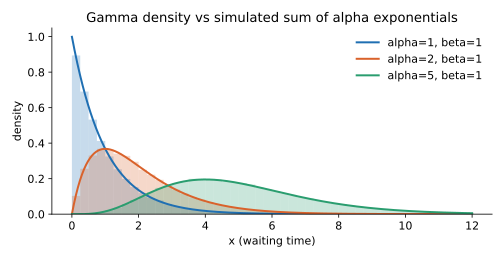

<ul class="post-sources">
<li markdown="span">질문 출처: [Science Vibe, 머신러닝 면접 질문 모음](https://jrc-park.tistory.com/259)</li>
</ul>

## 면접 답변

> Gamma 분포는 양수에서 정의되는 오른쪽 꼬리가 긴 분포로, 크게 세 곳에 쓰입니다. 첫째는 대기 시간 모델링입니다. 일정한 비율로 사건이 일어날 때 α번째 사건까지 걸리는 시간이 Gamma 분포를 따르기 때문입니다. 예를 들어 분당 평균 3건의 전화가 오는 콜센터에서 5번째 전화까지의 시간은 평균 약 1.67분인 Gamma 분포입니다. 둘째는 보험 청구액이나 강수량처럼 양수이고 치우친 데이터의 모델링이며, 이때는 Gamma GLM을 자주 씁니다. 셋째는 베이즈 추론의 사전 분포입니다. Poisson 비율과 Gaussian 정밀도의 켤레 사전 분포여서 사후 분포를 닫힌 형태로 구할 수 있습니다.

## 자세한 설명

### 정의

형태(shape) 파라미터 $$\alpha > 0$$와 비율(rate) 파라미터 $$\beta > 0$$를 쓰면 밀도 함수는 다음과 같다. $$\Gamma(\alpha)$$는 정규화에 필요한 감마 함수이다.

$$
p(x) = \frac{\beta^\alpha}{\Gamma(\alpha)} x^{\alpha - 1} e^{-\beta x}, \quad x > 0
$$

$$
\mathbb{E}[x] = \frac{\alpha}{\beta}, \qquad \text{Var}[x] = \frac{\alpha}{\beta^2}
$$

비율 대신 척도(scale) $$\theta = 1/\beta$$를 쓰는 자료와 라이브러리도 있다. NumPy의 `rng.gamma(shape, scale)`가 그 예이므로 어느 쪽인지 확인해야 한다.

특수한 경우는 다음과 같다.

- $$\alpha = 1$$: 지수 분포(exponential distribution)
- $$\alpha = k/2$$, $$\beta = 1/2$$: 자유도 $$k$$인 카이제곱 분포

### 대기 시간

비율 $$\beta$$인 Poisson 과정에서 사건 사이의 간격은 독립인 $$\text{Exp}(\beta)$$이다. 정수 $$\alpha$$에 대해 $$\alpha$$번째 사건까지의 시간은 이 간격 $$\alpha$$개의 합이므로 $$\text{Gamma}(\alpha, \beta)$$를 따른다.

앞의 콜센터 예는 $$\alpha = 5$$, $$\beta = 3$$이다. 평균은 $$5/3 \approx 1.67$$분, 분산은 $$5/9 \approx 0.56$$, 표준편차는 약 0.75분이다.

*곡선은 Gamma 밀도 함수, 옅은 막대는 $$\text{Exp}(1)$$ 변수 $$\alpha$$개의 합을 5만 번 시뮬레이션한 히스토그램이다. $$\alpha$$가 커지면 중심극한정리에 따라 종 모양에 가까워진다.*

### 양수이고 치우친 데이터

변동계수(표준편차/평균)가 $$1/\sqrt{\alpha}$$로 평균과 무관하다. 다시 말해 평균이 커질수록 표준편차도 비례해 커진다. 금액처럼 값이 클수록 변동도 큰 데이터에 맞는 성질이다.

**Gamma GLM**은 로그 링크 $$\log \mathbb{E}[y \mid \mathbf{x}] = \mathbf{x}^\top\boldsymbol{\beta}$$를 주로 쓴다. 예측값이 항상 양수이고, 분산이 평균의 제곱에 비례한다고 가정한다. 다만 $$y = 0$$인 데이터는 다룰 수 없으므로, 0이 많다면 0 여부와 양수 값을 나누어 모델링하는 방법을 고려한다.

### 베이즈 사전 분포

| 가능도 | Gamma를 두는 파라미터 | 사후 분포 |
|---|---|---|
| Poisson | 비율 $$\lambda$$ | $$\text{Gamma}(\alpha + \sum_i x_i, \beta + n)$$ |
| Exponential | 비율 $$\lambda$$ | $$\text{Gamma}(\alpha + n, \beta + \sum_i x_i)$$ |
| Gaussian (평균 $$\mu$$ 고정) | 정밀도 $$\tau = 1/\sigma^2$$ | $$\text{Gamma}(\alpha + n/2, \beta + \tfrac{1}{2}\sum_i (x_i - \mu)^2)$$ |

정밀도에 Gamma를 두는 것은 분산에 역감마(inverse-gamma) 분포를 두는 것과 같다. 계산 예는 [Q-62](/blog/2026/11/02/knowledge-62-conjugate-prior/)에 있다.

## 관련 개념

- **Poisson 분포**: 고정 구간의 사건 횟수를 세고, Gamma는 정해진 횟수까지의 시간을 잰다. 같은 과정을 보는 두 관점이다. [Q-61](/blog/2026/11/02/knowledge-61-poisson/)을 참고한다.
- **Dirichlet 분포**: 독립인 Gamma 변수를 합으로 정규화하면 Dirichlet 표본이 된다. [Q-59](/blog/2026/11/02/knowledge-59-beta-dirichlet/)를 참고한다.
- **지수족과 GLM**: Gamma도 지수족에 속하며, 그래서 GLM으로 다룰 수 있다. [Machine Learning 4강](/blog/2026/10/22/ml-04-glm/)에서 다룬다.
- **카이제곱 분포**: 우도비 검정의 극한 분포로, Gamma의 특수한 경우이다. [Q-70](/blog/2026/11/02/knowledge-70-likelihood-ratio-test/)을 참고한다.

## 꼬리 질문

**Q.** 양수 데이터면 로그를 취해 Gaussian으로 모델링해도 되지 않나요?
가능하며 분포가 잘 맞으면 좋은 선택입니다. 다만 로그 척도에서 평균을 예측해 그대로 지수를 취하면 원래 척도의 평균보다 작아지는 편향이 생깁니다. 원래 척도의 평균이 관심사라면 Gamma GLM이 직접적입니다.

**Q.** α가 1보다 작으면 분포 모양이 어떻게 되나요?
$$x \to 0$$에서 밀도가 무한대로 커지는 모양이 됩니다. 값 대부분이 0 근처에 있고 드물게 큰 값이 나옵니다.

**Q.** 정수가 아닌 α도 대기 시간으로 해석되나요?
사건 횟수로 직접 해석되지는 않습니다. 그래도 분포는 잘 정의되며, 모양을 조절하는 파라미터로 그대로 쓸 수 있습니다.
