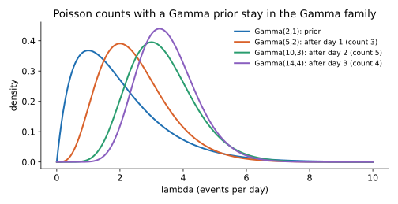

<ul class="post-sources">
<li markdown="span">질문 출처: [Science Vibe, 머신러닝 면접 질문 모음](https://jrc-park.tistory.com/259)</li>
</ul>

## 면접 답변

> Conjugate prior, 즉 켤레 사전 분포는 특정 가능도와 곱했을 때 사후 분포가 사전 분포와 같은 분포족에 머무는 사전 분포입니다. 장점은 계산입니다. 베이즈 정리의 분모인 적분을 직접 풀 필요 없이 파라미터만 갱신하면 사후 분포를 얻을 수 있습니다. 예를 들어 Binomial 가능도에 Beta 사전 분포를 두면 사후 분포도 Beta이고, 앞면과 뒷면 횟수를 파라미터에 더하기만 하면 됩니다. 그 결과 데이터가 순차적으로 들어와도 쉽게 갱신할 수 있고, 사전 분포의 파라미터를 가상의 관측으로 해석할 수도 있습니다. 다만 켤레성은 계산 편의를 위한 선택이지 사전 지식을 반드시 잘 나타내는 것은 아닙니다. 로지스틱 회귀처럼 켤레 사전 분포가 없는 모델에서는 MCMC나 변분 추론 같은 근사를 씁니다.

## 자세한 설명

### 정의

베이즈 정리에서 사후 분포는 가능도와 사전 분포의 곱에 비례한다.

$$
p(\theta \mid D) \propto p(D \mid \theta)\, p(\theta)
$$

가능도 $$p(D \mid \theta)$$에 대해, 사전 분포 $$p(\theta)$$와 사후 분포 $$p(\theta \mid D)$$가 같은 분포족에 속하면 이 분포족을 그 가능도의 **켤레 사전 분포**라 한다. 켤레성은 분포 하나의 성질이 아니라 가능도와 사전 분포 쌍의 성질이다.

### 대표적인 쌍

| 가능도 | 켤레 사전 분포 | 사후 분포 |
|---|---|---|
| Bernoulli, Binomial | Beta$$(\alpha, \beta)$$ | Beta$$(\alpha + h, \beta + t)$$ ($$h$$: 성공, $$t$$: 실패 횟수) |
| Multinoulli, Multinomial | Dirichlet$$(\boldsymbol{\alpha})$$ | Dirichlet$$(\boldsymbol{\alpha} + \mathbf{n})$$ ($$\mathbf{n}$$: 결과별 횟수) |
| Poisson | Gamma$$(\alpha, \beta)$$ | Gamma$$(\alpha + \sum_i x_i, \beta + n)$$ |
| Exponential | Gamma$$(\alpha, \beta)$$ | Gamma$$(\alpha + n, \beta + \sum_i x_i)$$ |
| Gaussian 평균 (분산 고정) | Gaussian | Gaussian |
| Gaussian 정밀도 (평균 고정) | Gamma | Gamma |

Beta-Binomial로 동전을 갱신하는 계산은 [Q-39](/blog/2026/11/02/knowledge-39-likelihood-prior-posterior/)에 있으므로, 여기서는 Gamma-Poisson을 본다.

### 계산 예: Gamma-Poisson

하루 사건 수가 $$\text{Poisson}(\lambda)$$를 따른다고 하고, $$\lambda$$의 사전 분포를 $$\text{Gamma}(2, 1)$$로 둔다. 가능도와 사전 분포에서 $$\lambda$$가 들어 있는 부분만 곱하면 다음과 같다.

$$
\underbrace{\prod_{i} \lambda^{x_i} e^{-\lambda}}_{\text{likelihood}} \cdot \underbrace{\lambda^{\alpha - 1} e^{-\beta\lambda}}_{\text{prior}} = \lambda^{\alpha + \sum_i x_i - 1} e^{-(\beta + n)\lambda}
$$

이는 다시 Gamma 형태이다. 사건 수 3, 5, 4를 차례로 관측하면 다음과 같다.

| 시점 | 분포 | 평균 |
|---|---|---:|
| 사전 | Gamma(2, 1) | 2.00 |
| 1일차 (3건) | Gamma(5, 2) | 2.50 |
| 2일차 (5건) | Gamma(10, 3) | 3.33 |
| 3일차 (4건) | Gamma(14, 4) | 3.50 |

*관측이 쌓일수록 분포가 데이터 쪽으로 움직이고 좁아진다. 격자 위에서 수치로 정규화한 사후 분포와 Gamma(14, 4)의 차이는 최대 $$3 \times 10^{-7}$$ 정도였다.*

사후 평균은 사전 평균과 MLE의 가중 평균이다. 이 예에서 사전 평균은 2이고 MLE는 $$12/3 = 4$$이다.

$$
\frac{\alpha + \sum_i x_i}{\beta + n} = \frac{\beta}{\beta + n} \cdot \frac{\alpha}{\beta} + \frac{n}{\beta + n} \cdot \bar{x} = \frac{1}{4} \cdot 2 + \frac{3}{4} \cdot 4 = 3.5
$$

즉 사전 분포는 "$$\beta$$일 동안 $$\alpha$$건을 본 것"과 같은 역할을 한다. $$n$$이 커지면 데이터의 비중이 커져 MLE에 가까워진다.

### 켤레성이 생기는 이유와 한계

지수족(exponential family) 가능도는 일반적으로 켤레 사전 분포를 갖는다. 충분 통계량을 더하는 것으로 갱신이 끝나므로 형태가 유지된다.

- **순서 무관**: 한꺼번에 갱신하든 하나씩 갱신하든, 순서를 바꾸든 결과가 같다.
- **표현력의 제한**: 다봉형 믿음은 단일 Beta로 나타낼 수 없다. 켤레 사전 분포의 혼합은 여전히 켤레이므로 이것으로 보완할 수 있다.
- **없는 경우**: 로지스틱 회귀의 계수나 신경망 가중치에는 실용적인 켤레 사전 분포가 없다. 이때는 MCMC, 변분 추론, Laplace 근사를 쓴다.

## 관련 개념

- **Prior, Likelihood, Posterior**: 켤레성의 전제가 되는 세 개념이다. [Q-39](/blog/2026/11/02/knowledge-39-likelihood-prior-posterior/)에서 다룬다.
- **Beta와 Dirichlet 분포**: 가장 자주 쓰는 켤레 사전 분포이다. [Q-59](/blog/2026/11/02/knowledge-59-beta-dirichlet/)를 참고한다.
- **지수족**: 켤레 사전 분포가 존재하는 대표적인 분포족이다. [Machine Learning 4강](/blog/2026/10/22/ml-04-glm/)에서 다룬다.
- **Frequentist와 Bayesian**: 파라미터를 확률 변수로 보는 베이즈 관점에서 사전 분포가 나온다. [Q-71](/blog/2026/11/02/knowledge-71-frequentist-bayesian/)을 참고한다.

## 꼬리 질문

**Q.** 켤레 사전 분포를 쓰면 MAP과 MLE는 어떻게 달라지나요?
Beta(α, β) 사전 분포에서 MAP은 (h + α − 1)/(n + α + β − 2)로, 가상의 관측을 더한 비율이 됩니다. Beta(1, 1)이면 MLE와 같아집니다. n이 커지면 차이가 사라집니다.

**Q.** 켤레 사전 분포를 쓰면 정답에 더 가까워지나요?
그렇지 않습니다. 계산이 쉬워질 뿐입니다. 믿음과 맞지 않는 분포를 편의로 고르고 데이터까지 적으면 결과가 왜곡될 수 있으므로, 사전 분포를 바꿔 보는 민감도 분석이 필요합니다.

**Q.** Gaussian 평균의 켤레 갱신은 어떤 모양인가요?
정밀도(분산의 역수)가 더해지고, 사후 평균은 정밀도로 가중한 평균이 됩니다. 사전 평균과 표본 평균 중 더 정밀한 쪽으로 끌려갑니다.
