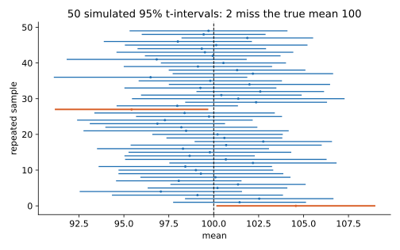

<ul class="post-sources">
<li markdown="span">질문 출처: [Science Vibe, 머신러닝 면접 질문 모음](https://jrc-park.tistory.com/259)</li>
</ul>

## 면접 답변

> 신뢰구간은 표본으로 추정한 값의 불확실성을 범위로 나타낸 것입니다. 95% 신뢰구간이란 같은 방식으로 표본을 뽑아 구간 만들기를 반복하면 그 구간들 중 약 95%가 참값을 포함한다는 뜻입니다. 주의할 점은 이미 계산된 구간 하나에 참값이 들어 있을 확률이 95%라는 뜻이 아니라는 것입니다. 빈도주의에서 참값은 고정된 상수이고, 무작위인 것은 구간 쪽이기 때문입니다. 예를 들어 표본 25개의 평균이 100이고 표준편차가 10이면 95% 신뢰구간은 약 95.9에서 104.1입니다. 표본 수를 4배로 늘리면 폭이 대략 절반으로 줄어듭니다. 머신러닝에서는 테스트 정확도처럼 유한한 데이터로 잰 성능의 오차 범위를 보고할 때 씁니다.

## 자세한 설명

### 평균의 신뢰구간

정규 분포에서 뽑은 표본 $$x_1, \dots, x_n$$의 표본 평균을 $$\bar{x}$$, 표본 표준편차를 $$s$$라 하면 참 평균 $$\mu$$의 $$100(1-\alpha)\%$$ 신뢰구간은 다음과 같다. $$t_{\alpha/2, n-1}$$은 자유도 $$n-1$$인 t 분포의 상위 $$\alpha/2$$ 분위수이고, $$s/\sqrt{n}$$은 평균의 **표준오차(standard error)**이다.

$$
\bar{x} \pm t_{\alpha/2,\, n-1} \frac{s}{\sqrt{n}}
$$

$$\sigma$$를 알거나 $$n$$이 충분히 크면 $$t$$ 대신 정규 분위수(95%에서 1.96)를 쓴다. 정규성이 없어도 $$n$$이 크면 [중심극한정리](/blog/2026/11/02/knowledge-44-clt/)에 의해 근사적으로 성립한다.

$$n = 25$$, $$\bar{x} = 100$$, $$s = 10$$이면 $$t_{0.025, 24} \approx 2.064$$, 표준오차는 2이므로 구간은 $$100 \pm 4.13$$, 즉 $$[95.87, 104.13]$$이다.

### 95%의 의미

*$$N(100, 10^2)$$에서 표본 25개를 뽑아 t 구간을 50번 만든 시뮬레이션이다. 구간마다 위치와 폭이 달라지고, 주황색 2개는 참값을 놓쳤다. 20만 번 반복했을 때의 포함 비율은 약 0.950이었다.*

그림에서 95%는 절차의 장기적 성질이다. 계산이 끝난 구간은 참값을 포함하거나 포함하지 않거나 둘 중 하나이다.

| 구분 | 신뢰구간 (Frequentist) | 신용구간 (credible interval, Bayesian) |
|---|---|---|
| 무작위인 것 | 구간 | 파라미터에 대한 믿음 |
| 의미 | 반복 시 95%의 구간이 참값 포함 | 사후 분포에서 참값이 이 구간에 있을 확률 95% |
| 필요한 것 | 표본 분포 | 사전 분포와 가능도 |

### 모델 평가에 적용

테스트 표본 $$n = 1000$$개에서 정확도 $$\hat{p} = 0.9$$이면 정규 근사(Wald) 구간은 다음과 같다.

$$
\hat{p} \pm 1.96\sqrt{\frac{\hat{p}(1-\hat{p})}{n}} = 0.9 \pm 0.0186
$$

즉 약 $$[0.881, 0.919]$$이다. 이 정도 규모에서는 0.5% 차이의 두 모델을 같은 테스트 셋의 점수만으로 단정하기 어렵다. 단, 다음에 주의한다.

- $$\hat{p}$$가 0이나 1에 가깝거나 $$n$$이 작으면 Wald 구간이 부정확하므로 Wilson 구간을 쓴다.
- AUC나 F1처럼 식이 복잡한 지표는 부트스트랩(bootstrap)으로 구간을 구할 수 있다.
- 두 모델 비교는 같은 표본에서 나온 쌍체 데이터이므로, 각각의 구간이 겹치는지 보기보다 차이의 구간을 직접 구한다.
- 테스트 셋을 반복해 보면서 모델을 고르면 이 구간은 더 이상 유효하지 않다.

## 관련 개념

- **중심극한정리**: 표본 평균의 근사 정규성이 신뢰구간의 근거이다. [Q-44](/blog/2026/11/02/knowledge-44-clt/)를 참고한다.
- **가설 검정과 p-value**: 대응되는 양측 검정에서 95% 구간에 $$\theta_0$$가 없으면 유의수준 5%로 기각한다. [Q-69](/blog/2026/11/02/knowledge-69-p-value/)를 참고한다.
- **A/B 테스트**: 효과 크기의 범위를 판단하는 데 신뢰구간을 쓴다. [Q-19](/blog/2026/11/02/knowledge-19-ab-test/)에 예가 있다.
- **표본 분산**: 표준오차 계산에 들어가는 $$s$$이다. [Q-53](/blog/2026/11/02/knowledge-53-sample-variance/)을 참고한다.
- **Frequentist와 Bayesian**: 신뢰구간과 신용구간의 해석 차이가 이 관점 차이에서 나온다. [Q-71](/blog/2026/11/02/knowledge-71-frequentist-bayesian/)을 참고한다.

## 꼬리 질문

**Q.** 신뢰수준을 99%로 높이면 무엇이 달라지나요?
구간이 넓어집니다. 포함할 가능성을 높이는 대신 정보가 덜 구체적이 되는 것입니다. 표본 수를 늘리면 신뢰수준을 유지하면서 폭을 줄일 수 있습니다.

**Q.** 신뢰구간과 예측구간은 어떻게 다른가요?
신뢰구간은 평균 같은 파라미터의 범위이고, 예측구간은 새 관측값 하나의 범위입니다. 새 관측값 자체의 노이즈가 더해지므로 예측구간이 더 넓고, 표본이 많아져도 노이즈 크기 아래로는 줄어들지 않습니다.

**Q.** 두 집단의 신뢰구간이 겹치면 차이가 없는 건가요?
아닙니다. 각 95% 구간이 조금 겹쳐도 차이의 검정은 유의할 수 있습니다. 차이 자체의 신뢰구간을 구해 0을 포함하는지 보아야 합니다.
