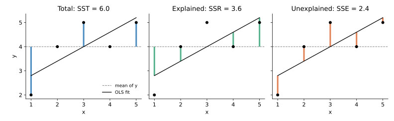

<ul class="post-sources">
<li markdown="span">질문 출처: [Science Vibe, 머신러닝 면접 질문 모음](https://jrc-park.tistory.com/259)</li>
</ul>

## 면접 답변

> 회귀 분석에서 total variation은 각 관측값이 전체 평균에서 얼마나 벗어나 있는지를 제곱해서 더한 값으로, SST라고 씁니다. 입력을 전혀 쓰지 않고 평균으로만 예측할 때의 오차이므로, 모델이 설명해야 할 변동의 총량이라고 볼 수 있습니다. 표본 분산에 n − 1을 곱한 값과도 같습니다. 절편이 있는 OLS에서는 이 값이 모델이 설명한 부분인 SSR과 설명하지 못한 부분인 SSE의 합으로 정확히 나뉩니다. 예를 들어 SST가 6이고 SSR이 3.6이면 SSE는 2.4이고, 결정계수는 0.6입니다. 참고로 확률 분포 사이의 거리인 total variation distance는 이름만 비슷할 뿐 다른 개념입니다.

## 자세한 설명

### 정의

관측값 $$y_i$$, 평균 $$\bar{y} = \frac{1}{n}\sum_i y_i$$에 대해 **총 변동(total variation, total sum of squares)**은 다음과 같다.

$$
\text{SST} = \sum_{i=1}^{n} (y_i - \bar{y})^2
$$

표본 분산을 $$s^2$$라 하면 $$\text{SST} = (n-1)s^2$$이다. 평균을 데이터로 추정하면서 제약이 하나 생기므로 자유도는 $$n - 1$$이다. SST는 입력이나 모델과 무관하게 $$y$$만으로 정해진다.

### 변동의 분해

회귀 모델의 예측값을 $$\hat{y}_i$$라 하면, 평균에서의 편차를 두 부분으로 쪼갤 수 있다.

$$
y_i - \bar{y} = (\hat{y}_i - \bar{y}) + (y_i - \hat{y}_i)
$$

양변을 제곱해 더하면 교차항 $$\sum_i (\hat{y}_i - \bar{y})(y_i - \hat{y}_i)$$가 남는다. OLS의 정규 방정식에 따르면 잔차는 모든 입력 열과 직교하므로 예측값과도 직교한다. 절편이 있으면 잔차의 합도 0이다. 이 두 사실로 교차항이 사라져 다음 항등식을 얻는다.

$$
\underbrace{\sum_i (y_i - \bar{y})^2}_{\text{SST}} = \underbrace{\sum_i (\hat{y}_i - \bar{y})^2}_{\text{SSR}} + \underbrace{\sum_i (y_i - \hat{y}_i)^2}_{\text{SSE}}
$$

기하학적으로는 평균을 뺀 $$y$$ 벡터, 그 직교 사영, 잔차가 이루는 직각삼각형의 피타고라스 정리이다.

### 계산 예

$$x = (1, 2, 3, 4, 5)$$, $$y = (2, 4, 5, 4, 5)$$에 직선을 맞추면 $$\hat{y} = 2.2 + 0.6x$$이고 $$\bar{y} = 4$$이다. 이 예제는 [Q-65](/blog/2026/11/02/knowledge-65-explained-variation/), [Q-66](/blog/2026/11/02/knowledge-66-unexplained-variation/), [Q-67](/blog/2026/11/02/knowledge-67-r-squared/)에서도 이어서 쓴다.

| $$x_i$$ | $$y_i$$ | $$\hat{y}_i$$ | $$(y_i - \bar{y})^2$$ | $$(\hat{y}_i - \bar{y})^2$$ | $$(y_i - \hat{y}_i)^2$$ |
|---:|---:|---:|---:|---:|---:|
| 1 | 2 | 2.8 | 4 | 1.44 | 0.64 |
| 2 | 4 | 3.4 | 0 | 0.36 | 0.36 |
| 3 | 5 | 4.0 | 1 | 0 | 1 |
| 4 | 4 | 4.6 | 0 | 0.36 | 0.36 |
| 5 | 5 | 5.2 | 1 | 1.44 | 0.04 |
| 합 |  |  | **SST = 6** | **SSR = 3.6** | **SSE = 2.4** |

*왼쪽: 점에서 평균까지의 편차(SST). 가운데: 회귀선에서 평균까지의 편차(SSR). 오른쪽: 점에서 회귀선까지의 잔차(SSE). 각 선분의 제곱을 합한 값이 패널 제목의 수치이다.*

### 항등식이 성립하는 조건

$$\text{SST} = \text{SSR} + \text{SSE}$$는 **절편이 있는 OLS를 학습 데이터에서 평가할 때** 성립한다. 항상 성립하는 것은 아니다. 같은 데이터에 원점을 지나는 직선 $$\hat{y} = 1.2x$$를 맞추면 $$\text{SSR} = 15.2$$, $$\text{SSE} = 6.8$$로 합이 22가 되어 SST 6과 다르다. 잔차의 합이 0이 아니어서 교차항이 남기 때문이다. 정규화 회귀, 비선형 모델, 테스트 데이터에서도 일반적으로 성립하지 않는다.

### 용어 주의

"Total variation"은 맥락에 따라 다른 뜻으로도 쓰인다.

- **분포 사이의 거리**: [total variation distance](/blog/2026/11/02/knowledge-68-tv-distance/)는 SST와 무관하다.
- **이미지 처리의 TV 정규화**: 인접 픽셀 차이의 합으로 정의하는 값으로, 이것도 별개이다.
- **약어**: 일부 교재는 SSR을 잔차 제곱합(residual), SSE를 설명된 제곱합(explained)으로 쓴다. 약어만 보지 말고 식을 확인해야 한다.

## 관련 개념

- **Explained variation**: 예측값이 평균에서 벗어난 정도인 SSR이다. [Q-65](/blog/2026/11/02/knowledge-65-explained-variation/)에서 다룬다.
- **Unexplained variation**: 잔차의 제곱합인 SSE이다. [Q-66](/blog/2026/11/02/knowledge-66-unexplained-variation/)에서 다룬다.
- **결정계수**: SST 중 모델이 설명한 비율이다. [Q-67](/blog/2026/11/02/knowledge-67-r-squared/)에서 다룬다.
- **표본 분산**: SST를 $$n-1$$로 나눈 값이다. [Q-53](/blog/2026/11/02/knowledge-53-sample-variance/)을 참고한다.
- **최소제곱과 직교 사영**: 잔차의 직교성은 [Linear Algebra 5강](/blog/2026/10/22/la-05-least-squares/)에서 다룬다.

## 꼬리 질문

**Q.** SST의 자유도는 왜 n − 1인가요?
편차 $$y_i - \bar{y}$$들의 합이 항상 0이어서, $$n - 1$$개가 정해지면 나머지 하나는 자동으로 결정되기 때문입니다.

**Q.** 입력 변수를 추가하면 SST가 변하나요?
변하지 않습니다. SST는 $$y$$만으로 계산되기 때문입니다. 학습 데이터에서 변수를 추가하면 SSR은 줄지 않고 SSE는 늘지 않습니다.

**Q.** ANOVA의 제곱합 분해와 같은 것인가요?
같은 구조입니다. ANOVA에서는 예측값이 그룹 평균이므로, SSR이 집단 간 제곱합이고 SSE가 집단 내 제곱합입니다.
