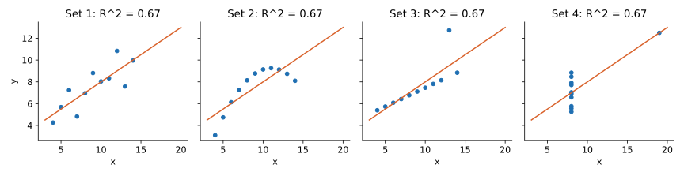

<ul class="post-sources">
<li markdown="span">질문 출처: [Science Vibe, 머신러닝 면접 질문 모음](https://jrc-park.tistory.com/259)</li>
</ul>

## 면접 답변

> 결정계수 R 제곱은 1에서 SSE를 SST로 나눈 값을 뺀 것으로, 평균으로만 예측하는 기준 모델에 비해 제곱 오차를 얼마나 줄였는지를 나타냅니다. 절편이 있는 OLS의 학습 데이터에서는 총 변동 중 모델이 설명한 비율과 같아 0과 1 사이의 값을 갖습니다. 예를 들어 SST가 6이고 SSE가 2.4이면 R 제곱은 0.6이고, 변동의 60%를 설명했다고 말합니다. 단위가 없어 해석이 쉽지만, 값이 높다고 모델이 올바른 것은 아닙니다. 비선형 패턴이나 이상치가 있어도 값이 높게 나올 수 있고, 학습 데이터에서는 변수를 넣기만 해도 줄어들지 않기 때문입니다. 그래서 잔차를 함께 보고, 조정 결정계수나 검증 데이터의 R 제곱을 확인합니다. 검증 데이터에서는 평균보다 못한 모델이라면 음수가 될 수도 있습니다.

## 자세한 설명

### 정의

**결정계수(coefficient of determination)**는 다음과 같다.

$$
R^2 = 1 - \frac{\text{SSE}}{\text{SST}}
$$

SSE는 모델의 잔차 제곱합이고 SST는 평균으로 예측했을 때의 제곱합이다. 따라서 $$R^2$$은 기준 모델 대비 오차 감소율이다. 절편이 있는 OLS에서는 $$\text{SST} = \text{SSR} + \text{SSE}$$이므로 $$R^2 = \text{SSR}/\text{SST}$$이기도 하다. 각 항은 [Q-64](/blog/2026/11/02/knowledge-64-total-variation/), [Q-65](/blog/2026/11/02/knowledge-65-explained-variation/), [Q-66](/blog/2026/11/02/knowledge-66-unexplained-variation/)에서 다뤘다.

예제 $$x = (1, 2, 3, 4, 5)$$, $$y = (2, 4, 5, 4, 5)$$에서 $$R^2 = 1 - 2.4/6 = 0.6$$이다. 입력이 하나인 선형 회귀에서는 $$R^2$$이 $$x$$와 $$y$$의 상관계수의 제곱과 같다. 여기서 $$r \approx 0.775$$이고 $$r^2 = 0.6$$이다.

### 값의 범위

| 상황 | 범위 |
|---|---|
| 절편 있는 OLS, 학습 데이터 | $$0 \le R^2 \le 1$$ |
| 테스트 데이터, 절편 없는 모델, 임의의 예측 | $$R^2 \le 1$$, 음수 가능 |

$$R^2 < 0$$은 그 데이터의 평균으로 예측하는 것보다 나쁘다는 뜻이다. 같은 데이터에 원점을 지나는 직선을 맞추면 $$\text{SSE} = 6.8$$이므로 $$R^2 = 1 - 6.8/6 \approx -0.133$$이다. "제곱"이라는 이름과 달리 어떤 값의 제곱은 아니며, 이때는 "설명 비율"이라는 해석도 쓸 수 없다.

### 조정 결정계수

학습 $$R^2$$은 변수를 추가해도 줄지 않으므로, 자유도로 보정한 **조정 결정계수(adjusted $$R^2$$)**를 쓴다. $$p$$는 입력 변수의 개수이다.

$$
R^2_{\text{adj}} = 1 - (1 - R^2) \frac{n - 1}{n - p - 1}
$$

예제에서는 $$1 - 0.4 \times 4/3 \approx 0.467$$이다. 새 변수가 우연 수준을 넘어 SSE를 줄여야 값이 오른다. 그래도 학습 데이터 기반 보정이므로, 예측 성능을 알고 싶다면 교차 검증을 쓰는 것이 더 직접적이다.

### 높은 R²이 말해 주지 않는 것

**Anscombe's quartet**(Anscombe, 1973)는 이를 보여 주는 고전적인 데이터이다. 네 데이터의 회귀선은 거의 같고 $$R^2$$도 모두 약 0.67이지만 구조는 전혀 다르다.

*Set 1은 직선 관계, Set 2는 곡선 관계, Set 3은 이상치 하나가 기울기를 끌어당긴 경우, Set 4는 점 하나가 회귀선을 결정하는 경우이다. 직접 계산한 결과 네 회귀선은 모두 약 $$\hat{y} = 3.00 + 0.50x$$이다.*

그 밖의 주의점은 다음과 같다.

- **인과를 뜻하지 않는다.** 함께 변하는 정도만 나타낸다.
- **좋은 값의 기준은 분야마다 다르다.** 노이즈가 큰 문제에서는 낮은 $$R^2$$도 쓸모가 있을 수 있다.
- **$$y$$의 범위에 의존한다.** 잔차가 같아도 $$y$$가 넓게 퍼진 데이터에서는 SST가 커져 값이 높아진다. 그래서 절대 오차 크기를 알려면 RMSE도 함께 본다.
- **대상 변수가 다르면 비교할 수 없다.** $$y$$와 $$\log y$$를 예측한 모델은 SST가 달라 $$R^2$$을 직접 비교할 수 없다.

## 관련 개념

- **SST, SSR, SSE**: 결정계수를 이루는 세 제곱합이다. [Q-64](/blog/2026/11/02/knowledge-64-total-variation/)에 분해가 있다.
- **상관계수**: 단순 선형 회귀에서는 $$R^2 = r^2$$이다. [Q-35](/blog/2026/11/02/knowledge-35-covariance-correlation/)를 참고한다.
- **에타 제곱**: ANOVA에서 같은 구조로 정의하는 지표이다. [Q-40](/blog/2026/11/02/knowledge-40-continuous-categorical-correlation/)을 참고한다.
- **교차 검증**: 일반화 성능을 재는 더 직접적인 방법이다. [Q-74](/blog/2026/11/02/knowledge-74-cross-validation/)에서 다룬다.
- **회귀 지표**: MAE, RMSE와 함께 보는 것이 좋다. [Q-22](/blog/2026/11/02/knowledge-22-useful-metrics/)를 참고한다.

## 꼬리 질문

**Q.** 테스트 데이터의 R²을 계산할 때 평균은 어느 것을 쓰나요?
scikit-learn의 `r2_score`를 포함해 일반적으로 평가 데이터의 평균을 씁니다. 학습 평균을 기준 모델로 삼는 정의도 있으므로, 두 값을 비교할 때는 어떤 정의인지 확인해야 합니다.

**Q.** 분류 모델에도 R²을 쓸 수 있나요?
그대로는 쓰지 않습니다. 로지스틱 회귀에서는 로그 가능도로 기준 모델과 비교하는 McFadden의 pseudo-R² 같은 지표를 쓰며, 이 값은 설명 비율로 해석되지 않습니다.

**Q.** R²이 0.99이면 무조건 좋은 모델인가요?
먼저 의심해야 합니다. 타깃 정보가 입력에 샌 데이터 누수, 추세가 강한 시계열에서 함께 움직이는 변수, 소수의 영향점 때문일 수 있습니다. 시간 순서를 지킨 검증과 잔차 확인이 필요합니다.
