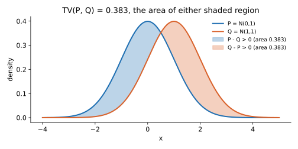

<ul class="post-sources">
<li markdown="span">질문 출처: [Science Vibe, 머신러닝 면접 질문 모음](https://jrc-park.tistory.com/259)</li>
</ul>

## 면접 답변

> Total variation distance는 두 확률 분포 사이의 거리로, 어떤 사건에 대해서든 두 분포가 부여하는 확률이 최대 얼마나 다른지를 나타냅니다. 계산은 두 확률 함수 차이의 절댓값을 합한 뒤 절반으로 나누면 되고, 값은 0에서 1 사이입니다. 예를 들어 세 결과에 대한 분포가 0.5, 0.3, 0.2와 0.2, 0.3, 0.5이면 거리는 0.3입니다. 직관적으로는 표본 하나를 보고 어느 분포에서 왔는지 맞힐 때의 최선의 성능과 직결됩니다. KL divergence와 달리 대칭이고 항상 유한한 진짜 거리입니다. 다만 지지 집합이 겹치지 않으면 얼마나 멀든 항상 1이어서, 그럴 때는 Wasserstein 거리가 더 유용합니다. 참고로 회귀에서의 total variation인 SST와는 이름만 같고 관계가 없습니다.

## 자세한 설명

### 정의

같은 공간 위의 확률 분포 $$P$$, $$Q$$에 대해 **total variation distance**는 모든 사건 $$A$$에 대한 확률 차이의 상한이다.

$$
\text{TV}(P, Q) = \sup_{A} \lvert P(A) - Q(A) \rvert
$$

이산 분포에서는 확률 질량 함수 $$p$$, $$q$$로 다음과 같이 계산한다. 연속 분포에서는 합을 적분으로 바꾼다.

$$
\text{TV}(P, Q) = \frac{1}{2} \sum_{x} \lvert p(x) - q(x) \rvert
$$

상한은 $$A^* = \{x : p(x) > q(x)\}$$에서 달성된다. $$\sum_x (p - q) = 0$$이므로 $$p > q$$인 부분의 합과 $$q > p$$인 부분의 합이 크기가 같고, 그중 한쪽이 곧 TV이다. 그래서 $$\tfrac{1}{2}$$이 붙는다. 일부 문헌은 $$\tfrac{1}{2}$$이 없는 L1 거리를 TV라 부르기도 하며, 이때는 범위가 $$[0, 2]$$이다.

### 계산 예

$$p = (0.5, 0.3, 0.2)$$, $$q = (0.2, 0.3, 0.5)$$이면 $$\text{TV} = \tfrac{1}{2}(0.3 + 0 + 0.3) = 0.3$$이다. $$A^*$$는 첫 번째 결과 하나이고, $$P(A^*) - Q(A^*) = 0.5 - 0.2 = 0.3$$으로 일치한다.

*두 음영 면적은 같고, 그 하나의 넓이가 TV이다. $$N(0, 1)$$과 $$N(1, 1)$$에서는 약 0.383이며, 닫힌 형태 $$2\Phi(0.5) - 1$$($$\Phi$$는 표준 정규 CDF)과 수치 적분이 일치했다.*

### 해석

**최적 판별.** 두 분포에서 같은 확률로 표본 하나를 뽑아 출처를 맞힌다고 하자. 어떤 판별 규칙의 오류율도 다음 값보다 작을 수 없고, $$p(x) > q(x)$$이면 $$P$$를 고르는 규칙이 이를 달성한다.

$$
P_{\text{error}}^* = \frac{1}{2}\left(1 - \text{TV}(P, Q)\right)
$$

앞의 이산 예에서 최소 오류율은 0.35이다. 가우시안 예에서는 정확도 상한이 약 0.691로, 표본 하나만으로는 구별이 어렵다.

**커플링.** $$X \sim P$$, $$Y \sim Q$$의 모든 결합 분포에 대해 $$P(X \ne Y)$$의 최솟값이 TV이다. 즉 두 변수를 최대한 같게 맞추어도 어쩔 수 없이 달라지는 비율이다.

### 다른 거리와의 비교

| 척도 | 대칭 | 범위 | 지지 집합이 겹치지 않을 때 |
|---|---|---|---|
| TV | O | $$[0, 1]$$ | 항상 1 |
| KL divergence | X | $$[0, \infty]$$ | 무한대 |
| JS divergence | O | $$[0, \ln 2]$$ | 항상 $$\ln 2$$ |
| Wasserstein-1 | O | $$[0, \infty]$$ | 떨어진 거리를 반영 |

표의 JS는 자연로그 기준이다. KL과 TV는 **Pinsker 부등식**으로 이어진다. KL이 자연로그 단위일 때 다음이 성립한다.

$$
\text{TV}(P, Q) \le \sqrt{\frac{1}{2} \text{KL}(P \parallel Q)}
$$

앞의 이산 예에서 $$\text{KL} \approx 0.275$$이므로 우변은 약 0.371이고, $$\text{TV} = 0.3$$은 이보다 작다. KL을 작게 만들면 TV도 작아진다는 보장이 되지만, 역은 성립하지 않는다.

### 머신러닝에서의 쓰임

- **이론적 보장**: 강화학습의 정책 변화 한계, 마르코프 체인의 혼합 시간(mixing time), 차분 프라이버시 분석에 자주 등장한다.
- **생성 모델 학습**: 저차원 다양체 위의 분포들은 지지 집합이 겹치지 않기 쉽다. 이때 TV는 상수 1이 되어 기울기 정보를 주지 못한다. WGAN 논문(Arjovsky et al., 2017)은 이를 근거로 Wasserstein 거리를 쓴다.
- **계산의 어려움**: 고차원 연속 분포의 표본에서 TV를 추정하기는 어려우므로, 실용적인 학습 목적함수보다 이론적 분석에 더 자주 쓴다.

## 관련 개념

- **회귀의 total variation**: 이름만 같은 별개의 개념으로, 관측값의 제곱합이다. [Q-64](/blog/2026/11/02/knowledge-64-total-variation/)에서 다룬다.
- **KL divergence**: 비대칭 척도로, Pinsker 부등식이 TV의 상한을 준다. [Q-80](/blog/2026/11/02/knowledge-80-kl-divergence/)에서 다룬다.
- **GAN**: 원래의 목적함수는 JS divergence와 연결된다. [Deep Learning 19강](/blog/2026/10/22/dl-19-gans/)을 참고한다.
- **가설 검정**: 단순 대 단순 가설의 최선의 검정력은 TV로 제한된다. [Q-70](/blog/2026/11/02/knowledge-70-likelihood-ratio-test/)을 참고한다.

## 꼬리 질문

**Q.** KL 대신 TV를 쓰지 않는 이유는 무엇인가요?
KL은 기댓값 형태여서 표본으로 추정하기 쉽고, 최소화가 최대 가능도 추정과 같아집니다. TV는 절댓값 때문에 표본 기반 추정과 최적화가 까다롭습니다.

**Q.** 표본 수를 늘리면 TV는 어떻게 작용하나요?
독립 표본 $$n$$개의 결합 분포끼리는 TV가 $$n$$과 함께 증가해 1에 다가갑니다. 분포가 조금만 달라도 표본이 충분하면 구별할 수 있다는 뜻입니다.

**Q.** 진짜 거리(metric)라는 것은 무슨 뜻인가요?
음이 아니고, 0이면 두 분포가 같으며, 대칭이고, 삼각 부등식을 만족한다는 뜻입니다. TV는 넷 다 만족하지만 KL은 대칭과 삼각 부등식을 만족하지 않습니다.
