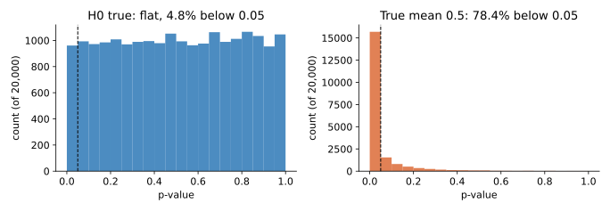

<ul class="post-sources">
<li markdown="span">질문 출처: [Science Vibe, 머신러닝 면접 질문 모음](https://jrc-park.tistory.com/259)</li>
</ul>

## 면접 답변

> P-value는 귀무가설이 참이라고 가정했을 때 지금 관측한 결과만큼 또는 그보다 더 극단적인 결과가 나올 확률입니다. 값이 작을수록 데이터가 귀무가설과 잘 맞지 않는다는 뜻이고, 미리 정한 유의수준보다 작으면 귀무가설을 기각합니다. 예를 들어 공정한 동전을 100번 던져 앞면이 60번 이상 또는 40번 이하로 나올 확률은 약 0.057이므로, 앞면이 60번 나왔다면 유의수준 5%에서 기각하지 못합니다. 가장 흔한 오해는 이 값을 귀무가설이 참일 확률로 읽는 것인데, 그렇지 않습니다. 또 효과의 크기나 중요성을 나타내지도 않습니다. 표본이 매우 크면 아주 작은 차이도 유의하게 나오기 때문입니다. 그래서 효과 크기와 신뢰구간을 함께 보고하고, 여러 번 검정했다면 다중 비교도 보정해야 합니다.

## 자세한 설명

### 정의

귀무가설 $$H_0$$, 검정 통계량 $$T$$, 관측값 $$t_{\text{obs}}$$에 대해, 값이 클수록 $$H_0$$에 불리한 통계량이라면 다음과 같다.

$$
p = P(T \ge t_{\text{obs}} \mid H_0)
$$

조건이 $$H_0$$이다. 즉 데이터가 $$H_0$$ 아래에서 얼마나 드문지를 잴 뿐, $$P(H_0 \mid \text{data})$$가 아니다. 후자를 구하려면 베이즈 정리와 사전 확률이 필요하다.

### 계산 예

공정한 동전($$H_0: \theta = 0.5$$)을 100번 던져 앞면이 60번 나왔다고 하자.

| 방법 | 값 |
|---|---:|
| 정확한 단측 $$P(X \ge 60)$$ | 0.0284 |
| 정확한 양측 $$P(X \ge 60) + P(X \le 40)$$ | 0.0569 |
| 정규 근사 양측 ($$z = 10/5 = 2$$, 연속성 보정 없음) | 0.0455 |

유의수준 5%에서 근사 검정은 기각하지만 정확 검정은 기각하지 못한다. 0.05 근처의 차이에 큰 의미를 두어서는 안 된다는 것을 보여 주는 예이다. 양측과 단측도 데이터를 보기 전에 정해야 한다.

### 분포로 본 p-value

*정규 분포에서 표본 30개를 뽑아 평균이 0인지 분산을 아는 z 검정을 2만 번 수행한 시뮬레이션이다. 왼쪽: 참 평균 0. 오른쪽: 참 평균 0.5로, 기각 비율이 이론적 검정력 0.782와 비슷하다. 점선은 0.05이다.*

연속 통계량에서 $$H_0$$가 참이고 가정이 맞으면 p-value는 $$[0, 1]$$에서 균등 분포를 따른다. 그래서 $$H_0$$ 아래에서 $$p < 0.05$$는 정의상 5%의 비율로 일어난다. 이것이 **제1종 오류율**을 통제한다는 말의 의미이다. 왼쪽 그림의 시뮬레이션도 약 4.8%이다.

### 흔한 오해

| 잘못된 해석 | 올바른 내용 |
|---|---|
| 귀무가설이 참일 확률이다 | $$H_0$$ 가정 아래의 데이터 확률이다 |
| 결과가 우연일 확률이다 | 위와 같은 오해이다 |
| 작을수록 효과가 크다 | 표본 수에도 크게 의존한다 |
| 0.05를 넘으면 효과가 없다 | 증거가 부족할 뿐 효과 없음의 증명이 아니다 |

미국통계학회(ASA)의 2016년 p-value 성명(Wasserstein & Lazar)도 이런 오해를 경고하며, p-value만으로 과학적 결론을 내리지 말라고 권고한다.

**표본 크기의 효과.** 동전을 $$n = 1{,}000{,}000$$번 던져 앞면 비율이 50.2%이면 $$z = 4$$, 양측 $$p \approx 6.3 \times 10^{-5}$$이다. 매우 유의하지만 실제 차이는 0.2%p이다. 그 차이가 중요한지는 p-value가 아니라 효과 크기와 맥락으로 판단해야 한다.

### 다중 검정

귀무가설이 모두 참이고 서로 독립인 검정을 유의수준 0.05로 20번 하면, 하나 이상 유의하게 나올 확률은 다음과 같다.

$$
1 - 0.95^{20} \approx 0.64
$$

**Bonferroni 보정**은 유의수준을 $$0.05/20 = 0.0025$$로 낮추어 이 확률을 0.05 이하로 만든다(위 조건에서 약 0.049). 검정이 많을 때는 거짓 발견 비율을 통제하는 Benjamini-Hochberg 방법도 많이 쓴다. 여러 변수나 하위 집단, 중간 결과를 살피다 유의한 것만 보고하는 **p-hacking**도 같은 이유로 문제가 된다.

## 관련 개념

- **제1종, 제2종 오류**: 유의수준과 검정력의 정의이다. [Q-78](/blog/2026/11/02/knowledge-78-type1-type2/)을 참고한다.
- **신뢰구간**: 효과의 크기와 불확실성을 함께 보여 준다. [Q-63](/blog/2026/11/02/knowledge-63-confidence-interval/)을 참고한다.
- **A/B 테스트**: p-value의 실무 사용 사례이고, 결과를 중간에 훔쳐보는 문제도 함께 다룬다. [Q-19](/blog/2026/11/02/knowledge-19-ab-test/)를 참고한다.
- **베이즈 정리**: $$P(\text{data} \mid H_0)$$류와 $$P(H_0 \mid \text{data})$$의 차이를 설명한다. [Q-34](/blog/2026/11/02/knowledge-34-bayes-theorem/)를 참고한다.
- **우도비 검정**: 이 값을 구하는 대표적인 검정 절차이다. [Q-70](/blog/2026/11/02/knowledge-70-likelihood-ratio-test/)에서 다룬다.

## 꼬리 질문

**Q.** p-value가 0.03이면 귀무가설이 참일 확률이 3%인가요?
아닙니다. 귀무가설이 참일 때 이런 결과가 나올 확률이 3%라는 뜻입니다. 귀무가설이 참일 확률은 사전 확률에 따라 달라지고, 사전 확률이 높으면 3%보다 훨씬 클 수 있습니다.

**Q.** 유의수준은 왜 0.05인가요?
수학적 근거가 있는 값이 아니라 관습입니다. 거짓 양성과 거짓 음성의 비용을 고려해 문제에 맞게 정해야 하며, 데이터를 보기 전에 정해야 합니다.

**Q.** 표본이 매우 많은 머신러닝 실험에서는 어떻게 해석해야 하나요?
대부분의 차이가 유의하게 나오므로, 유의성만으로는 정보가 적습니다. 차이의 신뢰구간과 실제로 의미 있는 최소 효과 크기를 비교합니다.
