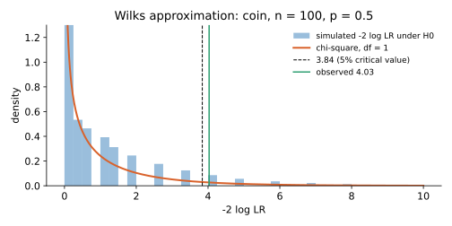

<ul class="post-sources">
<li markdown="span">질문 출처: [Science Vibe, 머신러닝 면접 질문 모음](https://jrc-park.tistory.com/259)</li>
</ul>

## 면접 답변

> 우도비 검정은 귀무가설의 제약을 건 모델과 제약을 풀어 준 모델의 최대 가능도를 비교해서, 제약이 데이터와 맞는지 판단하는 가설 검정입니다. 제약을 풀면 가능도는 커지거나 같으므로, 그 증가폭이 우연으로 볼 수 있는 수준을 넘는지가 핵심입니다. 일정한 조건이 맞으면 큰 표본에서 음의 로그 우도비의 2배가 카이제곱 분포를 따르고, 이때 자유도는 제약의 수입니다. 이를 Wilks 정리라고 합니다. 예를 들어 동전을 100번 던져 앞면이 60번이면 공정한 동전이라는 가설에 대한 통계량은 약 4.03이고, 자유도 1의 임계값 3.84를 넘으므로 유의수준 5%에서 기각합니다. 실무에서는 로지스틱 회귀에 변수를 추가한 모델이 의미 있게 좋아졌는지 비교할 때 자주 씁니다. 다만 두 모델이 포함 관계여야 하고, 표본이 작거나 파라미터가 경계에 놓이면 근사가 맞지 않을 수 있습니다.

## 자세한 설명

### 통계량

파라미터 공간 $$\Theta$$의 부분 집합 $$\Theta_0$$가 귀무가설 $$H_0: \theta \in \Theta_0$$를 나타낸다고 하자. $$L(\theta)$$가 데이터의 가능도일 때 **우도비(likelihood ratio)**와 검정 통계량은 다음과 같다.

$$
\lambda = \frac{\sup_{\theta \in \Theta_0} L(\theta)}{\sup_{\theta \in \Theta} L(\theta)}, \qquad \Lambda = -2 \ln \lambda = 2\left(\ell(\hat{\theta}) - \ell(\hat{\theta}_0)\right)
$$

$$\ell = \ln L$$이고, $$\hat{\theta}$$는 전체 공간의 MLE, $$\hat{\theta}_0$$는 $$H_0$$ 아래의 MLE이다. $$\Theta_0 \subset \Theta$$이므로 $$0 < \lambda \le 1$$이고 $$\Lambda \ge 0$$이다.

### Wilks 정리

$$H_0$$가 참이고 정칙 조건이 만족되면, $$n \to \infty$$일 때 다음이 성립한다. $$r$$은 $$H_0$$가 줄인 자유 파라미터의 수이다.

$$
\Lambda \xrightarrow{d} \chi^2_r
$$

$$\Lambda$$가 $$\chi^2_r$$의 상위 $$\alpha$$ 분위수보다 크면 기각한다. $$r = 1$$, $$\alpha = 0.05$$이면 임계값은 약 3.84이다.

### 계산 예

동전을 100번 던져 앞면 60번을 관측했고 $$H_0: \theta = 0.5$$이다. 제약 없는 MLE는 $$\hat{\theta} = 0.6$$이다. 이항 계수는 비에서 약분된다.

$$
\Lambda = 2\left(60 \ln\frac{0.6}{0.5} + 40 \ln\frac{0.4}{0.5}\right) \approx 4.03
$$

$$\chi^2_1$$ 기준 p-value는 약 0.045이다. 큰 표본에서 동등한 다른 검정과 비교하면 다음과 같다.

| 검정 | 평가 위치 | 통계량 | p-value |
|---|---|---:|---:|
| Likelihood ratio | 두 MLE 모두 | $$\Lambda = 4.03$$ | 0.0448 |
| Wald | 제약 없는 MLE | $$z = 2.04$$ | 0.0412 |
| Score | $$H_0$$의 값 | $$z = 2.00$$ | 0.0455 |
| 정확한 이항 검정 (양측) | 해당 없음 | 해당 없음 | 0.0569 |

근사 검정은 모두 5%보다 약간 작지만, 정확 검정은 5%를 넘는다. 표본이 100개여도 이산성 때문에 경계 근처에서는 결론이 갈릴 수 있다.

*공정한 동전을 100번 던지는 실험을 20만 번 시뮬레이션한 결과이다. 앞면 수가 정수이므로 통계량도 띄엄띄엄한 값만 갖지만 전체 형태는 $$\chi^2_1$$을 따른다. 3.84를 넘는 비율은 약 5.7%로, 명목 수준 5%보다 약간 크다.*

위 그림의 5.7%는 우연이 아니다. 앞면 59번이면 $$\Lambda \approx 3.26$$으로 기각되지 않고 60번이면 기각되므로, 기각 영역은 $$\lvert X - 50 \rvert \ge 10$$이고 그 정확한 확률은 0.0569이다.

### 왜 우도비인가: Neyman-Pearson 보조정리

$$H_0: \theta = \theta_0$$와 $$H_1: \theta = \theta_1$$이 모두 단순 가설이면, 같은 유의수준의 검정 중 우도비에 임계값을 적용하는 검정이 검정력이 가장 높다. 복합 가설에서 일반적으로 최적이라는 보장은 없지만, 우도비 검정은 이 아이디어를 최댓값으로 확장한 것으로 넓은 상황에서 잘 동작한다.

### 머신러닝에서의 사용

**모델 비교.** 포함 관계인 로지스틱 회귀나 GLM을 비교한다. 이들 모델에서 $$\Lambda$$는 두 모델의 **이탈도(deviance)** 차이이다. 변수 3개를 더한 모델과 원래 모델을 비교한다면 $$\Lambda$$를 $$\chi^2_3$$과 비교한다.

**적용 조건.**

- **포함 관계**: 한 모델이 다른 모델의 특수한 경우여야 한다. 포함 관계가 아니면 AIC, BIC, 교차 검증을 쓴다.
- **경계 문제**: 분산이 0이라는 가설처럼 귀무 값이 파라미터 공간의 경계에 있으면 $$\chi^2$$ 근사가 맞지 않는다. 가우시안 혼합의 성분 수 검정이 잘 알려진 예이다.
- **표본 크기**: 파라미터 수가 표본 수에 비해 크면 근사가 나빠진다. 정칙화나 과대 파라미터화된 신경망에 그대로 적용해서는 안 된다.

## 관련 개념

- **P-value와 오류**: 이 검정의 결과를 해석하는 틀이다. [Q-69](/blog/2026/11/02/knowledge-69-p-value/)와 [Q-78](/blog/2026/11/02/knowledge-78-type1-type2/)을 참고한다.
- **Likelihood**: 검정의 재료이다. [Q-39](/blog/2026/11/02/knowledge-39-likelihood-prior-posterior/)에서 다룬다.
- **Gamma와 카이제곱**: $$\chi^2_r$$은 $$\text{Gamma}(r/2, 1/2)$$이다. [Q-60](/blog/2026/11/02/knowledge-60-gamma/)을 참고한다.
- **GLM**: 이탈도로 모델을 비교하는 대표적인 모델이다. [Machine Learning 4강](/blog/2026/10/22/ml-04-glm/)을 참고한다.
- **Bayes factor**: 최대 가능도 대신 사전 분포로 적분한 주변 가능도의 비이다. 포함 관계가 아니어도 쓸 수 있지만 사전 분포에 민감하다.

## 꼬리 질문

**Q.** 변수를 넣을수록 가능도가 커지는데 어떻게 비교가 공정해지나요?
귀무가설이 참이어도 가능도는 늘어납니다. Wilks 정리는 그 증가폭의 분포를 알려 주므로, 증가가 파라미터 추가만으로 기대되는 수준을 넘는지 판단할 수 있습니다. 제약 하나당 $$\Lambda$$의 기댓값은 약 1입니다. 시뮬레이션의 평균도 약 1.01이었습니다.

**Q.** AIC와는 어떻게 다른가요?
우도비 검정은 작은 모델을 기각할 증거가 있는지 묻고, AIC는 예측 성능의 근사 추정으로 후보들의 순위를 매깁니다. AIC는 포함 관계가 없어도 쓸 수 있습니다. 파라미터 하나 차이에서 AIC는 $$\Lambda > 2$$면 큰 모델을 선호하므로 임계값 3.84보다 관대합니다.

**Q.** Wald 검정과 차이가 크면 어느 쪽을 믿어야 하나요?
보통 우도비 검정을 선호합니다. Wald 검정은 파라미터 변환에 따라 값이 달라지고, 추정값이 극단적일 때 성능이 떨어지기 때문입니다. 차이가 크다는 것 자체가 큰 표본 근사가 충분하지 않다는 신호이기도 합니다.
