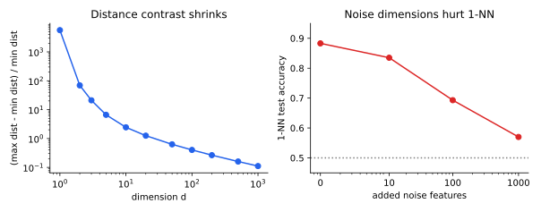

<ul class="post-sources">
<li markdown="span">질문 출처: [Science Vibe, 머신러닝 면접 질문 모음](https://jrc-park.tistory.com/259)</li>
</ul>

## 면접 답변

> 차원의 저주는 특징 수가 늘어날수록 공간의 부피가 지수적으로 커져서, 같은 수의 데이터가 점점 희박해지고 학습과 추정이 어려워지는 현상입니다. 축마다 구간을 10개로 나누면 구간 칸의 수가 차원마다 10배씩 늘기 때문에, 공간을 같은 밀도로 채우는 데 필요한 표본이 지수적으로 늘어납니다. 게다가 무작위 고차원 데이터에서는 가장 가까운 점과 가장 먼 점의 거리 차이가 상대적으로 줄어들어, KNN이나 K-means처럼 거리에 의존하는 방법의 성능이 떨어지기 쉽습니다. 예를 들어 정보가 있는 특징이 2개인 문제에 노이즈 특징을 많이 더하면, 1-NN의 정확도가 크게 떨어집니다. 그래서 차원 축소, 특징 선택, 정규화, 임베딩 학습 같은 방법을 씁니다. 실제 이미지처럼 겉보기 차원이 높아도 내재 차원이 낮은 데이터에서는 그 영향이 덜합니다.

## 자세한 설명

### 부피로 보는 세 가지 현상

단위 초입방체 $$[0, 1]^d$$를 생각하자.

**이웃이 더 이상 국소적이지 않다.** 균일 데이터의 10%를 담으려면 작은 초입방체의 변 길이가 $$0.1^{1/d}$$이어야 한다.

| 차원 $$d$$ | 1 | 2 | 10 | 100 |
|---|---:|---:|---:|---:|
| 필요한 변 길이 | 0.100 | 0.316 | 0.794 | 0.977 |

100차원에서는 전체 범위의 97.7%를 축마다 덮어야 데이터의 10%를 얻는다. 이런 이웃으로는 지역적인 평균을 낼 수 없다.

**부피가 구석과 껍질로 몰린다.** 내접 초구의 부피 비율은 차원이 늘수록 급격히 0으로 향한다.

| 차원 $$d$$ | 2 | 3 | 10 | 20 |
|---|---:|---:|---:|---:|
| 내접 초구 / 초입방체 | 0.785 | 0.524 | 0.00249 | $$2.46 \times 10^{-8}$$ |

또 변을 1%만 줄인 안쪽 초입방체의 바깥 부피 비율 $$1 - 0.99^d$$는 $$d = 100$$에서 0.634이다. 대부분의 부피가 얇은 바깥 껍질에 있다.

**필요한 표본이 지수적으로 는다.** 축마다 칸 10개마다 표본 하나를 두려면 $$10^d$$개가 필요하다. 어떤 함수에 대한 가정 없이 국소 평균으로만 학습한다면 이 비용을 피하기 어렵다.

### 거리의 대비 감소

아래 왼쪽 그림은 균일 분포에서 뽑은 500개 점과 질의점 사이의 거리로 $$(d_{\max} - d_{\min})/d_{\min}$$을 계산해 200회 평균한 것이다. 이 값은 $$d = 2$$에서 약 69, $$d = 10$$에서 2.44, $$d = 100$$에서 0.40, $$d = 1000$$에서 0.11이다. 일정한 조건에서 차원이 커지면 이 비율이 0으로 수렴함이 알려져 있다. 단, 모든 고차원 데이터에 성립하는 것은 아니다. 군집 구조가 뚜렷하거나 내재 차원이 낮으면 거리가 여전히 의미를 가질 수 있다.

*왼쪽: 차원에 따른 거리 대비(로그 축). 오른쪽: 정보 있는 특징 2개와 표준정규 노이즈 특징을 쓴 이진 분류의 1-NN 테스트 정확도. 학습 표본 200개, 50회 평균이다.*

오른쪽 실험에서 양성 클래스는 정보 있는 두 특징의 평균만 2씩 이동한다. 이 문제의 베이즈 최적 정확도는 약 0.921이다. 1-NN은 노이즈 특징이 없을 때 0.883이지만, 10개를 더하면 0.835, 100개에서 0.693, 1,000개에서 0.570까지 떨어진다. 데이터의 신호는 그대로인데 거리 계산이 노이즈에 묻힌 것이다.

### 왜 고차원 모델이 그래도 작동하는가

차원의 저주는 데이터와 함수에 아무 구조가 없을 때의 최악 시나리오에 가깝다. 실제 데이터에는 구조가 있는 경우가 많다.

- **낮은 내재 차원**: 고차원 공간 안의 저차원 다양체 근처에 놓인다는 다양체 가설(manifold hypothesis)이다.
- **매끄러움과 희소성**: 관련 있는 특징이 일부이거나 함수가 매끄러우면 필요한 표본이 크게 준다.
- **모델의 귀납 편향**: CNN의 지역성과 가중치 공유는 탐색할 함수 공간을 크게 줄인다.

대응은 이 구조를 쓰는 방향이다. 차원 축소와 특징 선택, L1/L2 정규화, 표현 학습이 대표적이다.

## 관련 개념

- **차원 축소**: PCA 등으로 정보가 있는 저차원 표현을 찾는다. [Q-25](/blog/2026/11/02/knowledge-25-dimensionality-reduction/)에서 다룬다.
- **KNN과 K-means**: 거리에 직접 의존하므로 영향을 크게 받는다. [Q-33](/blog/2026/11/02/knowledge-33-knn-vs-kmeans/)을 참고한다.
- **과적합**: 특징 수에 비해 표본이 적으면 우연한 패턴까지 맞추기 쉽다. [Q-13](/blog/2026/11/02/knowledge-13-overfitting/)에서 다룬다.
- **정규화**: 특히 L1은 불필요한 특징의 계수를 0으로 만들 수 있다. [Q-90](/blog/2026/11/02/knowledge-90-regularization/)을 참고한다.

## 꼬리 질문

**Q.** 특징을 많이 넣을수록 항상 나쁜가요?
아닙니다. 새 특징이 정보를 담고 있고 표본이나 정규화가 충분하면 성능이 오릅니다. 문제는 정보 없는 특징이 추정의 분산과 거리 계산의 노이즈를 늘릴 때입니다.

**Q.** 고차원에서 Euclidean 대신 다른 거리를 쓰면 해결되나요?
완화될 수는 있지만 근본적으로 해결되지는 않습니다. 코사인 유사도나 Manhattan 거리가 특정 데이터에서 더 낫기도 하지만, 그보다 특징 선택이나 표현 학습의 효과가 큰 경우가 많습니다.

**Q.** 트리 모델은 차원의 저주에 강한가요?
한 번에 특징 하나씩 분할하며 정보 없는 특징을 잘 고르지 않으므로 거리 기반 방법보다 노이즈 특징에 덜 민감한 편입니다. 그러나 특징이 너무 많으면 우연히 좋아 보이는 분할을 고르게 되고, 특징 간 상호작용을 찾기 위해 필요한 표본도 늘어납니다.
