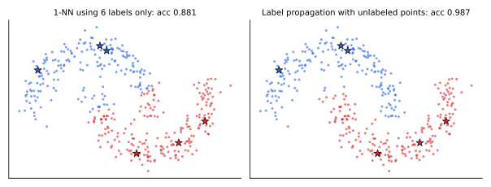

<ul class="post-sources">
<li markdown="span">질문 출처: [Science Vibe, 머신러닝 면접 질문 모음](https://jrc-park.tistory.com/259)</li>
</ul>

## 면접 답변

> 지도 학습은 입력과 정답 레이블로 입력에서 출력으로의 함수를 배우고, 비지도 학습은 레이블 없이 군집이나 분포 같은 데이터의 구조를 찾습니다. 준지도 학습은 그 사이로, 레이블이 있는 소량의 데이터와 레이블이 없는 다량의 데이터를 함께 사용해 지도 학습 과제를 풉니다. 레이블은 비싸지만 입력 자체는 싸게 모을 수 있는 경우가 많기 때문에 씁니다. 예를 들어 의료 영상은 전문의의 판독이 비싸므로, 판독된 수백 장과 판독되지 않은 수만 장을 함께 학습할 수 있습니다. 비레이블 데이터가 도움이 되려면 비슷한 입력은 같은 레이블을 갖거나 결정 경계가 밀도가 낮은 곳을 지난다는 식의 가정이 맞아야 합니다. 이 가정이 깨지거나 비레이블 데이터의 분포가 다르면 레이블만 쓸 때보다 오히려 나빠질 수 있습니다.

## 자세한 설명

지도 학습과 비지도 학습의 차이는 [Q-2](/blog/2026/11/02/knowledge-02-supervised-unsupervised/)에서 다루었으므로 여기서는 준지도 학습에 집중한다.

### 설정과 가정

레이블 데이터 $$\{(\mathbf{x}_i, y_i)\}_{i=1}^{l}$$과 비레이블 데이터 $$\{\mathbf{x}_j\}_{j=l+1}^{l+u}$$가 있고 보통 $$u \gg l$$이다. 비레이블 데이터는 $$p(\mathbf{x})$$에 대한 정보만 준다. 따라서 $$p(\mathbf{x})$$가 $$p(y \mid \mathbf{x})$$에 대해 무언가 알려 줄 때만 도움이 된다. 그 연결이 다음 가정들이다.

- **매끄러움 가정(smoothness)**: 고밀도 영역에서 가까운 입력은 레이블도 같다.
- **군집 가정(cluster)**: 같은 군집의 점은 같은 클래스일 가능성이 높고, 결정 경계는 저밀도 영역을 지난다.
- **다양체 가정(manifold)**: 데이터가 저차원 다양체 근처에 있어, 거리를 그 위에서 재는 것이 의미 있다.

### 대표 방법

| 방법 | 아이디어 | 주의점 |
|---|---|---|
| 자기 학습, 의사 레이블(pseudo-labeling) | 확신이 큰 예측을 레이블처럼 사용해 재학습 | 초기 오류가 스스로 강화됨 |
| 일관성 정규화(consistency regularization) | 입력에 변형을 가해도 예측이 유지되게 함 | 데이터에 맞는 증강이 필요 |
| 그래프 기반, 레이블 전파(label propagation) | 유사도 그래프를 따라 레이블을 퍼뜨림 | 그래프 구성에 민감, 큰 데이터에서 비쌈 |
| 생성 모델 + EM | 비레이블의 $$y$$를 잠재 변수로 보고 $$p(\mathbf{x}, y)$$ 적합 | 모델이 틀리면 악화될 수 있음 |

신경망에서는 대체로 다음 형태의 목적 함수로 정리된다. $$\mathcal{L}_{\text{sup}}$$은 레이블 손실, $$\mathcal{L}_{\text{unsup}}$$은 일관성 또는 의사 레이블 손실, $$\lambda$$는 둘의 가중치이다.

$$
\mathcal{L} = \mathcal{L}_{\text{sup}} + \lambda\, \mathcal{L}_{\text{unsup}}
$$

### 실험: 레이블 6개로 두 달 모양 분류

두 개의 반달 모양 군집에서 400개 점을 뽑고, 클래스당 3개에만 레이블을 주었다. 레이블 6개만 쓰는 1-NN과, 모든 점으로 유사도 그래프를 만드는 레이블 전파를 비교했다.

*별표가 레이블 6개이고 색은 예측 클래스이다. 100회 실험의 평균에 가까운 결과를 고른 예로, 제목의 값은 비레이블 점에 대한 정확도이다.*

100회 평균 정확도는 1-NN이 0.870, 레이블 전파가 0.974였고, 가장 나쁜 경우도 각각 0.589와 0.865였다. 레이블 전파가 1-NN보다 낮았던 경우는 1회였다. 군집 가정이 완벽하게 맞고, 그래프 폭 $$\sigma = 0.15$$도 이 데이터의 잡음 수준에 맞게 정했으므로 유리한 실험이다. 일반적인 개선 폭으로 읽으면 안 된다.

### 실패하는 경우

- 클래스가 군집과 일치하지 않으면 군집을 따르는 것이 오히려 해가 된다.
- 비레이블 데이터에 학습 대상이 아닌 클래스가 섞이면 의사 레이블이 오염될 수 있다.
- 비레이블 데이터의 효과는 레이블만으로 튜닝을 충분히 한 기준선과 비교해 평가해야 한다. 작은 검증 세트에 의존하면 이득을 과대평가하기 쉽다.

## 관련 개념

- **자기 지도 학습(self-supervised learning)**: 비레이블 데이터에서 만든 과제로 표현을 먼저 배운다. 이후 레이블로 미세 조정하면 준지도 학습의 한 경로가 된다. [Machine Learning 16](/blog/2026/10/22/ml-16-self-supervised/)에서 다룬다.
- **K-means와 EM**: 군집 구조를 찾는 비지도 방법으로, 생성 모델 기반 준지도 학습의 재료이다. [Machine Learning 12](/blog/2026/10/22/ml-12-kmeans-em/)를 참고한다.
- **생성 모델**: $$p(\mathbf{x})$$를 모델링하므로 비레이블 데이터를 직접 쓸 수 있다. [Q-84](/blog/2026/11/02/knowledge-84-generative-model/)에서 다룬다.
- **차원의 저주**: 다양체 가정은 고차원 데이터가 그래도 학습 가능한 이유이기도 하다. [Q-73](/blog/2026/11/02/knowledge-73-curse-of-dimensionality/)을 참고한다.

## 꼬리 질문

**Q.** 준지도 학습과 능동 학습(active learning)은 어떻게 다른가요?
준지도 학습은 비레이블 데이터를 그대로 활용하고, 능동 학습은 어떤 샘플에 레이블을 받을지 골라 사람에게 묻습니다. 함께 쓸 수도 있습니다.

**Q.** 판별 모델의 $$p(y \mid \mathbf{x})$$ 학습에 왜 비레이블 데이터가 그냥은 도움이 안 되나요?
손실에 $$y$$가 필요해서 비레이블 샘플은 그대로는 항이 없습니다. 그래서 일관성이나 저밀도 경계 같은 가정을 추가 손실로 넣어 $$p(\mathbf{x})$$의 정보를 경계에 연결합니다.

**Q.** 귀납적(inductive)과 변환적(transductive) 준지도 학습의 차이는 무엇인가요?
귀납적 방법은 새 입력에도 쓸 수 있는 모델을 만들고, 변환적 방법은 학습 때 주어진 비레이블 점의 레이블만 추정합니다. 기본적인 레이블 전파는 변환적입니다.
