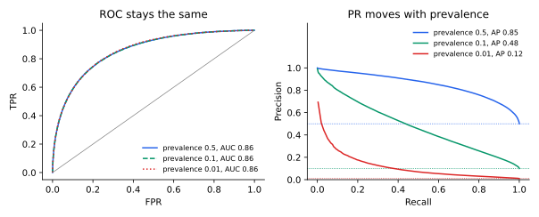

<ul class="post-sources">
<li markdown="span">질문 출처: [Science Vibe, 머신러닝 면접 질문 모음](https://jrc-park.tistory.com/259)</li>
</ul>

## 면접 답변

> PR 곡선은 이진 분류기의 임계값을 바꿔 가면서 Recall을 가로축, Precision을 세로축으로 그린 곡선입니다. 임계값을 낮추면 양성을 더 많이 찾아 Recall은 오르지만 잘못 잡는 경우가 늘어 Precision은 대체로 떨어지므로, 그 교환 관계를 한눈에 보여 줍니다. ROC 곡선과의 큰 차이는 Precision이 양성 비율에 의존한다는 점입니다. 예를 들어 클래스별 점수 분포가 같은 모델은 양성 비율이 50%든 1%든 ROC가 같지만, 제 실험에서 Recall 0.5일 때의 Precision은 0.88에서 0.07로 떨어졌습니다. 그래서 사기 탐지처럼 양성이 드물고 양성 예측의 품질이 중요한 문제에서 PR 곡선을 봅니다. 곡선 요약값으로는 평균 정밀도(AP)를 쓰고, 무작위 분류기의 기준선은 0.5가 아니라 양성 비율이라는 점에 주의해야 합니다.

## 자세한 설명

### 정의

점수 $$s$$와 임계값 $$t$$에 대해 $$s \ge t$$를 양성으로 예측하면 다음 두 값이 정해지고, 점 $$(\text{Recall}(t), \text{Precision}(t))$$를 이은 것이 PR 곡선이다.

$$
\text{Precision} = \frac{TP}{TP + FP}, \qquad \text{Recall} = \frac{TP}{TP + FN}
$$

ROC 곡선과 달리 단조롭지 않다. 임계값을 내려 음성을 만나면 Precision이 내려가고 양성을 만나면 다시 올라갈 수 있어 곡선이 톱니 모양이 된다.

### 손으로 그려 보기

[Q-38](/blog/2026/11/02/knowledge-38-roc-curve/)과 같은 양성 4개, 음성 4개의 데이터를 쓴다.

| 점수 | 0.9 | 0.8 | 0.7 | 0.6 | 0.55 | 0.4 | 0.3 | 0.2 |
|---|---:|---:|---:|---:|---:|---:|---:|---:|
| 정답 | + | + | − | + | − | + | − | − |
| Recall | 0.25 | 0.5 | 0.5 | 0.75 | 0.75 | 1 | 1 | 1 |
| Precision | 1 | 1 | 0.667 | 0.75 | 0.6 | 0.667 | 0.571 | 0.5 |

**평균 정밀도(average precision)**는 Recall이 증가하는 지점의 Precision을 증가분으로 가중 평균한 값이다. $$R_n$$, $$P_n$$은 $$n$$번째 임계값의 Recall과 Precision이다.

$$
\text{AP} = \sum_n (R_n - R_{n-1})\, P_n
$$

위 예에서는 $$0.25 \times (1 + 1 + 0.75 + 0.667) \approx 0.854$$이다.

### ROC와의 관계: 양성 비율

양성 비율을 $$\pi$$라 하면 Precision은 TPR, FPR과 다음 관계가 있다.

$$
\text{Precision} = \frac{\pi\, \text{TPR}}{\pi\, \text{TPR} + (1 - \pi)\, \text{FPR}}
$$

클래스별 점수 분포가 같으면 ROC는 그대로이지만 $$\pi$$가 작아지면 분모의 FPR 항이 커져 Precision이 내려간다. 다음 실험은 표준정규 음성과 평균 1.5인 양성의 점수 200만 개로 계산했다.

*같은 점수 분포를 양성 비율만 바꿔 그렸다. ROC 곡선은 겹치지만 PR 곡선은 양성 비율을 따라 내려간다. 오른쪽의 점선은 양성 비율과 같은 무작위 기준선이다.*

| 양성 비율 | ROC AUC | AP | Recall 0.5에서 FPR | Recall 0.5에서 Precision |
|---|---:|---:|---:|---:|
| 0.5 | 0.856 | 0.854 | 0.067 | 0.882 |
| 0.1 | 0.855 | 0.478 | 0.067 | 0.454 |
| 0.01 | 0.857 | 0.115 | 0.068 | 0.069 |

모델이 달라진 것이 아니라 양성 비율만 바뀌었다. 따라서 AP를 데이터셋끼리 비교할 때는 양성 비율을 함께 보아야 한다. 위 표의 AP 0.115는 기준선 0.01의 11배가 넘고, AP 0.854는 기준선 0.5의 2배도 안 된다.

### 해석과 주의점

- **AP와 곡선 아래 면적**: PR 공간의 점 사이를 직선으로 이으면 Precision을 잘못 추정할 수 있어, 사다리꼴 적분보다 위의 계단식 AP를 많이 쓴다.
- **곡선의 왼쪽 끝**: Recall이 0에 가까운 구간은 샘플 몇 개로 정해져 값이 불안정하다.
- **운영점**: 필요한 Recall 또는 Precision의 하한을 먼저 정하고, 그 조건에서 나머지를 최대화하는 임계값을 고른다.
- **ROC가 틀렸다는 뜻은 아니다**: ROC는 순위 능력을 양성 비율과 분리해 보여 주고, PR은 현재 비율에서 양성 예측의 품질을 보여 준다. 질문이 다르므로 함께 보면 좋다.

## 관련 개념

- **ROC 곡선**: 같은 점수로 FPR 대 TPR을 그린다. [Q-38](/blog/2026/11/02/knowledge-38-roc-curve/)을 참고한다.
- **F1-score**: PR 곡선 위의 한 점을 조화 평균으로 요약한다. [Q-27](/blog/2026/11/02/knowledge-27-f1-score/)에서 다룬다.
- **TPR과 Recall**: 같은 양이다. [Q-36](/blog/2026/11/02/knowledge-36-tpr-recall/)을 참고한다.
- **결정 이론**: 어느 임계값을 쓸지는 오류의 비용으로 정한다. [Q-76](/blog/2026/11/02/knowledge-76-decision-theory/)에서 다룬다.

## 꼬리 질문

**Q.** 무작위 분류기의 AP는 얼마인가요?
기대값이 대략 양성 비율입니다. 임계값과 무관하게 예측 양성 중 실제 양성의 비율이 $$\pi$$이기 때문입니다.

**Q.** Precision이 Recall 증가에 따라 올라갈 수도 있나요?
네. 임계값을 내렸을 때 새로 양성이 잡히면 Precision이 올라갑니다. 위 표에서 0.667에서 0.75로 오르는 구간이 그 예입니다.

**Q.** 음성 데이터를 다운샘플링해 학습하면 PR 평가에 문제가 있나요?
평가 데이터까지 다운샘플링하면 양성 비율이 달라져 Precision이 부풀려집니다. 평가는 실제 운영 비율에 맞추거나, 위 식으로 Precision을 환산해야 합니다.
