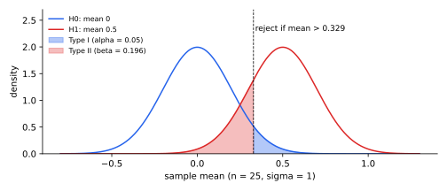

<ul class="post-sources">
<li markdown="span">질문 출처: [Science Vibe, 머신러닝 면접 질문 모음](https://jrc-park.tistory.com/259)</li>
</ul>

## 면접 답변

> 제1종 오류는 귀무가설이 참인데 기각하는 것으로, 없는 효과를 있다고 판단하는 위양성입니다. 제2종 오류는 귀무가설이 거짓인데 기각하지 못하는 것으로, 있는 효과를 놓치는 위음성입니다. 제1종 오류 확률을 유의 수준 알파, 제2종 오류 확률을 베타라 하고, 1에서 베타를 뺀 값이 검정력입니다. 표본 크기를 고정하면 기각 기준을 엄격하게 할수록 알파는 줄고 베타는 늘어나므로, 둘을 함께 줄이려면 표본을 늘려야 합니다. 예를 들어 코로나 검사에서 건강한 사람을 양성으로 판정하면 제1종 오류, 감염자를 음성으로 판정하면 제2종 오류입니다. 어느 오류가 더 심각한지는 문제의 비용에 따라 다르므로, 감염병 선별 검사에서는 보통 제2종 오류를 더 강하게 줄이려고 합니다.

## 자세한 설명

### 정의

귀무가설 $$H_0$$와 대립가설 $$H_1$$이 있을 때 결정과 실제의 조합은 네 가지이다.

| | $$H_0$$ 참 | $$H_0$$ 거짓 |
|---|---|---|
| $$H_0$$ 기각 | **제1종 오류** (확률 $$\alpha$$) | 올바른 검출 (검정력 $$1 - \beta$$) |
| $$H_0$$ 기각 안 함 | 올바른 판단 ($$1 - \alpha$$) | **제2종 오류** (확률 $$\beta$$) |

$$H_0$$를 음성, 기각을 양성 예측으로 보면 제1종 오류는 FP, 제2종 오류는 FN에 대응한다. $$\alpha$$는 FPR, $$\beta$$는 FNR, 검정력은 TPR과 같은 형태이다. 다만 어느 쪽을 $$H_0$$ 또는 양성으로 정의하느냐에 따라 이름이 뒤바뀌므로, 먼저 가설을 명시해야 한다.

### 수치 예

표준편차 $$\sigma = 1$$을 아는 정규 분포에서 $$n = 25$$개를 뽑아, $$H_0: \mu = 0$$을 $$H_1: \mu = 0.5$$에 대해 단측 검정한다. 표본 평균의 표준오차는 $$1/\sqrt{25} = 0.2$$이다.

$$\alpha = 0.05$$이면 기각 기준은 $$1.645 \times 0.2 = 0.329$$이다. 이때 $$\beta = \Phi((0.329 - 0.5)/0.2) \approx 0.196$$이고 검정력은 약 0.804이다. $$\Phi$$는 표준정규 분포의 누적 분포 함수이다.

*기각 기준선 오른쪽의 파란 면적이 제1종 오류, 왼쪽의 빨간 면적이 제2종 오류이다. 기준선을 움직이면 한쪽이 줄고 다른 쪽이 는다.*

| 설정 | 기각 기준 | $$\alpha$$ | $$\beta$$ | 검정력 |
|---|---:|---:|---:|---:|
| $$n = 25$$, 기본 | 0.329 | 0.05 | 0.196 | 0.804 |
| $$n = 25$$, 더 엄격 | 0.465 | 0.01 | 0.431 | 0.569 |
| $$n = 100$$ | 0.164 | 0.05 | 0.0004 | 0.9996 |

표본을 늘리면 두 분포가 좁아져 겹침이 줄기 때문에 두 오류를 함께 낮출 수 있다. 효과 크기가 클수록 같은 이유로 검정력이 오른다.

### 자주 하는 오해

- **$$\alpha$$는 기각했을 때 틀렸을 확률이 아니다.** $$\alpha = P(\text{기각} \mid H_0)$$이고, 기각 후 틀렸을 확률은 $$P(H_0 \mid \text{기각})$$이다. 후자는 실제 효과가 있는 가설의 비율과 검정력에 따라 달라지며 $$\alpha$$보다 훨씬 클 수 있다.
- **기각하지 못한 것은 $$H_0$$가 참이라는 증거가 아니다.** 검정력이 낮으면 효과가 있어도 대부분 놓친다.
- **검정을 여러 번 하면 제1종 오류가 쌓인다.** 진짜 효과가 없는 독립적인 검정 20개를 각각 $$\alpha = 0.05$$로 하면 하나 이상 유의하게 나올 확률이 $$1 - 0.95^{20} \approx 0.642$$이다. Bonferroni 보정이나 FDR 제어로 다룬다.

## 관련 개념

- **혼동 행렬**: FP와 FN의 집계 표이다. [Q-17](/blog/2026/11/02/knowledge-17-confusion-matrix/)을 참고한다.
- **p-value**: $$\alpha$$와 비교해 기각 여부를 정하는 값이다. [Q-69](/blog/2026/11/02/knowledge-69-p-value/)에서 다룬다.
- **A/B 테스트**: 검정력을 미리 계산해 필요한 표본 수를 정한다. [Q-19](/blog/2026/11/02/knowledge-19-ab-test/)를 참고한다.
- **결정 이론**: 두 오류의 비용으로 임계값을 정하는 일반적인 틀이다. [Q-76](/blog/2026/11/02/knowledge-76-decision-theory/)에서 다룬다.
- **PR, ROC 곡선**: 임계값을 움직일 때 두 오류의 교환을 곡선으로 그린다. [Q-77](/blog/2026/11/02/knowledge-77-pr-curve/), [Q-38](/blog/2026/11/02/knowledge-38-roc-curve/)을 참고한다.

## 꼬리 질문

**Q.** 왜 관례적으로 $$\alpha = 0.05$$를 쓰나요?
수학적으로 특별한 값이 아니라 역사적인 관례입니다. 잘못된 기각의 비용이 크면 더 작게 정합니다. 예를 들어 입자물리는 훨씬 엄격한 기준을 씁니다.

**Q.** 스팸 필터에서는 어느 오류가 더 심각한가요?
스팸을 양성으로 보면 정상 메일을 스팸으로 분류하는 FP가 대체로 더 비쌉니다. 중요한 메일을 놓치기 때문입니다. 그래서 Precision을 높게 유지하는 쪽으로 임계값을 잡습니다.

**Q.** A/B 테스트에서 검정력이 부족하면 어떤 일이 생기나요?
실제 효과를 놓치기 쉽고, 유의하게 나온 결과도 효과 크기가 과장되어 있을 가능성이 큽니다. 낮은 검정력에서 통과한 추정치는 우연히 컸던 경우가 많기 때문입니다.
